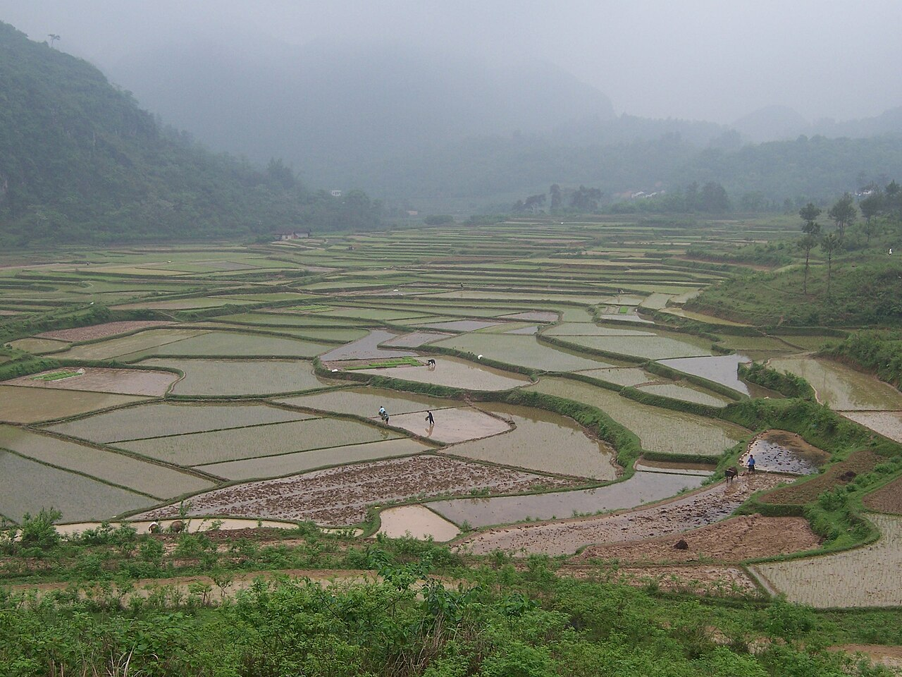
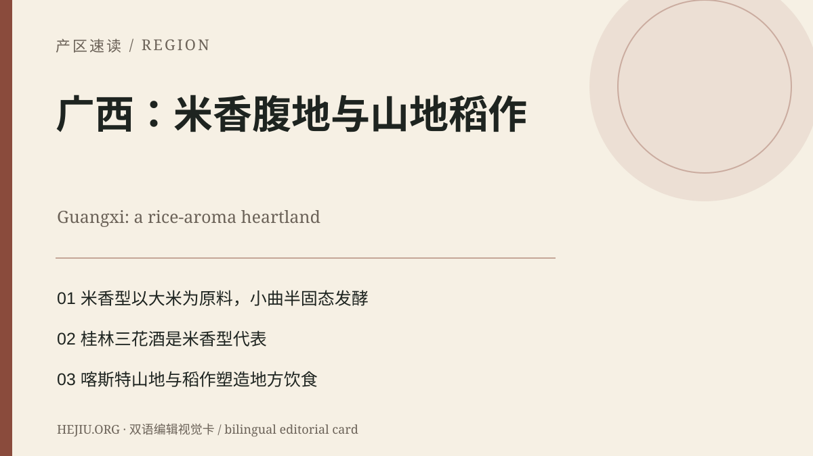

# 广西壮族自治区

广西位于中国南疆，东接广东，北连湖南、贵州，西邻云南，南临北部湾。山地、丘陵、喀斯特地貌与河谷平原交错，漓江、柳江、红水河等水系切割出众多小盆地。稻作是这里的农业底色，也让米酒成为广西最日常的酒类传统。

广西白酒在全国版图上最清晰的坐标，是米香型与桂林三花酒。它没有四川浓香、贵州酱香那样的规模叙事，却用“清、甜、爽、净”建立了自己的辨识度。理解广西酒，关键不是背品牌，而是理解大米、酒曲、发酵与蒸馏如何组合出轻盈的酒体。

图：桂林至阳朔的漓江航线，喀斯特山水构成广西的识别度。图片：Flora-Victoria，CC0，via Wikimedia Commons（[原图页面](https://commons.wikimedia.org/wiki/File:Li_River_cruise_from_Guilin_to_Yangshuo.JPG)）。

## 地理与气候

广西属亚热带季风气候，高温多雨，湿度大，夏长冬短。桂北以山地为主，桂林、柳州一带喀斯特峰林密布；桂南靠近北部湾，气候更接近热带；桂西与桂中则是丘陵、河谷与盆地。这样的地理让稻米、甘蔗、水果与水源都很充足。

对米香型白酒而言，水质与稻米品质非常重要。漓江流域的软水、当地籼米与适合的小曲，是桂林三花酒传统叙事的一部分。但水源与原料只是基础，蒸煮、糖化、发酵、蒸馏与贮存的控制，才决定酒体是否干净。

图：阳朔附近的稻作梯田，山地稻米与地方饮食的基础。图片：McKay Savage from London, UK，CC BY 2.0，via Wikimedia Commons（[原图页面](https://commons.wikimedia.org/wiki/File:China_-_Yangshuo_29_-_Rice_Paddy_Terraces_(140905203).jpg)）。

## 历史脉络

广西的酿酒传统与壮族、瑶族、侗族等民族的稻作生活、节庆与待客礼俗有关。米酒、糯米酒与地方小曲酒在县域与乡村广泛存在，常用于节庆、婚嫁、待客与劳作后的饮食。桂林三花酒在 20 世纪完成国营化与工业化，成为米香型白酒的全国代表。

改革开放后，广西酒类市场同时受到广东米酒、贵州白酒与进口酒的影响。桂林三花酒保持地方名酒地位，但全国化程度有限；地方米酒则更多留在餐饮、家庭与旅游场景。广西的“酒广”不在品牌数量，而在酒类与稻作、民族饮食的结合。

## 香型与风格

广西最具代表性的白酒香型是[米香型](ref:rice-aroma)。米香型以大米为原料，酒体清亮，米香清雅，入口绵甜，落口爽净，回味怡畅。它与[米酒](ref:rice-wine)的关系是“分类”与“原料”的关系：米酒可以指以米为原料的发酵酒或蒸馏酒，米香型则是白酒中的具体香型。

广西也有[黄酒](ref:yellow)、糯米甜酒与地方小曲酒。壮族、瑶族地区的糯米酒甜度高、酒精度低，常与节庆、待客和歌唱活动相连。把米香型白酒与甜型糯米酒混为一谈，会忽略工艺与糖度的差别。

图：广西：米香腹地与山地稻作。项目自制双语视觉卡，示意性编辑图，不作为实景照片。

## 原料与工艺

米香型白酒以[大米](ref:rice)为主，使用[水](ref:water)与酒曲完成糖化、[发酵](ref:fermentation)、[蒸馏](ref:distillation)与[勾调](ref:blending)。传统工艺强调清蒸清烧、低温发酵与小曲糖化，目的是保留米香与干净的口感。与酱香、浓香相比，米香型的发酵周期通常更短，酒体更轻。

[制曲](ref:qu)是米香型的风味起点。小曲中的微生物与酶系把米饭中的淀粉转化为糖，再转化为酒精；温度过高会产生杂味，温度过低则发酵不充分。现代酒厂用纯种曲、恒温发酵与过滤来控制稳定性，但传统小曲酒仍保留更多地方差异。

图：大米是广西米香型白酒的核心原料，山地稻作也塑造了地方饮食。图片：China News Service，CC BY 3.0，via Wikimedia Commons（[原图页面](https://commons.wikimedia.org/wiki/File:20201102.Hengnan.Hybrid_rice_Sanyou-1.6.jpg)）。

## 代表酒款与地方记忆

桂林三花酒是米香型白酒的代表，产自桂林，以大米为原料，酒体清亮、米香明显、入口绵甜。它的名字与桂林山水一起，成为广西酒类最常用的文化符号。广西还有桂林腐乳、米粉、酸嘢等饮食符号，米酒常与这些日常食物一起出现。

除了桂林三花酒，广西各地还有糯米酒、红薯酒、甘蔗酒与地方小曲酒。它们的产品标准、糖度与酒精度差异很大，购买时要看标签，不要只看“农家”“古法”等词。对游客，正规渠道的瓶装米香型白酒比散装酒更容易确认来源与保存条件。

## 市场与饮用

广西的饮酒场景以餐饮、节庆、家庭与旅游为主。米香型白酒适合配米粉、白切鸡、清蒸鱼、酸嘢与清淡菜肴；糯米甜酒适合节庆、甜品与家庭聚餐。米香型酒体轻，容易被误以为“可以多喝”，但酒精度并不低，仍要控制总量。

广西气候湿热，开瓶后的米酒与黄酒应冷藏、避光、尽快喝完；米香型白酒可以常温保存，但要注意瓶口密封与异味。旅游景点常见的散装米酒，来源与灭菌条件不透明，不建议作为送礼或长期收藏。

## 法规与产区保护

广西白酒、米酒与黄酒生产受食品安全法规与国家标准的约束。GB/T 15109-2021 对白酒工业术语、制曲、发酵与蒸馏等环节有定义；GB/T 17204-2021 对饮料酒分类与术语有规定。米香型名称、地理标志与地方标准的使用，需要符合相应规则；阅读酒标时，要区分原料、糖度、酒精度与生产商。

## 气候与酒类结构

| 区域 | 气候与地貌 | 主要酒类 | 买酒时看什么 |
| --- | --- | --- | --- |
| 桂北（桂林、柳州） | 喀斯特山地，湿润多雨 | 米香型白酒、糯米酒 | 香型、原料、生产商 |
| 桂中（南宁、来宾） | 盆地与丘陵，湿热 | 米酒、黄酒、白酒 | 糖度、酒精度与保存 |
| 桂南（北海、钦州） | 沿海，热带季风 | 米酒、啤酒、进口酒 | 渠道与新鲜度 |
| 桂西（百色、河池） | 山地河谷，民族聚居 | 糯米酒、地方小曲酒 | 来源与灭菌条件 |
| 桂东（梧州、玉林） | 丘陵，靠近广东 | 米酒、豉香型白酒 | 香型与产地真实性 |

这张表是宏观对照，不能替代酒厂的具体工艺。广西同一个县的不同作坊，也可能使用完全不同的曲种与甜度。

## 常见误区

第一，广西只有桂林三花酒。桂林三花是代表，但广西还有糯米酒、黄酒与地方小曲酒。

第二，米香型就是甜酒。米香型可以从干到甜，糖度要看标签与工艺。

第三，米香型没有陈年价值。米香型强调新鲜与干净，但优质酒仍可短期贮存；长期收藏不是它的强项。

第四，广西酒都很便宜。广西有大众米酒，也有精品米香型与旅游礼盒，价格差异很大。

第五，散装米酒更有地方味。散装酒的来源、灭菌与保存条件不透明，风险高于正规瓶装酒。

## 米香型的饮用与选酒

米香型的“清而不淡”来自两层：一是大米与清澈水源带来的干净底味，二是半固态发酵、蒸馏与陈放留下的微量酯类与米香。桂林三花酒是最常被引用的样本，但广西各地还有小曲米酒、三花系列与地方散酒，风格并不完全一致。第一次喝，先看酒体是否干净、入口是否甜润、落口有没有明显的米糠或酸败味。

温度建议在 18–22°C，夏天可以稍微冰镇到 15–18°C，但不要加大量冰块，否则会把米香冲淡。配桂林米粉、酸嘢、螺蛳粉与清蒸河鲜时，米香型的清甜能接住酸与鲜；螺蛳粉的重酸重辣会压住细致度，先喝一口清汤再喝酒更容易比较。

价格上，日常米酒多在几十元，三花系列与礼盒可以到一两百到数百元；老酒与手工小批量更贵，但“年份”必须有可核对的生产记录。购买时优先当地超市、品牌官方店与有资质的酒类专卖，核对执行标准、酒精度与净含量；散装米酒要特别留意来源与卫生条件。

到访广西可以围绕桂林、阳朔与三江展开：桂林看三花酒与城市酒文化，阳朔看稻作与旅游餐饮，三江看侗族、苗族米酒与合饮场景。酒厂与侗寨活动是否开放、是否接受散客，需以当地当期信息为准。

## 常见问题

**米香型白酒有什么特点？** 以大米为原料，酒体清亮，米香清雅，入口绵甜，落口爽净。它强调新鲜与干净，不是越陈越香。

**桂林三花酒怎么喝？** 可以常温小杯饮用，也可以冷藏后配米粉、白切鸡与清蒸鱼。开瓶后避光、密封，尽快喝完。

**米酒和黄酒是什么关系？** 米酒是按原料称呼的宽泛说法，黄酒是具体的饮料酒类别。米香型白酒是蒸馏酒，甜型糯米酒则可能是发酵酒，不能混为一谈。

**广西糯米酒都很甜吗？** 不一定。糖度取决于发酵与是否加糖，标签上的糖度、酒精度与原料表才是判断依据。

**散装米酒能买吗？** 旅游景点的散装米酒来源、灭菌与保存条件往往不透明，风险高于正规瓶装酒。送礼或长期存放，优先选标签完整的产品。

**米香型白酒能陈年吗？** 米香型强调新鲜、干净与米香，通常不适合长期收藏；短期存放可以，但要避光、密封、阴凉，并确认酒精度与瓶口状态。

## 延伸阅读

- [中国](ref:china)：广西在中国酒类地理中的位置。
- [米香型](ref:rice-aroma)：广西最具代表性的白酒香型。
- [米酒](ref:rice-wine)与[黄酒](ref:yellow)：米香型之外的米制酒类。
- [大米](ref:rice)、[糯米](ref:glutinous)与[水](ref:water)：广西米酒的基础原料。
- [制曲](ref:qu)、[发酵](ref:fermentation)、[蒸馏](ref:distillation)与[勾调](ref:blending)：理解米香型的工艺词。
- [白酒](ref:baijiu)：把米香型放回中国白酒的整体框架。

**关键事实。**

| 项目 | 内容 |
| --- | --- |
| 一句话定位 | 岭南西部的壮族自治区，桂林三花酒与米香型白酒的核心产区 |
| 层级 | 省/大区 |
| 所属 | 中国 |
| 国家代码 | CN |
| 代表线索 | 桂林三花酒、糯米酒与地方小曲酒 |

**来源与边界。** 本页关于「广西壮族自治区」的地理、香型与工艺信息，主要由广西壮族自治区人民政府、国家标准全文公开系统、中国酒业协会与《The Oxford Companion to Spirits and Cocktails》交叉核对。品牌历史、产品线与价格会变，涉及这些字段时以企业官方当期信息为准。正文为项目自写，来源只作核验，不复制原文。
