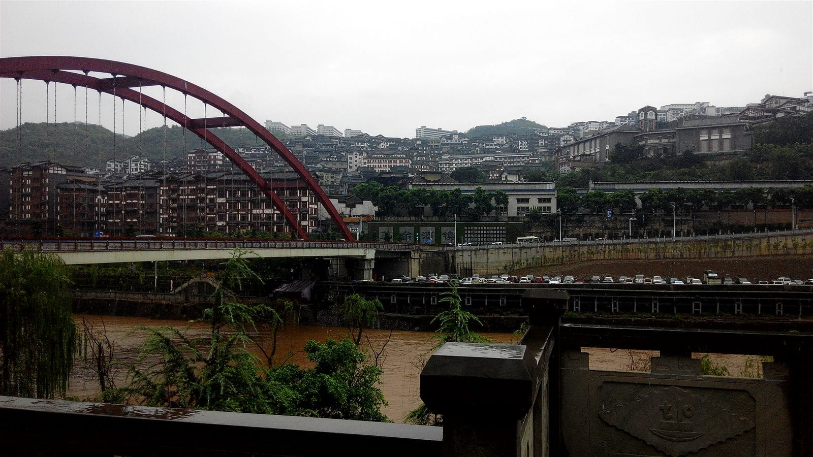

# 古蔺县

古蔺县隶属四川省泸州市，位于四川盆地南缘、云贵高原北麓。它的形状很特别：县域像一块半岛，从四川向南嵌入黔北，西与叙永接壤，东南北三面分别与贵州的毕节、金沙、仁怀、习水、赤水相邻。官方口径的面积为 3,185 平方公里，辖 3 个街道、17 个镇、3 个苗族乡，共有 43 个社区和 246 个行政村；2025 年末户籍人口 87.3 万人。

图：赤水河河谷的茅台镇段，用来说明这条河切割出的峡谷地貌与酒业带；拍摄地点不是古蔺二郎镇，不能当作郎酒厂区实景。图片：Wahsaw，CC0，via Wikimedia Commons（[原图页面](https://commons.wikimedia.org/wiki/File:Chishui_River_Bank_in_Maotai%28Moutai%29_Town%2C_Renhuai_City%2C_Zunyi%2C_Guizhou.jpg)）。

## 位置与到达

古蔺的“嵌入”位置决定了它的交通与酒业。从泸州城区往南，公路逐渐进入低山与河谷；从贵州仁怀、习水方向过来，则要翻越赤水河两岸的山地。县域内部高差大，河谷、台地与山脊的气候并不相同，乡镇之间的实际车程常比地图距离更长。

目前进入古蔺主要依靠公路与客运班线，县内没有民用机场，铁路也不是主要到达方式。泸州至古蔺的高速公路在推进中，具体通车时间与线路走向应以交通部门公告为准。自驾要注意山区弯道、雾天与雨季落石；夜间不建议赶路，尤其是从赤水河谷往高山乡镇方向。

把古蔺当作“泸州旁边的一个县”会低估它的距离感。从泸州城区到古蔺县城需要数小时车程，到二郎镇又是另一段山路。若从[贵州](ref:guizhou)的[遵义](ref:zunyi)或[习水](ref:xishui)方向进入，跨省边界看似很近，实际仍要绕行河谷与山梁。行程安排应留出缓冲，不要按平原城市的距离估算。

## 酒业与产区

古蔺最核心的酒业地标是二郎镇与[郎酒](ref:langjiu)。二郎镇位于赤水河畔，与贵州仁怀的茅台镇隔河相望；这一带被习惯称为“赤水河酱香酒谷”或“白酒金三角”的一部分。古蔺属于[四川](ref:sichuan)，但它的酒业语言更接近赤水河[酱香型白酒](ref:sauce)，而不是四川盆地腹地的浓香型。

郎酒的产区叙事围绕“赤水河、二郎镇、天宝峰、天宝洞、地宝洞”展开。天然溶洞被用于贮酒，是郎酒区别于许多酱香企业的记忆点；但溶洞贮酒并不是酱香型的法定工艺要求，也不能单独决定酒质。理解郎酒，应把河谷气候、制曲与下沙节奏、窖池与贮存条件放在一起看，而不是只记住一个“洞藏”概念。

古蔺不只二郎镇一处酒业空间。茅溪镇等地也有酱香生产与配套，县内形成了围绕高粱、制曲、包装、物流与销售的产业链。与[泸州](ref:luzhou)主城的浓香型产区相比，古蔺的酱香路线更依赖赤水河谷的小气候与跨省原料、技术交流；与[习水](ref:xishui)相比，两地共享一条河，但行政区划、企业体系与园区布局不同。

## 风味与工艺

[酱香型白酒](ref:sauce)的公共流程常被概括为“端午制曲、重阳下沙、九次蒸煮、八次发酵、七次取酒”。这套流程不是神秘配方，而是一套与季节、温度、高粱破碎度、曲药质量紧密配合的生产制度。古蔺位于赤水河谷，夏季湿热、冬季相对温和，微生物活动活跃，车间需要靠通风、摊晾与堆积发酵来控制温度。

酱香型白酒的风味通常被描述为酱香突出、幽雅细腻、酒体醇厚、空杯留香。具体到古蔺与二郎镇，不同企业、不同轮次、不同年份的基酒差异很大。轮次酒有的偏酸、有的偏甜、有的带焦香，最终靠勾调形成完整酒体。把“酱香”当成单一味道，会忽略轮次与勾调的复杂性。

对普通饮用者，判断酱香酒可以从香气干净度、入口的酸度与醇厚度、落口的回味三方面入手。先小杯闻香，再小口入口，让酒液在口腔里停留片刻；不要用大口干杯的方式品鉴。若想对照其他路线，可以读[浓香型白酒](ref:strong)与[白酒](ref:baijiu)，但不要用香型名称替代具体产品。

## 参访与行程

二郎镇是古蔺酒文化参访的核心。镇区沿赤水河与山坡展开，酒厂、老街与河谷道路交错；是否开放参观、如何预约、哪些区域可以拍摄，要以企业公告与现场规定为准。厂区不是普通景区，不能自行进入生产车间；在河边拍摄时也要注意来往车辆与落石。

除二郎镇外，古蔺还有几条不同气质的线路。茅溪镇适合了解另一片酱香产区与河谷乡镇；黄荆老林一带以森林、溪谷与避暑为主，官方资料把它描述为北纬 28 度附近的生态区域；太平古镇保存了红军四渡赤水时期的历史空间，适合对近代史感兴趣的旅行者。这些点位与酒厂不在同一方向，一天内不宜全部安排。

建议的两日动线是：第一天从泸州或遵义方向进入古蔺，下午在二郎镇看河谷与镇区，傍晚返回县城或就近住宿；第二天根据天气选择黄荆老林或太平古镇，再从来路或习水方向离开。若只安排一天，优先二郎镇，不要在山区公路上反复折返。

## 饮食与季节

古蔺饮食带明显的川南与黔北交界特征，麻辣鸡、羊肉、腊肉、豆花与山野菜都常见。搭配酱香型白酒时，咸鲜、发酵与适度油脂更容易托住酒体；过重的辣味会掩盖细腻度，品鉴时不宜先吃。若只是用餐，少量佐酒即可，不需要用“能喝”来证明懂酒。

春秋两季适合走二郎镇与古镇线路；夏季河谷湿热，黄荆老林相对凉爽，但暴雨与山洪风险上升；冬季山区湿冷，早晚温差大。赤水河谷的雾与道路结露会影响能见度，自驾应预留更多时间，避免夜间在陌生山路上赶路。

## 常见误区

第一，把古蔺当成“泸州酒”的同义词。泸州主城以浓香型见长，古蔺的核心是赤水河酱香，两者不能混为一谈。

第二，把“洞藏”当成酱香型的法定工艺。溶洞贮酒是企业选择，不是所有酱香酒都必须经过的环节，也不能单独代表质量。

第三，把二郎镇与茅台镇当成同一个地方。两地隔河相望、共享流域，但分属四川与贵州，行政区划、企业与参观规则都不同。

第四，把古蔺的山区距离按平原经验估算。县城、二郎镇、茅溪镇与黄荆老林之间的车程都不短，行程要留缓冲。

## 继续读

- 想理解酱香型的共同语言，读[酱香型白酒](ref:sauce)。
- 想把古蔺放回泸州与四川，读[泸州](ref:luzhou)与[四川](ref:sichuan)；想对照河对岸，读[遵义](ref:zunyi)、[贵州](ref:guizhou)与[习水](ref:xishui)。
- 想比较浓香与酱香的差异，读[浓香型白酒](ref:strong)；想从国家层级看酒类地理，读[中国](ref:china)与[白酒](ref:baijiu)。

## 相关图像

图：酱香型白酒。图片：Xiaomage de，CC BY-SA 4.0，via Wikimedia Commons（[原图页面](https://commons.wikimedia.org/wiki/File:Vertreter_der_vier_Baijiu_Kategorien.jpg)）。关联图像：古蔺县。

图：四川省。图片：FISU，CC BY 3.0，via Wikimedia Commons（[原图页面](https://commons.wikimedia.org/wiki/File:%E9%9B%AA%E5%B1%B1%E4%B8%8B%E7%9A%84%E6%88%90%E9%83%BD%E5%B8%82%E5%A4%A9%E9%99%85%E7%BA%BF_Chengdu_skyline_with_snow_capped_mountains.jpg)）。关联图像：古蔺县。
