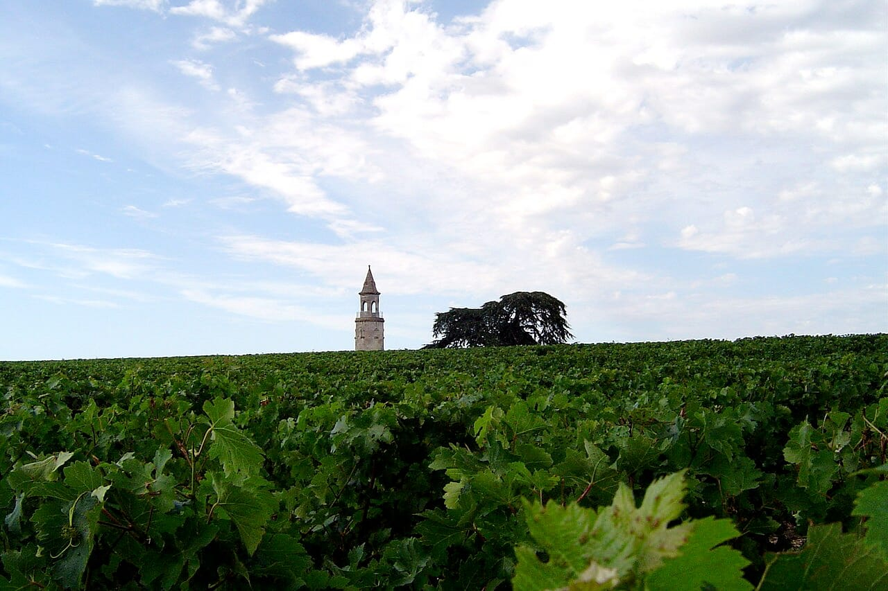
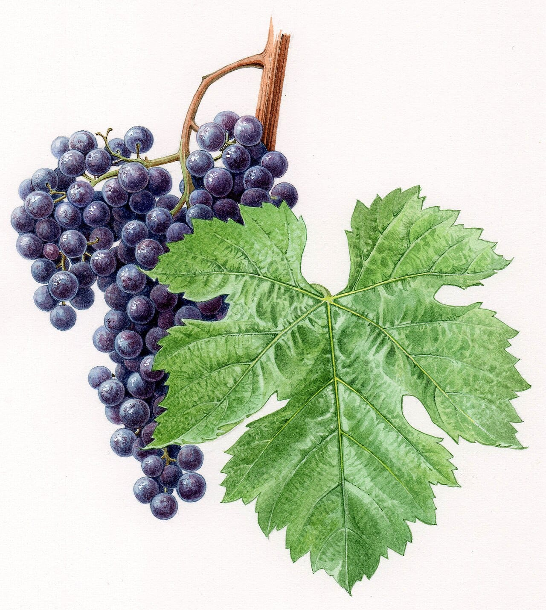

# 上梅多克

波尔多左岸北部的宽泛 AOC，覆盖从布朗克福到圣瑟兰-德卡杜尔讷的梅多克北部，环绕玛歌、圣朱利安、波亚克、圣埃斯泰夫等六个村庄级 AOC；以砾石脊上的赤霞珠为主，是 1855 分级名庄最密集的地带之一。

上梅多克是波尔多左岸的独立 AOC，环绕 Margaux、Saint-Julien、Pauillac 与 Saint-Estèphe；它以砾石丘上的 Cabernet Sauvignon 为主，风格比四大名村更紧、更经典。

图：Haut-Médoc：Vineyard in the Haut-Medoc（Wikimedia Commons）。图片：Jonas Roux，CC BY 2.0，via Wikimedia Commons（[原图页面](https://commons.wikimedia.org/wiki/File:Vineyard_in_the_Haut-Medoc.jpg)）。

## 定义与边界

上梅多克是[波尔多](ref:bordeaux)左岸的葡萄酒产区，位于吉伦特河口西岸，从北部的 Saint-Seurin 到南部的 Blanquefort；它环绕 Margaux、Saint-Julien、Pauillac、Saint-Estèphe 四个更著名的产区，并包含 Listrac-Médoc 与 Moulis-en-Médoc。

上梅多克 AOC 的葡萄酒可以来自这些“卫星”地块，但四大名村有自己的 AOC；读酒标时，写“Haut-Médoc”通常意味着酒庄不在四大名村之内，风格更偏经典左岸。

上梅多克不是“梅多克的上级产区”，而是梅多克南部的一个独立 AOC；它的边界、土壤与酒庄等级，与四大名村相互交织，不能简单按名字排序。

## 历史与命名

17 世纪，荷兰工程师排干沼泽，把吉伦特河口的湿地变成可耕作的牧场与葡萄园；18 世纪，上梅多克的酒庄随波尔多贸易兴起，1855 年分级把 La Lagune、Cantemerle 等列入名单。

20 世纪，上梅多克的 Cru Bourgeois 分级与合作社体系让中小酒庄有了市场；1970–80 年代，新酒庄与旧酒庄更新设备，风格从粗犷转向更精细。

“Haut-Médoc”字面是“上梅多克”，指地势较高、离河口较远的南部；它不是品质等级，而是地理与行政区划。

1855 年分级时，上梅多克的 La Lagune、Cantemerle、La Tour Carnet、Camensac 等被列入；这些酒庄的排名与价格，至今仍影响市场，但分级不是风土的唯一标准。

20 世纪的 Cru Bourgeois 分级让更多中小酒庄获得市场认可，也带来争议与修订；读上梅多克的酒标时，分级名称是参考，年份与酒庄现状更重要。

## 地理与风土

上梅多克的土壤以砾石、砂土与黏土为主，砾石丘（croupes）排水好、储热强，适合 Cabernet Sauvignon；黏土与砂土更适合 Merlot。吉伦特河口调节温度，海洋性气候让成熟期较长。

靠近河口的酒庄更早熟、更柔；内陆的砾石丘更晚熟、更紧。Listrac 与 Moulis 的土壤更冷、更黏，酒体更紧、更需要陈年。

上梅多克的风险是春季霜冻、夏季冰雹与采收期降雨；排水与冠层管理是关键。砾石丘的储热让 Cabernet 在凉爽年份也能成熟。

上梅多克的砾石丘多形成于第四纪河流冲积，砾石层厚、排水快、储热强；黏土与砂土分布在丘间与低地，适合 Merlot 与 Cabernet Franc。

靠近吉伦特河口的酒庄受河流调节，成熟更稳；内陆的 Listrac 与 Moulis 更冷、更晚熟，酒体更紧、更需要陈年。

上梅多克的砾石丘并非均匀分布：有些丘顶砾石厚、排水极快，Cabernet 成熟慢而紧；丘脚黏土更多，Merlot 更容易成熟。酒庄的调配比例，往往反映它拥有的地块类型，而不是单纯的风格偏好。

## 原料与风格

上梅多克以[赤霞珠](ref:cabernet)（Cabernet Sauvignon）为主，[梅洛](ref:merlot)（Merlot）、Cabernet Franc、Petit Verdot 与 Malbec 为辅；红葡萄酒带黑醋栗、黑樱桃、雪松、烟草与砾石，单宁中高，酸度中等，适合陈年。

与 Margaux 比，上梅多克更紧、更少花香；与 Saint-Estèphe 比，它更柔、更少黏土重量。风格差异来自地块与酒庄，而不是 AOC 名字本身。

上梅多克的 Cabernet Sauvignon 通常占 50–70%，Merlot 占 20–40%，Petit Verdot 与 Cabernet Franc 少量；酒精度 13–13.5%，酸度中等，单宁中高，陈年潜力 10–20 年。

年轻的上梅多克带黑醋栗、黑樱桃、雪松与石墨；陈年后出现烟草、皮革、蘑菇与干果。与 Margaux 的花香比，它更紧、更直；与 Pauillac 的雪松比，它更柔、更少力量。

上梅多克的 Petit Verdot 常被用作“香料与颜色”的补充：它晚熟、单宁高、颜色深，在温暖年份能增加紫罗兰与胡椒；Cabernet Franc 则给香气与酸度。读背标时，品种比例能解释酒的结构。

## 代表生产者与酒款

Château La Lagune、Château Cantemerle、Château La Tour Carnet、Château Camensac 是 1855 分级中的上梅多克酒庄；Château Sociando-Mallet、Château Potensac 等以稳定质量著称。

这些酒庄的红葡萄酒通常经橡木桶陈年，年轻时单宁紧，5–10 年后展开；上梅多克的 Cru Bourgeois 酒庄数量多，价格更亲民，风格更直接。

Château La Lagune 是上梅多克最著名的 1855 三级庄，风格优雅、早熟；Château Cantemerle 是五级庄，性价比高；Château La Tour Carnet 与 Camensac 也常被比较。

Château Sociando-Mallet 虽未列入 1855 分级，却以紧致、长寿的风格被视为“无冕之王”；Château Potensac 以稳定质量著称。

## 上桌方式

温度 16–18°C，用大肚红酒杯；年轻酒醒酒 1–2 小时，老酒换瓶去沉淀。配餐适合烤牛排、羊排、鸭胸、蘑菇与硬质奶酪；单宁与脂肪是搭配关键。

上梅多克不适合配清淡海鲜或辛辣菜；高单宁会放大辣感。老酒适合配简单烤肉，让雪松与烟草香气自己说话。

上梅多克的红葡萄酒适合配烤牛排、羊排、鸭胸、蘑菇与硬质奶酪；年轻酒醒酒 1–2 小时，老酒换瓶去沉淀。温度 16–18°C，不要用太小的高脚杯，否则单宁会过于集中。

## 选购与误区

先看酒庄与年份：1855 分级与 Cru Bourgeois 是参考，不是绝对；再看酒精度与橡木桶比例。上梅多克的中小酒庄性价比高，不必只追四大名村。

常见误读：把 Haut-Médoc 当成“比 Médoc 更高级”；以为它包含 Margaux 与 Pauillac；以为所有上梅多克都重桶。它是独立 AOC，风格从紧到柔都有。

上梅多克的酒庄等级多、价格跨度大；1855 分级与 Cru Bourgeois 都是参考，不是保证。买之前看年份、酒精度与酒庄近期风格，比只看等级更有用。

## 参见

- [波尔多](ref:bordeaux)：左岸与右岸的产区体系。
- [赤霞珠](ref:cabernet)：上梅多克的主导红葡萄。
- [梅洛](ref:merlot)：柔化结构的混酿品种。
- [红葡萄酒](ref:red)：红葡萄的发酵与结构。
- [橡木桶陈酿](ref:oak)：桶陈与单宁柔化。

上梅多克的白葡萄酒产量很少，但部分酒庄用 Sauvignon Blanc 与 Semillon 酿干白，风格偏柑橘、白花与矿物；它们通常不标 Haut-Médoc，而是以更具体的村庄名或 Vin de France 出售。

**关键事实。**

| 项目 | 内容 |
| --- | --- |
| 一句话定位 | 波尔多左岸北部的宽泛 AOC，覆盖从布朗克福到圣瑟兰-德卡杜尔讷的梅多克北部，环绕玛歌、圣朱利安、波亚克、圣埃斯泰夫等六个村庄级 AOC；以砾石脊上的赤霞珠为主，是 1855 分级名庄最密集的地带之一 |
| 层级 | 省/大区 |
| 所属 | 波尔多 |
| 国家代码 | FR |

**来源与边界。** 本页关于「上梅多克」的关键事实，主要由以下来源交叉核对：INAO（法国原产地与地理标志主管机构）、OIV（葡萄酒定义、产区统计与全球生产框架）、FAO（农业地理、气候与土地利用背景）等 4 条来源。价格、批次与状态会变，涉及这些字段时以页面所列来源的最新版本为准。正文为项目自写，来源只作核验，不复制原文。

## 相关图像

图：梅洛。图片：Felloni claire，CC BY-SA 4.0，via Wikimedia Commons（[原图页面](https://commons.wikimedia.org/wiki/File:Merlot.jpg)）。关联图像：上梅多克。

图：红葡萄酒类型示意图。项目自制双语视觉卡，示意性编辑图，不是现场照片。关联图像：上梅多克。
