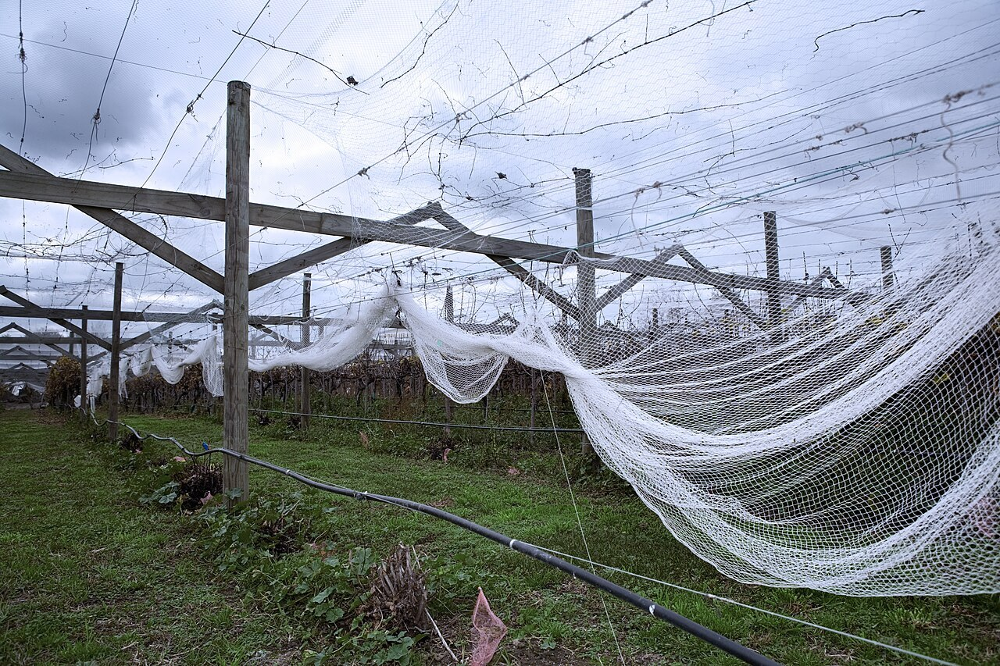

# 霍克斯湾

霍克斯湾位于新西兰北岛东海岸，是新西兰第二大葡萄酒产区，气候温暖干燥、日照长；以波尔多式赤霞珠/梅洛混酿、西拉与霞多丽著称，赫里塔加平原上的 Gimblett Gravels 砾石土是红葡萄酒的核心风土。

图："霍克斯湾"地区实景。摄影：New Zealand - Vineyard - 9878。署名：Jorge Royan，CC BY-SA 3.0，来自 Wikimedia Commons（[来源](https://commons.wikimedia.org/w/index.php?curid=15897982)）。这张照片用于说明"霍克斯湾"的实际风貌，不是霍克斯湾的全区域地图。

## 先划清「霍克斯湾」的边界
产区位于纳皮尔与黑斯廷斯之间的赫里塔加平原，平原由 Tutaekuri、Ngaruroro、Tukituki、Mohaka 四条河流冲积而成。霍克斯湾 GI 覆盖整个地区，内部按河谷与土壤分出 Esk Valley、Bridge Pa、Gimblett Gravels、Mangatahi 与 Matapiro、Tukituki 河谷等片区。这些片区名不是独立法定 AOC，而是行业与协会长期形成的划分。

GI 名只约束果实来源；同一标签下，靠海低地、砾石平原与西部内陆台地的温差和成熟节奏差别明显。买酒时把产区、片区、生产者、品种与年份分开读，才不会把“霍克斯湾”当成一个固定风味标签。

与新西兰其他大区相比，这里是最接近波尔多式红葡萄酒的产区，品种结构以红葡萄为主，不像马尔堡以长相思为主导。白葡萄酒在产区内占比不高，但霞多丽与芳香白葡萄酒有稳定表现。

## 历史与命名

1851 年，法国圣母会传教士在 Taradale 建立 Mission Estate，是新西兰最古老的酒庄；酒庄 1858 年从 Pakowhai 迁到 Meeanee，1870 年首次商业销售。1895 年，意大利葡萄栽培学家 Romeo Bragato 受新西兰政府委托考察，称霍克斯湾是他见过最适合种葡萄的省份。

早期名庄相继建立：1896 年 Te Mata Estate 获牌照，1897 年 Church Road（当时 McDonalds Winery）成立，1905 年西班牙人 Anthony Vidal 在黑斯廷斯创立 Vidal，1933 年 Esk Valley（当时 Glenvale）建立。Te Mata 在 1901 年已是全国最大酒庄。20 世纪中期，Tom McDonald 于 1949 年在 Taradale 酒庄酿出新西兰第一款商业赤霞珠。

二战后杂交品种与 Müller-Thurgau 一度占主导，1970 年代起精品种植回升。1974 年 John Buck 接手复兴 Te Mata，1980 年代初推出旗舰 Coleraine；1989 年 Stonecroft 发布新西兰第一款现代商业西拉；1993 年 Trinity Hill 在 Gimblett Gravels 开辟园区。现代产区的红葡萄酒声誉，是在这几轮重启中逐步建立的。

## 「霍克斯湾」的地理与风土
霍克斯湾属温暖海洋性气候，年日照约 2,200 小时，生长季热量可与波尔多相比；昼夜温差 10–15°C，有利于保留酸度。年降雨 800–1,000 毫米，且集中在生长季之外，夏季干燥。主要风险是春季霜冻、花期大风与采收期降雨，年份之间产量与风格波动不小。

赫里塔加平原的砾石、砂壤与黏土交错分布。Gimblett Gravels 是 1867 年 Ngaruroro 河改道洪水后露出的砾石扇，约 800 公顷；表层约 20 厘米细砂壤，下覆砾石夹砂，砾石像一层保温毯，30 厘米深处土温比周边高约 5°C，排水快、蓄热好，最适合赤霞珠、梅洛与西拉。

片区之间差别清晰：Bridge Pa 在 Gimblett 西侧，是更老的红黏土；Esk Valley 在北部 Eskdale 低地，靠海较凉；Mangatahi 与 Matapiro 在黑斯廷斯以西 30 公里的老台地，气候更凉；Tukituki 河谷围绕 Havelock North 展开。同一 GI 内，砾石地块结构紧、集中度高，黏土地块更圆润早熟。

## 原料与风格

红葡萄以赤霞珠、梅洛、西拉为主，品丽珠、马尔贝克、小维多辅助；白葡萄以霞多丽为主，长相思、灰皮诺、黑皮诺次之。波尔多式混酿是传统强项，香气带黑醋栗、雪松、黑莓与香料；西拉近二十年增长最快，带黑胡椒、花香与野果气息。

红葡萄酒酒体饱满但保留酸度，单宁成熟。砾石地块的酒结构紧、集中度高，黏土地块更柔和早熟。霞多丽风格从清爽果味到橡木桶陈都有，部分带矿物与坚果感；芳香白葡萄酒表现稳定，但知名度不如马尔堡。

酿造上，波尔多式混酿按地块与年份调配；西拉有的走北罗讷式整串发酵，有的偏新橡木风格。冷凉与温暖年份之间，采收窗口长短不一，生产者要在果味成熟度与保留酸度之间取舍，这个选择比品种本身更能决定酒的性格。

## 代表生产者与酒款

Te Mata Estate 1896 年创立，旗舰 Coleraine 为赤霞珠/梅洛混酿，Awatea 是次级波尔多混酿，Bullnose 为西拉，是新西兰最老牌的家族酒庄之一。Craggy Range 位于 Te Mata Peak 脚下的 Giants Estate，Gimblett Gravels 园区出 Le Sol、Sophia、Te Kahu 等酒款。

Trinity Hill 1993 年创立，Homage 西拉是新西兰西拉标杆之一；Church Road、Vidal、Mission Estate、Elephant Hill、Stonecroft 也是零售与酒单上的常见名字。霍克斯湾的这些名字不是官方分级，而是市场长期形成的参照。

旗舰混酿与单一园价格高、产量小，入门款更容易在餐厅和零售渠道找到。比较酒款时先看片区（砾石、黏土或靠海），再看品种与年份；同一酒庄的不同系列，地块与酿造投入可能完全不同。

## 「霍克斯湾」的上桌方式
饮用温度按风格调整：波尔多式混酿 16–18°C，西拉 15–17°C，霞多丽 10–12°C，芳香白葡萄酒 8–10°C。饱满红酒可醒酒半小时左右，年轻酒不必过度醒酒，以免果香散失。

配餐上，红混酿配烤羊肉、牛肉、鹿肉、熏肉与硬奶酪；西拉配烤肉、香肠与带香料的菜；霞多丽配烤海鲜、鸡肉与奶油酱。本地食材包括海湾鱼类、羊肉、乳制品与浆果，畜牧与果园业都很发达。

本地家常菜以烧烤、烟熏肉与软质奶酪常见，调味偏果香与香料，与红酒的果味和单宁衔接自然。选酒时先想主菜的脂肪与盐分，再决定用饱满红混酿、香料感西拉，还是清爽霞多丽去衔接。

## 选购、标签与误区

酒标上 GI 名之下，片区名（Gimblett Gravels、Bridge Pa 等）提示土壤与成熟节奏；再往下一级是单一园与酒款系列。年份在温暖产区同样重要：霜冻、花期风与采收雨都会改变产量与风格，对比同年份不同生产者，比跨年份比较更容易看出片区差别。

常见误区有三：把产区名当成品质等级；把“老藤”“手工”“传统”当成法律术语；把高酒精度当成成熟度的证明。它们都可能属实，也都可能只是营销语言，需要结合生产者与年份判断。

储存上，饱满红酒避光、温度稳定、卧放；年轻白葡萄酒趁鲜喝，优质混酿可陈年十年以上。买进口酒留意运输与储存记录，长期受热的酒开瓶后容易果味发闷、酸度突兀。

## 「霍克斯湾」周边怎么走
纳皮尔以 Art Deco 建筑闻名，黑斯廷斯是另一个住宿基地；酒庄沿平原与河谷分布，自驾最方便，当地有葡萄酒步道与定期美食节。半日行程可安排两到三家品鉴室加午餐。

一天可以走 Gimblett Gravels 与 Bridge Pa 一线，比较砾石与红黏土地块；也可以走 Esk Valley 靠海路线，看低地偏凉气候下的白葡萄酒与轻红。采收季在南半球 3–4 月，部分品鉴室缩短营业时间，出发前应通过酒庄官网或产区协会目录确认预约。

多数酒庄设有 cellar door 与餐厅；预约准时，不在发酵与陈酿区随意走动。山路、土路与品鉴室门槛对行动不便者并不总是友好，带长辈或小孩同行前先问清无障碍通道与洗手间位置。

- 相关条目：[new-zealand](ref:new-zealand)、[cabernet-sauvignon](ref:cabernet)、[syrah](ref:syrah)、[chardonnay](ref:chardonnay)、[red-wine](ref:red)。

相关条目：[新西兰](ref:new-zealand)、[赤霞珠](ref:cabernet)、[西拉](ref:syrah)。

## 相关图像

图：Syrah Grapes on the Vine。摄影：U.S. Geological Survey，CC0，来自 Wikimedia Commons。。图片：U.S. Geological Survey，CC0，via Wikimedia Commons（[原图页面](https://commons.wikimedia.org/w/index.php?curid=114429512)）。关联图像：霍克斯湾。

图：霞多丽。图片：Jenavive at English Wikipedia，Public domain，via Wikimedia Commons（[原图页面](https://commons.wikimedia.org/wiki/File:Chardonnay.jpg)）。关联图像：霍克斯湾。
