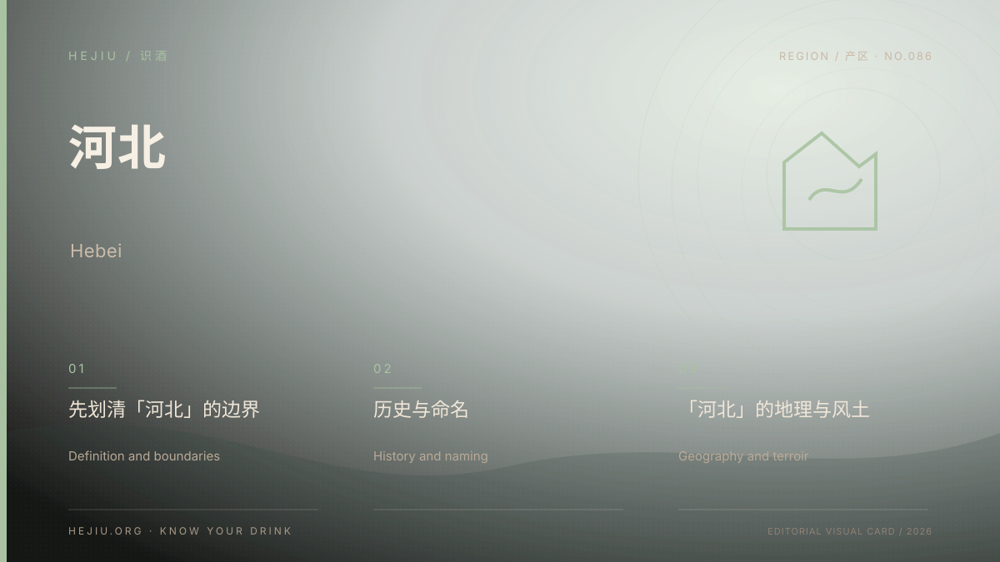

# 河北

中国北方葡萄酒产区，核心包括怀来（沙城）与昌黎；气候冷凉干燥、昼夜温差大，以赤霞珠、霞多丽与长城等品牌著称，是中国现代葡萄酒工业最早成形的地区之一。

图：河北栏目示意图。项目自产或类别插图，用于中国酒文化语境，不是该对象的实拍。

> **先给结论**
> **一句话：** 这页判断河北的风味与旅行价值，以及怎么安排。
>
> - **适合谁：** 正在比较河北与其他产区、准备买酒或安排旅行的人。
> - **不适合谁：** 只想要“哪个产区最贵”的结论、不关心风格和年份的人。
> - **先看这两点：**
>   - 读标先看产地标注：怀来（沙城）与昌黎碣石山是两个风土单元，不宜混为一谈；再看品种、年份、生产者与陈酿方式。
>   - 怀来距北京约 100 km，京张高铁开通后纳入首都一小时交通圈，酒庄沿桑干河、洋河两岸分布；昌黎距北京约 270 km，可与北戴河、秦皇岛海滨行程串联。

## 先划清「河北」的边界
河北的酿酒葡萄种植集中在两处相距较远的地带：西北张家口市的怀来（沙城）怀涿盆地，以及东部秦皇岛市的昌黎碣石山一带。前者在北京西北约 100 km，属内陆盆地；后者东临渤海，距北京约 270 km，是山海之间的丘陵产区。两地分属不同气候与土壤单元，酒标上应先分清是怀来还是昌黎，再谈风格比较。

法定与品牌框架上，“沙城葡萄酒”于 2002 年获国家地理标志保护产品；“昌黎葡萄酒”同年 8 月成为全国葡萄酒行业第一个国家地理标志保护产品，2005 年保护范围扩入卢龙、抚宁。2023 年 9 月 1 日起施行的《秦皇岛市碣石山葡萄酒产区保护条例》，把东部产区的种植、酿造与标识管理纳入地方立法。

除两个核心地带外，河北威县、双滦、永年等地也有鲜食与酿酒葡萄种植，但市场上所称“河北产区”通常指怀来与昌黎两大集群。

## 历史与命名

怀来的葡萄种植史可追溯至一千二百多年前，明清时期葡萄已是宣化府一带的宫廷贡品。1976 年，中国第一支符合国际标准的干白葡萄酒在沙城酒厂问世；1978 年中央五部委联合考察后，选定桑干河流域作为国家级葡萄酒科研基地；1980 年怀来从欧洲与美国引进 13 个国际酿酒品种，在沙城酒厂母本园种植。2001 年中法庄园从法国引进马瑟兰与小芒森种苗，这两个品种由此首次落地中国。

昌黎的葡萄栽培史有 400 余年。1983 年 5 月 20 日，新中国第一瓶干红葡萄酒——“北戴河”牌赤霞珠干红在原昌黎葡萄酒厂诞生，1984 年获原轻工业部全国酒类质量大赛金杯奖；1986 年酒厂以每株 1 美元的价格从法国波尔多引进赤霞珠、品丽珠、霞多丽、黑比诺等 5 万株嫁接苗，建成国内最早的酿酒葡萄基地之一；1988 年中粮华夏长城葡萄酒有限公司成立。

2000 年前后，两地先后获得“中国葡萄之乡”“中国葡萄酒之乡”“中国干红葡萄酒之乡”等称号；2019 年碣石山产区被中国酒业协会认证为中国第三个、河北首个葡萄酒小产区，2021 年获“中国马瑟兰葡萄酒优质产区”称号。

## 「河北」的地理与风土
怀来处北纬 40° 附近，北依燕山、南靠太行余脉，桑干河、洋河、永定河横贯怀涿盆地，官厅水库水面约 230 km² 调节盆地气候。属温带半干旱大陆性季风气候，四季分明，年平均降水量约 393 mm，年日照约 3,000 小时，昼夜温差可达 12°C 以上；酿酒葡萄种植海拔在 450–1,050 m 之间，园圃平均海拔约 498 m。土壤为多砾石砂壤土，土层深厚、透水透气，桑干河畔另有二百万年历史的泥河古化石沉积层。

昌黎碣石山产区处北纬 39° 附近，北枕碣石山、东临渤海、西南挟滦河，山体阻挡西部季风，渤海带来温和的海洋调节，无霜期较长；丘陵坡地多砾石沙质土，含钾丰富、通透性好，利于酚类与风味物质积累。东部产区划分为晾甲山、凤凰谷、卧佛山等 6 个子片区。

两地冬季寒冷，葡萄需埋土防寒越冬；降水集中在生长季，季风与坡向影响病害压力。海拔高差使怀来可在不同高度安排白品种与早熟红品种，昌黎则靠海洋调节拉长挂果期。

## 原料与风格

红葡萄以[赤霞珠](ref:cabernet)为主，搭配美乐、品丽珠、小味儿多、西拉与马瑟兰；白葡萄有[霞多丽](ref:chardonnay)、雷司令、长相思、小芒森与黑比诺。怀来高海拔冷凉地块多种植霞多丽、雷司令、长相思与黑比诺，低海拔热量更足的地块安排赤霞珠、美乐、西拉；昌黎以赤霞珠为骨干，风格偏浓郁厚重。

[红葡萄酒](ref:red)常见黑醋栗、黑莓与青椒草本气息，橡木桶陈酿后带出烘烤与香料；[白葡萄酒](ref:white)以霞多丽与雷司令为主，酸度清爽、果香直接。怀来还出产传统法起泡酒，1990 年第一瓶传统法起泡酒在长城桑干酒庄诞生；马瑟兰在怀来与昌黎均有种植，是近年国内关注度上升的杂交品种。

整体看，河北酒以国际品种为主，本土品种占比小；混酿与单品种并存，新庄在小品种与橡木工艺上的尝试比传统大厂更活跃。

## 代表生产者与酒款

怀来集群有中国长城葡萄酒有限公司、长城桑干酒庄、中法庄园、迦南酒业、紫晶庄园等。长城桑干酒庄始建于 1979 年，葡萄园约 75 ha，位于桑干河畔泥河古化石土壤上；中法庄园拥有 23 ha 葡萄园，2001 年引种马瑟兰与小芒森，是国内较早规模种植这两个品种的酒庄。

昌黎集群有中粮华夏长城、朗格斯酒庄、茅台葡萄酒、金士酒庄、茅台凤凰庄园、耿氏酒堡等。华夏长城 1988 年成立，其碣石山地下花岗岩大酒窖由 6.2 万块花岗岩砌成，面积 1.9 万 m²，可存 3 万余只橡木桶；朗格斯为奥地利资本参与建设的酒庄，2006 年已列入昌黎葡萄酒地理标志专用标志使用企业。

这些品牌与酒庄不是官方分级，而是市场与产业多年积累的参照。大厂产品线覆盖入门到酒庄款，精品酒庄产量小、风格实验性强；买前先看清产地（怀来或昌黎）、品种、年份与是否酒庄内装瓶。

## 「河北」的上桌方式
河北干红单宁中等偏紧、果味集中，适合配红烧肉类、烤羊排、炖牛肉与中式酱卤；赤霞珠款搭牛排与野味较稳妥，马瑟兰混酿果香更甜润，可配香料烤禽。霞多丽与雷司令干白配海鲜、白肉与清淡凉菜，起泡酒可作开胃酒配油炸小食。

适饮温度上，干红约 16–18°C，年轻款可短暂醒酒；干白 10–12°C，起泡酒 6–8°C。本地饮食近京味与东北口味，酱肉、烧烤与面食和饱满红酒搭配较顺。

## 选购、标签与误区

读标先看产地标注：怀来（沙城）与昌黎碣石山是两个风土单元，不宜混为一谈；再看品种、年份、生产者与陈酿方式。地理标志标志只说明原料与工艺符合对应规范，不等于具体酒款等级；大厂不同产品线之间品质与价格差距明显。

常见误解一是把“河北酒”当作单一风格，实际上内陆盆地的冷凉酸度与沿海丘陵的成熟厚重差别很大；二是以为国产酒不适合陈年，好年份的赤霞珠与马瑟兰在合适储存下可放数年。储存以阴凉稳定为先，避免高温、光照与震动；开瓶后白葡萄酒与轻红酒通常放 1–3 天，重红酒更久。

河北的怀来与昌黎气候不同，不能用一个河北葡萄酒概括；酒标上的产区名越具体，越能帮助判断风土与风格。

## 「河北」周边怎么走
怀来距北京约 100 km，京张高铁开通后纳入首都一小时交通圈，酒庄沿桑干河、洋河两岸分布；昌黎距北京约 270 km，可与北戴河、秦皇岛海滨行程串联。两处集群内部酒庄分散，单次品鉴 60–90 分钟，村镇间车程 30–60 分钟，一天两三个点较从容。

采收在北半球秋季 9 至 10 月，酒庄最忙；多数精品酒庄品鉴需提前预约，大厂酒窖与展厅开放时间相对固定。参观时不进入作业车间与地块，品鉴后不驾车；山地与坡地园区步道不一定无障碍，带长辈先电话确认。

- 相关条目：[china](ref:china)、[cabernet-sauvignon](ref:cabernet)、[chardonnay](ref:chardonnay)、[red-wine](ref:red)、[white-wine](ref:white)。
