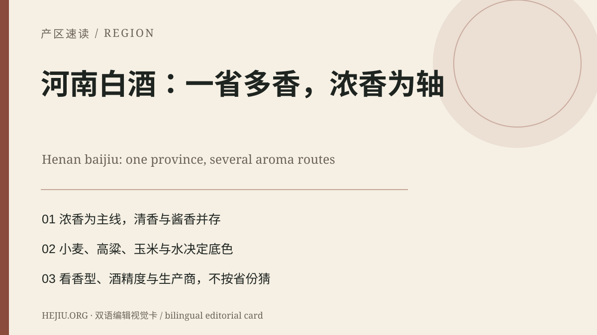

# 河南省

河南位于黄河中下游，太行山、伏牛山与华北平原在这里交接。它不是中国白酒版图里最“险峻”的产区，却是最典型的中原产区：平原广、粮源足、交通便利，酒厂可以围绕小麦、高粱、玉米等原料组织生产，也能把产品快速输送到全国市场。

河南酒类的关键词不是单一香型，而是“豫酒”这个区域品牌下的多条路线。浓香是市场主线，清香、酱香与地方特色酒同时存在；杜康、宋河、仰韶、宝丰等名字，承载的更多是历史叙事与地方记忆，而不是同一种风味。

图：郑州郑东新区城市天际线，河南省会与中原交通枢纽。图片：白诗棋，CC0，via Wikimedia Commons（[原图页面](https://commons.wikimedia.org/wiki/File:Zhengzhou_CBDcity.jpg)）。

## 地理与气候

河南横跨黄河、淮河、海河与长江流域，西部山地、东部平原、南部盆地并存。整体属暖温带—亚热带季风气候，四季分明，夏季高温多雨，冬季寒冷干燥。黄河冲积平原土层深厚，适合小麦、玉米、高粱等作物；豫西山地与豫南丘陵则提供了不同的微气候。

对酿酒而言，平原产区的好处是原料稳定、运输便利，挑战则是同质化。温度、湿度、水源与窖池条件会拉开风格差异，但消费者最容易感知的，仍是香型、酒精度、曲种与贮存时间。把“河南”当成一个统一风味，会忽略省内从豫北到豫南的差别。

图：郑州龙子湖中央岛天际线，城市与水域并置的现代河南。图片：Windmemories，CC BY-SA 4.0，via Wikimedia Commons（[原图页面](https://commons.wikimedia.org/wiki/File:20210908_Skyline_of_the_Central_Island_of_Longzihu.jpg)）。

## 历史脉络

河南的饮酒史几乎与中国酒史重叠。仰韶文化遗址中的陶器与谷物遗存，常被用来讨论早期发酵与饮酒；杜康的传说则把粮食酿酒的神话锚定在豫西。无论传说细节如何，河南在黄河流域农业、粮食加工与商贸网络中的位置，确实为酿酒提供了长期基础。

宋河、宝丰、仰韶等现代酒厂，多在 20 世纪完成国营化与工业化改造，再在改革开放后进入品牌化竞争。它们的共同点是“地方名酒”属性强：在省内宴席、礼品与地方宴请中有稳定认知，但全国化程度不一。理解豫酒，不能只看广告历史，还要看酒厂当前的原料、工艺与产品结构。

## 香型与风格

河南白酒以[浓香型](ref:strong)为主。浓香型的共同特征是窖香突出、绵甜甘冽、香味协调，但不同酒厂的窖池年龄、粮糟配比、制曲温度与贮存时间，会带来从“窖香浓郁”到“绵柔顺口”的差异。对日常饮用，浓香型的接受门槛较低，配豫菜、家常菜也容易。

[清香型](ref:light)在河南也有基础。清香型强调清、净、爽，发酵周期与工艺路线更接近北方传统；它适合不喜欢重窖香的人，也更容易做出干净、利落的口感。部分酒厂还会生产酱香或其他风格，形成“一厂多香”的产品矩阵。

香型不是质量等级。[白酒](ref:baijiu)的香型划分，描述的是制曲、发酵、蒸馏与贮存路线；同一香型内部可以从几十元到上千元，差别在原料、工艺、基酒比例与品牌溢价。看到“河南名酒”四个字，不等于看到了具体香型与等级。

图：河南白酒：一省多香，浓香为轴。项目自制双语视觉卡，示意性编辑图，不作为实景照片。

## 原料与工艺

河南白酒的原料以[小麦](ref:wheat)、[高粱](ref:sorghum)、[玉米](ref:maize)与[水](ref:water)为主。小麦既是制曲原料，也可能参与酿酒；高粱提供淀粉与单宁结构；玉米带来甜感与酒体厚度。不同酒厂的配比并不公开到每一粒粮食，但标签上的原料表是最直接的线索。

[制曲](ref:qu)决定曲香与发酵方向，[发酵](ref:fermentation)决定酒体的骨架，[蒸馏](ref:distillation)与[勾调](ref:blending)决定最终风格。浓香型通常强调老窖与续糟发酵，清香型更强调清蒸清烧与地缸发酵；这些工艺差异，会在香气与口感上留下明显痕迹。

图：小麦是制曲与酿酒的重要原料，也是河南白酒原料表里的常见项。图片：kallerna，CC BY-SA 4.0，via Wikimedia Commons（[原图页面](https://commons.wikimedia.org/wiki/File:Vehn%C3%A4pelto_6.jpg)）。

## 代表酒款与地方记忆

杜康、宋河、仰韶、宝丰是河南白酒最常见的四个名字。杜康更多承载“酒祖”传说；宋河与宝丰常被视为地方名酒；仰韶则把仰韶文化、陶器与酒厂叙事连接在一起。它们的具体产品线、香型与价格带并不相同，购买时要看瓶身标签，而不是只看地名。

河南也有葡萄酒、啤酒与黄酒生产，但在全国影响力上不如白酒。对游客或送礼者，最稳妥的方式是选择标注清楚香型、酒精度、生产商与产地的主流产品；对收藏者，则要额外核对批次、年份与真伪。

## 市场与饮用

河南是全国人口大省与消费大省，白酒在宴席、商务与节日礼品中有稳定需求。日常饮用以中低度浓香型为主，商务场景则更看重品牌与包装。近年来，消费者对“纯粮固态”“年份”“窖龄”等标签的关注度提高，但标签词并不等于质量保证，仍要回到原料、工艺与实际饮用体验。

配菜上，浓香型适合豫菜中的烧鸡、卤味、红烧肉与面食；清香型适合清蒸、凉菜与口味较轻的菜肴。高度酒不宜大口快饮，低度酒也不等于可以无限量；温度、器皿与饮水量都会影响第二天的感受。

## 法规与产区保护

河南白酒生产受食品安全法规与国家标准的约束。GB/T 15109-2021 对白酒工业术语、制曲、发酵与蒸馏等环节有定义；GB/T 17204-2021 对饮料酒分类与术语有规定。地理标志、产区名称与“纯粮固态”等标识的使用，需要符合相应规则；阅读酒标时，要区分产地、香型、酒精度与生产商。

## 气候与酒类结构

| 区域 | 气候与地貌 | 主要酒类 | 买酒时看什么 |
| --- | --- | --- | --- |
| 豫北平原（安阳、濮阳、新乡） | 暖温带季风，平原为主 | 浓香、清香白酒 | 香型、酒精度、生产商 |
| 豫西山地（洛阳、三门峡） | 山地丘陵，河谷切割 | 浓香、清香、地方酒 | 原料表、窖池与贮存信息 |
| 豫中平原（郑州、许昌、漯河） | 平原，交通便利 | 浓香为主，品牌集中 | 产品线、批次与渠道 |
| 豫东平原（商丘、周口） | 平原，农业基础强 | 浓香、地方酒 | 价格带与真实产地 |
| 豫南（南阳、信阳） | 盆地与丘陵，气候偏湿 | 浓香、清香、黄酒 | 口感偏好与配餐 |

这张表是宏观对照，不能替代酒厂的具体工艺。河南不同地市的水源、窖池与产品结构差异很大，买酒时仍要以标签和官方信息为准。

## 常见误区

第一，河南只有浓香型。浓香是主线，但清香、酱香与地方特色酒同样存在。

第二，杜康是一个酒厂。杜康既是历史传说，也被多个市场主体使用；具体产品要看生产商与商标。

第三，河南酒都便宜。河南有大众价格带，也有高端产品；价格由品牌、基酒与渠道共同决定。

第四，年份越久越好。贮存条件、基酒质量与勾调比例，比单纯年份更重要。

第五，配菜只能配重口味。浓香型可以配卤味与红烧，清香型也能配清蒸与凉菜，关键是酒体与菜味的轻重匹配。

## 价格带、渠道与到访线索

河南白酒的价格带大致可以分为三层：100–300 元的日常口粮，300–800 元的宴席与送礼，800 元以上的品牌旗舰。价格并不是香型的刻度，同一香型在不同品牌之间也会拉开很大差距；先确定喝的人、几个人喝、要不要礼盒，再回到酒体。

购买时优先选择品牌官方旗舰店、当地大型商超与有授权的烟酒行。所谓“内部酒”“特供酒”“酒厂关系酒”是高风险说法，包装上的生产许可、执行标准、酒精度与净含量，比故事更值得核对。整箱购买要检查箱码、瓶码与生产日期是否一致，散瓶则注意封口和酒线。

配餐上，浓香型适合烩面、烧鸡、卤味与豫菜里的咸鲜厚味；清香型可以配清蒸鱼、凉菜与汤类，避免用重辣盖住酒体。小杯慢饮、先吃后喝，比空腹快饮更稳妥。

到访线索可以围绕郑州、洛阳、汝阳与宝丰展开：郑州适合作为交通与博物馆起点，洛阳连接杜康文化叙事，汝阳与宝丰则能看到更具体的酒厂与产区环境。酒厂参观、品鉴与购酒政策会随季节调整，出发前以品牌官方渠道当期公告为准，不把旧攻略当成预约凭证。

## 常见问题

**河南白酒主要是浓香型吗？** 浓香是市场主线，但清香、酱香与地方特色酒同样存在。买酒时先看瓶身标注的香型，不要按省份猜。

**杜康是历史人物还是白酒品牌？** 两者都有。杜康是广泛流传的酿酒传说人物，也被多个市场主体用作商标；具体产品要看生产商、产地与执行标准。

**豫酒值得买吗？** 河南有稳定的地方名酒与大众价格带产品，也有高端线。值不值得买，取决于具体酒款的原料、工艺、批次与价格，而不是“豫酒”这个区域标签。

**河南白酒怎么配菜？** 浓香型可以配卤味、烧鸡、红烧肉与面食；清香型更适合清蒸、凉菜与口味轻的菜肴。高度酒不要大口快饮。

**河南有葡萄酒或其他酒类吗？** 有葡萄酒、啤酒与黄酒生产，但全国影响力不如白酒。买的时候仍要看产地、原料与生产商。

**河南酒都是高度酒吗？** 不是。河南白酒有 38%、42%、52% 等不同度数，也有低度产品；酒精度与香型、价格没有固定对应关系。

## 延伸阅读

- [中国](ref:china)：河南省在中国酒类地理中的位置。
- [白酒](ref:baijiu)：白酒的定义、香型与工艺。
- [浓香型](ref:strong)与[清香型](ref:light)：河南最常见的两条风味路线。
- [小麦](ref:wheat)、[高粱](ref:sorghum)、[玉米](ref:maize)与[水](ref:water)：河南白酒的基础原料。
- [制曲](ref:qu)、[发酵](ref:fermentation)、[蒸馏](ref:distillation)与[勾调](ref:blending)：理解河南白酒的五个工艺词。

**关键事实。**

| 项目 | 内容 |
| --- | --- |
| 一句话定位 | 黄河中下游的中原省份，豫酒以浓香为主，也有清香、酱香与地方特色酒 |
| 层级 | 省/大区 |
| 所属 | 中国 |
| 国家代码 | CN |
| 代表线索 | 杜康、宋河、仰韶、宝丰等地方名酒 |

**来源与边界。** 本页关于「河南省」的地理、香型与工艺信息，主要由河南省人民政府、国家标准全文公开系统、中国酒业协会与《The Oxford Companion to Spirits and Cocktails》交叉核对。品牌历史、产品线与价格会变，涉及这些字段时以企业官方当期信息为准。正文为项目自写，来源只作核验，不复制原文。
