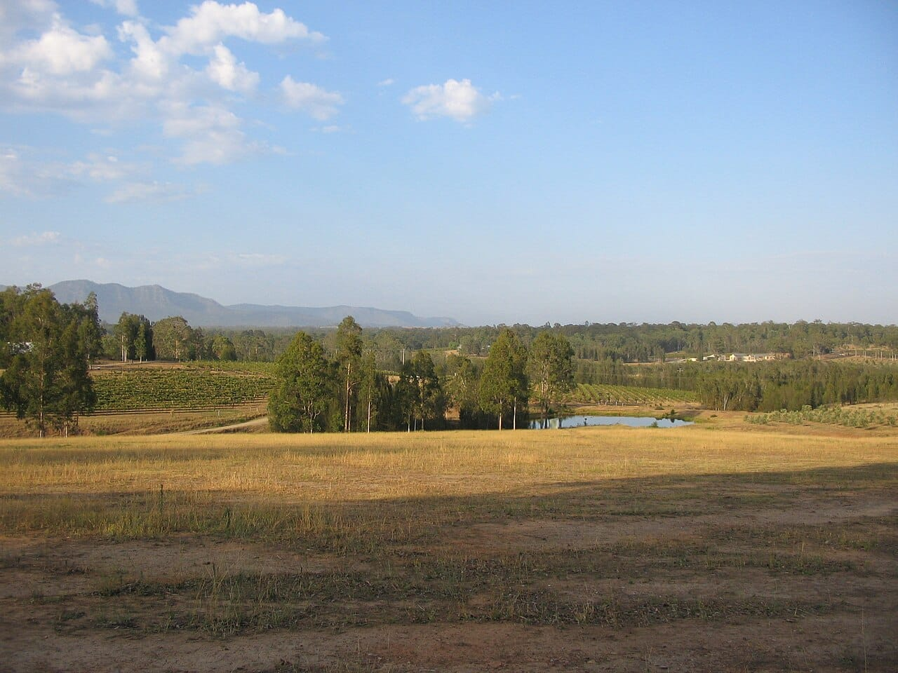
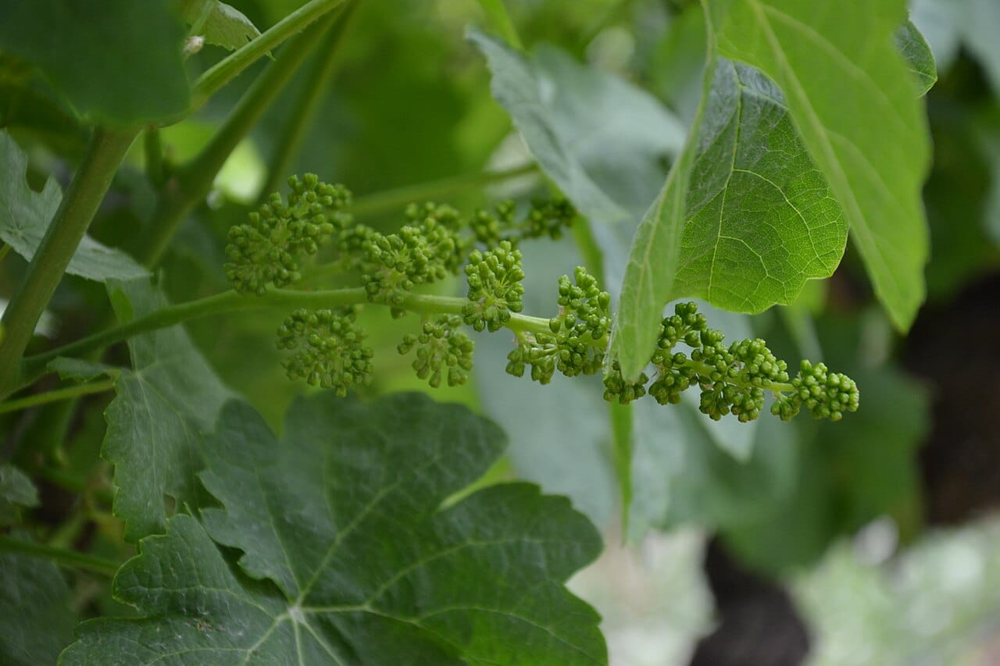

# 埃米塔日

北罗讷河谷塔恩-埃米塔日镇背后的花岗岩山丘，13 个 lieux-dits 组成；红葡萄酒以西拉为主，白葡萄酒以玛珊与胡珊为主，产量小、陈年潜力长，是罗讷河谷最著名的“山丘”产区之一。

埃米塔日是北罗讷河谷花岗岩山丘上的小产区，红葡萄酒几乎全用 Syrah，白葡萄酒用 Marsanne 与 Roussanne；产量小、坡度陡，风格紧致而长寿。

图：Hermitage：The view of the vineyards from the Hermitage Hideaway - Taken on the Saturday, 3rd February 2007 at 7-49am. - panoramio（Wikimedia Commons）。图片：Christopher Wood，CC BY-SA 3.0，via Wikimedia Commons（[原图页面](https://commons.wikimedia.org/wiki/File:The_view_of_the_vineyards_from_the_Hermitage_Hideaway_-_Taken_on_the_Saturday,_3rd_February_2007_at_7-49am._-_panoramio.jpg)）。

## 定义与边界

埃米塔日是[罗讷河谷](ref:rhone)的葡萄酒产区，核心是罗讷河左岸的花岗岩山丘，面积很小、产量有限；红葡萄酒以[西拉](ref:syrah)（Syrah）为主，白葡萄酒用[玛珊](ref:marsanne)（Marsanne）与 Roussanne 混酿。它是北罗讷最著名的红葡萄酒产区之一，也是 Syrah 的经典表达。

埃米塔日不是“Hermitage”与“Ermitage”两个产区，而是同一 AOC 的法文与英文转写；它的边界包括 Tain-l’Hermitage 与 Crozes-Hermitage 部分地块，但 AOC 只覆盖山丘上的特定坡面。

它与克罗兹-埃米塔日（Crozes-Hermitage）不同：克罗兹面积更大、地势更平，酒体更轻；埃米塔日面积小、坡地陡，酒体更紧、更矿物。读酒标时，两个名字只差一个词，风格差距却很大。

## 历史与命名

埃米塔日的名称与一位隐士骑士有关：传说 13 世纪的 Gaspard de Stérimberg 在山上隐居，后来建起小教堂；“Hermitage”即“隐修处”。传说无法完全核实，但山上的教堂与梯田确实存在。

埃米塔日的葡萄酒在中世纪已随罗讷河贸易进入教廷与贵族餐桌；19 世纪，Chapoutier、Jaboulet 等酒商把这里的 Syrah 卖到巴黎与伦敦。1937 年，埃米塔日获得 AOC 地位。

20 世纪后期，埃米塔日的白葡萄酒一度被忽视，因为红葡萄酒更著名；Chave、Chapoutier 等酒庄重新强调 Marsanne 老藤与桶陈，让白葡萄酒回到市场视野。

埃米塔日的梯田多由石墙支撑，最早由修道院与地方农户开垦；山上的小教堂 Chapelle Saint-Christophe 仍是产区的象征，酒标上常出现它的剪影。

19 世纪的埃米塔日红葡萄酒在巴黎与伦敦的价格一度高于波尔多；20 世纪的根瘤蚜、战争与霜冻让产量下降，部分梯田荒废，直到 1980 年代才逐步恢复。

## 地理与风土

埃米塔日的山丘由花岗岩构成，坡面朝南，梯田狭窄，机械难以进入；罗讷河调节温度，密史脱拉风带来干燥与通风，减少病害。花岗岩排水好、储热强，让 Syrah 缓慢成熟。

山丘的不同地段风格不同：Les Bessards 以花岗岩与砾石为主，酒体最紧、最矿物；Le Méal 更暖、更饱满；Les Greffieux 更柔、更早熟。酒庄的调配比例，往往决定酒的骨架。

埃米塔日的白葡萄酒多种在坡地高处或黏土较多的地块，Marsanne 与 Roussanne 的酸度较低，需要通过早采与桶陈保持平衡。

埃米塔日的山丘分为 Les Bessards、Le Méal、Les Greffieux、Les Murets 等地块，土壤从纯花岗岩到黄土与砾石不等；Les Bessards 的酒最紧、最矿物，Le Méal 更饱满、更早熟。

密史脱拉风是产区的“天然空调”：它带走湿气、降低病害，也让葡萄皮更厚、单宁更紧。陡坡上的梯田无法机械作业，所有工作靠人工，产量因此很低。

埃米塔日的 Les Murets 地块以黄土与砾石为主，酒体更柔、更早熟；它常被用来补充 Les Bessards 的骨架，让最终的混酿既有力量又不至于过紧。

## 原料与风格

埃米塔日红葡萄酒几乎全用 Syrah，颜色深、单宁中高，香气带黑莓、黑樱桃、黑胡椒、橄榄、皮革与紫罗兰；陈年后出现雪松、烟草、干果与矿物。酒体饱满，酸度中等。

白葡萄酒用 Marsanne 与 Roussanne，带白花、蜂蜜、蜂蜡、坚果与杏；酒体饱满、酸度低，陈年后更圆润。与霞多丽比，它更少柑橘、更多蜂蜜与坚果。

埃米塔日的风格不是“力量型”，而是“紧致型”：花岗岩与陡坡让酒保持骨架，密史脱拉风让果实健康，陈年潜力常达 15–25 年。

埃米塔日红葡萄酒通常整串或部分整串发酵，长时间浸渍，橡木桶陈年 12–24 个月；新桶比例因酒庄而异，Chave 更少新桶，Chapoutier 的 top cuvée 更多。

白葡萄酒的 Marsanne 与 Roussanne 常一起发酵，酒泥搅拌与桶陈增加蜂蜡、坚果与杏的复杂度；酸度低，需要通过早采与冷凉地块保持新鲜。

## 代表生产者与酒款

Chapoutier 的“l’Ermite”与“Le Pavillon”、Jaboulet 的“La Chapelle”、Chave 的“Cuvée Cathelin”是埃米塔日的代表；Delas 的“Les Bessards”也常被比较。

这些酒款产量小、价格高，酒标常标单一地块；读背标的地块名与年份，比只看酒庄名更能判断风格。

## 上桌方式

红葡萄酒温度 16–18°C，用大肚红酒杯；年轻酒醒酒 1–2 小时，老酒换瓶去沉淀。配餐适合烤牛排、羊排、野味、蘑菇与硬质奶酪。

白葡萄酒温度 12–14°C，用中等口径白酒杯；配烤鸡、奶油酱汁、龙虾与坚果。埃米塔日的酒体饱满，不适合配清淡海鲜。

## 选购与误区

埃米塔日产量小、价格高，买之前看年份与地块；老藤与单一地块版本更值得陈年，年轻藤版本更适合早饮。不要只看“Hermitage”这个名字，克罗兹-埃米塔日可能更合适日常。

常见误读：把埃米塔日当成一个大的产区；以为它只产红葡萄酒；以为 Syrah 都是胡椒味。埃米塔日的 Syrah 更黑莓、更橄榄、更皮革，白葡萄酒则是 Marsanne 的蜂蜜与坚果。

埃米塔日的酒庄风格差异很大：Chave 更传统、更矿物，Chapoutier 更精致、更多桶，Jaboulet 更饱满、更香料。买之前先确定自己喜欢的风格，再看地块与年份。

埃米塔日的年份差异明显：冷凉年份更紧、胡椒更多，需要更长时间；温暖年份更黑莓、更早熟。买老酒时，看酒庄的储存与装瓶历史，比看年份更重要。

## 参见

- [罗讷河谷](ref:rhone)：北罗讷的产区体系。
- [西拉](ref:syrah)：埃米塔日的红葡萄。
- [玛珊](ref:marsanne)：白葡萄酒的主要品种。
- [红葡萄酒](ref:red)：红葡萄的发酵与结构。
- [橡木桶陈酿](ref:oak)：桶陈与陈年潜力。

**关键事实。**

| 项目 | 内容 |
| --- | --- |
| 一句话定位 | 北罗讷河谷塔恩-埃米塔日镇背后的花岗岩山丘，13 个 lieux-dits 组成；红葡萄酒以西拉为主，白葡萄酒以玛珊与胡珊为主，产量小、陈年潜力长，是罗讷河谷最著名的“山丘”产区之一 |
| 层级 | 其他 |
| 所属 | 罗讷河谷 |
| 国家代码 | FR |

**来源与边界。** 本页关于「埃米塔日」的关键事实，主要由以下来源交叉核对：INAO（法国原产地与地理标志主管机构）、OIV（葡萄酒定义、产区统计与全球生产框架）、FAO（农业地理、气候与土地利用背景）等 4 条来源。价格、批次与状态会变，涉及这些字段时以页面所列来源的最新版本为准。正文为项目自写，来源只作核验，不复制原文。

## 相关图像

图：Marsanne：Marsanne - inflorescence（Wikimedia Commons）。图片：Marianne Casamance，CC BY-SA 4.0，via Wikimedia Commons（[原图页面](https://commons.wikimedia.org/wiki/File:Marsanne_-_inflorescence.jpg)）。关联图像：埃米塔日。

图：Viognier Grape must after pressing。摄影：Ian Brown，CC BY 2.0，来自 Wikimedia Commons。。图片：Ian Brown，CC BY 2.0，via Wikimedia Commons（[原图页面](https://commons.wikimedia.org/w/index.php?curid=13317886)）。关联图像：埃米塔日。
