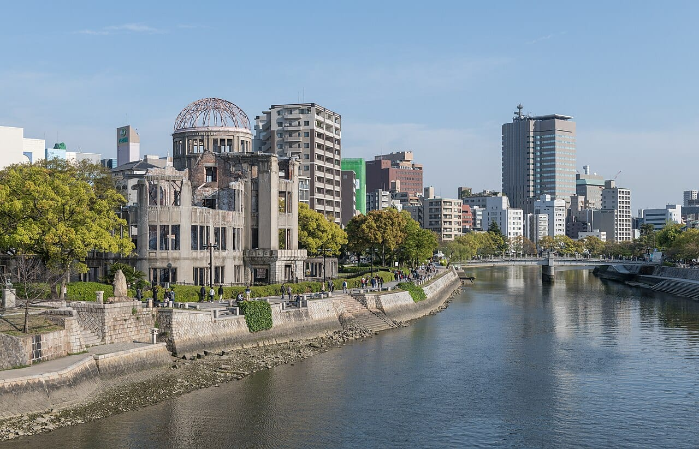
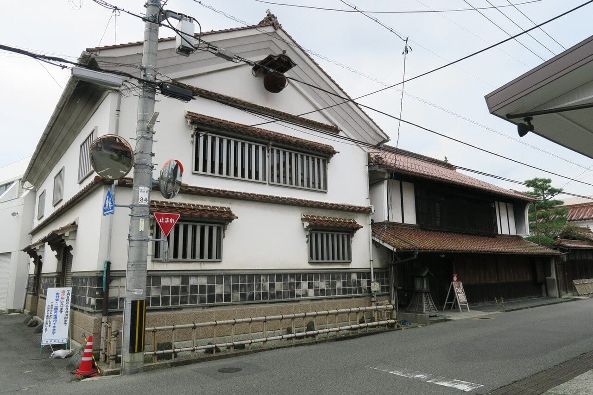
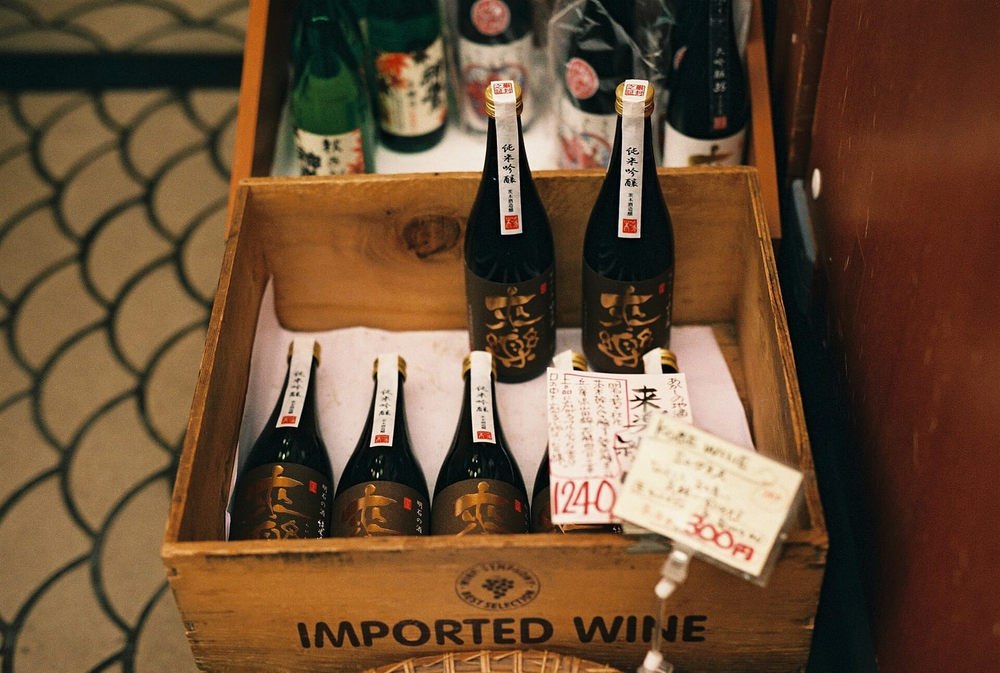

# 广岛

广岛是[日本](ref:japan)濑户内海侧的[清酒](ref:sake)产区，常与“西条酒藏群”“软水酿造法”“吟醸”三个关键词一起出现。它的产地结构不是单一城市，而是由东广岛市西条、安艺津、吴市等沿海与内陆酒藏共同组成；理解广岛，要同时看酒藏建筑、水的硬度、杜氏传统与酒米酵母的技术路线。

图：广岛。图片：DXR，CC BY-SA 4.0，via Wikimedia Commons（[原图页面](https://commons.wikimedia.org/wiki/File:Atomic_Bomb_Dome_and_Motoyaso_River,_Hiroshima,_Northwest_view_20190417_1.jpg)）。

> **先给结论**
> **一句话：** 这页判断广岛的风味与旅行价值，以及怎么安排。
>
> - **适合谁：** 正在比较广岛与其他产区、准备买酒或安排旅行的人。
> - **不适合谁：** 只想要“哪个产区最贵”的结论、不关心风格和年份的人。
> - **先看这两点：**
>   - 广岛的参观可以按“西条—安艺津—吴”组织。
>   - 广岛县位于本州西南部，南临濑户内海，北接中国山地。

## 定义与范围

广岛县位于本州西南部，南临濑户内海，北接中国山地。县内清酒藏分布在东广岛市西条、安艺津、吴市、竹原、三次、安艺高田、庄原等地。广岛县酒造组合负责藏元介绍、技术推广与产地宣传；组合把“广岛流”的软水酿造法、广岛杜氏与广岛酵母作为产地技术的核心。

“广岛清酒”不是法定产区等级，而是县级的产业与品牌概念。它涵盖西条的酒藏群、安艺津的吟醸源流、吴的沿海酒藏与内陆地方酒藏。把广岛等同于西条，会忽略安艺津与吴对软水酿造法与吟醸技术的贡献；把广岛等同于“软水”，也会忽略县内水质与酒风的差异。

## 西条酒藏群

西条是广岛最集中的清酒藏聚落，位于东广岛市西条地区。东广岛市的资料称，JR 西条站附近有 7 个藏元的赤瓦、白壁、海鼠壁酒藏并列，12 根红砖烟囱耸立，形成“西条酒藏通”。这个数字把西条的产业密度说得很具体：酒藏不是分散在乡间，而是集中在车站旁的街区，形成可以步行参观的“酒藏街道”。

2024 年 2 月 21 日，西条酒藏群被指定为国史迹，指定类别属于“交通・通信设施、治山・治水设施、生产设施及其他经济・生产活动相关遗迹”。这说明西条的价值不只是“还在酿酒”，而是酒藏建筑、烟囱、街区与生产系统作为近代产业遗产被整体保存。对参观者，西条看的是建筑群与街道尺度；对研究者，西条看的是酒藏如何在聚落中组织生产、运输与销售。

西条的代表藏元包括[贺茂鹤](ref:kamotsuru)、龟龄、[贺茂泉](ref:kamoizumi)、西条鹤、柄酒造等。它们的产品线覆盖纯米、吟醸、本酿造与地方限定酒；酒藏通上的红砖烟囱与白壁仓库，是西条最直观的视觉标识。把西条当作“酒藏主题公园”会忽略它仍是生产现场，参观时要遵守各藏元的开放规则。

## 软水酿造法

广岛清酒的技术名声，与安艺津的三浦仙三郎密切相关。广岛县酒造组合的资料记载，三浦仙三郎于明治 30 年（1897）在安艺津町三津确立软水酿造法；当时[软水](ref:water)被认为不适合酿酒，因为矿物质少、发酵力弱，但三浦选择用低温、长时间发酵来弥补，让软水酿出细腻、柔和、带鲜味的酒。1907 年第一次全国清酒品评会在东京举行，广岛酒取得压倒性成绩，广岛的产地名声由此建立。

软水酿造法的核心不是“水越软越好”，而是“用工艺适配水”。软水缺乏矿物质刺激，酵母发酵较慢，醪的酸度与温度管理更难；延长发酵、控制温度、精细管理酒母，才能把软水的柔和转化为酒体的细腻。把软水当成天然优势、忽略工艺适配，会误解三浦的技术贡献。广岛县酒造组合也把软水酿造法称为广岛流传统技术，说明它是一套可传承的方法，而不是水质标签。

安艺津与吴的沿海酒藏延续了这条脉络。吴市千福（三宅本店）创业于 1856 年，使用灰ヶ峰伏流水，水源被描述为含适量矿物质的软水；千福的酿造说明明确把“吟醸造り（軟水醸造法）”列为技术传统。安艺津的富久長则直接以三浦仙三郎的“百试千改”为座右铭，把软水酿造法与吟醸造り作为产地身份的核心。

## 女性杜氏与酒藏文化

广岛的杜氏文化中，女性杜氏是一条值得单独讲述的线索。富久長的今田美穂是代表性人物：她生于今田酒造本店，1994 年进入酒藏，后来成为代表取缔役与杜氏；她推动八反草这一在来酒米的复种，也参与白曲酿造的开发，并在 2020 年入选英国 BBC 评选的“100 位女性”。这条经历说明广岛的杜氏传统不是封闭的世袭结构，女性可以在技术、经营与产地叙事中同时发挥作用。

女性杜氏的意义不只是“性别话题”。清酒酿造是体力、时间与判断力的组合，杜氏要管理酒母、醪、温度、酸度与整个酒造季；女性进入这一角色，意味着酒藏的组织方式、技术传承与市场沟通都在变化。富久長的案例把安艺津的软水酿造法、吟醸技术与女性领导力放在同一条叙事里，让广岛的产地形象不只是“老酒藏”，也有当代的技术革新。

吴与安艺津的沿海酒藏还提供了另一种文化线索。安艺津是濑户内海的小港町，江户时代曾是广岛藩的米藏所在地；吴是军港城市，千福与盛川酒造等藏元在沿海环境中使用伏流水与软水。沿海酒藏的规模、市场与内陆西条不同，但共同构成广岛的“水—港—酒”地理。

## 安艺津、吴与沿海酒藏

安艺津位于东广岛市南部，面对三津湾。富久長的资料把安艺津描述为濑户内海的小港町，江户时代是广岛藩的米藏所在地，酒造业因此兴盛；三津湾的鲷、章鱼、小杂鱼与牡蛎，也构成当地饮食的一部分。安艺津的产地名声与三浦仙三郎、软水酿造法、吟醸造り直接相连，是广岛清酒技术史的关键地点。

吴市位于广岛县西南部，是面向濑户内海的港口城市。千福（三宅本店）创业于 1856 年，使用灰ヶ峰地下 60 米汲取的伏流水；盛川酒造的白鴻则以野呂山系地下水的极软水为仕込水。吴的酒藏规模与西条不同，但同样以软水与吟醸造法为技术底色。把安艺津与吴并列，可以看到广岛的软水传统不是单点，而是沿海多点分布。

竹原、三次、安艺高田、庄原等地的酒藏则代表内陆与中山间地。广岛县酒造组合把县内酒米生产集中在东广岛、三次、安艺高田、庄原等中山间地，说明酒藏与酒米产地之间存在空间分工：沿海酒藏酿酒，内陆中山间地种米。这个分工让“广岛酒”不只是沿海故事，也有山地农业的基础。

## 酒米、酵母与吟酿

广岛的清酒技术路线以[酒米](ref:rice)与酵母为两条主线。县酒造组合的资料列出雄町系、八反系、山田锦系三大系统，共 6 个品种；代表性酒米包括八反锦、千本锦、改良雄町、广岛八反、广岛雄町与こいおまち。八反锦以香气高、酒体淡丽著称；千本锦属于山田锦系，常被用于淡丽辛口；雄町系则带来更浓醇、更厚的酒体。

酵母方面，广岛县立食品工业技术中心培养广岛酵母 2、5、6、21 号、せとうち 21 号与令和 1 号酵母，并与酒造组合共同命名“广岛もみじ酵母”。2013 年 10 月，广岛もみじ酵母在酒造组合总会上亮相；使用该酵母的特定名称酒可以通过品质保证审查获得标识。这个制度把“酵母—香气—品质”变成可识别的地方技术品牌。

吟醸是广岛的另一条技术主线。东广岛市把西条称为“吟醸酒発祥の地”，并把三浦仙三郎的软水酿造法视为现代吟醸造りの基础。按国税厅的标识基准，[吟醸](ref:ginjo)要求[精米步合](ref:polishing) 60% 以下，大吟醸要求 50% 以下；纯米吟醸与纯米大吟醸还要求不使用酿造酒精。广岛的吟醸产品线覆盖从纯米吟醸到大吟醸，既使用县内酒米，也使用山田锦等外来酒米。

把“吟醸比例”当成一个固定数字并不可靠，因为县内各藏元的产品结构不同，公开统计也未必按吟醸类别拆分。更稳妥的判断是看酒标：精米步合、特定名称、是否纯米、是否使用广岛酵母，这些信息比一个笼统的比例更能说明技术路线。

## 参观与饮用

广岛的参观可以按“西条—安艺津—吴”组织。西条看酒藏群与红砖烟囱，适合步行与建筑观察；安艺津看三浦仙三郎与富久長的产地叙事，适合理解软水酿造法与吟醸源流；吴看沿海酒藏与伏流水，适合把“水—港—酒”连起来。各藏元的见学是否开放、是否需预约、是否有试饮，要以当日公告为准。

饮用上，广岛的吟醸与纯米吟醸适合稍冷或常温，搭配濑户内海鲜、牡蛎、小鰯与寿司；纯米与雄町系可以温饮，搭配黑猪、锅物与味道更浓的料理。软水酿造的酒常显得柔和、细腻，但不等于清淡无味；八反锦的香气、雄町的厚度与吟醸的香气温差，构成广岛酒的宽度。

试饮后不要驾车；未成年人不应饮酒，过量饮酒有害健康。购买时注意生酒与需要冷藏的酒，运输温度比价格更重要。

## 常见误区

第一，把广岛清酒等同于西条。西条是最大聚落，但安艺津、吴、竹原、三次、安艺高田、庄原都有酒藏，且技术脉络不同。

第二，把软水当成天然优势。软水发酵力弱，需要低温、长时间与精细管理才能酿出好酒；三浦仙三郎的贡献是工艺适配，不是发现了一种神奇的水。

第三，把“吟醸酒发祥地”当成唯一发源地叙事。西条与安艺津的技术贡献很重要，但吟醸是明治时期多产区、多刊物共同传播的概念；广岛的优势在于软水酿造法与吟醸造りの结合。

第四，把女性杜氏当成营销标签。今田美穂的经历包含酒米复种、白曲开发、经营与技术管理，女性身份只是理解广岛酒藏变化的一个入口。

第五，把“广岛酒”当成单一风格。八反锦的淡丽、雄町的浓醇、吟醸的香气与纯米的鲜味，构成不同产品线；酒标信息比地名更具体。

## 参考资料

- 広島県酒造組合「『広島』の酒造り」：https://hirosake.or.jp/brewing/
- 広島県酒造組合「『広島の酒』の歴史」：https://hirosake.or.jp/history/
- 文化庁「西条酒蔵群」：https://kunishitei.bunka.go.jp/bsys/maindetails/401/00004190
- 東広島市「吟醸酒発祥の地 東広島」：https://www.city.higashihiroshima.lg.jp/material/files/group/73/3002houkoku8_2.pdf
- 今田酒造本店「富久長の想い」：https://fukucho.jp/pages/philosophy
- 三宅本店「千福の酒造り」：https://sempuku.co.jp/efforts/award/
- 国税庁「清酒の製法品質表示基準を定める件」：https://www.nta.go.jp/taxes/sake/hyoji/seishu/kokuji891122/03.htm

## 相关图像

图：贺茂泉酒造的本社厂房，白色灰泥墙面与深色木格窗。图片：Lumi iori，CC BY-SA 4.0，via Wikimedia Commons（[原图页面](https://commons.wikimedia.org/wiki/File:Kamoizumi_shuzou.jpg)）。关联图像：广岛。

图：吟酿相关实景照片。图片：halfrain，CC BY-SA 2.0，via Wikimedia Commons（[原图页面](https://commons.wikimedia.org/wiki/File:%E7%B4%94%E7%B1%B3%E5%90%9F%E9%86%B8_(Junmai_Ginjo)_(15656231855).jpg)）。关联图像：广岛。
