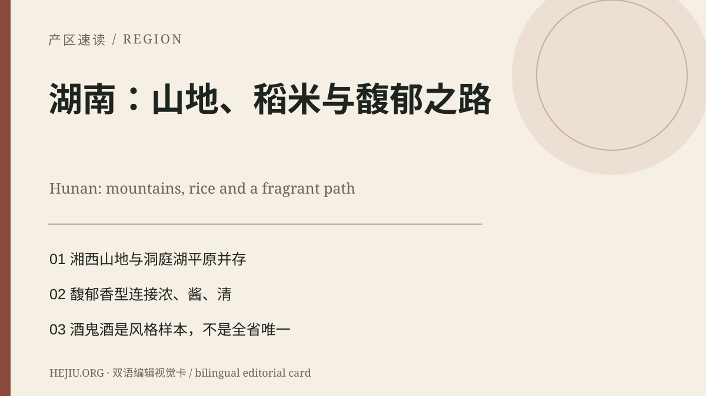

# 湖南省

湖南位于长江中游以南，东、南、西三面环山，北部向洞庭湖平原敞开。湿润、多山、河网密布的地理条件，让湖南的酒类呈现出与北方平原产区不同的面貌：既有高度白酒，也有米酒、黄酒与地方传统发酵酒。

在白酒版图里，湖南最容易被记住的是酒鬼酒与“馥郁香”。但湖南并不只有一种酒：常德的武陵酒走酱香路线，湘西与湘南的米酒、黄酒则更贴近日常饮食。理解湘酒，要把“名酒品牌”和“地方酒类”分开看。

图：湘西凤凰县的沱江，山地与水系塑造了湖南的酿酒地理。图片：Huangdan2060，CC0，via Wikimedia Commons（[原图页面](https://commons.wikimedia.org/wiki/File:Tuo_River_in_Fenghuang_County,_Hunan,_China4.jpg)）。

## 地理与气候

湖南属亚热带季风气候，夏季炎热多雨，冬季湿冷，年降水量大，空气湿度高。湘西、湘南以山地丘陵为主，湘北是洞庭湖平原，湘中则是丘陵盆地。这样的环境对制曲、发酵与贮存都有影响：高温高湿有利于微生物生长，也要求酒厂更严格地控制曲房、窖池与仓库的温湿度。

湘西的河谷与山地，常被用来解释馥郁香的“复合香气”；常德、岳阳等地的平原与湖区，则更适合大规模粮食种植与物流。地理不是风味的唯一原因，但它会通过原料、水质、微生物与贮存条件，改变酒的底色。

图：凤凰沱江上的船工，湘西水运与市井生活的一瞥。图片：Robert Baxter from China（中国），CC0，via Wikimedia Commons（[原图页面](https://commons.wikimedia.org/wiki/File:Boatman_Fenghuang,_Hunan_(9449805344).jpg)）。

## 历史脉络

湖南的酿酒传统与稻作、少数民族饮食和江湖商贸有关。湘西一带的米酒、苞谷酒与民族节庆紧密相连；湘中、湘北则更早接入中原与长江中游的白酒工艺。20 世纪以后，酒鬼酒、武陵酒、湘泉等品牌逐步完成工业化与品牌化。

酒鬼酒在 20 世纪后期以“馥郁香”建立识别度，武陵酒则以酱香型白酒进入湖南名酒序列。两者的共同点是把湖南的湿润气候与复合发酵工艺转化为品牌叙事；不同点在于香型路线、原料结构与产品价格带。地方米酒则更多留在县域与家庭场景，品牌化程度较低。

## 香型与风格

湖南白酒的主线是[白酒](ref:baijiu)中的馥郁香与酱香。馥郁香通常被描述为“浓、清、酱”多种香气并存，入口绵甜，香气复合，回味较长；它不是把三种香型简单混合，而是通过制曲、发酵、蒸馏与贮存形成复合风格。酱香型则强调酱香突出、幽雅细腻、酒体醇厚、空杯留香。

[浓香型](ref:strong)在湖南也有市场，但更多是外来品牌与本地产品的交汇。米酒与[米香型](ref:rice-wine)则属于另一条线：以大米或糯米为原料，口感更清、更甜，酒精度通常较低，适合日常饮用与烹饪。把馥郁香、酱香与米酒混为一谈，会失去湖南酒类的层次。

图：湖南：山地、稻米与馥郁之路。项目自制双语视觉卡，示意性编辑图，不作为实景照片。

## 原料与工艺

湖南白酒常用[高粱](ref:sorghum)、[大米](ref:rice)、[糯米](ref:glutinous)与[水](ref:water)。馥郁香型酒厂通常采用多粮配料与复合曲，强调[制曲](ref:qu)、[发酵](ref:fermentation)与多轮次取酒；酱香型更强调高温制曲、堆积发酵与长期贮存。米酒则更依赖米饭糖化与发酵，工艺路径与白酒不同。

工艺差异会直接反映在标签上：原料表、香型、酒精度、执行标准与生产商，是判断一瓶湖南酒的最短路径。不要只看“湘西”“洞庭”之类地名，它们可能只是品牌叙事，不等于具体产地或工艺。

图：大米是南方米香型白酒与半固态发酵的基础原料。图片：China News Service，CC BY 3.0，via Wikimedia Commons（[原图页面](https://commons.wikimedia.org/wiki/File:20201102.Hengnan.Hybrid_rice_Sanyou-1.6.jpg)）。

## 代表酒款与地方记忆

[酒鬼酒](ref:jiugui)是湖南最具全国认知度的白酒品牌之一，产自湘西吉首，以馥郁香型著称。它的产品线覆盖大众到高端价格带，具体酒款的原料、酒精度与执行标准并不相同。[酒鬼酒股份有限公司](ref:jiugui-brand)是理解品牌与产地关系的入口。

武陵酒是常德酱香型白酒的代表，湘泉则是酒鬼酒体系下的另一条产品线。湖南各地还有米酒、糯米酒、杨梅酒与地方小曲酒，它们更多出现在家庭餐桌、节庆与地方小吃中。对游客，最稳妥的买法是选择标签完整、渠道正规的主流产品；对地方酒，则要先确认甜度、酒精度与保存方式。

## 市场与饮用

湖南白酒的消费场景以宴席、商务与礼品为主，馥郁香与酱香在中高端市场更有话题；米酒与黄酒则更贴近日常餐饮。湘菜重辣、重香、重油，配酒时要注意辣味会放大酒精的灼热感，浓香或馥郁香可以配口味重的菜肴，米酒与低度酒更适合凉菜、甜品与家庭聚餐。

饮用高度白酒时，小杯慢饮比大口快饮更安全；不要用“解酒”名义劝酒。开瓶后的白酒要避光、密封、阴凉保存；米酒与黄酒开瓶后更容易氧化，应冷藏并尽快喝完。

## 法规与产区保护

湖南白酒生产受食品安全法规与国家标准的约束。GB/T 15109-2021 对白酒工业术语、制曲、发酵与蒸馏等环节有定义；GB/T 17204-2021 对饮料酒分类与术语有规定。地理标志、香型名称与企业标准的使用，需要符合相应规则；阅读酒标时，要区分产地、香型、酒精度与生产商。

## 气候与酒类结构

| 区域 | 气候与地貌 | 主要酒类 | 买酒时看什么 |
| --- | --- | --- | --- |
| 湘西（吉首、凤凰） | 山地河谷，湿润多雨 | 馥郁香白酒、米酒 | 香型、原料、生产商 |
| 常德、益阳 | 湖区平原，湿热 | 酱香、浓香白酒 | 执行标准、基酒与贮存 |
| 长沙、株洲、湘潭 | 丘陵盆地，城市集中 | 白酒、米酒、黄酒 | 产品线、渠道与价格带 |
| 湘南（郴州、永州） | 山地丘陵，靠近南岭 | 米酒、地方小曲酒 | 甜度、酒精度与保存 |
| 洞庭湖区 | 平原湿地，农业基础强 | 米酒、白酒 | 原料与产地真实性 |

这张表是宏观对照，不能替代酒厂的具体工艺。湖南同一个地市的不同酒厂，也可能采用完全不同的香型与原料。

## 常见误区

第一，湖南只有酒鬼酒。酒鬼酒是代表品牌，但湖南还有武陵酒、湘泉与大量地方米酒。

第二，馥郁香就是三种香型勾兑。馥郁香是工艺与风味类型，不是把浓香、清香、酱香简单混合。

第三，湘酒都辣。酒体是否“辣”更多取决于酒精度、酸度与饮用温度，不是产地决定。

第四，米酒没有门槛。米酒的甜度、酸度、酒精度与微生物控制同样需要工艺。

第五，配湘菜必须喝高度酒。辣味会放大酒精刺激，低度酒、米酒与充足饮水同样可以配湘菜。

## 馥郁香的品饮与购买

馥郁香型常被描述为“浓、清、酱”之外的另一条路：入口有浓香的粮香与窖香，中段带清香的爽净，落口又出现酱香的焦糊与回味。它不是一个可以用单一化学指标解释的味道，而是制曲、发酵、蒸馏与勾调共同形成的复合表达。第一次喝，不要用“像浓香还是像酱香”逼自己二选一，先记录入口的甜、粮香、酸度与回甘。

温度对馥郁香的影响很明显。18–22°C 的室温、小杯、少量入口，香气层次更容易展开；温度过低会把窖香压住，过高则让酒精感先行。配湘菜时，剁椒、腊味与烟熏会给酒增加咸鲜和烟熏的呼应，但重辣会压低细腻度，先吃一口菜再喝一口酒，比连续干杯更容易判断。

价格上，100–300 元适合日常与朋友聚饮，300–800 元适合宴席与送礼，800 元以上更多是品牌旗舰与收藏属性。购买时优先官方渠道与当地大型商超，核对执行标准、生产日期与瓶码；遇到“酒鬼酒内部版”“洞藏老酒”之类无法核验的说法，先放回货架。

到访湖南可以从吉首、凤凰与长沙三条线安排：湘西看酒鬼酒的地理与民族文化语境，长沙看市场与餐饮场景。酒厂参观与品鉴需要提前查官方预约，不要把景区演出时间当成酒厂开放时间。

## 常见问题

**馥郁香到底是什么香？** 它是酒鬼酒体系最具识别度的复合香型，常被描述为浓、清、酱多种香气并存。它不是把三种香型的酒简单混合，而是由原料、制曲、发酵、蒸馏与贮存共同形成。

**酒鬼酒和湘泉是什么关系？** 两者都属于湘西白酒的品牌叙事，但具体产品、价格与渠道不同。购买时要看生产商、执行标准与酒精度，不能只按品牌名判断。

**武陵酒是什么香型？** 武陵酒以酱香型白酒著称，产自常德。它与湘西馥郁香是两条不同的路线。

**湖南米酒怎么喝？** 米酒可以冷藏后单饮，也可以加热后配餐；甜度高的糯米酒适合小杯慢饮。开瓶后应冷藏并尽快喝完。

**湘菜配什么酒？** 口味重的剁椒、腊味与红烧菜可以配馥郁香或浓香；清蒸、凉菜与米粉可以配米酒、黄酒或低度酒。辣味会放大酒精刺激，别用高度酒硬压。

## 延伸阅读

- [中国](ref:china)：湖南省在中国酒类地理中的位置。
- [白酒](ref:baijiu)：白酒的定义、香型与工艺。
- [浓香型](ref:strong)与[米香型](ref:rice-wine)：湖南酒类的两条对照路线。
- [酒鬼酒](ref:jiugui)与[酒鬼酒股份有限公司](ref:jiugui-brand)：品牌与产地的入口。
- [高粱](ref:sorghum)、[大米](ref:rice)、[糯米](ref:glutinous)与[水](ref:water)：湖南白酒的基础原料。
- [制曲](ref:qu)、[发酵](ref:fermentation)与[勾调](ref:blending)：理解湘酒的三个工艺词。

**关键事实。**

| 项目 | 内容 |
| --- | --- |
| 一句话定位 | 洞庭湖以南的华中省份，馥郁香、酱香与米酒并存 |
| 层级 | 省/大区 |
| 所属 | 中国 |
| 国家代码 | CN |
| 代表线索 | 酒鬼酒、武陵酒、湘泉与地方米酒 |

**来源与边界。** 本页关于「湖南省」的地理、香型与工艺信息，主要由湖南省人民政府、国家标准全文公开系统、中国酒业协会与《The Oxford Companion to Spirits and Cocktails》交叉核对。品牌历史、产品线与价格会变，涉及这些字段时以企业官方当期信息为准。正文为项目自写，来源只作核验，不复制原文。
