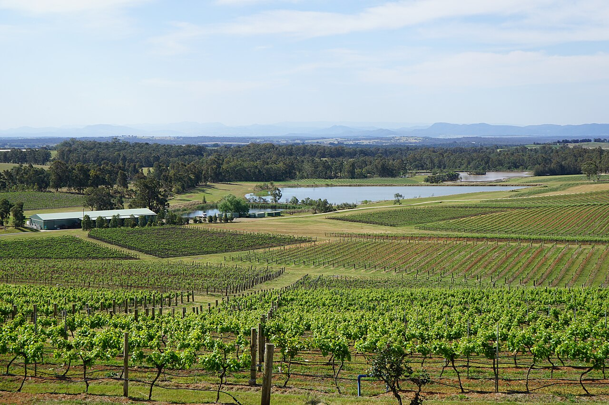
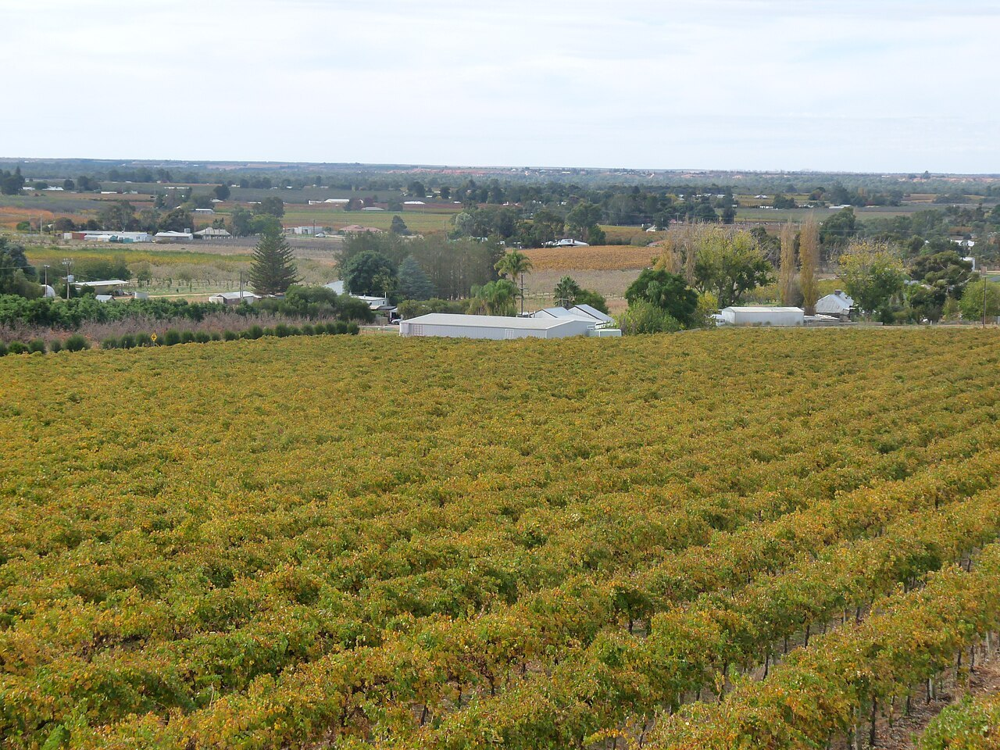

# 猎人谷

澳大利亚新南威尔士州的历史葡萄酒产区，悉尼以北约两小时车程；温暖湿润、以年轻赛美蓉与猎人谷西拉著称，1990 年代获 GI，是澳洲最古老的商业酒区之一。

猎人谷是澳大利亚最古老的商业葡萄酒产区之一，以低酒精、高酸的 Semillon 与泥土气息的 Shiraz 著称；湿度、雷暴与早采，是理解它的关键词。

图：Hunter Valley：Hunter Valley Vineyards (23754582745)（Wikimedia Commons）。图片：thinkrorbot，Public domain，via Wikimedia Commons（[原图页面](https://commons.wikimedia.org/wiki/File:Hunter_Valley_Vineyards_(23754582745).jpg)）。

## 定义与边界

猎人谷是[澳大利亚](ref:australia)新南威尔士州的葡萄酒产区，位于悉尼以北约两小时车程，分为上猎人谷与下猎人谷；Pokolbin、Lovedale、Broke 等地是核心。它以 Semillon 与 Shiraz 著称，是澳大利亚最古老的商业葡萄酒产区之一。

猎人谷不是单一气候区：下猎人谷更暖、更潮湿，上猎人谷海拔更高、夜晚更凉；酒标上的“Hunter Valley”可能覆盖不同风格，子产区与酒庄信息更重要。

它与 Barossa、Clare Valley 不同：猎人谷的湿度更高、下午雷暴更常见，Semillon 常早采、低酒精，Shiraz 更偏泥土与皮革，而不是果酱。

## 历史与命名

猎人谷的葡萄酒史可追溯到 19 世纪 20–30 年代，是澳大利亚最早的商业葡萄种植区之一；19 世纪后期，Semillon、Shiraz 与 Verdelho 已在这里种植。

20 世纪，猎人谷经历洪水、病害与市场变化，部分老园消失；1970–80 年代，Tyrrell’s、Brokenwood 等酒庄重新强调 Semillon 的陈年潜力，让猎人谷成为“老酒天堂”。

“Hunter Valley”以 Hunter River 命名，产区历史与河流、洪水、煤矿与农业社区交织；它不是“悉尼的郊区”，而是一个独立的葡萄酒文化。

猎人谷的早期葡萄酒多用于本地市场，19 世纪的洪水与病害让许多酒庄重建；20 世纪中期，Semillon 成为产区最有辨识度的白葡萄，Tyrrell’s 等家族酒庄保存了老藤与老酒。

猎人谷的“Vat 1”Semillon 从 1960 年代开始装瓶，证明低酒精白葡萄酒可以陈年数十年；这一传统让猎人谷在国际上获得“Semillon 圣地”的名声。

猎人谷的 Semillon 之所以能低酒精陈年，与当地早采传统有关：酒农在糖分还不高时就采收，留下高酸与青柠，让酒在瓶中慢慢发展出蜂蜜与烤面包。

## 地理与风土

猎人谷位于 Hunter River 河谷，西侧是 Brokenback Range，东侧是平原；温暖湿润的亚热带气候，夏季下午常有雷暴与冰雹，湿度高，病害压力大。

土壤以冲积土、红棕土与砂土为主，河谷底部排水差、湿度高；坡地与丘陵排水更好，成熟更慢。Semillon 常种在较凉的坡地，Shiraz 在谷底与坡地都有。

猎人谷的关键是“早采”：Semillon 常在酒精 10–11% 时采收，保留高酸与青柠；Shiraz 则在成熟与酸度之间平衡，避免过熟与果酱。

猎人谷的下午雷暴常来得又快又猛，冰雹会打伤果皮、引发灰霉；酒农通过疏叶、通风与选择性采收来降低风险。湿度高，也让有机种植更困难。

Brokenback Range 的山影与谷风让夜晚降温，Semillon 得以保留酸度；谷底的冲积土更肥沃、产量更高，坡地的红棕土更瘦、风味更集中。

## 原料与风格

[赛美蓉](ref:semillon)（Semillon）是猎人谷的旗帜：年轻时刻薄、青柠、草本与矿物，酒精度低；陈年后出现蜂蜜、烤面包、坚果与蜡质，常被比作“白葡萄酒里的雷司令”。

[西拉](ref:syrah)（Shiraz）带黑莓、黑樱桃、泥土、皮革与胡椒，酒体中等到饱满，单宁细；与 Barossa 的果酱风格比，它更偏大地与香料。Chardonnay 与 Verdelho 也有种植。

猎人谷的 Semillon 不适合用橡木桶，多数在不锈钢罐发酵，以保留酸度与纯净果味；Shiraz 部分用旧桶，避免过度橡木。

猎人谷 Semillon 的酿酒方式很“反直觉”：早采、低酒精、不锈钢罐、不过桶，年轻时甚至显得瘦；陈年后才出现蜂蜜、烤面包与坚果。

Shiraz 常带泥土、皮革、黑莓与胡椒，酒体中等到饱满；部分酒庄用整串发酵与旧桶，风格更香料、更轻。Chardonnay 则更饱满、更柑橘。

## 代表生产者与酒款

Tyrrell’s 的“Vat 1”Semillon、Brokenwood 的“Graveyard”Shiraz、McWilliam’s 的“Mount Pleasant”是猎人谷的代表；这些酒款展示 Semillon 的陈年与 Shiraz 的泥土感。

猎人谷的酒庄多兼做旅游与餐饮，酒标常标“Hunter Valley”与酒庄名；读背标的年份与酒精，比看酒庄建筑更能判断风格。

Tyrrell’s 的“Vat 1”与“Vat 9”、Brokenwood 的“Graveyard”、McWilliam’s 的“Mount Pleasant”是猎人谷的经典；这些酒款的年份差异很大，老酒比新年份更值得试。

猎人谷的 Semillon 老酒常以“Vat”编号命名，Tyrrell’s 的 Vat 1 是最著名的例子；这些酒款的年份差异比酒庄差异更大，买之前先试同年份的不同酒庄。

## 上桌方式

Semillon 温度 8–10°C，用中等口径白酒杯；年轻酒配海鲜、沙拉与亚洲香料，老酒配烤鸡、坚果与奶油酱汁。Shiraz 温度 16–18°C，配烤肉、野味与硬质奶酪。

猎人谷 Semillon 不适合过度冰镇，低温会压住青柠与草本；老酒只需换瓶，不需要长时间醒酒。

猎人谷 Semillon 配生蚝、寿司与越南菜时，青柠与草本能切油、提鲜；老酒配烤鸡、蘑菇与奶油酱汁，蜂蜜与坚果风味更明显。Shiraz 配烤肉与硬质奶酪，泥土感与脂肪很搭。

## 选购与误区

买猎人谷 Semillon 先看年份：年轻酒清爽，5–10 年后出现蜂蜜与烤面包；老酒价格高，但储存条件比年份更重要。买 Shiraz 看酒庄风格，Tyrrell’s 更经典，Brokenwood 更饱满。

常见误读：把猎人谷当成 Barossa 的凉爽版本；以为 Semillon 只能早饮；以为 Shiraz 都是果酱。猎人谷的 Semillon 可以陈年，Shiraz 更泥土、更皮革。

猎人谷 Semillon 的老酒常带“烤面包”与“蜂蜜”，不是氧化坏酒；如果酒液颜色过深、酸度消失，才可能是储存问题。买老酒时，看酒庄历史与储存条件，比看年份更重要。

## 参见

- [澳大利亚](ref:australia)：新南威尔士产区与法规。
- [赛美蓉](ref:semillon)：猎人谷的旗舰白葡萄。
- [西拉](ref:syrah)：猎人谷的红葡萄。
- [白葡萄酒](ref:white)：白葡萄的发酵与风格。
- [红葡萄酒](ref:red)：红葡萄的发酵与结构。

猎人谷的 Semillon 与 Shiraz 都适合在 5–10 年内饮用，老酒则要确认储存历史；买之前先试单瓶，比整箱更稳。

**关键事实。**

| 项目 | 内容 |
| --- | --- |
| 一句话定位 | 澳大利亚新南威尔士州的历史葡萄酒产区，悉尼以北约两小时车程；温暖湿润、以年轻赛美蓉与猎人谷西拉著称，1990 年代获 GI，是澳洲最古老的商业酒区之一 |
| 层级 | 省/大区 |
| 所属 | 澳大利亚 |
| 国家代码 | AU |

**来源与边界。** 本页关于「猎人谷」的关键事实，主要由以下来源交叉核对：Wine Australia（澳大利亚葡萄酒产区、GI 与产业框架）、Tourism Australia（澳大利亚葡萄酒产区的旅行与地理背景）、OIV（葡萄酒定义与全球生产框架）等 4 条来源。价格、批次与状态会变，涉及这些字段时以页面所列来源的最新版本为准。正文为项目自写，来源只作核验，不复制原文。

## 相关图像

图：Sémillon - Joseph Daurel。图片：Imprimerie A. Bellier & Cie - Bordeaux，CC0，via Wikimedia Commons（[原图页面](https://commons.wikimedia.org/w/index.php?curid=94839238)）。关联图像：猎人谷。

图：Renmark South Australia Vineyard。图片：Feral Arts，CC BY 2.0，via Wikimedia Commons（[原图页面](https://commons.wikimedia.org/w/index.php?curid=9069567)）。关联图像：猎人谷。
