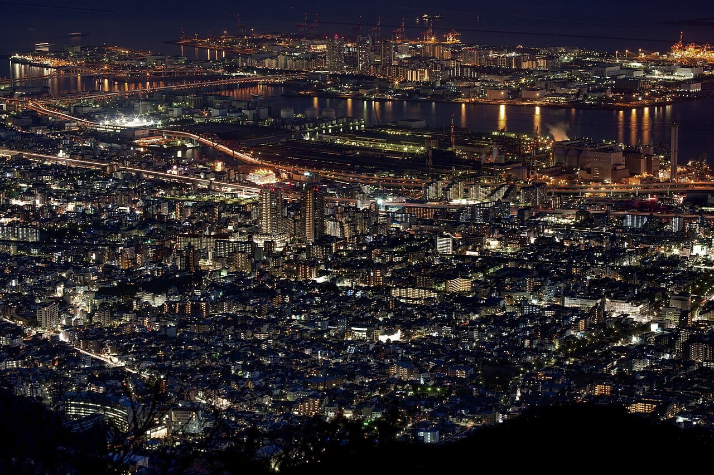
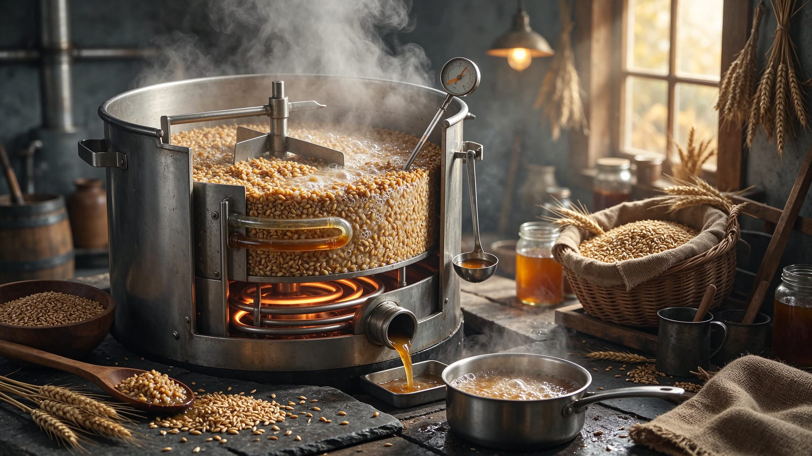
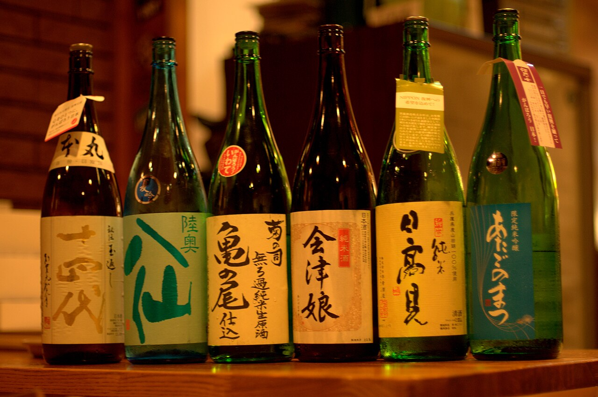

# 兵库县

兵库县的清酒名声常被压缩成两个词：滩与宫水。这个概括不算错，却漏掉了制度层面的关键变化——2018 年 6 月 28 日，“灘五郷”被日本国税厅长官指定为酒类地理的表示（GI），成为受生产基准约束的产地名称，而不只是历史地名。要理解兵库清酒，需要同时看沿海的滩五乡、内陆的酒米产区、以及纯米与吟酿这两条不同的产品路线。

图：兵库县。图片：Laitr Keiows，CC BY-SA 3.0，via Wikimedia Commons（[原图页面](https://commons.wikimedia.org/wiki/File:Night_view_of_Rokk%C5%8D_Island_and_Higashinada-ku,_Kobe,_Japan.jpg)）。

> **先给结论**
> **一句话：** 这页判断兵库县的风味与旅行价值，以及怎么安排。
>
> - **适合谁：** 正在比较兵库县与其他产区、准备买酒或安排旅行的人。
> - **不适合谁：** 只想要“哪个产区最贵”的结论、不关心风格和年份的人。
> - **先看这两点：**
>   - 兵库县位于日本近畿地方，北临日本海，南接濑户内海，县厅所在地为神户。
>   - 滩五乡冬季受来自西侧的季节风影响，六甲山方向的风沿坡下沉，形成所谓“六甲おろし”，带来适合低温发酵的寒冷条件。

## 地理：六甲山与濑户内海之间

兵库县位于日本近畿地方，北临日本海，南接濑户内海，县厅所在地为神户。清酒产业最集中的滩五乡位于神户市滩区、东滩区、芦屋市与西宫市的沿海地带，北靠六甲连峰，南面大阪湾，东西延伸约 10 公里。滩五乡由西乡、御影乡、鱼崎乡、西宫乡与今津乡五个区域组成，这一划分来自历史上的酒造聚落，不是行政等级。县内还有伊丹、姬路、加古川、丹波与神户北区等产地；把兵库等同于滩五乡，会忽略这些以不同水源与酒米为基础的小产区。

## 气候：六甲风与冬季寒造り

滩五乡冬季受来自西侧的季节风影响，六甲山方向的风沿坡下沉，形成所谓“六甲おろし”，带来适合低温发酵的寒冷条件。传统清酒在冬季最冷的时段完成仕込み，称为“寒造り”；低温让发酵缓慢、香气细腻，也降低杂菌风险。春季前后进行火入，夏季在桶中或罐中熟成，到秋季香味整合，这就是“秋上がり”。其中不重新加热、在气温下降后直接出货的酒，称为“冷卸”（ひやおろし），滩五乡传统上在 9 月以后上市。夏季高温高湿则是另一面，现代酒藏依靠温控设备维持全年生产。

## 水：宫水的硬度与低铁

滩五乡的核心自然条件是宫水。它取自西宫一带的地下水，流经六甲山系的砂砾层，属于硬水，含有适量钙、钾与磷酸，铁含量极低。铁会促进氧化并使酒液着色，是清酒酿造最需要避免的杂质；适度的矿物质则支持酵母繁殖与发酵，使酒体更有骨架。宫水因此被视为滩酒辛口风格的物质基础。县内其他水源的硬度与矿物组成不同，酿出的酒往往更柔和或更轻，不能把宫水当作全县的默认条件。滩五乡酒造组合与神户市、西宫市还长期开展地下水调查与宫水保存调查，说明水源并非取之不尽的固定资源。

## 米：山田锦的 1923 年与 1936 年

兵库是山田锦的代表产区。1923 年，兵库县立农事试验场以“山田穗”为母本、“短稈渡船”为父本进行人工杂交，经过选育固定，1936 年作为兵库县奖励品种登记并命名。山田锦的特点是心白大、颗粒饱满、吸水与溶解较快，适合高精米步合与吟酿类香气；但稻秆较高、容易倒伏，栽培管理要求高，产量受气候影响明显。兵库县内并非只有山田锦，五百万石、雄町等酒米也在使用；不同酒米的心白大小与蛋白质含量不同，直接改变[制曲](ref:qu-making)与[糖化](ref:saccharification)的表现。酿造使用[稻米](ref:rice)与[水](ref:water)，经精米、洗米、浸渍、蒸米后进入并行复[发酵](ref:fermentation)。

## 法定规则：GI 灘五郷

“灘五郷”于 2018 年 6 月 28 日获得 GI 指定，使用该名称必须满足生产基准。产地范围为神户市滩区、东滩区、芦屋市与西宫市内的滩五乡；原料方面，米与米曲只能使用日本国产米，且须符合农产物检查法 3 等以上；酿造用水只能取自滩五乡境内；酿造、贮藏以及面向消费者的装瓶也必须在区内完成。若使用酿造酒精，其用量不得超过米（含曲米）重量的 25%。GI 证明的是产地与工艺，不是地块分级，也不等同于质量排名；它更接近法国 AOC 的产地逻辑，但没有勃艮第式的园级体系。

## 特定名称与精米步合

日本清酒的特定名称按精米步合与原料区分。纯米大吟酿与大吟酿的精米步合不超过 50%，纯米吟酿与吟酿不超过 60%，纯米与本酿造不超过 70%。纯米类不添加酿造酒精，本酿造允许少量添加以调整香气与口感。吟酿香气来自低温长期发酵与高精米步合，常表现为苹果、梨、香蕉或花香；纯米酒则更强调米香、鲜味与质地。特定名称是标签制度，不是品质排序，同一酒藏的不同产品线可以横跨多个类别。

## 酒母：生酛、山废与速酿

酒母是培养酵母的中间阶段，决定发酵起点与风味走向。生酛依靠天然乳酸菌，并通过“山卸”把米曲与蒸米捣碎，耗时长、操作重、风险高，但能带来更厚的酸度与鲜味；山废（山废酛）省略捣碎步骤，同样依赖天然乳酸菌；速酿则直接添加乳酸，控制稳定、周期短，是现代主流。滩五乡传统上使用大型木桶与低温长期发酵，现代酒藏多改用温控罐，但仍有酒藏保留[生酛与山废](ref:kimoto-yamahai)路线。酒母选择影响风味与风险，不构成等级高低。

## 风格：辛口、秋上がり与冷卸

滩酒常被描述为“男酒”：辛口、酒体扎实、酸度与鲜味平衡、收口干净，适合温饮与佐餐。宫水的矿物质与山田锦的溶解性共同支撑这种骨架。吟酿类则在同一条海岸线上走出另一条路线，强调果香、轻盈与冷饮。与之相对，京都伏见的“女酒”常被形容为柔和、偏甜，这种对照是风格描述，不是产地优劣。秋上がり与冷卸则把时间维度带入风格：同一款酒在春季、夏季与秋季的口感并不相同，标签上的季节词有实际工艺含义。

## 代表酒藏与产品线

滩五乡的代表酒藏包括白鹤（Hakutsuru）、菊正宗（Kikumasamune）、大关（Ozeki）、剑菱（Kenbishi）、樱正宗（Sakuramasamune）、泽之鹤（Sawanotsuru）与白鹿（Hakushika）。它们的产品线通常从本酿造、纯米酒延伸到吟酿与大吟酿，价格从日常餐酒到礼品级都有覆盖；大型酒藏的优势在稳定供应与渠道，小酒藏则以限量、生酒与特定酒米为卖点。姬路的楯野川（Tatsuriki，本田商店）不在滩五乡范围内，却说明兵库清酒并不只依赖沿海水源，内陆酒藏同样可以凭借山田锦与精细精米做出高精米步合的吟酿。

## 市场与年份

日本清酒的国内消费量长期下降，吟酿与纯米类在结构中的比重上升，海外出口成为增长点。兵库县清酒产量位居全国第一，滩五乡又是县内产量最高的区域，但“产量第一”不等于所有酒款都走同一路线。清酒的年份概念弱于葡萄酒，酒米年份、气温与酿造条件仍会影响风味；秋上がり、冷卸、生酒与熟成酒提供了另一种时间标签。评价一款兵库清酒时，产地、酒米、精米步合、酒母与是否加热处理，比单独看“滩”字更有意义。

## 常见误区

第一，认为兵库清酒只有滩五乡。县内还有伊丹、姬路、丹波等产地。
第二，认为宫水到处都有。宫水是特定地下水，不能代表全县水源。
第三，认为生酛一定优于速酿。酒母影响风味与风险，不是等级。
第四，认为山田锦只产自兵库。其他县也种植，兵库是主要产区之一。
第五，认为辛口等于高质量。辛口描述甜度倾向，不构成品质判断。
第六，把 GI 灘五郷 当成葡萄园式分级。它约束产地与工艺，不是地块排名。

## 延伸阅读

- [日本](ref:japan)：日本清酒的产区、制度与消费背景。
- [清酒](ref:sake)：清酒的定义、特定名称与基本工艺。
- [纯米酒](ref:junmai-sake)：不添加酿造酒精的清酒类别。
- [生酛与山废](ref:kimoto-yamahai)：天然乳酸菌培养酒母的传统路线。
- [稻米](ref:rice)与[水](ref:water)：酒米与宫水构成的原料基础。
- [制曲](ref:qu-making)、[糖化](ref:saccharification)与[发酵](ref:fermentation)：并行复发酵的关键环节。

## 相关图像

图：谷物糖化的编辑插图：蒸煮罐、蒸汽、加热结构与取样；AI 辅助绘制，不是工厂实拍。图片：Hejiu 编辑团队，使用豆包 Seedream 5.5 AI 辅助生成；项目自制，不是现场照片（[项目说明](https://hejiu.org/about/)）。关联图像：兵库县。

图：清酒瓶装，精米步合、酒度与日本酒度常决定选购判断。图片：koutalou，CC BY 2.0，via Wikimedia Commons（[原图页面](https://commons.wikimedia.org/wiki/File:Sake_bottles.jpg)）。关联图像：兵库县。
