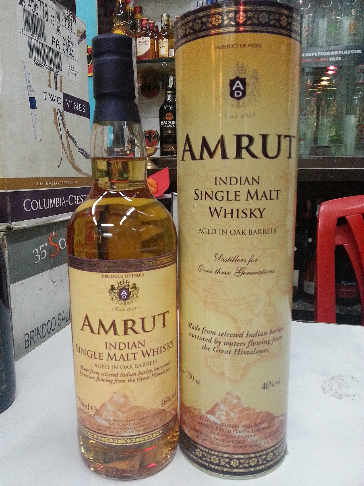

# 印度

印度威士忌的国家级产区，产量居世界前列；原料包括糖蜜中性酒精、谷物与麦芽，风格从大众调和威士忌到单一麦芽都有，热带气候使陈年速度极快。

图：Amrut 印度单一麦芽威士忌，瓶身标注 Indian Single Malt Whisky。图片：User:Vikrambj，CC BY-SA 3.0，via Wikimedia Commons（[原图页面](https://commons.wikimedia.org/wiki/File:Amrut_singlemalt_whisky_2013-06-11_18-39.jpg)）。

## 先划清「印度」的边界
印度是全球产量最大的烈酒市场之一，威士忌是其中最重要的类别。原料可以从糖蜜中性酒精、谷物到麦芽，风格从大众调和到单一麦芽都有。

这里的“产区”是国家层级，不是葡萄酒式地块。标签上的“whisky”不一定等于苏格兰式麦芽威士忌；先看基底（糖蜜/谷物/麦芽）、是否调和、酒精度与生产者，再谈风格。

## 历史与命名

印度威士忌的现代产业与糖蜜酒精、许可制度与大众市场紧密相关；21 世纪后，Amrut、Paul John、Rampur 等单一麦芽进入国际视野，改变了“印度只有调和酒”的印象。

热带气候让陈年速度极快，天使分享每年可达 8–12%；酒厂常用较低年份达到饱满风格。快熟成是优势也是风险：香气来得快，木质与酒精也容易过头。

## 「印度」的地理与风土
主要生产地包括班加罗尔、果阿、北方邦与马哈拉施特拉；各地水源、谷物与气候不同，酒厂分布靠近原料、港口或消费市场。

印度各地气候差异大：南部湿热、北部温差更大、沿海受季风影响。仓库温度与湿度决定熟成速度；同一酒款在不同仓库里可能相差明显，读产区名时要结合蒸馏厂与仓库。

## 原料与风格

原料结构决定风格：糖蜜中性酒精带来干净、廉价的基底，谷物与麦芽增加香气与结构。单一麦芽强调麦芽比例、壶式蒸馏与陈年；调和酒则依靠不同酒液的比例。

风格从轻盈、顺口的日常调和，到浓郁、热带水果与香料感强的单一麦芽。高酒精与甜味要平衡；不要用“印度威士忌”一个词概括所有产品。

## 代表生产者与酒款

代表单一麦芽包括 Amrut、Paul John、Rampur；Amrut 在 2000 年代后进入国际视野，是印度精品威士忌的起点之一。

大众品牌则覆盖更广的价格带。看生产者时，先分清是蒸馏厂自有麦芽，还是采购糖蜜酒精再调和；前者更强调原料与蒸馏，后者更强调配方与价格。

## 「印度」的上桌方式
饮用时先看酒精度与甜度：单一麦芽可净饮或加少量水，调和酒适合加冰或苏打。热带气候下，室温偏高，冰会化得快，最好用大冰块或少加。

配餐适合辛香、油脂与烧烤：咖喱、烤肉、香料炖菜与坚果都能托住酒体。高酒精遇到重辣会放大灼热感，可以先吃一口脂肪或酸奶，再小口喝。

## 选购、标签与误区

标签重点看：基底（molasses/grain/malt）、类别（single malt/blended）、酒精度、陈年与生产者。若只写“whisky”而没有基底，信息不足以判断风格。

常见误区是把印度威士忌都当成“便宜调和”，或把高酒精度当成高品质。印度也有严肃的单一麦芽；开瓶后避光、直立、常温保存，热带气候下尤其要避免高温。

## 「印度」周边怎么走
酒厂参观集中在班加罗尔、果阿与部分北方产区；多数需要预约，交通以包车或自驾为主。

路线安排上，把城市与酒厂分开：班加罗尔周边可做一日，果阿适合与海岸行程结合。印度各地气候与交通差异大，出发前查官网与天气；一次选一到两家，比赶路更有效。

## 进一步阅读

进一步阅读：印度威士忌最容易被两个词耽误——“便宜”和“热带”。便宜只说明大众市场的价格带，不说明杯中物的原料；热带只说明熟成快，不说明风格一定浓。把它们拆开，会看到三条线：糖蜜基底的大众调和、谷物与麦芽的调和、以及单一麦芽。第一条线追求顺口与规模，第二条线在价格与香气之间找平衡，第三条线才强调蒸馏厂、麦芽比例与桶型。对比时先看基底与类别，再看酒精度与陈年；同一酒厂的不同桶型，差异可能比不同酒厂更大。若去班加罗尔或果阿，酒厂预约与交通时间要一起算，不要把“产区”当成一个可以步行看完的街区。

还有一点常被忽略：印度的“单一麦芽”并不自动等于高年份。热带熟成让三年酒也能饱满，买时看酒精度、桶型与批次，比只看数字可靠。若比较两家酒厂，先选同一年份与同一桶型；否则差异可能来自仓库，不是原料。印度各邦税制与销售渠道差异大，同一品牌在不同城市价格可能差很多，旅行时不必把“产区价”当成必然便宜。若只买一瓶，先选一款单一麦芽与一款大众调和对照；价格带不同，但差异不只在价格。

- 相关条目：[scotland](ref:scotland)、[whisky](ref:whisky)、[barley](ref:barley)、[distillation](ref:distillation)、[terroir](ref:terroir)。
关于印度，本页只保留产区与风格信息；地图、实时价格与营业时间请查当地官方渠道。

对照阅读：[苏格兰](ref:scotland)、[大麦](ref:barley)。

相关条目：[威士忌](ref:whisky)。

**关键事实。**

| 项目 | 内容 |
| --- | --- |
| 一句话定位 | 印度威士忌的国家级类别，产量居世界前列；原料包括糖蜜中性酒精、谷物与麦芽，风格从大众调和威士忌到单一麦芽都有，热带气候使陈年速度极快 |
| 层级 | 国家 |
| 国家代码 | IN |

**来源与边界。** 本页关于「印度」的关键事实，主要由以下来源交叉核对：Food Safety and Standards Authority of India（印度酒精饮料法规对威士忌类别、标签与酒精度的框架）、Amrut Distilleries（班加罗尔 Amrut 的单一麦芽产品、原料与热带熟成叙述）、John Distilleries（果阿 Paul John 的单一麦芽产品、原料与无添加/非冷凝过滤描述）等 4 条来源。价格、批次与状态会变，涉及这些字段时以页面所列来源的最新版本为准。正文为项目自写，来源只作核验，不复制原文。

**并读。** 把「印度」与「苏格兰」、「威士忌」、「大麦」放在一起读时，先确认它们是同一层级还是上下游关系：先确认边界与法定分类，再比较气候、土壤、海拔与代表酒款。本页负责给出产区的基本坐标，对照条目补上具体案例与差异；读完再回到本页，才能分清哪些差别属于产区本身，哪些只是产地、批次或品牌选择。

**适用边界。** 对「印度」而言，产区边界、面积与法定分类会随法规更新；气候描述是长期趋势，不是某一年的天气预报。

**更新提示。** 「印度」最近核对于 2026-11-22；面积、法定分类、标签规则与年份表现会变，引用前以法规与产区官方文本为准。
