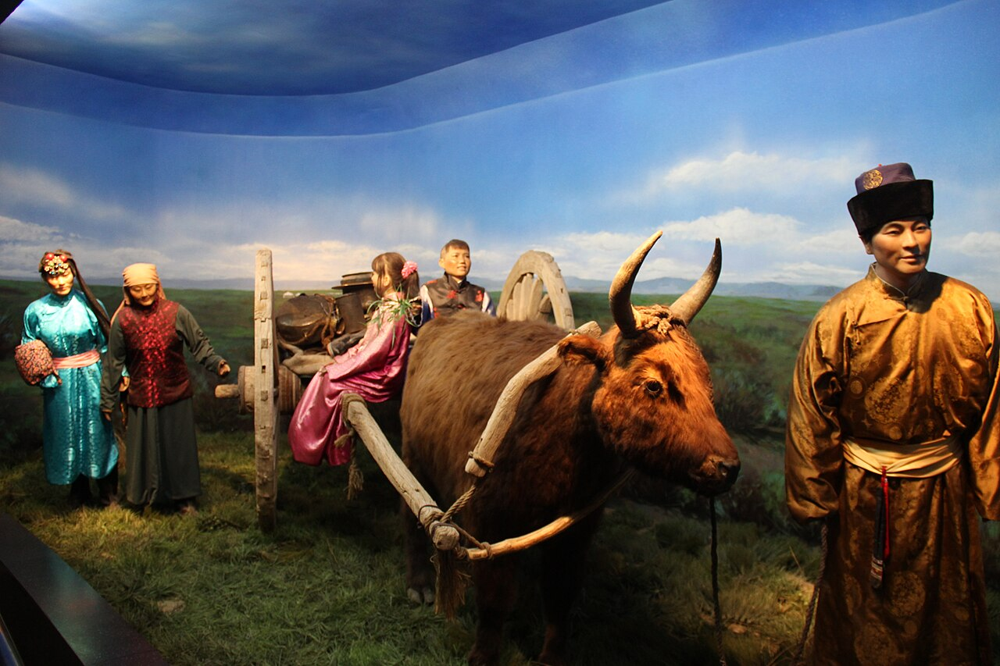
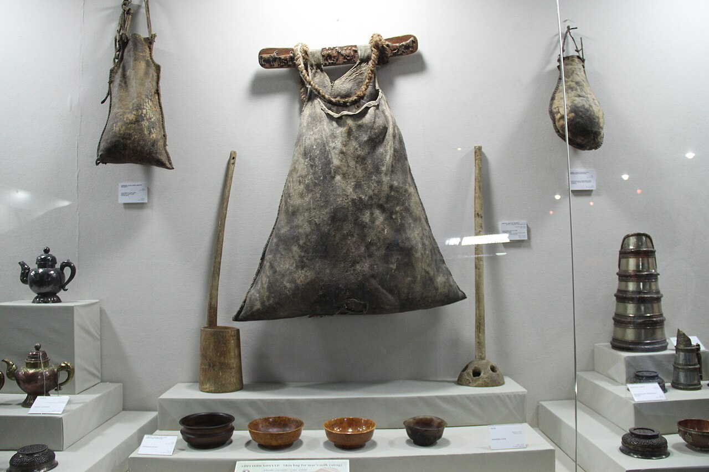
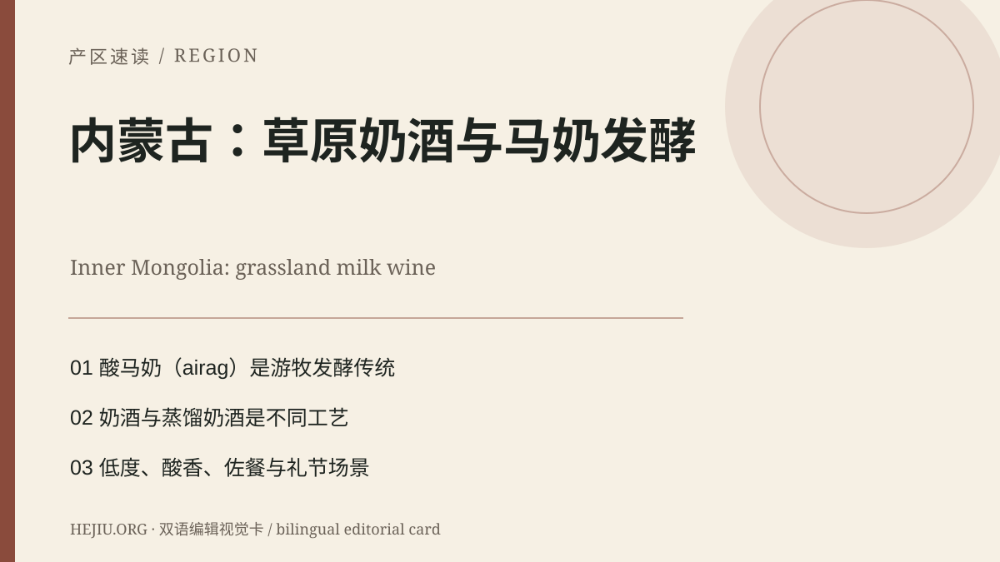
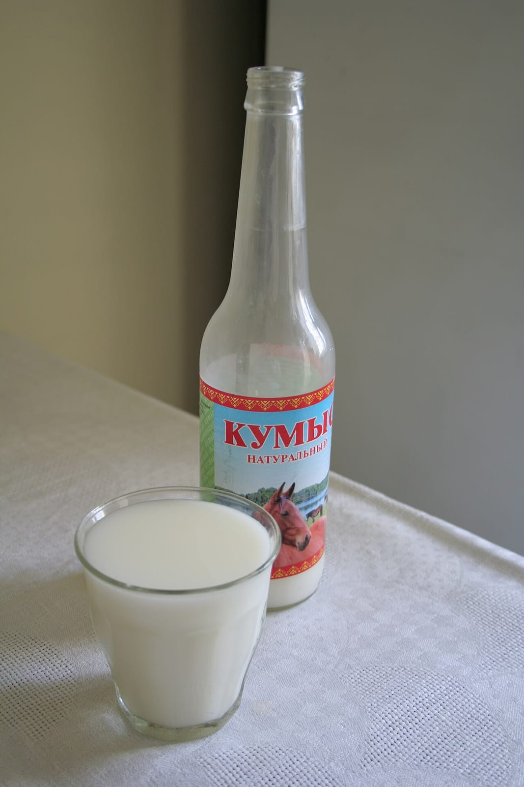

# 内蒙古自治区

内蒙古横亘中国北方，从东北大兴安岭延伸到西北戈壁，草原、沙地、山地与河套平原并存。它不是传统意义上的“白酒大省”，却有两条很鲜明的酒类传统：河套平原的粮食白酒，以及草原上的马奶酒。

把这两条线放在一起看，才能理解内蒙古的酒：河套王、蒙古王代表的是粮食蒸馏酒，酒精度高、宴席属性强；[马奶酒](ref:airag)则是发酵乳酒，酒精度低、带酸度与奶香，和那达慕、牧民生活与待客礼俗相连。两者不是同一种酒，也不该用同一套品鉴标准。

图：内蒙古草原，游牧地理与奶酒传统的背景。图片：Gary Todd from Xinzheng, China，CC0，via Wikimedia Commons（[原图页面](https://commons.wikimedia.org/wiki/File:Inner_Mongolia_Grasslands_Scene_(19170728093).jpg)）。

## 地理与气候

内蒙古地域狭长，东部湿润、西部干旱，中部有阴山与河套平原。河套平原依靠黄河灌溉，小麦、玉米、高粱等作物条件较好，是内蒙古粮食白酒的主要基础；呼伦贝尔、锡林郭勒等草原地区则以畜牧业为主，马奶、牛奶与乳制品丰富。

气候从寒温带向干旱区过渡，冬季漫长寒冷，夏季短促。低温对发酵与贮存是挑战，也意味着酒体不易过快氧化；草原地区的温差与干燥空气，则影响奶酒的发酵与保存。地理条件通过原料、微生物与储存环境作用于酒。

图：蒙古族传统马奶皮囊，酸马奶与奶酒器具的实物参照。图片：Gary Todd from Xinzheng, China，CC0，via Wikimedia Commons（[原图页面](https://commons.wikimedia.org/wiki/File:Mongolian_Traditional_Life_Skin_Bag_for_Mare%27s_Milk_(35575509081).jpg)）。

## 历史脉络

内蒙古的粮食白酒与晋陕移民、河套农业和边境贸易有关。河套平原在清代与近代形成农业与商贸集镇，酿酒作坊随之出现；20 世纪以后，河套酒业、蒙古王等企业完成工业化与品牌化。

马奶酒的历史更久，与草原游牧生活、那达慕、婚礼与待客礼俗相连。传统马奶酒以马奶发酵而成，酸度明显、酒精度低，既可以解渴，也是一种社交饮品。它和粮食白酒的消费场景、工艺与风味完全不同。

## 香型与风格

内蒙古粮食白酒以[浓香型](ref:strong)为主，也有清香与其他风格。河套王、蒙古王是常见的品牌线索，产品覆盖大众到中高端价格带。浓香型的窖香、绵甜与酒体厚度，适合北方宴席与牛羊肉菜肴。

[马奶酒](ref:airag)属于发酵乳酒，不是[白酒](ref:baijiu)。它的酒精度通常较低，风味以乳酸、奶香与轻微气泡感为主，适合冰镇或冷藏饮用。把马奶酒当成“低度白酒”，会误解它的原料、工艺与饮用方式。

图：内蒙古：草原奶酒与马奶发酵。项目自制双语视觉卡，示意性编辑图，不作为实景照片。

## 原料与工艺

粮食白酒以[高粱](ref:sorghum)、[小麦](ref:wheat)、[玉米](ref:maize)与[水](ref:water)为原料，经[制曲](ref:qu)、[发酵](ref:fermentation)、[蒸馏](ref:distillation)与[勾调](ref:blending)制成。河套平原的粮食供应与黄河水，是当地白酒产业的基础；不同酒厂的窖池、曲种与贮存时间，会带来风格差异。

马奶酒以马奶为原料，依靠自然发酵或特定菌种发酵，产生乳酸与少量酒精。它的关键是奶源、温度与发酵时间，而不是蒸馏。传统做法与家庭、牧区生活紧密相关，工业化产品的巴氏杀菌、灌装与冷链则会改变风味。

图：Airag（马奶酒）实物参照，与内蒙古草原奶酒传统相呼应。图片：A.Savin，CC BY-SA 3.0，via Wikimedia Commons（[原图页面](https://commons.wikimedia.org/wiki/File:Kumys-bottle.jpg)）。

## 代表酒款与地方记忆

河套王是河套酒业的代表品牌，产自巴彦淖尔，以浓香型白酒为主；蒙古王是内蒙古另一个常见白酒品牌，产品线覆盖不同价格带。两者常出现在宴席、礼品与商务场景，具体酒款要看标签上的香型、酒精度与生产商。

马奶酒更多以地方品牌、牧民自制与旅游产品出现。那达慕、草原婚礼与蒙古包待客中，马奶酒常与奶食、手把肉一起出现。对游客，正规灌装、冷藏链完整的马奶酒比散装产品更容易确认食品安全。

## 市场与饮用

内蒙古的饮酒场景分化明显：城市宴席与商务以浓香白酒为主，草原旅游与节庆则常见马奶酒。牛羊肉、奶食与面食是常见配菜，浓香型白酒可以配手把肉、烤羊排与火锅；马奶酒适合冰镇单饮或配奶食，不宜与高度白酒混饮。

马奶酒含乳蛋白与乳酸，开瓶后应冷藏并尽快喝完；粮食白酒应避光、密封、阴凉保存。草原地区昼夜温差大，旅游携带时要注意瓶体防冻与防撞。

## 法规与产区保护

内蒙古白酒与马奶酒生产受食品安全法规与国家标准的约束。GB/T 15109-2021 对白酒工业术语、制曲、发酵与蒸馏等环节有定义；GB/T 17204-2021 对饮料酒分类与术语有规定。乳酒、奶酒与白酒的分类不同，标签上的原料、酒精度、执行标准与生产商，是最直接的信息。

## 气候与酒类结构

| 区域 | 气候与地貌 | 主要酒类 | 买酒时看什么 |
| --- | --- | --- | --- |
| 河套平原（巴彦淖尔、包头） | 黄河灌溉平原，温差大 | 浓香型白酒 | 香型、原料、生产商 |
| 呼和浩特、乌兰察布 | 阴山南麓，城市集中 | 白酒、乳酒 | 产品线与渠道 |
| 呼伦贝尔、锡林郭勒 | 草原，寒冷干燥 | 马奶酒、奶酒 | 冷藏链、杀菌与来源 |
| 通辽、赤峰 | 西辽河平原，农业基础强 | 白酒、地方酒 | 执行标准与价格带 |
| 阿拉善、西部 | 干旱戈壁，人口稀疏 | 地方酒、旅游酒 | 来源与保存条件 |

这张表是宏观对照，不能替代酒厂的具体工艺。内蒙古同一个盟市也可能同时存在粮食白酒与乳酒产品。

## 常见误区

第一，内蒙古只有马奶酒。内蒙古有河套王、蒙古王等粮食白酒，也有马奶酒与奶酒。

第二，马奶酒是白酒。马奶酒是发酵乳酒，不是蒸馏白酒，酒精度与风味都不同。

第三，马奶酒越酸越正宗。酸度来自发酵，但过酸可能是发酵失控或保存不当。

第四，草原白酒都烈。酒精度取决于具体产品，不能按产地判断。

第五，马奶酒可以长期常温保存。乳酒开瓶后应冷藏并尽快喝完，常温放置容易变质。

## 奶酒与粮食酒的场景分工

内蒙古的酒桌上常同时出现两类东西：一类是河套王、蒙古王等粮食白酒，另一类是马奶酒（airag）与奶酒。前者是蒸馏酒，酒精度通常较高，讲究香型、酒体与配餐；后者是发酵乳酒，酒精度低、带酸与乳香，更多出现在草原生活、节庆与待客场景。把两者都叫“蒙古酒”可以，但不能互相替代。

奶酒适合冷藏后饮用，温度在 5–10°C 更能保留酸度与气泡感；粮食白酒则适合 18–22°C、小杯慢饮。配餐上，手把肉、烤羊排与奶制品适合粮食白酒的厚味，奶酒更适合作为开场或中场，用酸度清理油脂。第一次喝奶酒不要按白酒的量来，低酒精度不等于可以大量饮用。

购买时，粮食白酒看品牌、执行标准、酒精度与生产日期；奶酒要看配料表是否为生乳发酵、是否添加糖与香精、保质期与冷链条件。旅游景区的“现酿奶酒”如果没有标签与生产信息，只能当作现场体验，不适合长期保存或大量购买。

到访可以围绕呼和浩特、锡林郭勒与呼伦贝尔展开：呼和浩特看博物馆与城市市场，锡林郭勒看草原牧区与奶酒生活，呼伦贝尔看更大尺度的草原与季节性旅游。草原活动与牧户接待受季节影响很大，出发前确认当期是否接待。

## 草原待客与饮酒节奏

草原待客有自己的节奏：先上奶茶与奶食，再上肉，酒不一定最先出现。主人递酒时，双手接、少量喝，比一口闷更得体；如果不能喝，提前说明并以茶或奶代酒，通常比勉强举杯更容易被接受。不要把城市酒桌上的劝酒方式直接搬到牧区，也不要用“喝多少”衡量诚意。

奶酒适合在开场或中场出现，酸度能清理手把肉的油脂；粮食白酒适合正餐后段，小杯慢饮，配肉与奶食。草原昼夜温差大，酒後外出要加衣、避免受凉；长途驾驶或骑马前不饮酒，这一条比任何“解酒偏方”都重要。

如果参加那达慕、婚礼或牧户家宴，先问清活动安排与饮酒习俗，不要自行打开主人的酒柜或给未成年人递酒。拍摄人物、牧民与仪式前先征得同意；把体验当成一次做客，而不是一次“酒文化采风”。

## 常见问题

**马奶酒是白酒吗？** 不是。马奶酒是发酵乳酒，以马奶为原料，酒精度通常较低；白酒是粮食蒸馏酒，工艺与风味都不同。

**马奶酒是什么味道？** 通常带乳酸、奶香与轻微气泡感，酸度明显，适合冰镇或冷藏饮用。过酸可能是发酵失控或保存不当。

**河套王、蒙古王是什么香型？** 两者以浓香型白酒为主，但具体产品线、酒精度与价格不同，买的时候看标签。

**马奶酒怎么保存？** 开瓶后应冷藏并尽快喝完；未开封产品按标签要求的冷藏链与保质期保存。常温放置容易变质。

**草原白酒配什么菜？** 浓香型白酒可以配手把肉、烤羊排、火锅与奶食；马奶酒适合冰镇单饮或配奶食，不宜与高度白酒混饮。

## 延伸阅读

- [中国](ref:china)：内蒙古在中国酒类地理中的位置。
- [白酒](ref:baijiu)：粮食白酒的定义、香型与工艺。
- [浓香型](ref:strong)：内蒙古粮食白酒的主线。
- [马奶酒](ref:airag)：草原发酵乳酒的工艺与饮用。
- [高粱](ref:sorghum)、[小麦](ref:wheat)、[玉米](ref:maize)与[水](ref:water)：河套白酒的基础原料。
- [制曲](ref:qu)、[发酵](ref:fermentation)、[蒸馏](ref:distillation)与[勾调](ref:blending)：理解内蒙古粮食白酒的工艺词。

**关键事实。**

| 项目 | 内容 |
| --- | --- |
| 一句话定位 | 中国北方的草原自治区，河套粮食白酒与草原马奶酒并存 |
| 层级 | 省/大区 |
| 所属 | 中国 |
| 国家代码 | CN |
| 代表线索 | 河套王、蒙古王、马奶酒 |

**来源与边界。** 本页关于「内蒙古自治区」的地理、香型与工艺信息，主要由内蒙古自治区人民政府、国家标准全文公开系统、中国酒业协会与《The Oxford Companion to Spirits and Cocktails》交叉核对。品牌历史、产品线与价格会变，涉及这些字段时以企业官方当期信息为准。正文为项目自写，来源只作核验，不复制原文。
