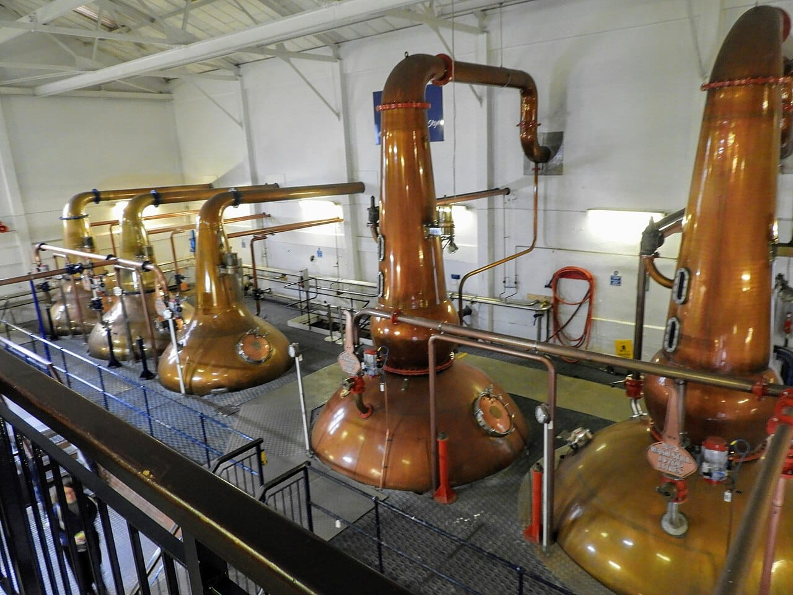
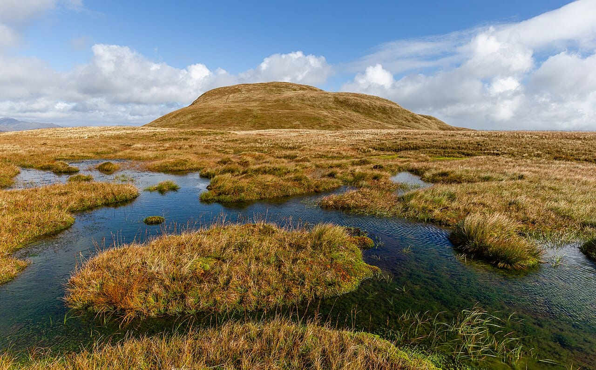

# 岛屿区

苏格兰威士忌的“岛屿区”并非法定产区，而是除艾莱岛以外的岛屿蒸馏厂集合，包括 Arran、Jura、Skye、Lewis、Orkney 等；风格从轻盈花香到泥煤海风都有，不能用一个味道概括。

图：斯凯岛 Talisker 蒸馏厂的铜制壶式蒸馏器。图片：Reading Tom，CC BY 2.0，via Wikimedia Commons（[原图页面](https://commons.wikimedia.org/wiki/File:Stills_at_Talisker_Distillery.jpg)）。

## 先划清「岛屿区」的边界
苏格兰威士忌的法定产区只有 Highland、Speyside、Islay、Lowland 与 Campbeltown；“岛屿区”不是法定产区，而是行业与消费者把艾莱岛以外的岛屿蒸馏厂放在一起的集合名称。

这些酒厂分布在 Arran、Jura、Skye、Lewis、Orkney 等岛屿，风格从轻盈花香到泥煤海风都有。看到“Islands”先确认它只是描述性集合，不是法律等级；具体风格要看蒸馏厂、泥煤值与陈年。

## 历史与命名

岛屿蒸馏厂的历史与海岛农业、渔业、走私与地方燃料相连；许多酒厂在 19 世纪建立，经历关停与重启，近二十年又出现新厂。

“岛屿”这个名字没有统一法规，酒厂可以来自不同行政区。名称的边界与风土的边界并不重合；同一岛屿上也可能有泥煤与无泥煤、海洋感与花香感并存。

## 「岛屿区」的地理与风土
海岛气候湿润、风大，仓库湿度高，熟成速度通常比内陆慢；海风、盐雾与泥煤燃料影响蒸馏厂的原料与干燥方式，但不是每家都使用泥煤。

岛屿风土不是葡萄园坡向，而是海洋、泥煤、水源与仓库。高湿度让酒体更圆、香气更慢展开；同一酒厂的不同仓库与年份批次也会有差异。

## 原料与风格

原料以大麦麦芽为主，泥煤烘干程度决定泥煤风味；壶式蒸馏与陈年容器决定酒体。岛屿风格跨度大：Arran 偏轻盈花果，Jura 带油脂与海风，Talisker 有胡椒与泥煤，Highland Park 带石楠蜜与轻泥煤。

不要用一个“海岛味”概括所有酒。先看泥煤 ppm、蒸馏厂位置与陈年容器，再看酒精度与批次；这些信息比“岛屿区”三个字更能预测风格。

## 代表生产者与酒款

代表酒厂包括 Arran、Jura、Talisker、Highland Park 与 Scapa；参观通常需要渡轮与预约，部分酒厂在冬季缩短开放时间。

看生产者时，区分酒厂自有麦芽与采购麦芽、泥煤来源、蒸馏与仓库位置。大品牌可能把不同酒厂的酒液调和；小酒厂则更强调单一酒厂与批次差异。

## 「岛屿区」的上桌方式
饮用时先确认泥煤强度与酒精度：轻泥煤适合净饮或少量水，重泥煤适合加一点水打开香气；不要用大量冰压住泥煤与海风。

配餐适合海产、烟熏与咸味：熏鱼、牡蛎、海盐奶酪、黑巧克力都能接住泥煤与海洋感。重泥煤配重甜会显得冲突；先吃咸鲜，再小口喝，层次更清楚。

## 选购、标签与误区

标签重点看：酒厂名、泥煤/无泥煤、陈年、酒精度、桶型与批次。若只写“Islands”，它不提供法定产区保证，只是风格提示。

常见误区是把岛屿区当成一个法定产区，或把泥煤当成所有岛屿酒的标配。实际上岛屿内部差异很大；开瓶后避光、直立、常温保存，重泥煤酒更需要慢慢喝。

## 「岛屿区」周边怎么走
岛屿路线通常从苏格兰本土坐渡轮进入：Arran 从格拉斯哥附近出发较方便，Islay 与 Jura 需要更长的船程，Orkney 与 Lewis 更远。

把渡轮班次、天气与酒厂预约放在同一天考虑；冬季风浪会改变行程。一次选一个岛、两家酒厂，比跳岛赶路更现实；不开车时可用当地交通或包车。

## 进一步阅读

进一步阅读：岛屿区最适合用“泥煤—海洋—花果”三条轴来读，而不是记岛名。先看泥煤：无泥煤的 Arran 与重泥煤的 Talisker 不在同一个坐标；再看海洋感：Jura 的油脂与海风、Highland Park 的石楠蜜与轻泥煤，是两种不同的海岛表达；最后看花果与酒体：有的酒厂偏轻盈，有的偏厚。三条轴交叉，才能解释同一岛屿内部为什么也有差异。参观时把渡轮、天气与预约放在一张表里：Arran 相对容易，Islay 与 Jura 需要更长船程，Orkney 与 Lewis 更适合多日行程。不要为了打卡跳岛；一个岛两家酒厂，已经足够建立对比。

如果只选一个岛，先问自己想要哪种体验：Arran 适合从格拉斯哥当天往返，Jura 与 Islay 适合住一晚，Orkney 与 Lewis 需要把飞机或长船程算进去。酒厂之外，岛屿的天气、食物与步行路线也是理解风格的一部分；海风不是抽象词，它会出现在仓库、泥煤与当地人的日常里。买酒时先试小样或酒厂限定，再决定整瓶；岛屿酒产量小，热门批次常在官网先售罄。若时间只够一天，选 Arran 或 Islay 的一个酒厂，别把渡轮与品鉴排得太满。岛上天气变化快，备一件防风外套，比多排一个点实用；酒厂商店常有小样，先试小样，再决定是否买整瓶。再看。

岛屿酒厂的小批次常常只在酒厂或官网发售，出发前先查库存与预约。

- 相关条目：[scotland](ref:scotland)、[whisky](ref:whisky)、[barley](ref:barley)、[distillation](ref:distillation)、[peat-phenol-ppm](ref:peat)。
关于岛屿区，本页只保留产区与风格信息；地图、实时价格与营业时间请查当地官方渠道。

对照阅读：[苏格兰](ref:scotland)、[大麦](ref:barley)。

相关条目：[威士忌](ref:whisky)。

**关键事实。**

| 项目 | 内容 |
| --- | --- |
| 一句话定位 | 苏格兰威士忌的“岛屿区”并非法定产区，而是除艾莱岛以外的岛屿蒸馏厂集合，包括 Arran、Jura、Skye、Lewis、Orkney 等；风格从轻盈花香到泥煤海风都有，不能用一个味道概括 |
| 层级 | 省/大区 |
| 所属 | 苏格兰 |
| 国家代码 | GB |

**来源与边界。** 本页关于「岛屿区」的关键事实，主要由以下来源交叉核对：The Scotch Whisky Association（苏格兰威士忌五个法定产区，以及“Islands”不是法定地区名、岛屿多归入 Highland 的说明，；Highland 包含岛屿、各产区风味差异）、UK Legislation（《Scotch Whisky Regulations 2009》对产区与地理标识的法定框架）、VisitScotland（苏格兰岛屿蒸馏厂参观与岛屿威士忌旅游背景）。价格、批次与状态会变，涉及这些字段时以页面所列来源的最新版本为准。正文为项目自写，来源只作核验，不复制原文。

**并读。** 把「岛屿区」与「苏格兰」、「威士忌」、「大麦」放在一起读时，先确认它们是同一层级还是上下游关系：先确认边界与法定分类，再比较气候、土壤、海拔与代表酒款。本页负责给出产区的基本坐标，对照条目补上具体案例与差异；读完再回到本页，才能分清哪些差别属于产区本身，哪些只是产地、批次或品牌选择。

**适用边界。** 对「岛屿区」而言，产区边界、面积与法定分类会随法规更新；气候描述是长期趋势，不是某一年的天气预报。

## 相关图像

图：苏格兰卢斯丘陵 Doune Hill 下方的泥炭沼泽；这是泥煤产地场景，不是 PPM 测量仪，也不是某款酒的酒液。图片：Michal Klajban，CC BY-SA 4.0，via Wikimedia Commons（[原图页面](https://commons.wikimedia.org/wiki/File:A_peat_bog_below_the_top_of_Doune_Hill,_Luss_Hills,_Scotland.jpg)）。关联图像：岛屿区。

图：威士忌。图片：Guinnog，CC BY-SA 3.0，via Wikimedia Commons（[原图页面](https://commons.wikimedia.org/wiki/File:Whiskyhogmanay2010.jpg)）。关联图像：岛屿区。
