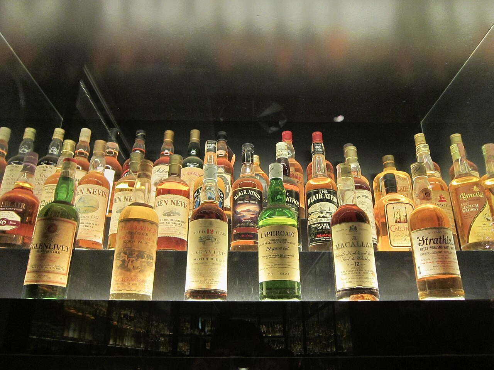

# 艾雷岛

艾雷岛位于苏格兰西海岸外，是内赫布里底群岛中最南的岛屿之一，面积约 600 平方公里，人口约 3200。岛上聚集了苏格兰最密集的酒厂群之一，从南岸的拉弗格、乐加维林与阿贝，到北岸的卡尔里拉与邦纳哈本，再到西岸的布赫拉迪、齐侯门与 2018 年投产的 Ardnahoe。它既是英国法规下的受保护地方名称，也常被当作重泥煤风格的代名词；这两层含义需要分开理解。

图：艾雷岛地区的一处实景。摄影：The scotch whisky experience (Ank Kumar, infosys limited) 01。署名：Ank Kumar，CC BY-SA 4.0，来自 Wikimedia Commons（[来源](https://commons.wikimedia.org/w/index.php?curid=98613535)）。这张照片来自艾雷岛产区内已核实条目，用于说明当地风貌，不是艾雷岛的全区域地图。

## 法定地位与边界

在《2009 年苏格兰威士忌条例》的框架下，艾雷岛与高地、低地、斯佩塞、坎贝尔镇同属受保护的地方名称。标注艾雷岛的苏格兰威士忌必须在该岛蒸馏，并仍然满足苏格兰威士忌的全部法定条件：在苏格兰陈年、使用橡木桶至少 3 年、装瓶酒精度不低于 40% vol。地方名称说明产地，不构成质量等级，也不保证某种风味。岛呈狭长形，南北两端与中部都有酒厂分布，海岸线曲折，公路与渡轮决定了原料和成品进出岛屿的方式。

## 气候与泥炭

岛上受北大西洋暖流影响，冬季温和、夏季不热，降雨频繁、风力强，湿度常年偏高。这种气候不利于谷物干燥，却适合长时间桶陈；仓库的通风与温度波动，往往比“海风”更能解释酒体变化。岛上有大片泥炭沼泽，泥炭由苔藓、石楠与植物残体在半缺氧条件下堆积而成，被用于烘烤发芽大麦。燃烧产生的酚类化合物附着在麦芽表面，形成泥煤风味的来源；泥炭层的深度、植物组成与燃烧温度不同，烟熏的香气也从药味、焦油到篝火、海藻不等。

## 水源与麦芽供应

酒厂水源多为地表水、泉水或井水，例如阿贝使用 Uigeadail 湖一带的水源，拉弗格使用 Kildalton 一带的水。水的矿物组成影响糖化效率与发酵，但酒厂通常更强调稳定供应，而不是把水当作唯一风味来源。传统地板发芽在岛上已大幅减少，多数酒厂从 Port Ellen 的中央发芽厂购入麦芽，并按订单指定酚值（ppm）。这意味着“岛上发芽”并不等于“岛上风格”，真正的差异来自酚值设定、蒸馏切酒与桶型。

## 蒸馏与切酒

岛上酒厂几乎都使用壶式蒸馏器，多数经过两次蒸馏。蒸馏器形状、林恩臂角度、加热方式与冷凝器设计，决定了回流比与铜接触量，进而影响酒体的油脂感、硫味与烟熏强度。切酒是另一道关键：酒头与酒尾的比例、切点早晚，会让同样的泥煤麦芽呈现完全不同的入口强度。重泥煤酒款常保留更多酒尾以增加重量感，轻泥煤酒款则更注重中段的花果与柑橘。

## 南岸与北岸的风格差异

南岸的 Ardbeg、Lagavulin 与 Laphroaig 常被视为重泥煤代表，香气里常见碘酒、焦油、海藻、烟灰与柑橘皮；其中 Ardbeg 的麦芽酚值常被标在 55 ppm 左右，Laphroaig 与 Lagavulin 略低，但入口强度还取决于蒸馏与陈年。北岸的 Caol Ila 泥煤程度中等，风格更偏柑橘、油脂与海水；Bunnahabhain 以无泥煤或轻泥煤为主，酒体厚、带坚果与油润感。西岸的 Bruichladdich 常规款无泥煤，Octomore 系列则把酚值推到 100 ppm 以上，成为“重度烟熏”的实验样本；Kilchoman 是农场型酒厂，从种植大麦到装瓶都在岛上完成。

## 代表酒厂与历史节点

Bowmore 建于 1779 年，是岛上历史最久的持证酒厂之一；Ardbeg 与 Laphroaig 在 1815 年取得执照，Lagavulin 紧随其后；Caol Ila 建于 1846 年，Bruichladdich 与 Bunnahabhain 都始于 1881 年。Port Ellen 在 1983 年停产，长期被视为行业收缩的象征，其存世酒款成为收藏对象；酒厂在 2024 年重新投产，新酒与老酒之间的差异，是观察“复厂如何改变风格”的现实案例。Kilchoman 于 2005 年投产，Ardnahoe 于 2018 年投产，说明岛屿产能仍在扩张。

## 年份、市场与旅游

威士忌酒标上的年份通常是瓶中最低酒龄，而非单一年份收成；艾雷岛的桶源以波本桶为主，雪莉桶与葡萄酒桶用于调味或过桶。市场方面，重泥煤风格在 21 世纪初的单一麦芽热潮中获得溢价，推动了扩产与新建；但泥煤本身面临环保与供应链争议，部分酒厂开始尝试无泥煤产品与本地泥炭替代方案。每年 5 月的 Feis Ile 音乐与威士忌节把酒厂、渡轮与民宿连成一条旅游链，也使岛屿经济更依赖季节性客流。

## 常见误区

第一，艾雷岛等于重泥煤。岛上无泥煤与轻泥煤酒款并不少见，邦纳哈本与布赫拉迪的常规产品就是例子。第二，泥煤酚值越高越艾雷。酚值只是麦芽指标，蒸馏切酒与陈年会大幅改变入口强度。第三，海岛威士忌一定有咸味。海风与仓库位置的影响常被品牌叙事放大，需要具体酒款具体判断。第四，艾雷岛是一个质量等级。它只是受保护的地方名称。第五，烟熏味越重越好。风格偏好没有高下，平衡与完成度才是评价标准。第六，所有艾雷岛酒厂都用岛上发芽的大麦。多数麦芽来自岛外中央发芽厂。

对照阅读：[苏格兰](ref:scotland)、[泥煤（peat）](ref:peat)。

## 延伸阅读

- [苏格兰](ref:scotland)：苏格兰威士忌的法定框架与产区体系。
- [威士忌](ref:whisky)：威士忌的类型与基本工艺。
- [泥炭](ref:peat)：泥煤在烘麦与风味形成中的作用。
- [蒸馏](ref:distillation)：壶式蒸馏与切酒的基本原理。
- [橡木桶陈年](ref:oak-ageing)：桶型与陈年对风格的影响。
- [大麦](ref:barley)：发芽大麦作为威士忌原料。

**关键事实。**

| 项目 | 内容 |
| --- | --- |
| 一句话定位 | 苏格兰内赫布里底群岛中的威士忌岛屿产区，面积约 600 平方公里，人口约 3200；泥炭烘麦带来的酚类、海风与长时间陈年构成其常见印象，但岛上也有无泥煤与轻泥煤酒款，不能把艾雷岛简单等同于重泥煤 |
| 层级 | 其他 |
| 所属 | 苏格兰 |
| 国家代码 | GB |

**来源与边界。** 本页关于「艾雷岛」的关键事实，主要由以下来源交叉核对：UK Government (legislation.gov.uk)（苏格兰威士忌受保护地方名称的范围与法定要求）、Scotch Whisky Association (SWA)（苏格兰威士忌的产区体系、泥煤使用与产业信息）、Oxford University Press（提供关于艾雷岛、泥煤风味与苏格兰蒸馏的条目）等 4 条来源。价格、批次与状态会变，涉及这些字段时以页面所列来源的最新版本为准。正文为项目自写，来源只作核验，不复制原文。
