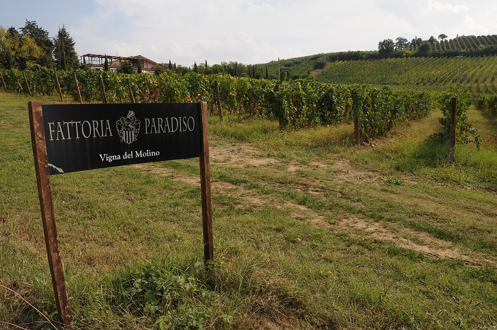
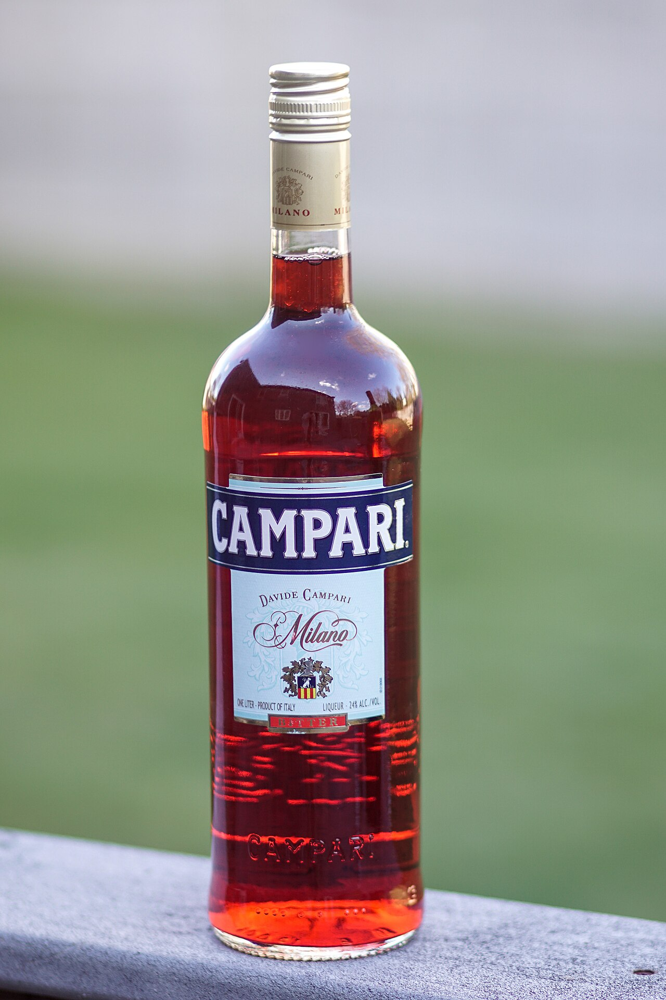
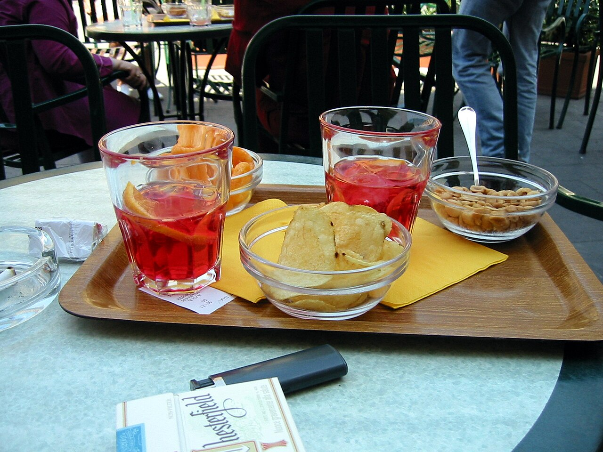

# 意大利

意大利是南欧重要的葡萄酒生产国，20 个大区几乎都产酒。它的特点不是单一风格，而是本土品种、地方传统与分级制度共同形成的多样性：北部有阿尔卑斯山脚下的起泡酒与内比奥罗，中部有托斯卡纳的桑娇维塞，南部与岛屿则多地中海气候下的红葡萄酒与甜酒。

图：意大利。摄影：' 09 - ITALY - Vineyard and signs Emilia Romagna wine - Mollino。署名：Topural 1，CC BY-SA 2.0，来自 Wikimedia Commons（[来源](https://commons.wikimedia.org/w/index.php?curid=35825496)）。

## 地理与气候

意大利位于地中海北岸，国土呈靴形伸入地中海。北部阿尔卑斯山与波河平原形成大陆性气候，冬季寒冷、夏季炎热；中部亚平宁山脉让东西两侧的降水与温差不同；南部与西西里、撒丁受地中海影响，夏季炎热干燥。海拔是重要的调节变量，山坡上的葡萄园往往比平原更凉爽、昼夜温差更大。

气候差异直接影响品种选择与采收。北部成熟期较晚，酸度保留更好，适合起泡酒与高酸红葡萄酒；南部热量充足，糖分上升快，需要通过海拔、采收时间与灌溉管理来保留酸度。不能用一个产区的经验判断整个意大利。

## 「意大利」的时间线
意大利的葡萄种植可追溯到古代，罗马时期已有系统的栽培与酿酒记录。中世纪修道院与地方领主保留了地块与品种传统。20 世纪中期以后，意大利建立 DOC 体系，随后加入 DOCG 与 IGT，形成今天的三级框架。制度化的同时，一批生产者通过“超级托斯卡纳”等方式突破原有规则，推动了对品种与国际市场的重新讨论。

## 葡萄酒大区与子产区

- 皮埃蒙特：以巴罗洛、巴巴莱斯科的内比奥罗著称，也有起泡酒与白葡萄酒。
- 威尼托：从瓦波利切拉红葡萄酒到普罗塞克起泡酒，风格跨度大。
- 托斯卡纳：基安蒂、蒙塔希诺与保格利，桑娇维塞与赤霞珠都有代表。
- 弗留利与上阿迪杰：以白葡萄酒与本土品种见长。
- 坎帕尼亚、普利亚、西西里与撒丁：地中海气候下的红葡萄酒、甜酒与本土品种。

这些大区内部还有更细的 DOCG 与 DOC 产区。产区名称越具体，通常意味着品种、产量与陈年规则越细，而不是质量自动更高。

## 「意大利」的品种与风格坐标
意大利品种极为多样。[桑娇维塞](ref:sangiovese)是托斯卡纳的核心红品种，酸度高、带酸樱桃与草本气息；内比奥罗颜色浅、单宁与酸度高，适合长期陈年；威尼托的科维纳、坎帕尼亚的艾格尼科都有地方特色。白葡萄方面，灰皮诺、特雷比奥罗、卡塔拉托等分布广泛。

同一品种在不同大区会呈现不同风格。[红葡萄酒](ref:red-wine)在北部可能更轻盈、酸度更高，在南部则更成熟、酒体更饱满；[白葡萄酒](ref:white-wine)从清瘦矿物型到浓郁果味型都有。品种与产区的匹配，比单看品种名更能解释瓶中风格。

## 代表酒款与生产者

[西施佳雅](ref:sassicaia)是托斯卡纳保格利的代表，以赤霞珠与品丽珠为主，说明意大利酒也可以在既有分级之外形成独立身份。日常消费中，[金巴利](ref:campari)是意大利苦味[开胃酒](ref:aperitif)的代表，常见于餐前饮用与调酒。除此之外，巴罗洛、布鲁奈罗、普罗塞克等类型都有自己的代表性生产者。

意大利酒款的命名常同时包含产区、类型与酒庄，阅读酒标时要区分“产区名”和“酒庄名”。具体酒款还会受年份、酿造与陈年方式影响，不能仅凭产区推断。

## 法规与分级

意大利葡萄酒大致分为 DOCG、DOC 与 IGT 三类，并与欧盟的 PDO/PGI 体系衔接。DOCG 通常对产区、品种、产量、陈年与标签要求更严；DOC 覆盖范围更广；IGT 更强调地方特色与灵活性。分级保证的是规则与产地，不等于每一瓶的感官质量。

“超级托斯卡纳”是理解制度与市场关系的好例子：部分酒款曾因品种或工艺不符合当时规则而只能标为日常餐酒，后来通过 IGT 与独立产区获得身份。法规会变化，酒标上的类别也要结合年份看。

## 气候与土壤数据

| 区域 | 气候 | 主要土壤 | 代表酒类 |
| --- | --- | --- | --- |
| 西北部（皮埃蒙特、瓦莱达奥斯塔） | 大陆性，秋季多雾 | 石灰岩、泥灰岩、砂土 | 内比奥罗红葡萄酒、起泡酒 |
| 东北部（威尼托、弗留利） | 阿尔卑斯与亚得里亚海过渡 | 砾石、冲积土 | 起泡酒、白葡萄酒 |
| 中部（托斯卡纳、翁布里亚） | 地中海与大陆性过渡 | 砾石、黏土、石灰岩 | 桑娇维塞红葡萄酒 |
| 南部与岛屿 | 地中海，夏季炎热干燥 | 火山土、石灰岩、砂土 | 红葡萄酒、甜酒 |

这张表是宏观对照，具体地块的土壤与朝向仍需看单个产区。把大区气候当成酒款风格保证，会忽略海拔与年份的作用。

## 烈酒与苦味酒

意大利也生产格拉帕（Grappa）、柠檬酒（Limoncello）与苦味酒（amaro）等。格拉帕以葡萄渣蒸馏，属于果渣白兰地；苦味酒以草本、根茎与糖调制，常作为餐后酒。它们与[葡萄酒](ref:wine)共享产地文化，但原料与工艺不同，不能归入葡萄酒类别。

## 市场与饮用

意大利是重要的葡萄酒出口国，国内消费以餐饮与日常饮用为主。起泡酒常见于庆祝与餐前场景，红葡萄酒适合搭配肉类与奶酪，白葡萄酒适合海鲜与轻食。饮用温度、杯型与开瓶后的保存都会影响体验；对具体酒款，酒标上的产区、年份、酒精度与类别是最直接的信息。

## 「意大利」容易被读错的地方
第一，意大利酒都是高酸、番茄味。品种与产区差异很大，不能一概而论。

第二，DOCG 一定比 DOC 好。分级保证规则，不保证每瓶质量。

第三，意大利只有葡萄酒。它也有起泡酒、苦味酒、格拉帕与啤酒等。

第四，超级托斯卡纳都是赤霞珠。不同酒款的品种比例差异很大。

第五，陈年越久越好。适饮期取决于酒款结构与保存条件。

## 参考资料
- [葡萄酒](ref:wine)：理解意大利的分类、酿造与产区框架。
- [红葡萄酒](ref:red-wine)与[白葡萄酒](ref:white-wine)：两类基本风格与工艺。
- [起泡酒](ref:sparkling)：普罗塞克与传统法起泡酒的差别。
- [桑娇维塞](ref:sangiovese)：托斯卡纳核心品种。
- [西施佳雅](ref:sassicaia)：保格利产区的代表酒款。
- [橡木桶陈年](ref:oak-ageing)：意大利红葡萄酒的桶陈传统。

## 相关图像

图：金巴利。图片：Kenneth C. Zirkel，CC BY-SA 4.0，via Wikimedia Commons（[原图页面](https://commons.wikimedia.org/wiki/File:Bottle_of_Campari_(United_States).jpg)）。关联图像：意大利。

图：开胃酒。图片：Wikimedia Commons contributor，Public domain，via Wikimedia Commons（[原图页面](https://commons.wikimedia.org/wiki/File:Aperitif_Campari_Soda.jpg)）。关联图像：意大利。
