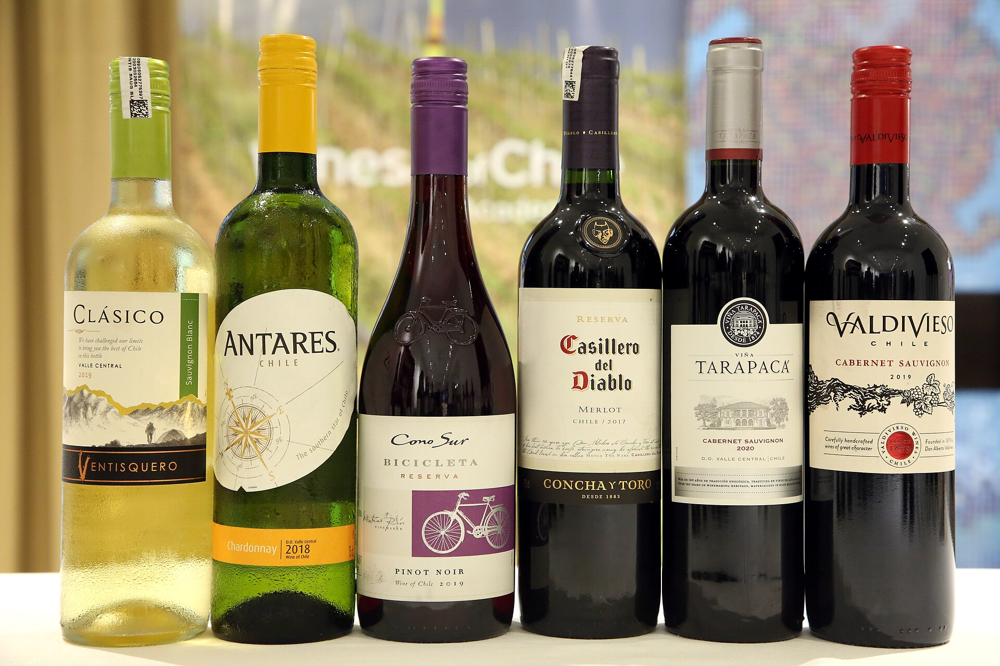

# 伊塔塔谷

伊塔塔谷（Valle del Itata）是智利南部的传统葡萄酒产区，以老藤 País、Moscatel 与 Cinsault 闻名。它不属于中央山谷，而是 Sur 产区内的一个 Subregión，气候更凉、降雨更多，许多葡萄园仍采用旱作。

图：伊塔塔谷地区产业实景。图片：https://www.chile.gob.cl/india/noticias/lanzamiento-de-wines-of-chile-academy-en-dependencias-de-la-embajada，CC0，via Wikimedia Commons（[原图页面](https://commons.wikimedia.org/wiki/File:Vinos_chilenos.jpg)）。这张照片用于说明伊塔塔谷的实际风貌，不是伊塔塔谷的全区域地图。

## 定义与范围

按智利第 464 号法令，伊塔塔谷是 Región del Sur 下的一个 Subregión，范围覆盖 Ñuble 与 Biobío 一带。子产区内按市镇划分 Áreas，包括 Chillán、Quillón、Portezuelo 与 Coelemu。

按 Wines of Chile 的品种面积口径，伊塔塔谷主要品种合计约 1 万公顷：País 3,877 公顷、Moscatel de Alejandría 3,675 公顷、Cinsault 831 公顷、Chardonnay 754 公顷、Cabernet Sauvignon 250 公顷、Carmenère 211 公顷、Syrah 199 公顷、Pinot Noir 175 公顷。SAG 2024 年统计的 Sur 产区合计约 7,000 公顷，与品种面积口径略有差异。

## 「伊塔塔谷」的时间线
伊塔塔谷的葡萄种植可追溯到 16 世纪的殖民时期，País（Listán Prieto）随早期移民进入南美。19 世纪，产区形成以老藤与旱作葡萄园为基础的酿酒传统。

20 世纪，产区经历市场变化与种植结构调整，部分老藤被保留下来。2010 年代以后，酿酒师重新关注 País、Cinsault 与 Moscatel 老藤，伊塔塔谷因此进入精品葡萄酒视野。

## 地理与气候

伊塔塔谷位于智利南部，地中海气候受太平洋影响明显：冬季降雨较多，夏季干燥但不如中央山谷炎热，生长季温度较低，成熟期更长。

产区地形以低丘与河谷为主，海拔不高，海风与冷空气可以深入内陆。旱作葡萄园依赖冬季土壤储水，干旱年份的水分压力会限制产量；这也是许多老藤葡萄园低产、风味集中的原因之一。

土壤以花岗岩风化土、火山沉积物与片岩为主，肥力较低、排水较好。贫瘠土壤限制长势，配合旱作与老藤，形成较小的产量与较集中的风味。这些差异构成[风土](ref:terroir)基础。

## 法定 Áreas

伊塔塔谷的 Áreas 以市镇边界划定：

- Chillán：产区北部，河谷与低丘并存，老藤分布较多。
- Quillón：谷地地形，土壤与水分条件差异明显。
- Portezuelo：内陆地块，旱作葡萄园比例较高。
- Coelemu：靠近沿海方向，受海洋影响更强，温度更温和。

就「伊塔塔谷」而言，Áreas 是法定地理名称，不是质量等级。酒标上更具体的地名通常意味着更集中的原料来源，但不必然代表更高品质。

## 品种与原料

País 是伊塔塔谷面积最大的品种，常带红果、干草与香料气息，酒体较轻、单宁柔和；Moscatel de Alejandría 带花香与柑橘气息，可用于干型或甜型；Cinsault 带红樱桃与香料，酒体轻盈。Chardonnay、Cabernet Sauvignon、Syrah 与 Pinot Noir 也有种植。

原料是[葡萄](ref:grape)。老藤与旱作是产区的重要特征，但老藤不等于高品质，年份、地块与酿造同样重要。

## 「伊塔塔谷」怎么做出来
红葡萄经除梗与温控[发酵](ref:fermentation)，País 与 Cinsault 常采用较短浸渍与较低温度，以保留果味与香气；部分酒庄使用整串发酵或旧[橡木桶](ref:oak-ageing)，避免新桶掩盖品种特征。Moscatel 依风格决定是否保留残糖。

白葡萄低温发酵。Chardonnay 部分经橡木桶与酒泥搅拌，部分保持不锈钢罐的清爽风格。产区的传统酿造与精品化路线并存，酒款风格差异较大。

## 法规与酒标

智利葡萄酒的产地标识受第 464 号法令与相关法规管理。D.O. 酒款须来自划定产区；酒标标注品种时，传统品种在混酿中须至少占 85%。法令另设 Secano Interior 特殊名称，用于旱作条件下的特定产区酒款，但它也是地理与栽培条件的标识，不是质量等级。

Reserva、Gran Reserva 等术语没有统一的陈年或质量强制标准，不能当作法定质量等级。Región、Subregión、Zona 与 Área 是不同层级的法定地理名称。

## 「伊塔塔谷」的酒标与喝法
酒标应核对 D.O. 名称、品种、[年份](ref:vintage)、[酒精度](ref:abv)、容量与装瓶者。标注[单一品种](ref:single-varietal)的酒款须满足品种比例；混酿按法规列出品种。País 与 Cinsault 建议 14–16 摄氏度，Chardonnay 建议 10–12 摄氏度，Moscatel 依风格可在 8–10 摄氏度。

País 与 Cinsault 适合禽肉、猪肉与炖菜；Moscatel 适合作为开胃酒或搭配水果与甜点；Chardonnay 适合海鲜与奶油类菜肴。开瓶后冷藏并尽快喝完。本页关于伊塔塔谷的内容涉及酒精饮料；过量饮酒有害健康，未成年人不应饮酒。

## 「伊塔塔谷」容易被读错的地方
第一，把伊塔塔谷当成中央山谷的一部分。它属于 Sur 产区，气候与种植传统不同。
第二，认为 País 只适合粗放酒。老藤 País 可以酿造精细、轻盈的红葡萄酒。
第三，把 Secano Interior 当成质量等级。它标识旱作条件与产区，不评价酒质。
第四，把 Reserva 当成质量等级。智利没有统一的 Reserva 陈年标准。
第五，以为老藤一定更好。老藤产量低、风味集中，但年份与酿造同样决定品质。

**关键事实。**

| 项目 | 内容 |
| --- | --- |
| 一句话定位 | 智利 Sur 产区内 Valle del Itata 子产区，范围覆盖 Ñuble 与 Biobío 一带，法定 Áreas 包括 Chillán、Quillón、Portezuelo 与 Coelemu；按 Wines of Chile 的品种面积口径，主要品种合计约 1 万公顷，País 3,877 公顷、Moscatel de Alejandría 3… |
| 层级 | 其他 |
| 所属 | 智利 |
| 国家代码 | CL |

**来源与边界。** 本页关于「伊塔塔谷」的关键事实，主要由以下来源交叉核对：Servicio Agrícola y Ganadero (SAG), Chile（Región del Sur、Valle del Itata 子产区、Áreas 划分与 Secano Interior 特殊名称；Sur 产区的面积与全国占比）、Wines of Chile（伊塔塔谷的品种面积、气候、土壤与风格描述）、OIV（补充核对条目背景、术语与制度口径）。价格、批次与状态会变，涉及这些字段时以页面所列来源的最新版本为准。正文为项目自写，来源只作核验，不复制原文。

**并读。** 把「伊塔塔谷」与「葡萄酒」、「白葡萄酒」、「红葡萄酒」放在一起读时，先确认它们是同一层级还是上下游关系：先确认边界与法定分类，再比较气候、土壤、海拔与代表酒款。本页负责给出产区的基本坐标，对照条目补上具体案例与差异；读完再回到本页，才能分清哪些差别属于产区本身，哪些只是产地、批次或品牌选择。

**适用边界。** 对「伊塔塔谷」而言，产区边界、面积与法定分类会随法规更新；气候描述是长期趋势，不是某一年的天气预报。

## 参考资料
- [葡萄酒](ref:wine)：理解伊塔塔谷的类别、年份与产地规则的入口。
- [红葡萄酒](ref:red-wine)与[白葡萄酒](ref:white-wine)：伊塔塔谷两大酒类的基本框架。
- [赤霞珠](ref:cabernet)、[西拉](ref:syrah)与[黑皮诺](ref:pinot-noir)：产区的常见红品种。
- [霞多丽](ref:chardonnay)：产区的主要白品种。
- [葡萄](ref:grape)：酿酒葡萄的结构与成熟指标。
- [发酵](ref:fermentation)：País 与 Cinsault 的低温短浸渍。
- [酸度](ref:acidity)：南部气候与旱作对酸度的影响。
- [风土](ref:terroir)：花岗岩、火山沉积与片岩如何影响成熟。
- [橡木桶陈年](ref:oak-ageing)：旧桶与整串发酵对品种表达的影响。
- [干型](ref:dry)：Moscatel 从干型到甜型的风格。
- [年份](ref:vintage)：伊塔塔谷的年份差异与降雨影响。
- [单一品种](ref:single-varietal)：品种标注的比例规则。
- [酒精度](ref:abv)：酒标上 % vol 的含义。

## 相关图像

图：年份（vintage）。图片：Chiusi Painter，Public domain，via Wikimedia Commons（[原图页面](https://commons.wikimedia.org/wiki/File:Cup_vintage_Cdm_Paris_320_n1.jpg)）。关联图像：伊塔塔谷。

图：葡萄酒。图片：André Karwath，CC BY-SA 2.5，via Wikimedia Commons（[原图页面](https://commons.wikimedia.org/wiki/File:Red_and_white_wine_in_glass.jpg)）。关联图像：伊塔塔谷。
