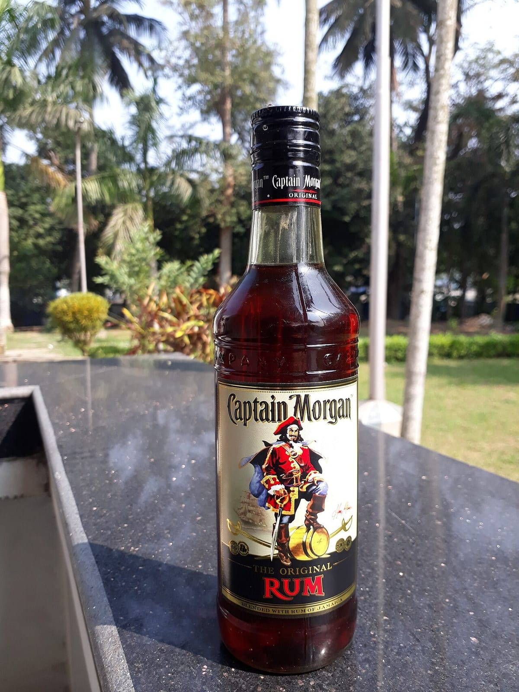

# 牙买加

牙买加是加勒比海中的岛国，也是[朗姆酒](ref:rum)最重要的产区之一。它以糖蜜为原料，通过长时间发酵与壶式蒸馏得到高酯、厚重、带强烈果香与溶剂感的酒液，这种风格常被描述为“funky”；同时，牙买加也生产适合调酒的轻盈白朗姆。

图：牙买加地区实景。图片：Acampbell3000，CC BY 3.0，via Wikimedia Commons（[原图页面](https://commons.wikimedia.org/wiki/File:Appleton_Estate_Jamaica_November_2012.jpg)）。这张照片用于说明牙买加的实际风貌，不是牙买加的全区域地图。

## 地理与甘蔗

牙买加位于加勒比海北部，属热带海洋性气候，全年温暖、降水分布不均。岛上石灰岩与河谷平原交错，甘蔗种植与制糖业在殖民时期形成规模，糖蜜因此成为朗姆酒最便利的原料。

甘蔗种植与制糖的规模会影响朗姆酒产业：糖厂与酒厂常常共生，糖蜜的新鲜度与成分直接进入发酵环节。把产地等同于风味并不准确，发酵与蒸馏才是牙买加风格的核心。

## 朗姆的历史

牙买加的朗姆酒生产与 17 世纪加勒比种植园经济密切相关。糖蜜发酵蒸馏后得到的酒液便于运输与交易，朗姆酒也成为船员、种植园与港口城市生活的一部分。18 世纪，朗姆酒贸易扩张，牙买加逐渐形成以重酒体为特色的产区形象。

19 世纪以后，蒸馏技术与发酵管理进步，牙买加既能生产高酯重酒体，也能生产较轻盈的产品。20 世纪，白朗姆在调酒市场扩张，陈年朗姆与高酯风格则在近年重新受到关注。

## 原料与发酵

牙买加朗姆酒主要使用糖蜜，部分产品也使用甘蔗汁。糖蜜加水稀释后接种酵母，发酵时间可能从数天到两周以上。较长的[发酵](ref:fermentation)与野生微生物参与会产生更多酯类与酸类，形成香蕉、熟果、菠萝与溶剂般的香气。

传统工艺会使用“dunder”（蒸馏残液）与“muck”（培养微生物的残渣）来延续风味，这些做法提高了酯类生成的风险与控制难度。现代酒厂通过菌种管理、温度控制与卫生规范提高稳定性，但高酯风格仍依赖发酵与蒸馏的配合。

## 蒸馏与风格

牙买加朗姆酒传统上使用壶式[蒸馏](ref:distillation)，保留更多酯类与厚重酒体；柱式蒸馏则得到更轻盈、干净的产品。许多酒厂同时使用两种蒸馏器，再以不同比例调配，形成从轻盈白朗姆到高酯陈年朗姆的产品线。

高酯风格不是缺陷，而是产区特征。酯类带来强烈的果香与“溶剂感”，在纯饮时可能显得浓烈，在调酒中则能穿透糖与果汁。酒标上的“overproof”表示酒精度明显高于常规产品，常见白朗姆的 overproof 版本可达 63% vol 左右，饮用时需注意稀释与安全。

## 产区与生产者

牙买加的主要朗姆酒生产者集中在岛上中西部与南部，代表性酒厂包括 Appleton Estate、Hampden Estate、Worthy Park 与 Monymusk 等。不同酒厂的发酵时间、蒸馏器与陈年策略差异明显，因此“牙买加朗姆”内部并不统一。

产区名称可以帮助判断风格传统，但不是质量保证。小酒厂与大型酒厂、壶式与柱式、白朗姆与陈年朗姆，都会影响最终产品。购买时应看原料、蒸馏方式、陈年声明与酒精度，而不是只认产地。

## 陈年与饮用

陈年朗姆在橡木桶中进行，参见[橡木桶陈年](ref:oak-ageing)。热带陈年温度高、蒸发快，数年即可带来明显颜色与香草、焦糖、干果风味。白朗姆通常经过过滤，颜色浅、风味轻，适合莫吉托与代基里；高酯陈年朗姆适合纯饮或用于强调风味的调酒。

颜色深浅不能直接等同于陈年长度，焦糖着色也会影响外观。饮用高酯朗姆时，少量加水或加冰可以降低酒精刺激并打开香气；用于调酒时，糖与青柠的比例需要根据酒体的强度调整。

## 常见误区

第一，认为牙买加朗姆都很甜。高酯风格强调的是香气与酒体，不等于高糖。
第二，把“funky”当成质量问题。它是发酵与蒸馏造成的风格特征。
第三，认为所有牙买加朗姆都是深色。白朗姆与 overproof 白朗姆同样常见。
第四，把产地名称当成等级。产区只说明传统与规则背景。
第五，忽视酒精度。overproof 产品需要稀释，纯饮时应格外注意。

牙买加朗姆的识别点是糖蜜、长时间发酵与壶式蒸馏带来的高酯、厚重“funky”风格，同时也生产较轻盈的白朗姆。高酯不是缺陷，而是工艺与微生物作用的结果；产地名称不是质量等级，读酒标时要看酯值、蒸馏方式、陈年与是否调和。牙买加的高酯风格来自特定酵母、长发酵与壶式蒸馏，酯值高低是可以标注和比较的技术信息；“funky”只是感官描述，不是质量等级。读酒标时把风格词与工艺参数分开。

对照阅读：[朗姆酒](ref:rum)、[蒸馏](ref:distillation)。

## 延伸阅读

- [朗姆酒](ref:rum)：朗姆酒的原料、蒸馏与类别框架。
- [发酵](ref:fermentation)：长时间发酵与酯类生成的技术基础。
- [蒸馏](ref:distillation)：壶式与柱式蒸馏对酒体的影响。
- [橡木桶陈年](ref:oak-ageing)：陈年朗姆颜色与风味的来源。

**关键事实。**

| 项目 | 内容 |
| --- | --- |
| 一句话定位 | 加勒比海岛国与朗姆酒的重要产区；以糖蜜、长时间发酵与壶式蒸馏形成高酯、厚重的“funky”风格，同时也生产轻盈的白朗姆 |
| 层级 | 国家 |
| 国家代码 | JM |

**来源与边界。** 本页关于「牙买加」的关键事实，主要由以下来源交叉核对：Jamaica Rum（牙买加朗姆酒的产区、原料与风格表达）、WIRSPA（加勒比朗姆酒的生产背景与地理标志讨论）、European Union（朗姆酒的原料类别与最低酒精度）等 4 条来源。价格、批次与状态会变，涉及这些字段时以页面所列来源的最新版本为准。正文为项目自写，来源只作核验，不复制原文。

**并读。** 把「牙买加」与「朗姆酒」、「发酵」、「蒸馏」放在一起读时，先确认它们是同一层级还是上下游关系：先确认边界与法定分类，再比较气候、土壤、海拔与代表酒款。本页负责给出产区的基本坐标，对照条目补上具体案例与差异；读完再回到本页，才能分清哪些差别属于产区本身，哪些只是产地、批次或品牌选择。

**适用边界。** 对「牙买加」而言，产区边界、面积与法定分类会随法规更新；气候描述是长期趋势，不是某一年的天气预报。

**更新提示。** 「牙买加」最近核对于 2026-11-05；面积、法定分类、标签规则与年份表现会变，引用前以法规与产区官方文本为准。

## 相关图像

图：一瓶 Captain Morgan 原味朗姆酒，深色酒液与品牌标签。图片：Pinakpani，CC BY-SA 4.0，via Wikimedia Commons（[原图页面](https://commons.wikimedia.org/wiki/File:Bottle_of_Captain_Morgan_Rum_01.jpg)）。关联图像：牙买加。

图：发酵。图片：Tjhackmann，CC BY-SA 4.0，via Wikimedia Commons（[原图页面](https://commons.wikimedia.org/wiki/File:Phylogenetic_tree_of_bacteria_and_archaea,_highlighting_those_that_carry_out_fermentation.png)）。关联图像：牙买加。
