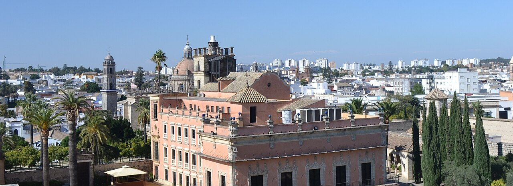

# 赫雷斯

赫雷斯（Jerez）是[西班牙](ref:spain)安达卢西亚加的斯省南部的[加强酒](ref:fortified-wine)产区，包含赫雷斯-谢雷斯-雪莉与曼萨尼亚-桑卢卡尔-德巴拉梅达两个法定产区。它以帕洛米诺为主，用 solera 与 criaderas 的叠桶系统熟成。

图：赫雷斯。图片：Annie and Andrew，CC BY 2.0，via Wikimedia Commons（[原图页面](https://commons.wikimedia.org/wiki/File:(Jerez_de_la_Frontera)_DSC_0560_(6271831479)_(cropped).jpg)）。

## 定义与范围

赫雷斯不是一个单一产区名，而是两个相邻的法定产区：赫雷斯-谢雷斯-雪莉（Jerez-Xérès-Sherry）与曼萨尼亚-桑卢卡尔-德巴拉梅达（Manzanilla-Sanlúcar de Barrameda）。两者由同一监管委员会管理，但曼萨尼亚的熟成地点与风格要求不同。

英语中的 Sherry 是这类酒的通用称呼，中文常译作“雪莉”。酒标上可能出现 Jerez、Xérès 或 Sherry 等写法；判断身份时应以法定产区名称与酒种为准，而不是只看商品名。

## 历史脉络

赫雷斯的葡萄酒贸易在近代与英国市场紧密相连，Sherry 一词也由此进入英语。20 世纪逐步建立法定产区制度，强化酒精度、熟成方式与酒种名称被写入法规。

历史形成的酒种体系非常完整：从轻盈干型的 Fino 到浓郁的 Oloroso，再到甜型的 Pedro Ximénez，覆盖了从开胃酒到餐后酒的需求。理解这套体系，比记住某个品牌更重要。

## 地理与气候

产区位于伊比利亚半岛南端，靠近大西洋，气候属温暖的地中海型，夏季炎热、冬季温和，年降雨集中在秋冬。大西洋湿度与海风影响酒窖中的酒花生长。

土壤以当地称为 albariza 的白垩质土壤为主，保水性强、表面易结壳，能在干旱季节为葡萄提供水分。产区内部以赫雷斯、桑卢卡尔与埃尔波多黎各等地为核心，不同地点的湿度差异影响生物陈酿。

## 品种与原料

主要品种是帕洛米诺（Palomino Fino），酸度不高、香气中性，适合强化与长期熟成；甜型酒使用佩德罗-希梅内斯与麝香葡萄。原料是[葡萄](ref:grape)。

帕洛米诺在成熟时需要控制产量以保留酸度，因为强化与氧化会进一步降低清新感。甜型酒的葡萄则常经过日晒晾干，以提高糖分浓度。

## 酿造与熟成体系

基酒完成[发酵](ref:fermentation)后，按目标酒种进行强化，再进入熟成系统。solera 是叠桶系统：最底层为 solera，上面依次为第一、第二 criaderas；装瓶时从 solera 取出部分酒液，再用上一层的酒补入，逐层向上补液。

这种“取出与补入”（saca y reposición）使不同年份的酒液持续混合，形成稳定的风格。熟成使用[橡木桶](ref:oak-ageing)，桶容量通常不大，曼萨尼亚的规定要求不超过 1000 升。

## 生物陈酿与氧化陈酿的分界

两条路径的分界首先是[酒精度](ref:abv)：准备走生物陈酿的基酒强化至约 15% vol，酒花酵母可以在酒面形成一层“酒花膜”，在缺氧条件下消耗酒精与氧气，产生面包、杏仁与咸鲜气息；准备走氧化陈酿的基酒强化至至少 17% vol，酒花无法存活，酒液直接与氧气接触。

生物陈酿（crianza biológica）以 Fino 与曼萨尼亚为代表；氧化陈酿（crianza oxidativa）以 Oloroso 为代表。Amontillado 与 Palo Cortado 走的是“先生物、后氧化”的连续路径：先在酒花下熟成，酒花衰退后再提高酒精度并转入氧化熟成。

法定最短熟成时间通常为两年；曼萨尼亚必须在桑卢卡尔-德巴拉梅达的酒窖中完成至少两年的生物陈酿。

## 主要酒种

- Fino：干型，生物陈酿，酒精度约 15%–17% vol，色浅，带杏仁、面包与咸鲜，适合冰镇后作为开胃酒。
- Manzanilla：干型，生物陈酿，只能在桑卢卡尔-德巴拉梅达生产，风格比 Fino 更轻盈、更咸鲜，常带洋甘菊气息。
- Amontillado：先生物后氧化，颜色比 Fino 深，带榛子与咸鲜，酒精度通常高于 Fino。
- Oloroso：氧化陈酿，酒精度至少 17% vol，颜色深，带核桃、焦糖与香料，酒体更饱满。
- Palo Cortado：先生物后氧化，香气接近 Amontillado，酒体接近 Oloroso，产量稀少。
- Pedro Ximénez 与 Moscatel：甜型，常以日晒葡萄酿制，糖分高，口感浓郁。

## 酒标与年份

酒标通常标注法定产区名称、酒种、酒精度、容量与装瓶者。酒种名称是识别风格的核心信息；Fino、Manzanilla、Oloroso 等词不能互换使用。

标有“en rama”的酒款通常过滤较少，风格更接近酒窖原样，但它不是法定酒种分类。多数赫雷斯酒为无年份的 solera 混合体系，少数酒款会标注年份。

## 市场与饮用

Fino 与曼萨尼亚适合冷藏后饮用，建议温度约 7–10 摄氏度，开瓶后应尽快喝完；Oloroso 与 Amontillado 适合稍高温度，约 12–15 摄氏度。

Fino 与曼萨尼亚适合搭配海鲜、橄榄、火腿与炸物；Oloroso 适合搭配野味、菌菇、硬质奶酪与炖菜；甜型酒适合搭配甜点与蓝纹奶酪。本页关于赫雷斯的内容涉及酒精饮料；过量饮酒有害健康，未成年人不应饮酒。

## 常见误区

第一，把 Sherry 当成一种甜酒。Fino 与曼萨尼亚都是干型。
第二，把生物陈酿与氧化陈酿混为一谈。两者的强化酒精度与酒花状态不同。
第三，把 Manzanilla 当成 Fino 的别名。它只能在桑卢卡尔-德巴拉梅达生产。
第四，认为 Amontillado 只是“陈年更久的 Fino”。它经历了从生物到氧化的路径转换。
第五，把 solera 当成单一陈年酒。它是多层级、持续补液的混合系统。

## 延伸阅读

- [西班牙](ref:spain)：赫雷斯所属的国家产区框架。
- [加强酒](ref:fortified-wine)：强化酒的类别与工艺框架。
- [葡萄](ref:grape)：赫雷斯所用葡萄的成熟度、酸度与单宁判断。
- [发酵](ref:fermentation)：基酒酿造的基础环节。
- [橡木桶陈年](ref:oak-ageing)：solera 与 criaderas 使用的容器。
- [葡萄酒](ref:wine)：理解赫雷斯的类别、年份与产地规则的入口。
- [酒精度](ref:abv)：15%–17% vol 在生物与氧化路径中的意义。

**关键事实。**

| 项目 | 内容 |
| --- | --- |
| 一句话定位 | 西班牙安达卢西亚加的斯省南部的加强酒产区，包含赫雷斯-谢雷斯-雪莉与曼萨尼亚-桑卢卡尔-德巴拉梅达两个法定产区；以帕洛米诺为主，用 solera 与 criaderas 的叠桶系统熟成，按酒花生物陈酿与氧化陈酿两条路径分出 Fino、Manzanilla、Amontillado、Oloroso 与 Palo Cortado 等酒种 |
| 层级 | 其他 |
| 所属 | 西班牙 |
| 国家代码 | ES |

**来源与边界。** 本页关于「赫雷斯」的关键事实，主要由以下来源交叉核对：Consejo Regulador（赫雷斯的产区、品种、强化酒精度与生物/氧化陈酿路径；由原条目末尾参考资料迁移，未逐条复核访问日期）、Junta de Andalucía（曼萨尼亚必须在桑卢卡尔-德巴拉梅达酒窖中生物陈酿至少两年；由原条目末尾参考资料迁移，未逐条复核访问日期）、European Union（欧盟加强酒类别、地理标志与标签规则）等 7 条来源。价格、批次与状态会变，涉及这些字段时以页面所列来源的最新版本为准。正文为项目自写，来源只作核验，不复制原文。

## 相关图像

图：加强葡萄酒。图片：Jon Sullivan，Public domain，via Wikimedia Commons（[原图页面](https://commons.wikimedia.org/wiki/File:Port_wine.jpg)）。关联图像：赫雷斯。

图：Uga - Lanzarote - Spain. Vineyards -U16。图片：Luis Miguel Bugallo Sánchez，CC BY-SA 3.0，via Wikimedia Commons（[原图页面](https://commons.wikimedia.org/w/index.php?curid=17458062)）。关联图像：赫雷斯。
