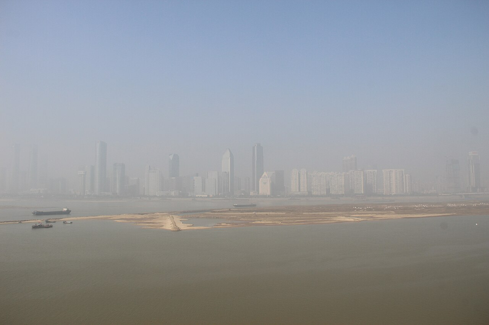
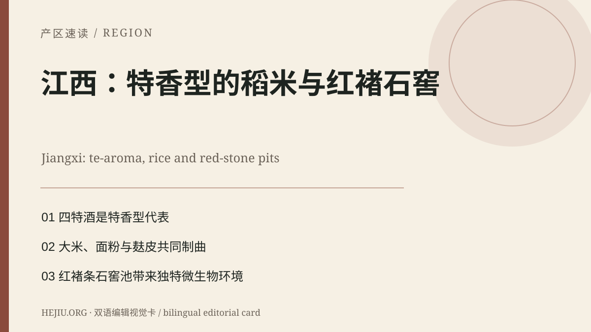

# 江西省

江西位于长江中下游以南，东、南、西三面环山，北部是鄱阳湖平原，赣江自南向北贯穿全省。红壤、丘陵、稻田与丰沛降水，构成典型的江南农业景观，也为大米酿酒提供了长期基础。

江西白酒在全国版图上最独特的坐标，是四特酒与特香型。它不像浓香那样以窖香取胜，也不像清香那样以“清、净”见长，而是把浓、清、酱的某些特征复合在一起。理解江西酒，关键是理解“复合”不是“混合”，以及大米原料如何支撑这种风格。

图：从滕王阁俯瞰赣江，江西水系与城市的关系。图片：Gary Todd from Xinzheng, China，CC0，via Wikimedia Commons（[原图页面](https://commons.wikimedia.org/wiki/File:Gan_Jiang_River_Viewed_from_Top_of_Tengwangge_(Prince_of_Teng_Pavilion)_(31431802671).jpg)）。

## 地理与气候

江西属亚热带季风气候，夏季炎热多雨，冬季湿冷，春秋较短。鄱阳湖平原水网密布，赣南、赣东与赣西以山地丘陵为主，赣中则是吉泰盆地。这样的地形让江西既有大规模稻作，也有相对封闭的地方酿酒传统。

湿热气候有利于微生物生长，也对曲房、窖池与仓库的温湿度控制提出更高要求。四特酒所在的樟树，位于赣中平原与丘陵过渡带，水运与稻米供应便利；赣南、赣东的山地则保留更多米酒、糯米酒与地方小曲酒传统。

图：南昌滕王阁，赣文化地标与江南楼阁建筑。图片：xiquinhosilva，CC BY 4.0，via Wikimedia Commons（[原图页面](https://commons.wikimedia.org/wiki/File:%E6%BB%95%E7%8E%8B%E9%98%81_2024-08-05_12.jpg)）。

## 历史脉络

江西的酿酒传统与稻作、水运、商帮和药都文化有关。樟树历史上是药材与商贸重镇，饮食与酿造业发达；四特酒在 20 世纪完成国营化与工业化，逐步成为江西白酒的代表。李渡、章贡王等品牌则分布在南昌进贤、赣州等地，构成江西白酒的另一个层次。

江西也是中国革命的红色文化区域，地域叙事常与山川、稻田、古窖与手工酿造结合。但品牌故事不等于酒质，消费者仍要回到原料、工艺、香型与价格。

## 香型与风格

江西最具代表性的白酒香型是[特香型](ref:te-aroma)。特香型通常被描述为“浓、清、酱三香兼具”，酒体清亮，香气复合，入口绵甜，回味较长。它不是把三种基酒按比例勾兑，而是通过原料、制曲、发酵、蒸馏与贮存的组合，形成复合香气。

[浓香型](ref:strong)与[清香型](ref:light)在江西也有市场，但特香型的识别度最高。江西还有米酒、糯米酒与黄酒，它们与稻作饮食更贴近。把特香型当成“浓香加酱香”，会忽略它在原料与工艺上的独立路径。

图：江西：特香型的稻米与红褚石窖。项目自制双语视觉卡，示意性编辑图，不作为实景照片。

## 原料与工艺

特香型白酒以[大米](ref:rice)为主要原料，使用[水](ref:water)与复合曲完成[制曲](ref:qu)、[固态发酵](ref:solid)、[蒸馏](ref:distillation)与[勾调](ref:blending)。大米原料让酒体更干净、绵甜；复合曲与窖池微生物则带来更复杂的香气。与高粱为主的白酒相比，特香型的粮香更轻，口感更柔。

[发酵](ref:fermentation)温度、窖池材质与贮存时间，会改变特香型的复合程度。标签上的原料表、香型、酒精度与执行标准，是判断一瓶江西酒的最短路径。不要只看“特香”二字，不同酒厂的特香型产品差异很大。

图：制曲培养微生物与酶系，决定白酒的发酵方向；特香型以大米、面粉与麸皮制曲。图片：Uranassbandit，CC BY-SA 3.0，via Wikimedia Commons（[原图页面](https://commons.wikimedia.org/wiki/File:Hongqu_3.jpg)）。

## 代表酒款与地方记忆

四特酒是特香型白酒的代表，产自樟树，以大米为主要原料，产品线覆盖大众到高端价格带。李渡酒产自南昌进贤，依托元代烧酒作坊遗址建立品牌叙事；章贡王产自赣州，是赣南白酒的代表之一。三者的香型、价格与渠道并不相同，购买时要看具体产品。

江西还有糯米酒、米酒、杨梅酒与地方小曲酒。赣南客家地区的米酒与酿豆腐、盐焗鸡等饮食相连；鄱阳湖区的米酒则更贴近日常餐饮。对游客，正规瓶装酒比散装酒更容易确认来源与保存条件。

## 市场与饮用

江西白酒的消费场景以宴席、商务、礼品与日常餐饮为主。特香型在中高端市场更有话题，大众价格带则以浓香、清香与地方酒为主。赣菜重辣、重鲜、重油，配酒时要注意辣味会放大酒精刺激；特香型与浓香型可以配口味重的菜肴，米酒与低度酒更适合凉菜、米粉与家常菜。

高度白酒应小杯慢饮；开瓶后避光、密封、阴凉保存。米酒与黄酒开瓶后容易氧化，应冷藏并尽快喝完。不要用“特香更柔和”作为过量饮酒的理由。

## 法规与产区保护

江西白酒生产受食品安全法规与国家标准的约束。GB/T 15109-2021 对白酒工业术语、制曲、发酵与蒸馏等环节有定义；GB/T 17204-2021 对饮料酒分类与术语有规定。特香型名称、地理标志与企业标准的使用，需要符合相应规则；阅读酒标时，要区分原料、香型、酒精度与生产商。

## 气候与酒类结构

| 区域 | 气候与地貌 | 主要酒类 | 买酒时看什么 |
| --- | --- | --- | --- |
| 赣中（南昌、樟树、丰城） | 平原与丘陵过渡，湿热 | 特香型、浓香白酒 | 香型、原料、生产商 |
| 赣北（九江、景德镇） | 鄱阳湖平原与山地 | 白酒、米酒 | 执行标准与渠道 |
| 赣南（赣州） | 山地丘陵，客家聚居 | 米酒、章贡王等白酒 | 甜度、酒精度与保存 |
| 赣东（上饶、抚州） | 丘陵盆地，靠近浙江、福建 | 米酒、地方小曲酒 | 来源与灭菌条件 |
| 赣西（宜春、萍乡） | 山地，靠近湖南 | 白酒、米酒 | 香型与产地真实性 |

这张表是宏观对照，不能替代酒厂的具体工艺。江西同一个地市也可能同时存在特香型酒厂与地方米酒作坊。

## 常见误区

第一，江西只有四特酒。四特是代表，但江西还有李渡、章贡王与大量地方米酒。

第二，特香型就是浓香加酱香。特香型是独立的工艺与风味类型，不是简单勾兑。

第三，大米酒都不耐存。大米原料不等于低质，贮存效果取决于酒体、度数与保存条件。

第四，江西酒都很便宜。江西有大众价格带，也有高端产品与旅游礼盒。

第五，配赣菜必须喝高度酒。辣味会放大酒精刺激，低度酒与充足饮水同样可以配赣菜。

## 特香型的对比与选酒

特香型的难点在于它同时具备浓香、清香与酱香的某些特征：闻香有窖香与粮香，入口有清香的净爽，回味又带一点酱香的焦糊。把它简单说成“三香合一”会丢掉重点——重点不是三种香型的拼贴，而是大米、面粉、麸皮制曲与红褚条石窖池共同形成的整体结构。

对比着喝最有效：同一价位选一瓶浓香、一瓶清香、一瓶特香，按“闻香—入口—回味”三项记录。特香型通常入口更宽、回味更长，但香气不如浓香张扬；如果只追求一入口的爆香，可能会误判它“淡”。配赣菜时，瓦罐汤、粉蒸肉、藜蒿炒腊肉适合中段，南昌拌粉与辣味小炒则要减少单次入口量。

价格上，100–300 元适合日常，300–800 元适合宴席与送礼，800 元以上进入品牌旗舰区间。四特、李渡、章贡王等品牌的产品线差异很大，先看具体酒款与年份，不要只看品牌名。购买时核对执行标准、生产日期与防伪信息；所谓“内部特供”“老酒勾调”如果没有可核验的批次，不应作为溢价理由。

到访江西可以把樟树、南昌与鄱阳湖串起来：樟树看特香型的制曲与窖池，南昌看市场与餐饮，鄱阳湖看稻作与水域环境。酒厂参观与品鉴通常需要预约，具体以企业官方当期安排为准。

## 常见问题

**特香型是什么味道？** 常被描述为浓、清、酱三香兼具，酒体清亮，香气复合，入口绵甜，回味较长。它不是把三种香型简单勾兑，而是原料、制曲、发酵、蒸馏与贮存共同形成的复合风格。

**四特酒为什么用大米？** 大米原料让酒体更干净、绵甜，复合曲与窖池微生物则带来更复杂的香气。具体产品仍要看原料表与执行标准。

**李渡酒和章贡王是什么关系？** 两者都是江西白酒品牌，但产地、香型、产品线与价格不同。李渡在南昌进贤，章贡王在赣州，不能按“江西酒”一概而论。

**江西酒怎么配赣菜？** 口味重的剁椒、腊味、红烧可以配特香或浓香；清蒸、米粉与凉菜可以配米酒、黄酒或低度酒。辣味会放大酒精刺激，别用高度酒硬压。

**特香型能陈年吗？** 高度特香型白酒可以短期到中期贮存，但陈年效果取决于酒体、度数与保存条件；低度酒与米酒不适合长期收藏。

## 延伸阅读

- [中国](ref:china)：江西省在中国酒类地理中的位置。
- [白酒](ref:baijiu)：白酒的定义、香型与工艺。
- [特香型](ref:te-aroma)：江西最具代表性的白酒香型。
- [浓香型](ref:strong)与[清香型](ref:light)：与特香型对照的两条路线。
- [大米](ref:rice)与[水](ref:water)：江西特香型白酒的基础原料。
- [制曲](ref:qu)、[固态发酵](ref:solid)、[蒸馏](ref:distillation)与[勾调](ref:blending)：理解特香型的工艺词。

**关键事实。**

| 项目 | 内容 |
| --- | --- |
| 一句话定位 | 鄱阳湖与赣江流域构成的华东省份，四特酒与特香型的核心产区 |
| 层级 | 省/大区 |
| 所属 | 中国 |
| 国家代码 | CN |
| 代表线索 | 四特酒、李渡酒、章贡王与地方米酒 |

**来源与边界。** 本页关于「江西省」的地理、香型与工艺信息，主要由江西省人民政府、国家标准全文公开系统、中国酒业协会与《The Oxford Companion to Spirits and Cocktails》交叉核对。品牌历史、产品线与价格会变，涉及这些字段时以企业官方当期信息为准。正文为项目自写，来源只作核验，不复制原文。
