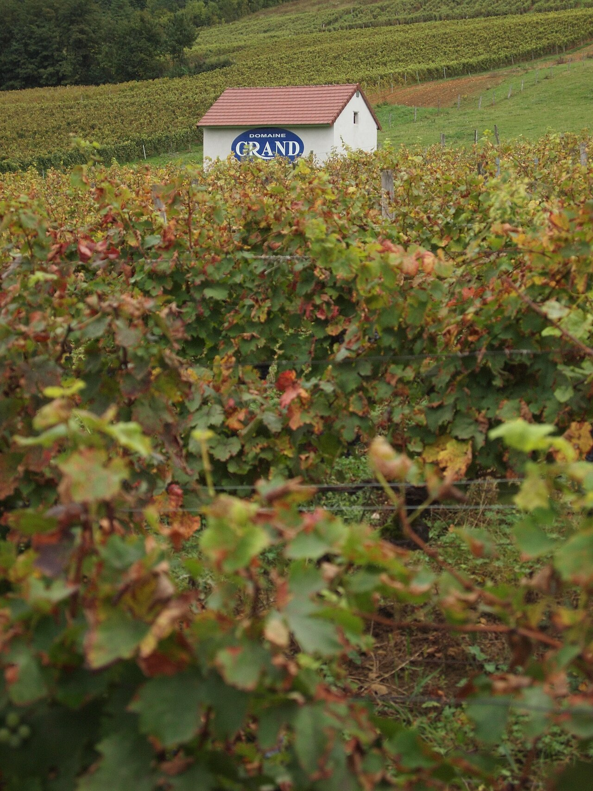

# 汝拉

汝拉（Jura）是法国东部一条狭长的葡萄酒产区，夹在勃艮第与瑞士边境之间。它最容易被记住的是黄酒（vin jaune）：一种用萨瓦涅（Savagnin）酿造、在旧橡木桶中不添酒、不换桶、任由一层酵母膜覆盖表面、陈年六年以上的白葡萄酒。但汝拉并不只有黄酒。普尔萨（Poulsard）与特鲁索（Trousseau）做的轻色红酒、霞多丽与萨瓦涅做的“未氧化”白葡萄酒、稻草酒与起泡酒，共同构成一个品种与法规都很具体的产区。

图：汝拉。摄影：File:Bodegas Grand vineyard in Passenans, Jura, France.jpg。署名：Francisco Gonzalez，CC BY 2.0，来自 Wikimedia Commons（[来源](https://commons.wikimedia.org/w/index.php?curid=25637605)）。

## 地理：80 公里的南北带状

汝拉葡萄园南北延伸约 80 公里，分布在海拔 250-450 米的丘陵坡地上，行政上主要属于汝拉省，部分延伸到杜省。产区西侧是汝拉山脉（Mont Jura）的石灰岩褶皱，东侧逐渐过渡到瑞士高原。北端接近阿尔萨斯与弗朗什-孔泰，南端靠近里昂与勃艮第。主要城镇包括阿尔布瓦（Arbois）、隆勒索涅（Lons-le-Saunier）、沙隆堡（Château-Chalon）与埃图瓦勒（L'Étoile）。

## 气候：大陆性与山地影响

汝拉属大陆性气候，冬季寒冷，夏季温暖，昼夜温差大，生长季比勃艮第略短。山地阻挡了部分大西洋影响，也让秋季更凉爽；这使葡萄保持较高酸度，成熟期拉长。霜冻、冰雹与采收期降雨是主要风险，尤其在高海拔地块。

## 土壤与坡度：泥灰岩与石灰岩

汝拉的土壤以石灰岩、泥灰岩（marl）与碎石为主，特别是里阿斯期（Lias）的灰色泥灰岩，被认为是黄酒风格的重要来源。坡地排水好、土层薄，根系扎得深；朝南或东南的坡面更温暖，适合普尔萨与特鲁索成熟；朝北或高海拔地块酸度更高，适合酿造清爽白葡萄酒。

## 法定框架：六个主要 AOC

汝拉的主要 AOC 包括 Arbois（1936 年）、Château-Chalon（1936 年）、Côtes du Jura（1937 年）、L'Étoile（1937 年）、Crémant du Jura（1995 年）与 Macvin du Jura（1991 年）。Arbois 覆盖范围最大，红白桃红都产；Château-Chalon 只产黄酒；L'Étoile 以白葡萄酒为主，也有稻草酒；Crémant du Jura 是起泡酒；Macvin 是加烈酒。Arbois 之下还有 Arbois Pupillin 这一地理名称。

## 黄酒：60 个月与 6 年 3 个月

黄酒的规则非常具体：只能使用萨瓦涅，采收后在不添酒的旧橡木桶中陈年，酒液表面形成酵母膜（voile），至少 60 个月处于膜下，从采收算起至少 6 年 3 个月才能装瓶。成品使用 62 cl 的 clavelin 瓶，这不是营销选择，而是法规规定的容量。黄酒常见坚果、咖喱、蜂蜡、柑橘皮与咸鲜气息，酸度高，开瓶后氧化速度快。

## 其他风格：未氧化白、轻色红与稻草酒

未氧化（ouillé）白葡萄酒以霞多丽与萨瓦涅为主，风格更接近勃艮第：柑橘、白花、榛子与矿物感。红葡萄酒以普尔萨、特鲁索与黑皮诺为主，颜色浅、单宁轻、酸度高，常带红樱桃、蔓越莓、胡椒与泥土气息。稻草酒（vin de paille）用风干葡萄酿造，甜度高、产量低；Macvin 则是加入葡萄蒸馏酒的加烈酒。

## 代表生产者

汝拉的代表性生产者包括 Jean-François Ganevat（拉沙隆）、Stéphane Tissot（阿尔布瓦）、Domaine de la Pinte（阿尔布瓦）、Domaine Rolet（阿尔布瓦）、Fruitière Vinicole d'Arbois、Michel Gahier（阿尔布瓦）与已退休的 Jacques Puffeney。它们分别代表自然派、传统派、合作社与精品小农路线，风格差异很大。

## 年份与市场

汝拉葡萄园面积约 2000 公顷，产量小，长期以法国国内市场与出口精品市场为主。年份差异主要来自霜冻、冰雹与采收期降雨；黄酒与稻草酒需要多年陈年，价格通常高于普通红白。出口市场以日本、美国、北欧与英国为主，顶级黄酒与特鲁索的价格在过去十年明显上升。

## 饮用与配餐

黄酒适合 12-14℃ 饮用，配坚果、菌菇、鹅肝、孔泰奶酪与咖喱类菜肴；未氧化白葡萄酒配海鲜、禽肉与奶油酱；普尔萨与特鲁索红葡萄酒适合 14-16℃，配熟食、烤肉与野味。黄酒开瓶后应冷藏并尽快饮用，避免长时间暴露在空气中。

## 常见误区

第一，把汝拉黄酒当成普通白葡萄酒。它经过长期氧化陈年，风味与保存要求不同。第二，认为汝拉只有黄酒。产区也生产红白葡萄酒、起泡酒与加烈酒。第三，把汝拉与勃艮第混为一谈。两者相邻，但品种与法规体系不同。第四，认为黄酒越陈越好。开瓶后氧化会加速衰退。第五，把 clavelin 的 62 cl 当作普通酒瓶容量，它是黄酒的法定瓶型。

汝拉是法国东部的小产区，石灰岩与泥灰岩坡地、萨瓦涅与普尔萨、特鲁索等本地品种构成它的底色；黄酒与稻草酒是标志性产品，另有未氧化白、轻色红与起泡酒。汝拉黄酒有法定陈年要求，但不能把整个汝拉产区都当成氧化风格。汝拉黄酒的氧化风格来自长时间在桶中陈年并保持酒液与空气接触，不是所有汝拉白葡萄酒都经过这条路；稻草酒的甜度则来自迟采与干燥浓缩。先确认品类，再谈风格。

对照阅读：[法国](ref:france)、[白葡萄酒](ref:white-wine)。

## 延伸阅读

- [法国](ref:france)：法国葡萄酒法规与产区体系。
- [勃艮第](ref:burgundy)：汝拉以西的邻近产区。
- [白葡萄酒](ref:white-wine)与[红葡萄酒](ref:red-wine)：汝拉的两个基本类型。
- [黄酒](ref:yellow-wine)：汝拉最具标志性的氧化风格白葡萄酒。
- [霞多丽](ref:chardonnay)与[黑皮诺](ref:pinot-noir)：汝拉使用的国际品种。

**关键事实。**

| 项目 | 内容 |
| --- | --- |
| 一句话定位 | 法国东部、勃艮第与瑞士之间的葡萄酒产区，以石灰岩与泥灰岩坡地、萨瓦涅与普尔萨、特鲁索等本地品种著称；黄酒（vin jaune）与稻草酒是标志性产品，法定产区包括 Arbois、Château-Chalon、Côtes du Jura、L'Étoile 与 Crémant du Jura |
| 层级 | 其他 |
| 所属 | 法国 |
| 国家代码 | FR |

**来源与边界。** 本页关于「汝拉」的关键事实，主要由以下来源交叉核对：INAO（汝拉各法定产区的范围与规则，包括黄酒与稻草酒；由原条目末尾参考资料迁移，未逐条复核访问日期）、European Union（欧盟葡萄酒类别、地理标志与标签规则）、Oxford University Press（提供关于汝拉、黄酒与萨瓦涅的条目；由原条目末尾参考资料迁移，未逐条复核访问日期）等 7 条来源。价格、批次与状态会变，涉及这些字段时以页面所列来源的最新版本为准。正文为项目自写，来源只作核验，不复制原文。

**并读。** 把「汝拉」与「法国」、「勃艮第」、「白葡萄酒」放在一起读时，先确认它们是同一层级还是上下游关系：先确认边界与法定分类，再比较气候、土壤、海拔与代表酒款。本页负责给出产区的基本坐标，对照条目补上具体案例与差异；读完再回到本页，才能分清哪些差别属于产区本身，哪些只是产地、批次或品牌选择。

**适用边界。** 对「汝拉」而言，产区边界、面积与法定分类会随法规更新；气候描述是长期趋势，不是某一年的天气预报。
