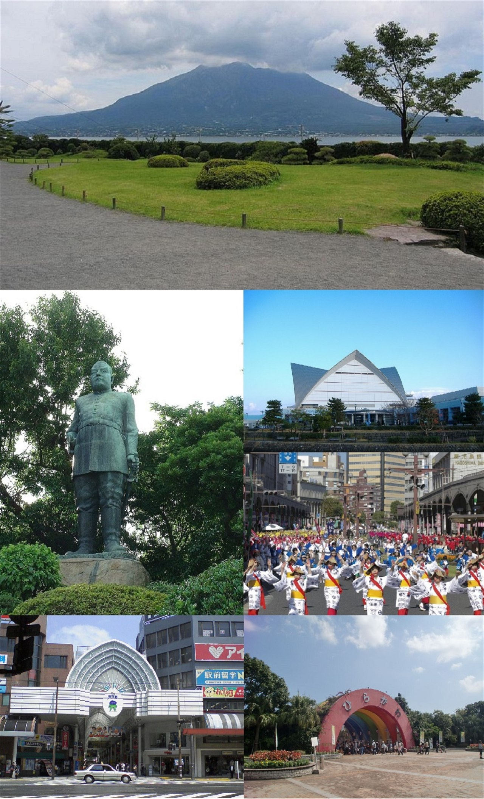
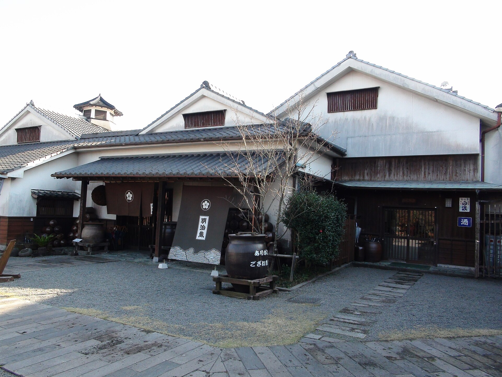

# 鹿儿岛

鹿儿岛是[日本](ref:japan)九州南部的本格烧酒核心产区。与清酒不同，[烧酒](ref:shochu)是蒸馏酒：先以[米](ref:rice)麹和水培养酵母，再加入蒸熟的萨摩芋进行二次发酵，最后用单式蒸馏器[蒸馏](ref:distillation)。鹿儿岛的产地名声建立在芋、麹、蒸馏方式与贮藏容器之上，而不是清酒式的精米步合与吟醸香。

图：鹿儿岛。图片：A pool full of water，CC BY-SA 4.0，via Wikimedia Commons（[原图页面](https://commons.wikimedia.org/wiki/File:Kagoshima_Montage.jpg)）。

> **先给结论**
> **一句话：** 这页判断鹿儿岛的风味与旅行价值，以及怎么安排。
>
> - **适合谁：** 正在比较鹿儿岛与其他产区、准备买酒或安排旅行的人。
> - **不适合谁：** 只想要“哪个产区最贵”的结论、不关心风格和年份的人。
> - **先看这两点：**
>   - 鹿儿岛县的烧酒以萨摩芋烧酒为主。
>   - 萨摩芋烧酒的主原料是萨摩芋，常用品种包括黄金千贯（コガネセンガン）与安纳芋等。

## 定义与范围

鹿儿岛县的烧酒以萨摩芋烧酒为主。鹿儿岛县观光站的资料称，县内有 80 余家藏元、2000 种以上的本格烧酒铭柄，并把它与奄美群岛的奄美黑糖烧酎并列为本格烧酒的两大类型。这里的“本格烧酒”不是营销形容词，而是酒税法与业界标识规则中的类别：它属于单式蒸馏烧酎，原料与蒸馏方式都有明确边界。

鹿儿岛县酒造组合负责产地推广、藏元介绍与烧酎文化活动。县内藏元分布在鹿儿岛市、指宿、知览、川内、出水、加治木、大隅、鹿屋、种子屋久等地区，南北跨度大，芋的品种、麹的种类与蒸馏选择各不相同。把鹿儿岛当作一个单一风格，会忽略这些地区差异。

## 芋、麹与二次仕込み

萨摩芋烧酒的主原料是萨摩芋，常用品种包括黄金千贯（コガネセンガン）与安纳芋等。黄金千贯是长期的主流原料，淀粉含量高、香气扎实；安纳芋糖度高、香气甜润，常被用来做更柔和的酒。芋的品种、蒸煮程度与发酵温度，会直接影响成酒的甜感、香气与尾韵。

麹是鹿儿岛烧酒的第二条主线。县观光站把麹分为白曲、黑曲与黄曲：白曲酿出的酒较柔和、清爽；黑曲带来更厚的醇味与更强的香气；黄曲则常呈现更果香、更轻盈的调子。白曲与黑曲是芋烧酒最常见的两类，黑曲在高温高湿的鹿儿岛环境中更耐杂菌，白曲则让芋香更干净。不同藏元会按产品定位选择麹种，而不是把某一种麹当作“正宗”。

工艺上，烧酒采用两次仕込み。一次仕込み把蒸米、米麹、水与酵母混合，培养酒母；二次仕込み加入蒸熟的芋与水，继续发酵成醪。这个结构与清酒的“酛”不同：烧酒的第一次发酵以米麹为中心，第二次才让芋成为主原料。发酵完成后进入蒸馏，蒸馏方式决定香气保留的程度。

## 蒸馏：常压与减压

本格烧酒使用单式蒸馏器，属于[单式蒸馏](ref:potstill)范畴。国税厅的资料把单式蒸馏烧酎定义为用连续式蒸馏机以外的蒸馏机、酒精度 45 度以下的酒类；连续式蒸馏烧酎则是连续式蒸馏、36 度未满。两者不是同一类产品，本格烧酒对应前者。

蒸馏压力直接影响风味。常压蒸馏温度较高，原料的香气、油脂与复杂成分保留更多，酒体更厚、更有个性；减压蒸馏在较低温度下进行，香气更轻、更干净，常被描述为“ソフトタイプ”。鹿儿岛县观光站与国税厅的资料都把常压归为香味丰富型、减压归为轻快型。选择哪一种，不是质量高低，而是产品定位：常压适合突出芋香与醇厚感，减压适合清爽、易饮的路线。

蒸馏后的原酒酒精度通常较高，装瓶前加水调整。原料、麹、发酵与蒸馏共同决定风味骨架，加水只是最后的平衡。把“蒸馏次数越多越高级”当作规则是错误的；本格烧酒的关键在于单式蒸馏与原料表达，而不是反复蒸馏。

## 25 度的法律与市场含义

25 度是鹿儿岛烧酒最常见的商品酒精度，许多芋烧酒以 25 度装瓶，明治藏的“さつま白波”和“黒白波”就是 25 度，原酒则可能达到 37 度。但 25 度不是区分“本格”与“非本格”的法定门槛。按现行酒税法，单式蒸馏烧酎的酒精度上限是 45 度，连续式蒸馏烧酎是 36 度未满；本格烧酒的标识取决于原料组合与单式蒸馏，而不是刚好 25 度。

历史上，旧酒税法曾以 25 度作为烧酎甲类的税率档位，超过 25 度要按度数加税，这让 25 度成为生产与定价的惯例。今天的市场仍保留 25 度作为“标准芋烧酒”的舒适区，但消费者不该把 25 度当成法律分界。看到 25 度、37 度或更高的原酒，应看标签上的“本格烧酎”与原料、蒸馏说明，而不是只按度数判断。

## 甕贮藏与熟成

贮藏容器会影响烧酒的口感。鹿儿岛的传统藏元使用甕壺（かめつぼ）贮藏，陶器的微细气孔允许缓慢氧化与微量挥发，使新酒的辛辣感降低、香气变得圆润。[明治藏](ref:meijigura)至今仍以甕壺仕込み与贮藏为特色，其“さつま白波明治蔵”以甕壺仕込み突出芋的芳醇香气与白曲的轻快感。

现代藏元也使用不锈钢罐、木樽或玻璃容器，不同容器带来不同的熟成速度与风味。甕贮藏不是唯一正确的方式，但它解释了为什么一些鹿儿岛烧酒在较低酒精度下仍有厚度。熟成时间从数月到数年不等，标签上的“长期贮藏”“古酒”等表述需要看具体定义与来源，不能只凭包装判断。

## 本格烧酎的标识规则

本格烧酒的标识受酒税法与业界公正竞争规约约束。按日本酒造组合中央会的说明，本格烧酒是单式蒸馏烧酎中使用谷物、薯类及其麹与水等特定原料组合的产品，酒精度上限 45 度；它不能使用连续式蒸馏，也不能随意添加调味物质。标识规则的目的，是让消费者把“本格烧酒”与“烧酎甲类乙类混和”区分开。

购买时要看三个信息：一是“本格焼酎”字样；二是原料（芋、米麹、水等）；三是蒸馏方式与酒精度。若标签写“芋烧酎”但没有“本格”，可能是混和烧酎；若写“本格烧酎”，则应为单式蒸馏并符合原料要求。地理名称如“萨摩”“鹿儿岛”说明产地与传统，但不替代类别标识。

## 酒藏与观光

鹿儿岛的酒藏观光以“藏巡”与“烧酎街道”为线索。县观光站与县酒造组合会介绍各地区的藏元、试饮与活动；明治藏位于枕崎，保留明治时代的藏建筑与甕壺仕込み，可以近距离看到传统工序。[雾岛工厂花园](ref:kirishima)则是另一类参观形态，把烧酎生产、庭园与餐饮体验放在同一园区，适合了解鹿儿岛烧酒的现代面向。

参观时要注意，烧酒藏是生产场所，发酵与蒸馏有安全限制；是否开放、是否需预约、是否有试饮，要以藏元公告为准。试饮后不要驾车；未成年人不应饮酒，过量饮酒有害健康。把酒藏参观与当地料理结合，例如萨摩扬、黑猪料理与海鲜，能更好地理解芋烧酒在鹿儿岛餐桌上的位置。

## 常见误区

第一，把烧酒当成清酒的一种。烧酒是蒸馏酒，清酒是酿造酒；两者的原料、发酵与成品逻辑不同。

第二，把 25 度当成法律分界。25 度是常见商品度数，也是旧税率表的档位；现行本格烧酒的法定上限是单式 45 度、连续式 36 度未满，区分核心是蒸馏方式与原料。

第三，把白曲或黑曲说成“唯一正宗”。白曲、黑曲、黄曲各有风味与工艺适配，藏元按产品选择，不构成等级。

第四，把常压蒸馏当成“落后”、减压当成“高级”。常压保留更多原料香，减压更轻快干净，二者是风格选择。

第五，把“芋烧酎”等同于“本格烧酎”。芋烧酎可以是混和烧酎；只有标明“本格烧酎”并符合单式蒸馏与原料规则的产品，才是本格类别。

相关条目：[日本](ref:japan)。

## 参考资料

- 鹿児島県観光サイト「焼酎王国！かごしまの本格焼酎に注目」：https://www.kagoshima-kankou.com/gourmet/shochu/siru
- 鹿児島県酒造組合「みんなの鹿児島焼酎」：https://www.honkakushochu.or.jp/
- 東京国税局「焼酎に関するもの」：https://www.nta.go.jp/about/organization/tokyo/sake/abc/abc-shochu.htm
- 日本酒造組合中央会「日本の酒・本格焼酎と泡盛」：https://www.japansake.or.jp/honkaku/about/all/
- 薩摩酒造「明治蔵」：https://www.meijigura.com/

## 相关图像

图：萨摩酒造明治藏相关实景照片。图片：Sakaori ( talk )，CC BY 3.0，via Wikimedia Commons（[原图页面](https://commons.wikimedia.org/wiki/File:Satsuma_Shuzo%27s_Kedogawa_Shochu_factory_and_museum,_Meijigura.JPG)）。关联图像：鹿儿岛。

图：日本类别配图。图片：OS6，CC BY-SA 3.0，via Wikimedia Commons（[原图页面](https://commons.wikimedia.org/wiki/File:Kamotsuru_Sake_Brewing.jpg)）。关联图像：鹿儿岛。
