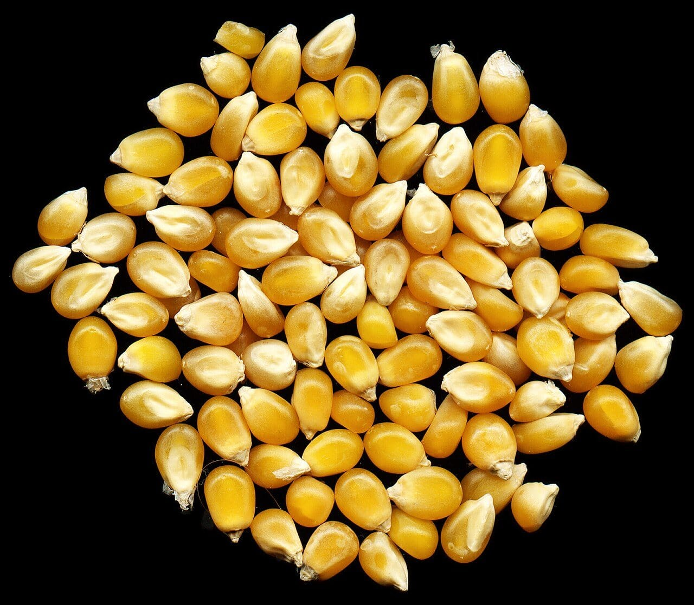

# 肯塔基州

肯塔基州位于美国中东部，是波本威士忌产量最集中的地方。按肯塔基蒸馏酒协会的公开说法，全球波本供应中约 95% 来自这里；州内约有 100 家持证蒸馏厂，分布在 42 个县，由 84 家公司运营。这个数字很容易被读成“波本等于肯塔基”，但法律上并非如此：波本是全美范围的法定类别，肯塔基只是其主导产区。把产地、法规与品牌分开，是理解肯塔基威士忌的第一步。

图：肯塔基州地区的一处实景。图片：Nyttend，Public domain，via Wikimedia Commons（[原图页面](https://commons.wikimedia.org/wiki/File:Brown-Forman_warehouse_A_and_bottling_house.jpg)）。这张照片来自肯塔基州产区内已核实条目，用于说明当地风貌，不是肯塔基州的全区域地图。

## 地理：从路易斯维尔到巴兹敦

肯塔基州北接俄亥俄河，南邻田纳西，地形以丘陵与喀斯特地貌为主。威士忌产业集中在几条走廊：路易斯维尔（Louisville）是最大的城市与物流中心；巴兹敦（Bardstown）被称为“波本之都”；法兰克福（Frankfort）、劳伦斯堡（Lawrenceburg）、克莱蒙（Clermont）、洛雷托（Loretto）、凡尔赛（Versailles）与谢尔比维尔（Shelbyville）都有重要酒厂。酒厂分布与河流、道路、石灰岩水源和历史移民路线有关。

## 气候与水源

肯塔基属亚热带湿润气候，夏季炎热潮湿，冬季寒冷但不极端，四季温差明显。这种温差对威士忌陈年是关键：酒液在橡木桶中受热膨胀、遇冷收缩，反复进出木材，提取香草、焦糖与木质风味。州内石灰岩含水层提供硬度较高、铁含量低的水，适合糖化与发酵；石灰岩还能过滤杂质，历史上也是酒厂选址的重要原因。

## 土壤与地形

肯塔基中部的“蓝草地区”（Bluegrass）以石灰岩母岩、磷酸盐丰富的土壤和起伏的草场著称。土壤排水性影响玉米、黑麦与大麦的种植，也影响水源的矿物组成。虽然威士忌风味主要来自谷物、酵母、蒸馏与橡木桶，但水质与谷物品质仍是产地差异的起点。

## 法定定义：联邦规则而非州法

美国联邦法规《27 CFR Part 5》定义波本威士忌：以不少于 51% 的玉米为主要谷物，在美国境内蒸馏，蒸馏酒精度不超过 160 proof，入桶强度不超过 125 proof，只能使用全新烘烤的橡木桶，不得添加色素与调味物质。法规没有要求波本必须产自肯塔基，因此“Bourbon”与“Kentucky Bourbon”是两个不同层级的概念。酒标上的 Kentucky 字样表示产地，但不能反过来推论所有波本都来自该州。

## 历史：税、战争与禁酒令

18 世纪欧洲移民把谷物蒸馏带到阿巴拉契亚山脉以西，玉米剩余与石灰岩泉水促成早期酒厂。肯塔基的波本县（Bourbon County）常被认为与波本之名有关，但名称来源仍有不同说法。1791 年联邦消费税引发 1794 年的威士忌暴动，说明蒸馏业与税制长期纠缠。19 世纪巴兹敦与路易斯维尔形成生产与转运中心；1920-1933 年禁酒令期间多数酒厂停产，部分以药用许可维持；1933 年废除后重建，20 世纪形成大企业主导的品牌体系。1964 年美国国会通过决议，把波本称为“美国本土烈酒”。

## 工艺：酸醪、柱式蒸馏与新桶

典型配方以玉米为主体，黑麦或小麦提供风味，发芽大麦提供酶；玉米品种、研磨粗细与蒸煮方式都会影响甜感与酒体。发酵常采用酸醪方式，把上一批的酸醪回添到新醪中，抑制杂菌并维持批次稳定。蒸馏多在柱式蒸馏器后接壶式二次蒸馏（doubler）；新桶必须经烘烤或炭化，常见 3 号或 4 号炭化程度，标准桶容量为 53 加仑。酒库（rickhouse）多为波纹铁皮或砖木结构，冬夏温差推动酒液在桶内往复移动。

## 风格：高黑麦、小麦与单桶

波本常见香草、焦糖、椰子和橡木甜香，入口偏甜，余味带香料与木质。黑麦比例高的配方更辛香，小麦配方更柔和，高玉米配方更甜润。单桶（single barrel）指酒液来自单一桶，桶强（cask strength）指未经稀释或仅轻微稀释，二者都不是质量等级。酒标上的酒龄指瓶中最年轻基酒的年龄，不是所有原酒的平均年龄。

## 代表酒厂与地名

肯塔基的代表性酒厂包括 Jim Beam（克莱蒙）、Wild Turkey 与 Four Roses（劳伦斯堡）、Maker's Mark（洛雷托）、Heaven Hill（巴兹敦）、Buffalo Trace（法兰克福）、Woodford Reserve（凡尔赛）、Barton 1792（巴兹敦）、Bulleit（谢尔比维尔）、Angel's Envy 与 Michter's（路易斯维尔）、Old Forester（路易斯维尔）。从大型量产到小型工艺酒厂，肯塔基的产业层次比“波本之乡”四个字复杂得多。

## 年份与市场

威士忌没有葡萄年份，但有蒸馏年份、入桶年份与装瓶年份。酒龄通常以整年计，常见 4 年、6 年、8 年、10 年与 12 年以上；年份越久不一定越好，过长陈年可能带来过量木质与苦味。肯塔基波本在美国本土与出口市场都保持增长，1999 年设立的肯塔基波本小径（Kentucky Bourbon Trail）把酒厂参观、节庆与旅游结合起来，成为产区品牌化的重要工具。

## 争议：干县、定义与“小批量”

第一，肯塔基并非所有县都允许销售酒类，干县（dry county）制度至今存在，酒厂分布与地方许可、旅游政策有关。第二，波本的联邦定义不要求肯塔基产地，把两者等同会误导消费者。第三，“小批量”（small batch）没有统一的法定定义，不同酒厂的使用方式差异很大。第四，酒龄标注只保证最年轻基酒，不能推断所有原酒的年龄。第五，波本必须使用全新烘烤橡木桶，不能像苏格兰威士忌那样重复使用旧桶。

## 饮用与配餐

波本纯饮时适合 18-20℃，加水或加冰会改变香气释放；高酒精度桶强适合少量加水。配餐可选烤肉、烟熏肋排、炸鸡、山核桃派与黑巧克力。经典鸡尾酒包括 Old Fashioned、Manhattan 与 Mint Julep。过量饮酒有害健康，未成年人不应饮酒；美国法定饮酒年龄为 21 岁。

## 常见误区

第一，波本必须来自肯塔基。第二，肯塔基所有威士忌都是波本。第三，波本可以重复使用旧桶。第四，小批量是法定等级。第五，陈年越久越好。第六，酒标上的年份是平均酒龄。

对照阅读：[美国](ref:usa)、[玉米](ref:maize)。

## 延伸阅读

- [美国](ref:usa)：美国酒类产区与 AVA 制度的整体框架。
- [波本威士忌](ref:bourbon)：波本的法定定义、原料与陈年要求。
- [玉米](ref:maize)：玉米作为波本主要谷物的作用。
- [橡木桶陈年](ref:oak-ageing)：全新烘烤橡木桶对风味的影响。
- [蒸馏](ref:distillation)：柱式蒸馏与二次蒸馏的基本原理。
- [发酵](ref:fermentation)：酸醪发酵与风味前体。

## 相关图像

图：干燥的玉米粒。酿酒常用马齿型或硬粒型，甜玉米并非主要原料。图片：Joel Penner，CC BY 2.0，via Wikimedia Commons（[原图页面](https://commons.wikimedia.org/wiki/File:Maize_Corn.jpg)）。关联图像：肯塔基州。

图：美国类别配图。图片：Luke，CC BY-SA 2.0，via Wikimedia Commons（[原图页面](https://commons.wikimedia.org/wiki/File:Wine_Country_of_the_Dundee_Hills,_Oregon.jpg)）。关联图像：肯塔基州。
