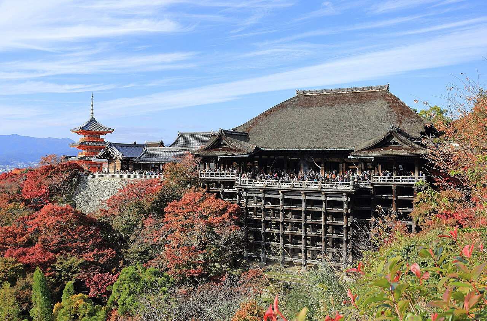

# 京都

京都首先是[日本](ref:japan)的一座城市，也是一个府。作为[清酒](ref:sake)产区，“京都”既可以指京都市内的酒藏，也可以指整个京都府的酿造传统。本页处理的是府域层面的清酒地理：它把洛中、伏见、京都丹波、宫津、福知山与京丹后峰山等酒藏组合放在同一张地图上，而不是重复伏见的运河与博物馆细节。

图：京都。图片：Martin Falbisoner，CC BY-SA 4.0，via Wikimedia Commons（[原图页面](https://commons.wikimedia.org/wiki/File:Kiyomizu-dera,_Kyoto,_November_2016_-02.jpg)）。

## 定义与范围

京都府的酒藏组织由京都府酒造组合连合会统筹，下面按地域分为若干组合。根据连合会的藏元一览，府内至少包括京丹后峰山、宫津、福知山、京都丹波、洛中与伏见等分区；宫津组合还涵盖舞鹤的酒藏，京都丹波组合涵盖龟冈与京丹波。这个结构说明“京都清酒”不是单一产区，而是由城市中心的小酒藏、南部伏见的酒藏聚落，以及北部山地与日本海侧的地方酒藏共同组成。

把京都府与京都市混为一谈，会漏掉最重要的地理差异。京都市内以洛中和伏见为代表：洛中是上京、左京、右京一带的小型藏元，伏见是南部沿河的酒藏聚落。京都市外则有丹波、丹后、宫津、福知山等以地方米与水为基础的酒藏。府域页的任务是说明这些分区如何协作与区分，而不是把某一处的风格推广到全府。

## 府内分区：洛中、伏见与丹波丹后

洛中指的是京都中心城区，历史上酒藏密集，如今保留下来的是少量小型藏元。连合会名单中，洛中组合包括上京区的佐佐木酒造、左京区的松井酒造与右京区京北的羽田酒造。它们规模不大，产品线却完整，常见纯米、吟醸、本酿造与季节限定酒。洛中的优势不是产量，而是靠近京都的消费市场、寺院、料亭与旅游动线。

伏见是府内最大的清酒聚落，独立成组合，沿宇治川与濠川分布。它拥有月桂冠、黄樱、金鵄正宗、玉乃光等藏元，也有多家中小酒藏。伏见的水源、船运与博物馆体系是另一套故事，本页只在分区层面提及，不展开其“伏水”、十石舟与纪念馆细节，以免与伏见页重复。

京都丹波、宫津、福知山与京丹后峰山属于府内的地方酒乡。它们分布在丹波高地、日本海侧的宫津与舞鹤、以及京丹后地区，气候与水质和京都市不同，酒风也更接近地方消费习惯。京都丹波组合包括龟冈与京丹波的藏元；宫津组合包括宫津、舞鹤与与谢野、伊根的藏元；京丹后峰山组合则集中在京丹后市。把这些名字列出来，是为了让读者知道“京都府”内部并非只有伏见一种模板。

## 洛中的小酒藏：佐佐木酒造

佐佐木酒造是洛中的代表。它创立于 1893 年，位于京都市上京区北伊势屋町，藏址在丰臣秀吉聚楽第的旧地南端。酒藏使用与千利休传说相关的金明水、银明水作为仕込水，代表铭柄包括“聚楽第”“古都”“西之极”。川端康成曾称“古都”的风味是京都的味道，这类文学轶事让洛中酒藏与京都的城市记忆紧密相连。

小酒藏的意义不只是“老”。洛中藏元在市中心有限的空间里维持酿造，意味着它们必须更依赖手工、少量批次与直接销售。佐佐木酒造提供酒藏见学（需预约），把聚楽第跡、上京区的街巷与酒藏内部连成一条短动线。对游客而言，这类见学比大型工厂更能看到城市与酒造的关系；对研究者而言，它是观察京都中心酒藏如何在住宅、寺院与商业区之间生存的样本。

洛中并不是“伏见的缩小版”。伏见是沿河形成的产业聚落，洛中是嵌入城区的分散酒藏；伏见以大型企业与博物馆见长，洛中以小藏元、限定酒与地缘销售见长。把两者放在同一个府域页里，重点正是这种产业分工，而不是把酒风写成同一种。

## 水与米：京都的酿造条件

京都府的酿造条件南北差异明显。京都市内的酒藏多使用地下水或井水，水质因地点而异；伏见以中硬水著称；丹波与丹后则更多依赖山地涌水与河川水系。水的硬度、铁含量与矿物质组成会影响糖化、发酵速度与酒体骨架，因此不能用“京都水”一概而论。对具体酒藏，仕込水的公开说明比地名更可靠。

米的选择同样分散。京都府内酒藏使用山田锦、五百万石、祝、雄町等不同[酒米](ref:rice)，也使用府内契约栽培的米。[精米步合](ref:polishing)是判断酒类的关键指标：[纯米](ref:junmai)酒只以白米、米麹与水为原料；纯米吟醸要求精米步合 60% 以下，纯米大吟醸要求 50% 以下；本酿造允许少量酿造酒精，精米步合须在 70% 以下，添加酒精不得超过白米重量的 10%，米麹须达到白米重量的 15% 以上。这些门槛来自国税厅的《清酒的制法品质表示基准》，适用于全日本，也适用于京都。

酒母路线也影响风格。洛中与府内小藏常用生酛、山废或速酿等不同[酒母](ref:kimoto)；生酛与山废依靠天然乳酸菌，酸度与鲜味更复杂，风险也更高；速酿添加乳酸，发酵更稳定、风格更干净。把“京都酒”说成单一柔和风格，会掩盖这些工艺选择。

## 料理搭配：京都的餐桌

京都的饮食文化以季节、克制与食材本味为核心。清酒的搭配不必追求“最贵”，而要看料理的咸度、油脂、鲜味与温度。汤豆腐、生麸、烤鱼、渍物、寿司与精进料理，适合纯米或吟醸类；清淡的料理配轻快、酸度适中的酒，味道浓的料理配醇厚、鲜味强的纯米酒。京都料理常被概括为“淡”，但实际有盐渍、发酵与出汁带来的层次，搭配时要把这些层次算进去。

温度也属于搭配。[吟醸](ref:ginjo)类适合稍冷或常温，纯米与醇厚型可以温饮；温饮会放大米香与鲜味，也可能放大酒精感。京都的冬季寒冷，温热清酒与汤豆腐、锅物在体感上更协调；夏季则更适合冷酒或气泡感较强的酒。料理搭配没有唯一答案，原则是酒与菜在强度上接近，不让一方压住另一方。

## 酒标与购买

购买京都清酒时，先看特定名称与精米步合，再看酒母、酵母、是否生酒、是否原酒。纯米、纯米吟醸、纯米大吟醸、本酿造、吟醸、大吟醸各有硬性门槛；“京都”或“洛中”只是产地与历史信息，不是等级。酒标上的“生酒”表示未加热杀菌，需要冷藏；“原酒”表示未加水稀释，酒精度可能较高；“一次火入”与“瓶内火入”则影响保存与风味。

如果要在京都买酒，洛中的小藏元适合买限定与季节酒，伏见适合买博物馆联名与标准产品，丹波、丹后与宫津适合买地方米与地方水酿造的特色酒。机场与车站的清酒零售价格通常高于藏元直卖，但选择更集中；藏元直卖能问到酿造细节，却常受营业时间与库存限制。无论在哪里买，都要确认运输与保存条件，尤其是生酒与需冷藏的酒。

## 常见误区

第一，把“京都清酒”等同于伏见。伏见是府内最大的聚落，但洛中、丹波、丹后、宫津、福知山与京丹后峰山各有自己的藏元与风格。

第二，把洛中当成“已经没有酒藏”。洛中仍有佐佐木酒造、松井酒造、羽田酒造等小藏元，只是规模与分布不同于伏见。

第三，把“京都水”说成统一的软水。府内水质南北差异大，伏见为中硬水，丹波与丹后更多依赖山地涌水；具体酒藏要看仕込水说明。

第四，把地名当成质量等级。京都、洛中、伏见说明产地与历史，不直接决定精米步合、酒母或是否生酒。

第五，把清酒搭配只当成“清淡配清淡”。京都料理有盐渍、发酵与出汁的层次，搭配要看强度、鲜味与温度，而不是只看颜色或清淡程度。

相关条目：[日本](ref:japan)。

## 参考资料

- 京都府酒造組合連合会「京の酒蔵元」：https://kyoto-sake.sakura.ne.jp/ja/ichiran.html
- 佐々木酒造「京都洛中・佐々木酒造株式会社」：https://www.jurakudai.com/
- 国税庁「清酒の製法品質表示基準を定める件」：https://www.nta.go.jp/taxes/sake/hyoji/seishu/kokuji891122/03.htm
- Kyoto Travel（京都市公式观光指南）：https://kyoto.travel/
