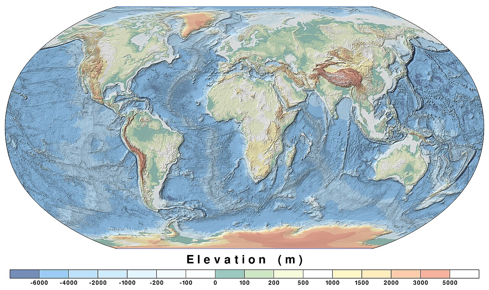

# 低地

低地（Lowland）是[苏格兰](ref:scotland)威士忌五个受保护产区之一，范围在苏格兰中南部，通常被描述为邓迪与格里诺克一线以南的广阔地带。它常被贴上“清淡、青草、柑橘”的标签，但这只是统计印象：产区里既有坚持三次蒸馏的老酒厂，也有用自家农场大麦做实验的新酒厂，风格跨度并不小。

图：低地。图片：Ian Macky, PAT Atlas，Public domain，via Wikimedia Commons（[原图页面](https://commons.wikimedia.org/wiki/File:PAT_-_World_topographic.jpg)）。

## 一条折线划出的法定范围

《2009 年苏格兰威士忌条例》没有用行政大区来定义低地，而是画了一条从北爱尔兰海峡出发、沿克莱德湾南岸到格里诺克，再经卡德罗斯、厄尔座椅山、华莱士纪念碑，沿 B998 与 A91 公路到米尔纳索特，最后顺 M90、厄恩河与泰河抵达北海的折线。线以南是低地，线以北是高地，坎贝尔镇与艾雷岛则单独列为受保护地方名称。

这条线是法律边界，不是风格边界。[条例](ref:swr)规定，只有在该区域内蒸馏的苏格兰威士忌才能标注“Lowland”。一款在低地陈年、却在高地蒸馏的酒，不能使用这个名称；反过来，在低地蒸馏、运到别处陈年的酒也不符合苏格兰威士忌的通用条件。

## 地理与气候

低地覆盖苏格兰南部的大片区域，包括爱丁堡、格拉斯哥、法夫、边界区与加洛韦。这里地势平缓、农田连片，气候比西部沿海干燥，冬季受海洋调节而不至于极寒。大麦曾是本地重要作物，如今酒厂多从外部采购，但农场型酒厂仍会自种大麦，以控制原料与风味。

与斯佩塞相比，低地没有高度集中的酒厂群；与艾雷岛相比，它没有强烈的海风与泥煤资源。这种“什么都不极端”的环境，既让清淡风格成为可能，也让酒厂更依赖原料处理、蒸馏器形状与桶型来建立个性。

## 清淡不等于单薄

典型的低地香气是青草、青苹果、柠檬皮、燕麦与奶油，入口干净，收口偏短，酒精感不重。这样的描述容易让人以为低地只有“水感”很重的酒，实际上酒体可以从轻盈一直延伸到油脂感明显：蒸馏器的高矮、回流比、是否三次蒸馏、桶的烘烤程度，都会改变重量。

清淡也不等于没有层次。低地酒常被用作 aperitif 或 Highball 基酒，因为它的香气不压食物、气泡也不容易被木质味盖住。但一些老酒厂的雪莉桶版本、桶强版本，完全能支撑长时间品饮。把低地当成“入门产区”，是对风格谱系的简化，而不是对产区的准确描述。

## 三次蒸馏的传统

低地是苏格兰三次蒸馏传统最集中的地方。多一次蒸馏意味着酒液与铜接触更久、回流更多，新酒更干净、酒精度更高、硫味更少，入口也更柔。[蒸馏](ref:distillation)次数不是质量等级，而是一种风格工具：两次蒸馏保留更多油脂与谷物感，三次蒸馏则把线条拉细。

欧肯特轩（Auchentoshan）是这一传统最明确的代表。酒厂建立于 1823 年，位于克莱德班克附近，官方资料称它是苏格兰唯一对每一滴酒都坚持三次蒸馏的单一麦芽酒厂。三次蒸馏让它的新酒更轻盈，也让桶型的影响更容易被察觉。

## 四家酒厂，四种路径

欧肯特轩代表了城市边缘的老酒厂路径：靠近格拉斯哥，面向调和与单一麦芽两个市场，风格干净、柑橘感明显。布莱德诺克（Bladnoch）位于加洛韦，官方以 1817 年作为起点，是苏格兰最南端的酒厂之一，近代经历停产与重启，风格在清淡与油脂之间摆动。格兰昆奇（Glenkinchie）位于东洛锡安，靠近爱丁堡，长期被视为“爱丁堡的麦芽”，以青草、柠檬与麦芽甜为主。

达夫特米尔（Daftmill）则是另一种路径：它位于法夫，是一座农场型酒厂，使用自家农场种植的[大麦](ref:barley)与自有自流井水，产量很小。酒厂在 2005 年完成首次蒸馏，首批 12 年装瓶直到 2018 年才上市。这种“先存酒、后卖酒”的节奏，与大型酒厂的商业模型完全不同。

## 为什么酒厂数量长期偏少

低地的酒厂数量远少于斯佩塞。原因不是风土不适合，而是历史与产业结构的叠加：20 世纪调和需求集中，许多低地酒厂被关闭或并入更大集团；靠近城市的土地价格与环保约束，也提高了新建门槛。长期来看，低地原酒大量进入调和体系，独立装瓶的单一麦芽反而少见。

近十余年情况在变化。苏格兰威士忌协会指出，低地是近年新酒厂增长明显的区域，新建项目分布在法夫、边界区与格拉斯哥周边。它们规模小、设备灵活，常尝试长发酵、非常规酵母与不同桶型。[威士忌](ref:whisky)整体需求上升，是这股新增产能的背景，但低地的总数仍无法与斯佩塞相比。

## 低地的六个误读

第一，认为低地只有清淡风格。实际上酒体与桶型跨度很大。第二，把低地等同于苏格兰南部所有威士忌，忽略坎贝尔镇是独立受保护地方名称。第三，认为低地必须三次蒸馏。法规没有这条要求，三次蒸馏只是部分酒厂的传统。第四，认为低地威士忌都没有泥煤味。少数产品使用泥煤麦芽，只是不占主流。第五，把产区名称当成质量等级。第六，认为低地没有好酒，忽略小酒厂的实验性作品。

选购时先看酒厂与蒸馏次数，再看桶型与酒精度。低地的清淡风格适合纯饮作为开场，也适合调制 Highball；[单一麦芽](ref:single-malt)的通用品鉴方法同样适用：先闻香，再加少量水，最后才考虑加冰。适量饮用，未成年人不应饮酒。

相关条目：[苏格兰](ref:scotland)、[威士忌](ref:whisky)。

**关键事实。**

| 项目 | 内容 |
| --- | --- |
| 一句话定位 | 苏格兰威士忌五个受保护产区之一，范围在邓迪与格里诺克一线以南；常被概括为青草、柑橘与奶油般的清淡风格，但产区内部既有三次蒸馏的老酒厂，也有农场型新酒厂，清淡只是起点而非规则 |
| 层级 | 其他 |
| 所属 | 苏格兰 |
| 国家代码 | GB |

**来源与边界。** 本页关于「低地」的关键事实，主要由以下来源交叉核对：UK Government (legislation.gov.uk)（Lowland 作为受保护区域的法定边界与标签限制）、Scotch Whisky Association（低地的地理描述、风格概述与近年新酒厂增长）、Auchentoshan Distillery（酒厂 1823 年建立与三次蒸馏传统）等 5 条来源。价格、批次与状态会变，涉及这些字段时以页面所列来源的最新版本为准。正文为项目自写，来源只作核验，不复制原文。

## 相关图像

图：单一麦芽苏格兰威士忌。图片：Sansvase，CC BY-SA 3.0，via Wikimedia Commons（[原图页面](https://commons.wikimedia.org/wiki/File:Bowmore_whisky_12_years.JPG)）。关联图像：低地。

图：大麦。图片：Cliff from Arlington, Virginia, USA，CC BY 2.0，via Wikimedia Commons（[原图页面](https://commons.wikimedia.org/wiki/File:Barley_(Hordeum_vulgare)_-_United_States_National_Arboretum_-_24_May_2009.jpg)）。关联图像：低地。
