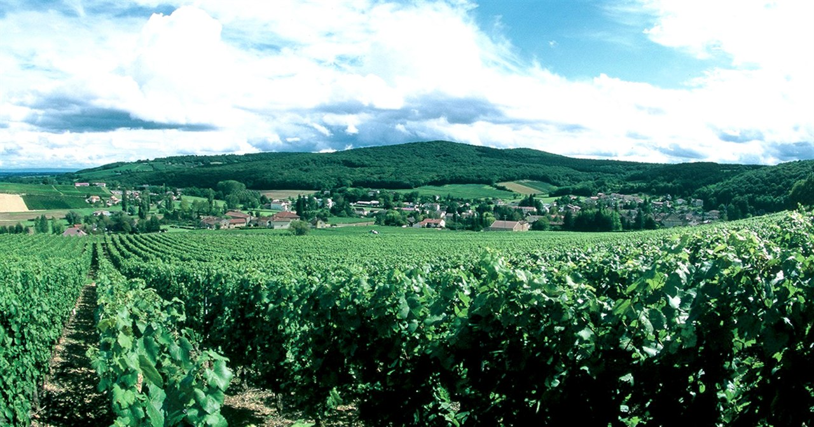

# 马贡

马贡（Mâconnais）是勃艮第最南部的白葡萄酒产区，沿索恩河以西的丘陵展开；以霞多丽为主，覆盖马贡、普伊-富赛、圣韦朗、维雷-克莱塞等 AOC，石灰岩坡地、合作社传统与相对宽裕的产量，使它成为进入勃艮第白葡萄酒最容易的入口之一。

图：Mâconnais：Paysage du Haut-Mâconnais (Lugny)（Wikimedia Commons）。图片：Frikar，CC BY-SA 3.0，via Wikimedia Commons（[原图页面](https://commons.wikimedia.org/wiki/File:Paysage_du_Haut-M%C3%A2connais_(Lugny).jpg)）。

## 先划清「马贡」的边界
马贡位于勃艮第南部、索恩河西侧，属索恩-卢瓦尔省，因中心城镇马贡（Mâcon）得名。产区北接博若莱南部，南抵沙罗莱边缘，东西两侧分别是索恩平原与马贡丘陵；与金丘相比，这里气候更温暖，霞多丽成熟更充分，风格与价格跨度也更大。索恩河冲积平原在东侧，丘陵在西侧，葡萄园主要挂在朝东、朝南的坡面上，平地与河滩较少种植。

产区内的 AOC 分几层：基础的 Mâcon 可产白、桃红与红；Mâcon-Villages 仅用于白葡萄酒，酒标可加村庄名；村庄级白葡萄酒 AOC 包括普伊-富赛、普伊-洛谢、普伊-万泽勒、圣韦朗与维雷-克莱塞。它们共享一片丘陵，但地块海拔、坡向与石灰岩层位不同，酒标上的村庄名比“马贡”更能说明风格。

## 历史与命名

马贡一带的葡萄种植依托中世纪以来的修道院与庄园传统，索恩河长期是葡萄酒外运的水道；近代根瘤蚜与病害之后，产区在 20 世纪重建，合作社把小农的果实集中酿造，支撑起大众价位的勃艮第白。马贡镇自古是河港，往来里昂与巴黎的商人在此装船，酒款的名声沿水路向北传播。

村庄级 AOC 的设立时间各不相同：普伊-富赛 1936 年获批，圣韦朗 1971 年设立，维雷-克莱塞则由 1999 年 2 月 26 日的法令把原 Mâcon-Viré 与 Mâcon-Clessé 合并而成。2020 年 9 月 3 日，普伊-富赛有 22 个地块共 194 公顷被 INAO 批准为一级园，约占该 AOC 面积的四分之一。

## 「马贡」的地理与风土
土壤以侏罗纪石灰岩、泥灰岩与黏土质灰岩为主，坡地海拔多在 200 至 450 米，朝东坡向上午受光、下午避晒。石灰岩坡面排水快、养分薄，长出的霞多丽酸度紧、矿物感清晰；坡脚黏土与砂卵石地块更温润，果实更成熟、酒体更宽。这些石灰岩形成于侏罗纪海相沉积，表层常带白色碎石，排水快而底土保留水分，正是霞多丽喜欢的条件。

索恩平原与丘陵之间的小气候差异明显：高处与多石地块晚熟、酸度高，低洼与偏黏地块早熟、果香更甜。索吕特雷与韦尔吉松两处石灰岩岩丘是产区地标，被列为法国“大圣地”（Grand Site de France）；岩丘周边的坡地是普伊-富赛最集中的地块。

## 原料与风格

村庄级白葡萄酒几乎只用霞多丽 (ref:chardonnay)；基础 Mâcon 的红与桃红可用佳美，少量黑皮诺 (ref:pinot) 参与调配，产量与知名度都有限。白葡萄酒风格从清爽柑橘、白花到黄油、榛子与橡木香料不等，差别来自地块、发酵容器与桶陈比例。

马贡白通常酸度明快、果味直接，普伊-富赛的好年份可有层次与数年陈年空间；橡木桶发酵与新桶使用在生产者之间差异很大，有的酒庄追求清爽矿石感，有的走丰满奶油路线。红葡萄酒以佳美为主，果味新鲜、单宁轻，适合年轻时饮用。佳美与博若莱的传统相通，酒色浅、单宁细，带新鲜红果与多汁的果香。

## 代表生产者与酒款

普伊-富赛的代表有 Château de Fuissé、Domaine Barraud；圣韦朗与维雷-克莱塞一侧有 Joseph Burrier、Domaine des Deux Roches 等；大名庄 Domaine Leflaive 也在马贡-韦尔泽有地块。产区内合作社仍占重要位置，把分散小农的果实做成稳定的入门级勃艮第白。

这些名字不是官方分级，而是市场长期参照。村庄级 AOC 的旗舰款价格明显高于基础 Mâcon，同一酒庄的村庄款与单一地块款也有层级差；购买时先分清 AOC 层级、地块与生产者风格，比只认“勃艮第白”更有效。

## 「马贡」的上桌方式
马贡白适饮温度约 10 至 12 摄氏度，偏凉上杯能保留酸度与柑橘香；年轻清爽款不必醒酒，丰满橡木款可稍提前开瓶。杯型用中等肚径白葡萄酒杯即可。

配餐以淡水鱼、烤禽、奶油酱海鲜、软质奶酪与清淡意面为主；果酸能接上酱汁的油脂，矿物感衬托海鲜鲜味。普伊-富赛这类较丰满的白可配白肉炖菜，红与桃红则适合沙拉、冷肉与清淡炖菜。本地邻近沙罗莱牛肉产区，轻煎牛排或烤香肠配马贡红或桃红，油脂与果味相互平衡。

## 选购、标签与误区

读标签先看 AOC 层级：Mâcon 最宽，Mâcon-Villages 与村庄名更具体；普伊-富赛、圣韦朗、维雷-克莱塞各自的村庄范围不重叠，村名下再标一级园或地块名。圣韦朗位于普伊-富赛南侧，围绕圣韦朗镇一带，早年属博若莱白葡萄种植范围，AOC 设立后归入马贡体系。2020 年后普伊-富赛的一级园是地块名称，不是跨村的等级排序。

常见误区是把“勃艮第白”当成一个味道，或把价格高直接等同品质。马贡内部平原与坡地、石灰岩与黏土地块差别明显；年份之间的降雨与成熟度也会改变风格。基础款以年轻新鲜为主，不必久藏；收藏与陈年应选村庄级好年份。

## 「马贡」周边怎么走
马贡镇位于索恩河畔，是到访产区的门户；向北到博纳约四十分钟车程，周边坡地集中在索吕特雷-普伊、韦尔吉松、富赛一带。酒庄品鉴多需预约，单次留 60 至 90 分钟，一天两三家加午餐较从容。

春秋两季坡景与花期最适合走访；采收季（9 月）酒庄最忙，开放时间应提前确认。公共交通有限，自驾或参加当地酒乡小团更方便；岩丘步道、葡萄园土路与品鉴室门槛对行动不便者并不总是友好。

- 相关条目：[burgundy](ref:burgundy)、[chardonnay](ref:chardonnay)、[pinot-noir](ref:pinot)、[white-wine](ref:white)、[oak-ageing](ref:oak)。
- 马贡距博若莱与沙罗莱都不远，出行前可在 BIVB 或产区酒庄官网核对当年开放安排与品鉴预约方式。

相关条目：[勃艮第](ref:burgundy)。

**关键事实。**

| 项目 | 内容 |
| --- | --- |
| 一句话定位 | 勃艮第南部的白葡萄酒产区，以霞多丽为主，覆盖马贡、普伊-富赛、圣韦朗、维雷-克莱塞等 AOC；石灰岩与黏土坡地、合作社传统与较高的产量，使它成为勃艮第白葡萄酒最容易入门的产区之一 |
| 层级 | 省/大区 |
| 所属 | 勃艮第 |
| 国家代码 | FR |

## 相关图像

图：Burgundy vineyards near Beaune, France。图片：Mark Gorzynski，CC BY-SA 4.0，via Wikimedia Commons（[原图页面](https://commons.wikimedia.org/w/index.php?curid=65061583)）。关联图像：马贡。

图：黑皮诺。图片：Cjp24，Public domain，via Wikimedia Commons（[原图页面](https://commons.wikimedia.org/wiki/File:Grape_near_Sancerre.jpg)）。关联图像：马贡。
