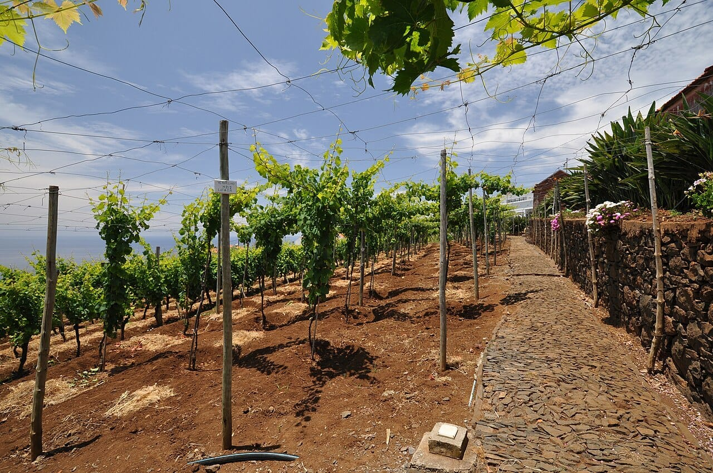
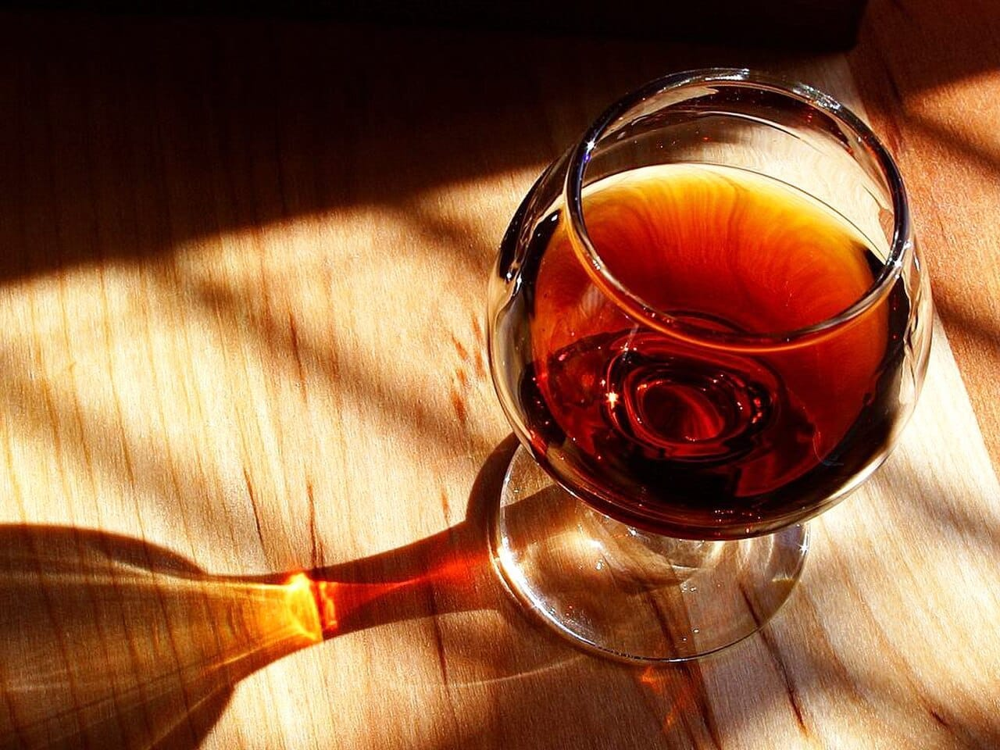

# 马德拉

马德拉（Madeira）是[葡萄牙](ref:portugal)马德拉岛出产的[加强酒](ref:fortified-wine)法定产区，以高酸度、长时间熟成与加热氧化风格著称。贵族品种 Sercial、Verdelho、Bual 与 Malvasia 按甜度从干到甜排列。

图：马德拉。摄影：Quinta das Vinhas ^ Cottages, Estreito da Calheta, Madeira, Portugal, 27 June 2011 - Top vineyards - panoramio (1)。署名：anagh，CC BY-SA 3.0，来自 Wikimedia Commons（[来源](https://commons.wikimedia.org/w/index.php?curid=53715566)）。

## 定义与范围

马德拉既是岛屿地名，也是加强酒产品名称。产区覆盖马德拉岛，酒液在岛上完成强化与熟成；酒标上的 Madeira 指法定产区，不等于任意一种甜酒。

理解马德拉要抓住两个变量：品种决定基础甜度与酸度，熟成方式决定氧化与焦糖化程度。两者叠加，形成从极干到极甜的完整谱系。

## 「马德拉」的时间线
马德拉的葡萄酒在 17 至 18 世纪随大西洋航线传播，长时间海运与高温船舱使酒液经历氧化与加热，形成独特风格。后来酒庄用加热槽与阁楼熟成模拟这一过程。

这段历史解释了马德拉为什么耐存放：高酸度、强化与氧化使酒液稳定，开瓶后也能保存较久。它既是历史产物，也是工艺选择的结果。

## 地理与气候

马德拉是北大西洋中的火山岛，地形陡峭，葡萄园以小块梯田形式分布在坡面上，海拔从海岸延伸到数百米。气候属亚热带海洋性，湿度高、降雨分布不均。

火山土壤与陡坡排水条件限制产量，梯田与灌溉渠道构成独特景观。不同海拔与朝向造成成熟度差异，也影响品种选择与甜度目标。

## 「马德拉」的品种与风格坐标
贵族品种按甜度排列：Sercial 最干，酸度高、带柑橘与杏仁；Verdelho 中等干，带蜂蜜与柑橘；Bual 中等甜，带焦糖与干果；Malvasia（Malmsey）最甜，带糖渍水果与咖啡。

Tinta Negra 是种植面积最大的品种，可用于从干到甜的多种风格，但酒标通常不标品种名。贵族品种产量小，标注品种的马德拉通常价格更高。

## 「马德拉」怎么做出来
葡萄经[发酵](ref:fermentation)，在残糖仍高时加入葡萄酒精强化，停止发酵并保留甜度。随后进入熟成，熟成方式决定风格走向。

estufagem 是把酒液置于加热槽中，以约 45–50 摄氏度的温度处理至少 3 个月，加速氧化与焦糖化，适合较年轻的量产酒；canteiro 是把酒桶放在温暖的阁楼中自然熟成多年，风格更细腻、复杂度更高。

## 陈年分级

马德拉按熟成时间分级：基础马德拉至少 3 年；Reserve 至少 5 年；Special Reserve 至少 10 年；Extra Reserve 至少 15 年；Frasqueira（Vintage）为单一年份，至少 20 年桶陈。

Colheita 是单一年份马德拉，至少 5 年桶陈。年龄标示描述的是风格目标与最低要求，不等于每一瓶的实际平均年龄完全一致。

## 土壤与地形

土壤以火山岩与玄武岩风化产物为主，夹杂黏土与碎石。排水性好、肥力低，葡萄根系需要深入寻找水分，产量因此受限。

地形以陡坡与梯田为主，部分地块坡度极大，需要人工或缆索运输。海拔与朝向影响日照与成熟度，也决定不同品种的种植位置。

## 酒标与年份

酒标通常标注 Madeira、品种或“Tinta Negra”、甜度、年龄或年份、容量与装瓶者。品种名与年龄标示是判断风格的核心信息。

单一年份马德拉标注采收年份，混酿马德拉标注年龄（5、10、15、20 年等）。以瓶身实际标注为准。

## 市场与饮用

Sercial 与 Verdelho 适合冷藏后作为开胃酒，建议温度约 10–12 摄氏度；Bual 与 Malvasia 适合稍高温度，约 14–16 摄氏度，可搭配坚果、干果、巧克力与蓝纹奶酪。

马德拉开瓶后稳定性较好，但仍应避光、阴凉存放，理想温度为 12–15 摄氏度。本页关于马德拉的内容涉及酒精饮料；过量饮酒有害健康，未成年人不应饮酒。

## 「马德拉」容易被读错的地方
第一，把马德拉当成烹饪专用酒。高品质马德拉可以直接饮用。
第二，认为马德拉都很甜。Sercial 与 Verdelho 可以是干型或半干型。
第三，把 estufagem 当成低质工艺。它是法规允许的熟成方式，风格目标不同。
第四，认为 Tinta Negra 只能酿低端酒。它也能酿出高品质的多种风格。
第五，把“Madeira”当成葡萄品种。它是产区与酒的名称。

马德拉是葡萄牙马德拉岛的加强酒产区，以高酸、长时间熟成与加热氧化风格著称；贵族品种按甜度从干到甜排列，Tinta Negra 多用于量产酒。estufagem 加热槽与 canteiro 自然阁楼是两条熟成路径，年份与等级标识说明陈年体系，不是甜度排序。贵族品种名、熟成年份与甜度是三条独立信息：Sercial 可以是干型，Malvasia 可以是甜型，而同一品种也能因熟成路径呈现不同风格。把年份数字直接当成甜度或等级，会误读酒标。

对照阅读：[葡萄牙](ref:portugal)、[葡萄](ref:grape)。

**关键事实。**

| 项目 | 内容 |
| --- | --- |
| 一句话定位 | 葡萄牙马德拉岛出产的加强酒法定产区，以高酸度、长时间熟成与加热氧化风格著称；贵族品种 Sercial、Verdelho、Bual 与 Malvasia 按甜度从干到甜排列，Tinta Negra 用于多数量产酒，熟成分为 estufagem 加热槽与 canteiro 自然阁楼两条路径，按 3、5、10、15、20 年分级 |
| 层级 | 其他 |
| 所属 | 葡萄牙 |
| 国家代码 | PT |

**来源与边界。** 本页关于「马德拉」的关键事实，主要由以下来源交叉核对：IVBAM（马德拉的品种、熟成方式与年份分级；由原条目末尾参考资料迁移，未逐条复核访问日期）、European Union（欧盟加强酒类别、地理标志与传统术语规则）、Oxford University Press（提供关于马德拉与各贵族品种的条目；由原条目末尾参考资料迁移，未逐条复核访问日期）。价格、批次与状态会变，涉及这些字段时以页面所列来源的最新版本为准。正文为项目自写，来源只作核验，不复制原文。

**并读。** 把「马德拉」与「葡萄牙」、「加强葡萄酒」、「葡萄」放在一起读时，先确认它们是同一层级还是上下游关系：先确认边界与法定分类，再比较气候、土壤、海拔与代表酒款。本页负责给出产区的基本坐标，对照条目补上具体案例与差异；读完再回到本页，才能分清哪些差别属于产区本身，哪些只是产地、批次或品牌选择。

**适用边界。** 对「马德拉」而言，产区边界、面积与法定分类会随法规更新；气候描述是长期趋势，不是某一年的天气预报。

## 参考资料
- [葡萄牙](ref:portugal)：马德拉所属的国家产区框架。
- [加强酒](ref:fortified-wine)：强化酒的类别与工艺框架。
- [葡萄](ref:grape)：马德拉所用葡萄的成熟度、酸度与单宁判断。
- [发酵](ref:fermentation)：马德拉在发酵中途强化的基础逻辑。
- [橡木桶陈年](ref:oak-ageing)：canteiro 与长期熟成使用的容器。
- [葡萄酒](ref:wine)：理解马德拉的类别、年份与产地规则的入口。
- [酒精度](ref:abv)：18%–20% vol 在标签上的含义。

## 相关图像

图：葡萄牙类别配图。图片：John Hayes from San Antonio, Texas, USA，CC BY-SA 2.0，via Wikimedia Commons（[原图页面](https://commons.wikimedia.org/w/index.php?curid=151531010)）。关联图像：马德拉。

图：加强葡萄酒。图片：Jon Sullivan，Public domain，via Wikimedia Commons（[原图页面](https://commons.wikimedia.org/wiki/File:Port_wine.jpg)）。关联图像：马德拉。
