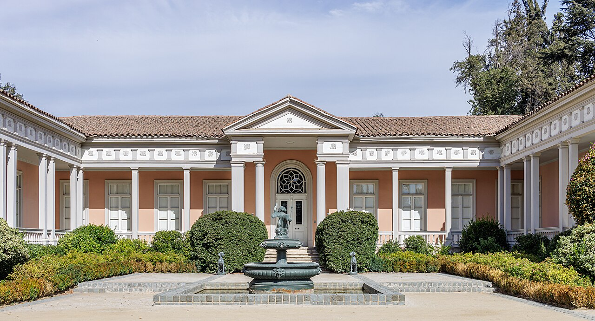

# 迈坡

迈坡（Maipo）是智利中央山谷内的法定葡萄酒子区，围绕首都圣地亚哥，是智利现代葡萄酒业的发源地与产业中心。它以 Cabernet Sauvignon 红酒建立起国际声誉，也是智利酒庄密度最高、历史最集中的产区。

图：迈坡地区的一处实景。图片：Rjcastillo，CC BY-SA 4.0，via Wikimedia Commons（[原图页面](https://commons.wikimedia.org/wiki/File:Frente_Casa_Patronal_Concha_y_Toro.jpg)）。这张照片来自迈坡产区内已核实条目，用于说明当地风貌，不是迈坡的全区域地图。

## 智利葡萄酒的地理中心

迈坡是 Valle Central 这一法定葡萄酒大区下的子区，名称来自流经圣地亚哥的 Maipo 河。产区从安第斯山麓一直延伸到海岸丘陵，覆盖圣地亚哥都市区与周边农业地带，城镇、酒庄与葡萄园高度交织。

这种位置带来双重身份：它既是智利最古老的优质酒产区，也是酒庄、贸易与出口体系的枢纽。许多智利大型酒庄的总部、酒窖与旗舰酒款都集中在这里，使迈坡成为智利葡萄酒产业事实上的中心。

迈坡也是智利葡萄酒旅游最成熟的区域之一。酒庄距市区近，参访路线短，历史建筑、葡萄园与安第斯山景观可以在一天内组合完成。这种可达性让迈坡成为许多国际游客接触智利葡萄酒的第一站，也强化了它作为产业展示窗口的角色。

## 1851 年与法国品种的引入

1851 年，Silvestre Ochagavía 从法国引入 Cabernet Sauvignon、Merlot 等品种，并在圣地亚哥附近建立酒庄，这一事件被视为智利现代葡萄酒业的起点。此后数十年，法国品种在迈坡扎根，形成以波尔多式红酒为核心的产业方向。

1883 年 Concha y Toro 建立，随后更多酒庄在迈坡出现。19 世纪后期，智利因地理隔离躲过欧洲的根瘤蚜危机，保留了未经嫁接的法国品种资源，这成为智利葡萄酒历史叙事的重要部分。

20 世纪，迈坡逐渐形成以出口为导向的产业：酒庄扩大产能，引入温控发酵与不锈钢设备，并在 1990 年代以后加速进入欧美市场。这一过程让迈坡从地方性农业产区转变为全球葡萄酒供应链中的稳定供给者。

## 安第斯山到太平洋的横谷

迈坡的地形是一条横切安第斯山与太平洋的河谷。东侧是安第斯山麓的冲积扇与高阶地，海拔较高，昼夜温差大，成熟较慢；中部是圣地亚哥盆地，热量充足，适合充分成熟；西侧是海岸丘陵，受太平洋与晨雾影响，温度更低。

灌溉来自安第斯山的融雪与河流，使干旱的夏季仍能稳定生产。地中海气候带来干燥的生长季与集中的采收期，病害压力相对较低。东西向的海拔与海洋影响梯度，构成产区的[风土](ref:terroir)基础。

## 三个常用地带

当地常把迈坡分为三个地带。Alto Maipo 位于东侧山麓，包括 Puente Alto 与 Pirque 等地，海拔更高、更凉爽，是高端 Cabernet Sauvignon 的核心；Central Maipo 位于盆地中部，热量更足，风格更宽厚；Coastal Maipo 位于西侧丘陵，受海洋影响，温度较低。

这三者是产业与地理上的常用说法，不是第 464 号法令下的法定子区，酒标不会把它们当作官方产区层级。购买时应区分酒庄自用的地块名称、常用地带名与法定产地名。

圣地亚哥的城市扩张也在改变产区：部分历史葡萄园被住宅与商业用地取代，酒庄因此向更高的山麓与更西的丘陵寻找新地块。地价上涨与水源竞争，是迈坡未来十年最现实的结构性压力。

## Cabernet Sauvignon 的主导地位

Cabernet Sauvignon 是迈坡最重要的红品种，也是智利国际形象的核心。Alto Maipo 的酒款通常带黑加仑、黑樱桃、雪松、烟草与石墨气息，单宁结构紧密，酸度清晰，适合[橡木桶陈年](ref:oak-ageing)与长期陈放。

Carmenère 在迈坡也有种植，常带青椒、黑莓与香料气息；Syrah 与 Merlot 作为补充品种存在。红葡萄经除梗与温控[发酵](ref:fermentation)，浸渍时间与桶型决定风格走向。原料是葡萄，品种与产地标注须符合法规比例。

## 法规与酒标

智利葡萄酒的产地体系由第 464 号法令确立，把全国划分为葡萄酒大区、子区与地带。迈坡作为 Valle Central 的子区，酒标使用 Valle del Maipo 或 Maipo 时须符合该子区的产地规则；品种与年份标注须满足酒法规定的最低比例，具体数值以 SAG 规则为准。

酒标还须标明[酒精度](ref:abv)、容量与生产商。智利的 Reserva、Gran Reserva 等字样不是法定质量等级，更多是酒庄与市场的自我定位，购买时不应把它们当成官方分级。

对消费者而言，更可靠的线索是法定产地名与品种比例。Valle del Maipo 说明葡萄来自该子区，具体地块与酒庄风格则需看背标与酒庄资料；同一酒庄的不同系列，可能来自完全不同的海拔与土壤。

## 饮用与误区

迈坡红酒建议在 16 至 18 摄氏度饮用，适合烤肉、牛排、蘑菇与硬质奶酪。Alto Maipo 的高端酒款常需醒酒一至两小时；Central Maipo 的酒款果味更外放，适合较早饮用。配餐时应注意酒款的酸度与单宁强度。

常见误区有四。第一，把迈坡当成整个中央山谷：它只是其中一个子区。第二，认为智利酒都便宜：迈坡的高端 Cabernet Sauvignon 已进入国际名酒价格区间。第三，把 Reserva 当成法定等级：它是酒庄定位。第四，以为智利没有原产地规则：第 464 号法令与 SAG 对产地、品种与年份都有明确要求。

**关键事实。**

| 项目 | 内容 |
| --- | --- |
| 一句话定位 | 智利中央山谷（Valle Central）内的法定子区 Valle del Maipo，围绕圣地亚哥，是智利葡萄酒业的传统中心；1851 年 Silvestre Ochagavía 引入法国品种，被视为现代智利葡萄酒的起点 |
| 层级 | 其他 |
| 所属 | 智利 |
| 国家代码 | CL |

**来源与边界。** 本页关于「迈坡」的关键事实，主要由以下来源交叉核对：Ministerio de Agricultura de Chile / FAOLEX（Valle del Maipo 作为 Valle Central 子区的法定地位与边界表述）、Guía Peñín（迈坡葡萄园 12,216 公顷、海拔范围与主要酒庄分布）、Vinos de Chile（迈坡在智利葡萄酒版图中的位置与产区描述）等 6 条来源。价格、批次与状态会变，涉及这些字段时以页面所列来源的最新版本为准。正文为项目自写，来源只作核验，不复制原文。

## 参考资料

- [葡萄酒](ref:wine)：理解迈坡的大类归属与产地规则。
- [红葡萄酒](ref:red-wine)：红葡萄酒的酿造与风格框架。
- [智利](ref:chile)：智利葡萄酒产区的整体格局。
- [Cabernet Sauvignon](ref:cabernet)：迈坡的旗舰红品种。
- [Carmenère](ref:carmenere)：智利代表性红品种。
- [Syrah](ref:syrah)：迈坡的补充红品种。
- [发酵](ref:fermentation)：红葡萄浸渍与温控发酵。
- [橡木桶陈年](ref:oak-ageing)：桶型与新桶比例对风格的影响。
- [风土](ref:terroir)：海拔、冲积扇与海洋影响。
- [酸度](ref:acidity)：高海拔与昼夜温差对酸度的作用。
- [酒精度](ref:abv)：酒标上 % vol 的含义。
