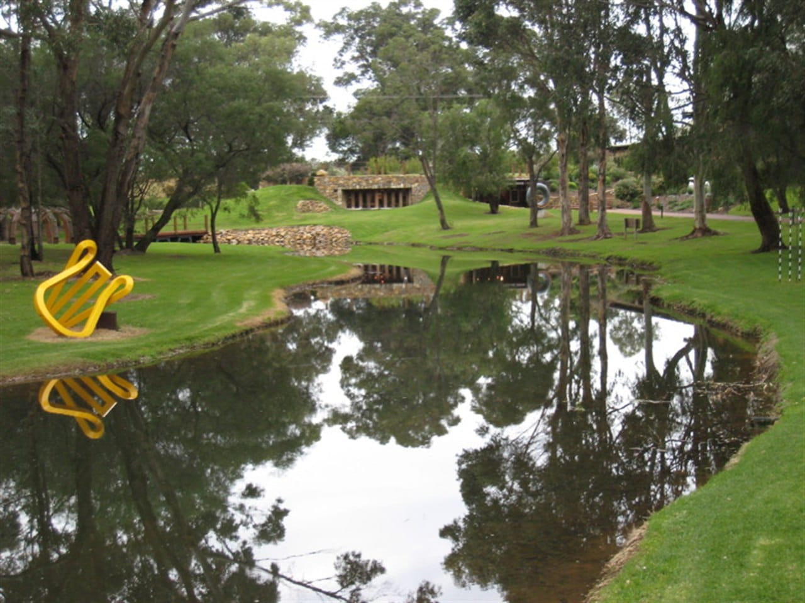

# 玛格丽特河

玛格丽特河（Margaret River）是西澳大利亚州西南角的葡萄酒产区，以 Cabernet Sauvignon 混酿与 Chardonnay 闻名。它三面环海、地理上高度孤立，海洋对气候的影响比澳大利亚多数产区更强。

图：玛格丽特河地区的一处实景。图片：Mark Pegrum，CC BY-SA 2.0，via Wikimedia Commons（[原图页面](https://commons.wikimedia.org/wiki/File:Vasse_Felix_Winery.jpg)）。这张照片来自玛格丽特河产区内已核实条目，用于说明当地风貌，不是玛格丽特河的全区域地图。

## 定义与范围

玛格丽特河位于西澳西南角，珀斯以南约三小时车程，产区范围大致在 Cape Naturaliste 与 Cape Leeuwin 之间的沿海地带。GI 面积 2,137 平方公里，葡萄园 5,725 公顷（Wine Australia 2025–26 口径）；Margaret River Wine Association 的 2024 年报告则按 5,840 公顷统计。两组数字口径不同，引用时应注明来源。

产区约有 175 家酒庄或葡萄酒生产者，其中约 68% 的压榨量低于 100 吨。玛格丽特河约占澳大利亚全国葡萄压榨量的 2%，规模不大，但在精品红白葡萄酒市场地位突出。

## 「玛格丽特河」的时间线
玛格丽特河的商业葡萄种植始于 1967 年，此后在 1970 至 1980 年代逐步扩展。产区的孤立位置与地中海气候吸引了早期生产者，Cabernet Sauvignon 与 Chardonnay 很快成为核心品种。

1990 年代以后，玛格丽特河在国际市场建立声誉，Cabernet Sauvignon 混酿与 Chardonnay 成为代表风格。产区规模有限，酒庄多以家族经营与小产量为主，市场评价更依赖酒庄与年份，而不是某个官方分级。

## 地理与气候

玛格丽特河是澳大利亚海洋性特征最明显的产区之一，尤其是降雨。产区三面受海洋影响，冬季降雨集中，生长季降雨约 202 毫米，1 月均温约 20.9 摄氏度。Wine Australia 形容其气候在干旱年份与波尔多相似。

与许多澳大利亚产区相比，玛格丽特河的昼夜温差较小，热量积累均匀，成熟节奏平稳。这使 Cabernet Sauvignon 的单宁更细致、Chardonnay 的酸度更清晰；同时也意味着年份差异更多来自降雨与成熟期温度，而不是剧烈的高低温波动。

海拔从海平面到 234 米，整体不高，海洋与坡向对微气候的影响更直接。Cape Naturaliste 至 Cape Leeuwin 的山脊以花岗岩与片麻岩为基底，上覆砾质壤土，保水能力整体偏低。低保水能力限制了产量与长势，也解释了产区为何重视地块选择与水分管理。这些差异构成[风土](ref:terroir)基础。

## 地块与差异

玛格丽特河 GI 内部目前没有注册的次级产区，酒标上出现的 Wilyabrup 等地名是常用地块名称，不是独立 GI。产区的差异主要来自距海距离、坡向与土壤厚度，而不是行政区划。

- 北部靠近 Cape Naturaliste 的地块受海洋调节更强，成熟期较平稳。
- 中部与内陆地块热量积累略高，Cabernet Sauvignon 更易达到充分成熟。
- 南部靠近 Cape Leeuwin 的地块风更大、温度更低，Chardonnay 与早熟品种表现更突出。

这些差异是地块层面的，不宜简单等同于“北暖南冷”的固定公式。具体酒款仍要看酒庄、年份与栽培方式。

## 品种与原料

Cabernet Sauvignon 是玛格丽特河最具代表性的红品种，常与 Merlot 混酿，酒体中等至饱满，带成熟黑加仑、紫罗兰与砾石气息。Chardonnay 是核心白品种，常带柑橘、白花与坚果风味，酸度清晰；Semillon 与 Sauvignon Blanc 常混酿为清爽的干白。其他品种包括 Shiraz、Petit Verdot 与 Malbec。

原料是[葡萄](ref:grape)。产区的品种结构相对集中，Cabernet Sauvignon 与 Chardonnay 占据主要面积，这与气候和市场的长期选择有关。

## 「玛格丽特河」怎么做出来
红葡萄经除梗与温控[发酵](ref:fermentation)，Cabernet Sauvignon 常采用较长浸渍与压帽，以提取颜色与单宁，随后在法国[橡木桶](ref:oak-ageing)中陈年，新桶比例因酒庄而异。Cabernet Sauvignon 与 Merlot 的混酿比例、采收时间与浸渍强度，是风格差异的主要来源。

白葡萄低温发酵。Chardonnay 部分经橡木桶发酵、酒泥搅拌与苹果酸乳酸发酵，部分保持不锈钢罐的清爽风格；Semillon 与 Sauvignon Blanc 混酿通常在不锈钢罐中发酵，以保留酸度与草本香气。

## 法规与酒标

澳大利亚葡萄酒的产区标识以 GI 为核心，由 Wine Australia 管理。单一产区、品种或年份标注时，酒款至少 85% 须来自所标注的产区、品种或年份；混酿须在酒标上标明，主要来源排在前。Margaret River 是注册 GI 名称，酒标使用须符合产地规则。

GI 是地理边界，不是质量分级。玛格丽特河没有全国统一的酒庄分级，酒庄声誉来自历史、酒款表现与市场评价。

## 「玛格丽特河」的酒标与喝法
酒标应核对 GI 名称、品种、[年份](ref:vintage)、[酒精度](ref:abv)、容量与装瓶者。标注[单一品种](ref:single-varietal)的酒款须达到 85% 品种比例；混酿按法规列出品种。Cabernet Sauvignon 建议 16–18 摄氏度，Chardonnay 建议 10–12 摄氏度，Semillon 与 Sauvignon Blanc 建议 8–10 摄氏度。

Cabernet Sauvignon 适合红肉、烤肉与硬质奶酪；Chardonnay 适合海鲜、禽肉与奶油类菜肴；Semillon 与 Sauvignon Blanc 适合海鲜、沙拉与轻食。开瓶后冷藏并尽快喝完。本页关于玛格丽特河的内容涉及酒精饮料；过量饮酒有害健康，未成年人不应饮酒。

## 「玛格丽特河」容易被读错的地方
第一，把玛格丽特河当成西澳的唯一产区。西澳还有 Great Southern、Swan District 等 GI。
第二，认为产区只产 Cabernet Sauvignon。Chardonnay、Semillon 与 Sauvignon Blanc 同样重要。
第三，把 GI 当成质量等级。GI 只划定地理范围，不评价酒质。
第四，以为海洋性气候意味着凉爽。玛格丽特河生长季热量充足，昼夜温差小，风格更接近波尔多的干旱年份。
第五，把酒标上的地块名称当成注册 GI。目前产区内部没有注册的次级产区。

**关键事实。**

| 项目 | 内容 |
| --- | --- |
| 一句话定位 | 西澳西南角的葡萄酒产区，三面环海、地理上高度孤立；GI 面积 2,137 平方公里、葡萄园 5,725 公顷（行业协会 2024 年口径 5,840 公顷），海拔 0–234 米，生长季降雨约 202 毫米 |
| 层级 | 其他 |
| 所属 | 澳大利亚 |
| 国家代码 | AU |

## 参考资料
- [葡萄酒](ref:wine)：理解玛格丽特河的类别、年份与产地规则的入口。
- [红葡萄酒](ref:red-wine)与[白葡萄酒](ref:white-wine)：玛格丽特河两大酒类的基本框架。
- [赤霞珠](ref:cabernet)：产区的核心红品种。
- [霞多丽](ref:chardonnay)：产区最具代表性的白品种。
- [长相思](ref:sauvignon-blanc)与[赛美蓉](ref:semillon)：常见的干白混酿组合。
- [葡萄](ref:grape)：酿酒葡萄的结构与成熟指标。
- [发酵](ref:fermentation)：红葡萄浸渍与白葡萄低温发酵。
- [酸度](ref:acidity)：海洋性气候与均匀热量积累对酸度的影响。
- [风土](ref:terroir)：花岗岩、片麻岩与砾质壤土如何影响成熟。
- [橡木桶陈年](ref:oak-ageing)：Cabernet Sauvignon 与 Chardonnay 的桶陈选择。
- [干型](ref:dry)：Semillon 与 Sauvignon Blanc 混酿的干型定位。
- [年份](ref:vintage)：玛格丽特河的年份差异与降雨影响。
- [单一品种](ref:single-varietal)：85% 品种标注规则。
- [酒精度](ref:abv)：酒标上 % vol 的含义。

## 相关图像

图：Sémillon - Joseph Daurel。摄影：Imprimerie A. Bellier & Cie - Bordeaux，CC0，来自 Wikimedia Commons。。图片：Imprimerie A. Bellier & Cie - Bordeaux，CC0，via Wikimedia Commons（[原图页面](https://commons.wikimedia.org/w/index.php?curid=94839238)）。关联图像：玛格丽特河。

图：葡萄。图片：Vyacheslav Argenberg，CC BY 4.0，via Wikimedia Commons（[原图页面](https://commons.wikimedia.org/wiki/File:Grapes,_Rostov-on-Don,_Russia.jpg)）。关联图像：玛格丽特河。
