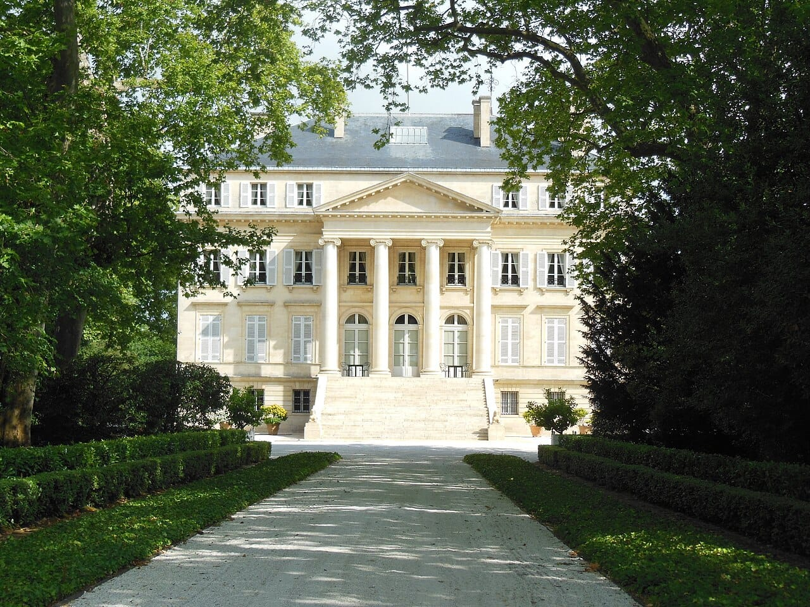

# 玛歌

玛歌（Margaux）是吉伦特河口左岸、梅多克南段的红葡萄酒法定产区，1954 年 8 月 10 日获得 AOC 地位。产区由 Margaux、Cantenac、Labarde、Arsac 与 Soussans 五个公社组成，以砾石丘脊上香气细腻、单宁柔和的赤霞珠混酿著称；1855 年分级中，这里拥有一座一级庄与五座二级庄。

图：玛歌：Château Margaux 2014（Wikimedia Commons）。图片：Jibi44，CC BY-SA 4.0，via Wikimedia Commons（[原图页面](https://commons.wikimedia.org/wiki/File:Ch%C3%A2teau_Margaux_2014.JPG)）。

## 定义与范围

Margaux 只适用于来自划定地块、并在区内完成发酵与陈年的静止红[葡萄酒](ref:red-wine)。法定地理范围覆盖五个公社：Margaux、Cantenac、Labarde、Arsac 与 Soussans；此外还有六个邻近公社被允许承担部分发酵与陈年操作。这里的关键在于，“Margaux”既是村庄名，也是一个覆盖五个公社的产区名，Cantenac 或 Labarde 的葡萄园同样可以标为 Margaux。

这种做法与波尔多其他村庄级产区一致：行政边界服务于管理，产区边界服务于风土识别。消费者看到 Margaux 时，应理解为“玛歌产区”，而不是“玛歌村内某一块地”。

## 五个公社与边界

五个公社沿吉伦特河口左岸自北向南展开。Margaux 村位于核心，Cantenac 紧邻其西侧与南侧，Labarde 与 Arsac 在内陆，Soussans 更靠南。葡萄园多分布在排水良好的砾石丘脊上，丘脊之间是被黏土与石灰岩填充的低地。

这种“村名 + 邻村”的组合，使玛歌产区的风格并不均一：靠河口的坡面更早熟，内陆的砾石脊更晚熟，Cantenac 一带的黏土比例更高。1855 年名单中的多座二级庄位于 Cantenac，也说明“玛歌”作为一个产区名，早已超出单一村庄的范围。

产区气候与波亚克相近，属温带海洋性，河口对极端温度有缓冲作用；不同之处在于玛歌的砾石层通常更薄，黏土与石灰岩更靠近地表，根系更早接触含水层，干旱年份的表现相对稳定。产区南端的 Soussans 地势更平坦，成熟略晚，常用于调配中提供酸度与结构。

五个公社都可标 Margaux，但酒庄与地块差异很大；AOC 只保证范围与规则，不是质量排名。

## 砾石、黏土与香气风格

玛歌的[风土](ref:terroir)常被概括为“砾石 + 黏土 + 石灰岩”的组合，但各地块比例差异很大。砾石丘脊排水快、储热好，适合晚熟的[赤霞珠](ref:cabernet-sauvignon)；黏土较多的地块保水性强，在干旱年份有优势，也让梅洛更容易成熟。

与波亚克的坚实结构相比，玛歌的典型描述是紫罗兰、黑醋栗、雪松与丝滑的单宁，年轻时更易接近，但优质年份仍可陈年数十年。这种“香气优先”的印象来自品种与地块的组合，而不是某个单一土壤成分。

## 1855 年分级中的玛歌

1855 年为巴黎世界博览会制定的梅多克分级，把 Château Margaux 列为一级庄，这是本产区唯一的一级庄。名单同时把 Rauzan-Ségla、Rauzan-Gassies、Durfort-Vivens、Lascombes 与 Brane-Cantenac 列为二级庄，构成玛歌“一级 + 五座二级”的结构。

分级针对酒庄而非地块，因此同一酒庄不同地块、同一地块不同年份，都可以有完全不同的表现。1855 年之后，酒庄分拆、易主与葡萄园买卖持续改变实际版图，名单本身却基本冻结；阅读“列级庄”字样时，应把它当作历史坐标，而不是当前品质排序。

## 品种与配比

法定品种为赤霞珠、梅洛、品丽珠、小维多、马尔贝克与佳美娜。赤霞珠提供骨架、香气与陈年潜力，梅洛带来柔化与较早的成熟；与波亚克相比，玛歌部分地块的梅洛比例更高，这也是其单宁更柔和的原因之一。

法规要求采收时梅洛的最低糖度为 189 克/升，其他品种为 180 克/升；最低自然酒精度为 11%，产量上限 57 百升/公顷，封顶产量 63 百升/公顷，种植密度至少 7,000 株/公顷，最大田间负载 9,500 公斤/公顷，获准灌溉的地块为 8,000 公斤/公顷。这些参数与波亚克相同，风格差异主要来自地块与配比。

配比还会随年份调整：晚熟年份赤霞珠比例上升，早熟年份梅洛比例上升。酒庄通常把不同地块分开发酵，再在调配阶段决定最终比例，这也是同一酒庄不同年份风格变化的技术原因。

## 酿造与陈年

发酵后在[橡木桶](ref:oak-ageing)中陈年，法定最低陈年持续到采收次年的 6 月 1 日，向消费者开放销售不得早于次年 9 月 1 日。上市酒液的苹果酸不得超过 0.30 克/升，可发酵糖不得超过 2 克/升。

玛歌的桶陈策略通常比波亚克更克制，以保留香气；但新桶比例仍因酒庄而异。单宁较柔和的年份可以较早饮用，结构较强的年份则需要更长陈年，二者都不能用“村庄风格”一概而论。

## 酒标与选购

酒标上的 Margaux 必须与产区一致；核对年份、酒精度、容量、装瓶者与酒庄名。列级庄标识只反映 1855 年及其后续个别调整中的历史位置。购买时还要区分“Margaux”与“Margaux 村内某酒庄”——前者是产区，后者是具体酒庄，二者不能互换。

同一年份、同一产区的不同酒庄，价格差异往往远大于风格差异；把产区名当作品质保证，容易忽略酒庄与地块的实际表现。

另一个常见混淆是 Cantenac-Margaux 这个历史地名：它指 Cantenac 一带，而不是一个独立 AOC；酒标写 Margaux 即可，写 Cantenac 并不构成产区等级。选购时更可靠的做法是核对酒庄、年份与地块信息，而不是只看村庄名。

对照阅读：[法国](ref:france)、[赤霞珠](ref:cabernet-sauvignon)。

**关键事实。**

| 项目 | 内容 |
| --- | --- |
| 一句话定位 | 吉伦特河口左岸梅多克南段的红葡萄酒法定产区，1954 年 8 月 10 日获 AOC 地位，范围覆盖 Margaux、Cantenac、Labarde、Arsac 与 Soussans 五个公社；1855 年分级中玛歌酒庄（Château Margaux）为一级庄，另有 Rauzan-Ségla、Rauzan-Gassies、Durfort-Vivens、L… |
| 所属 | 波尔多 |
| 国家代码 | FR |

**来源与边界。** 本页关于「玛歌」的关键事实，主要由以下来源交叉核对：République française、INAO（AOC 管理与 cahier des charges 的官方地位）、Conseil Interprofessionnel du Vin de Bordeaux（波尔多产区分层与村庄级产区的背景）等 4 条来源。价格、批次与状态会变，涉及这些字段时以页面所列来源的最新版本为准。正文为项目自写，来源只作核验，不复制原文。

**并读。** 把「玛歌」与「法国」、「波尔多」、「赤霞珠」放在一起读时，先确认它们是同一层级还是上下游关系：先确认边界与法定分类，再比较气候、土壤、海拔与代表酒款。本页负责给出产区的基本坐标，对照条目补上具体案例与差异；读完再回到本页，才能分清哪些差别属于产区本身，哪些只是产地、批次或品牌选择。

## 参考资料

- [法国](ref:france)：AOC 制度与国家级产区框架。
- [波尔多](ref:bordeaux)：左岸村庄级产区的整体结构。
- [赤霞珠](ref:cabernet-sauvignon)：玛歌混酿的骨架品种。
- [红葡萄酒](ref:red-wine)：玛歌的类别、单宁与酿造概览。
- [风土](ref:terroir)：土壤、地形与微气候如何组合成地块特征。
- [橡木桶陈年](ref:oak-ageing)：桶陈对香气与单宁整合的影响。

## 相关图像

图：Moët & Chandon vineyards in Verzenay, Champagne, France。图片：Mustang Joe，CC0，via Wikimedia Commons（[原图页面](https://www.flickr.com/photos/63234672@N04/13180177073)）。关联图像：玛歌。

图：风土（terroir）。图片：Friedrich Petersdorff，CC BY-SA 2.0 de，via Wikimedia Commons（[原图页面](https://commons.wikimedia.org/wiki/File:080110_zell_mosel.JPG)）。关联图像：玛歌。
