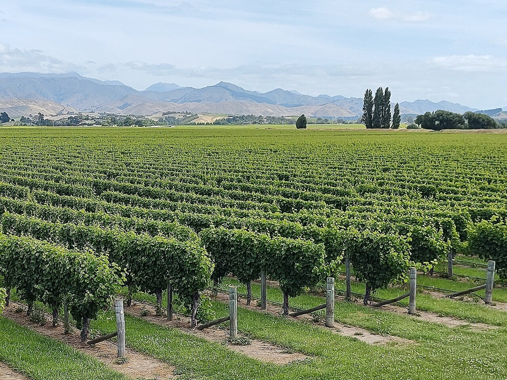

# 马尔堡

马尔堡（Marlborough）是新西兰最大的葡萄酒产区，位于南岛东北端。它以 Sauvignon Blanc 打开国际市场，也生产 Pinot Noir、Chardonnay 与芳香型白葡萄酒。凉爽而日照充足的气候、低降雨与排水良好的土壤，是理解马尔堡风格的关键。

图：马尔堡怀劳谷（Wairau Valley）的葡萄园，整齐的藤行伸向远处。图片：Jonathan Harker，CC BY 4.0，via [原图页面](https://commons.wikimedia.org/wiki/File:Wairau_Valley_vineyards_in_the_Marlborough_wine_region,_New_Zealand.jpg)。

## 定义与范围

马尔堡位于新西兰南岛东北端，行政上属 Marlborough 地区，中心城镇为 Blenheim。按新西兰葡萄酒种植者 2026 年葡萄种植报告，产区种植 32,191 公顷葡萄，占全国种植面积 73%；产果面积 31,603 公顷，有 1,134 个葡萄园，平均每个葡萄园约 28 公顷。

Marlborough GI 于 2018 年注册。GI 划定地理边界，酒标使用须满足产地比例要求。产区内部主要有三个次级产区：Wairau Valley、Southern Valleys 与 Awatere Valley。

## 「马尔堡」的时间线
马尔堡的现代葡萄酒业起步于 1970 年代，早期以试验性种植为主。1980 年代，Sauvignon Blanc 以强烈的香气与清晰的酸度打开出口市场，使新西兰葡萄酒进入国际视野。

此后产区迅速扩张，成为全国种植面积最大的产区。1990 年代以后，Pinot Noir、Chardonnay 与芳香型品种的面积增加，次级产区的差异也逐渐被重视。产区的扩张伴随灌溉、机械化与出口导向，但小产量、精细栽培的酒庄仍占重要位置。

## 地理与气候

马尔堡位于南岛东北端的雨影区，气候凉爽但日照充足，降雨少，生长季常受来自海上的凉风影响。当地毛利语称 Wairau Valley 为“云层有洞的地方”，指其日照条件。

昼夜温差与海风是成熟节奏的关键。白天热量足以推进成熟，夜间降温帮助保留酸度；Awatere Valley 更靠南、更干燥、风更大，成熟更慢；Wairau Valley 的河床砾石排水快、升温早；Southern Valleys 的土壤更重、含更多黏土，向南更凉更干。

土壤以河流冲积砾石、砂质壤土与黏土为主，肥力中等、排水良好。排水过快的地块需要灌溉补充水分，保水较好的地块则要控制长势。这些差异构成[风土](ref:terroir)基础。

## 次级产区

马尔堡的三个次级产区各有侧重：

- Wairau Valley：面积最大，以老河床砾石为主，地块与降雨差异形成多种中气候；沿海地块受海风调节，内陆更干、更早熟。
- Southern Valleys：包括 Omaka、Fairhall、Brancott、Ben Morvan 与 Waihopai 等谷地，土壤更重、黏土更多，向南更凉更干，Pinot Noir 与芳香型品种表现突出。
- Awatere Valley：位置最南、地理上最独立，更凉、更干、风更大，常有海拔差异，产量较低，Sauvignon Blanc 香气更鲜明，Pinot Noir 更偏芳香。

次级产区是地理与气候概念，不是质量等级。同一产区内的酒庄、年份与地块差异仍然很大。

## 品种与原料

Sauvignon Blanc 是马尔堡的主导品种，常带百香果、青柠、青草与矿物气息，酸度高、香气外放。Pinot Noir 呈深色樱桃、李子与香料气息，酒体中等、单宁细致；Chardonnay 从清爽型到经橡木桶发酵的浓郁型都有；Riesling、Pinot Gris 与 Gewürztraminer 等芳香型品种覆盖干型到甜型。

原料是[葡萄](ref:grape)。品种结构高度集中在 Sauvignon Blanc，这与国际市场需求、气候适应性与栽培传统有关，但不意味着其他品种不重要。

## 「马尔堡」怎么做出来
Sauvignon Blanc 多在低温下用不锈钢罐[发酵](ref:fermentation)，以保留香气与酸度；部分酒庄使用天然酵母、旧桶或酒泥搅拌增加复杂度。Pinot Noir 常部分整串发酵，浸渍时间较短，低温发酵，并在法国[橡木桶](ref:oak-ageing)中陈年，新桶比例通常较低。

Chardonnay 部分经橡木桶发酵与酒泥搅拌；芳香型品种依酒庄风格决定是否保留残糖。起泡酒采用传统法的生产规模较小，但品质受到关注。

## 法规与酒标

新西兰葡萄酒地理标志受《地理标志（葡萄酒与烈酒）注册法》管理，Marlborough GI 于 2018 年注册。酒标标注单一品种、年份或产区时，至少 85% 的酒液须来自所标注的品种、年份或产区；混酿须按比例从高到低标注。

GI 是地理边界，不是质量分级。新西兰没有全国统一的酒庄分级，酒庄声誉来自历史、酒款表现与市场评价。酒标上的产区名越具体，原料来源通常越集中，但不必然代表更高品质。

## 「马尔堡」的酒标与喝法
酒标应核对 GI 名称、品种、[年份](ref:vintage)、[酒精度](ref:abv)、容量与装瓶者。标注[单一品种](ref:single-varietal)的酒款须达到 85% 品种比例；混酿按法规列出品种。Sauvignon Blanc 建议 8–10 摄氏度，Chardonnay 建议 10–12 摄氏度，Pinot Noir 建议 14–16 摄氏度，Riesling 依风格可在 8–12 摄氏度。

Sauvignon Blanc 适合海鲜、沙拉、山羊奶酪与亚洲料理；Pinot Noir 适合禽肉、蘑菇与清淡红肉；Chardonnay 适合奶油类菜肴。开瓶后冷藏并尽快喝完。本页关于马尔堡的内容涉及酒精饮料；过量饮酒有害健康，未成年人不应饮酒。

## 「马尔堡」容易被读错的地方
第一，认为马尔堡 Sauvignon Blanc 都是一个味道。次级产区、酒庄与年份会带来明显差异。
第二，把马尔堡当成新西兰葡萄酒的全部。霍克斯湾、中奥塔哥、怀拉拉帕等产区同样重要。
第三，把 GI 当成质量等级。GI 只规定地理来源，不评价酒质。
第四，以为产区凉爽就成熟不足。马尔堡日照充足，成熟依靠昼间热量与较长生长季。
第五，把次级产区当成注册 GI。Wairau Valley、Southern Valleys 与 Awatere Valley 是常用产区划分，酒标规则仍以 GI 与 85% 比例为准。

对照阅读：[葡萄酒](ref:wine)、[红葡萄酒](ref:red-wine)。

**关键事实。**

| 项目 | 内容 |
| --- | --- |
| 一句话定位 | 新西兰南岛东北端的葡萄酒产区，全国最大的葡萄酒产区；2026 年葡萄种植报告口径为种植 32,191 公顷，占全国 73%，产果 31,603 公顷，有 1,134 个葡萄园 |
| 层级 | 其他 |
| 所属 | 新西兰 |
| 国家代码 | NZ |

**来源与边界。** 本页关于「马尔堡」的关键事实，主要由以下来源交叉核对：New Zealand Winegrowers（产区概况、三个次级产区、气候与土壤描述、品种与酒款风格；马尔堡种植面积、产果面积、葡萄园数量与占全国比例）、Intellectual Property Office of New Zealand (IPONZ)（Marlborough GI 的注册状态与注册年份）、New Zealand Legislation（单一品种、年份与产区标注的 85% 规则及混酿标注顺序）。价格、批次与状态会变，涉及这些字段时以页面所列来源的最新版本为准。正文为项目自写，来源只作核验，不复制原文。

## 参考资料
- [葡萄酒](ref:wine)：理解马尔堡的类别、年份与产地规则的入口。
- [红葡萄酒](ref:red-wine)与[白葡萄酒](ref:white-wine)：马尔堡两大酒类的基本框架。
- [长相思](ref:sauvignon-blanc)：马尔堡最具辨识度的品种。
- [黑皮诺](ref:pinot-noir)：马尔堡红葡萄酒的核心品种。
- [霞多丽](ref:chardonnay)与[雷司令](ref:riesling)：马尔堡白葡萄酒的另一条主线。
- [葡萄](ref:grape)：酿酒葡萄的结构与成熟指标。
- [发酵](ref:fermentation)：Sauvignon Blanc 与 Pinot Noir 的发酵差异。
- [酸度](ref:acidity)：凉爽夜晚与海风对酸度的影响。
- [风土](ref:terroir)：砾石、黏土与中气候如何划分次级产区。
- [橡木桶陈年](ref:oak-ageing)：Pinot Noir 与 Chardonnay 的桶陈选择。
- [干型](ref:dry)：芳香型品种从干型到甜型的风格。
- [年份](ref:vintage)：马尔堡的年份差异与降雨影响。
- [单一品种](ref:single-varietal)：85% 品种标注规则。
- [酒精度](ref:abv)：酒标上 % vol 的含义。

## 相关图像

图：酸度（acidity）。图片：Chemicalinterest，Public domain，via Wikimedia Commons（[原图页面](https://commons.wikimedia.org/wiki/File:Zn_reaction_with_HCl.JPG)）。关联图像：马尔堡。

图：橡木桶陈酿的编辑插图：桶壁烘烤层、酒液与取样管；AI 辅助绘制，不是酒窖实拍。图片：Hejiu 编辑团队，使用豆包 Seedream 5.5 AI 辅助生成；项目自制，不是现场照片（[项目说明](https://hejiu.org/about/)）。关联图像：马尔堡。
