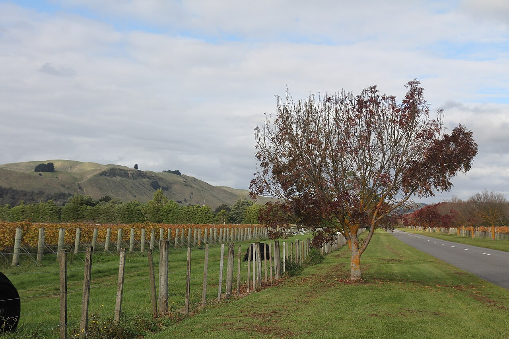

# 马丁堡

马丁堡是新西兰北岛怀拉拉帕谷地南端的精品葡萄酒产区，也是新西兰现代黑皮诺的重要起点；葡萄园集中在马丁堡台地，村庄小、酒庄密，冷凉气候与砾石土壤让酒风偏咸鲜、结构感强。

图：Martinborough：IMG9408 Martinborough vineyards, New Zealand（Wikimedia Commons）。图片：jonathanischoice，CC BY 2.0，via Wikimedia Commons（[原图页面](https://commons.wikimedia.org/wiki/File:IMG9408_Martinborough_vineyards,_New_Zealand.jpg)）。

## 先划清「马丁堡」的边界
马丁堡位于惠灵顿东北约一小时车程的怀拉拉帕谷地南端，行政上属于南怀拉拉帕。它不是一个巨大的葡萄种植带，而是围绕马丁堡村展开的一小片产区：台地、村边地块与向东延伸的 Te Muna 一带共同构成今日的种植版图。对外行来说，最容易记住的是“小”；对种植者来说，真正重要的是这片小地方同时拥有排水极快的砾石台地、挡雨的 Tararua 山脉和足够长的秋季。

在酒标上，“Martinborough”是地理标志，不是某一座酒庄的名字。它说明葡萄来自这个划定区域，却不保证一定来自台地最好的地块，也不说明酒庄规模、树龄或酿造方式。同一片产区里，既有几十年树龄的家庭酒庄，也有收购果实的大型酒商；把产区名、酒庄名、单一园与年份分开读，才不会把“马丁堡”当成一个固定的风味标签。

马丁堡台地常被描述为长约五公里、宽约一公里的一弯高地，表层是薄薄的粉砂壤土，下面是深厚的河流砾石。台地之外，Te Muna 路一带的黏土比例更高，村南与谷地边缘的土壤更杂；这些差别不会都写在正面酒标上，却会改变黑皮诺的香气、单宁和成熟节奏。

## 历史与命名

马丁堡的现代葡萄酒史有一个很明确的起点：1978 年，土壤科学家 Derek Milne 在 DSIR 的研究中把这里的土壤、降雨与生长季和勃艮第作比较，认为马丁堡具备种植高品质黑皮诺的潜力。这个判断不是浪漫故事，而是把气候与土壤数据放在一起的结果；它直接说服了一批人去买地、试种。

1979 年，Neil McCallum 在台地上种下 Dry River 的第一批商业葡萄；1980 年，Clive Paton 在村北一片五公顷的羊圈砾石地上创建 Ata Rangi，Derek Milne 与 Russell Schultz 等人则建立 Martinborough Vineyard。此后几年，Te Kairanga（1984）、Palliser（1989）等酒庄陆续出现；1999 年，曾在 Martinborough Vineyard 酿酒的 Larry McKenna 又在 Te Muna 路创建 Escarpment，把产区的东界往外推了一截。

这段历史常被压缩成“1980 年一代先驱”，但真正决定产区性格的还有两件事：一是 1980 年代后期到 1990 年代，马丁堡的黑皮诺在国际比赛中连续获得关注，让这个人口很少的村庄进入全球黑皮诺讨论；二是 2000 年以后，土地价格、旅游与出口市场一起上涨，酒庄开始更明确地按单一园、克隆与酿造哲学来区分自己。先驱故事提供身份，市场与土地才解释今天的价格和风格分歧。

## 「马丁堡」的地理与风土
马丁堡的气候核心是“雨影”：盛行西风从 Tararua 与 Remutaka 山脉上抬升、降雨，越过山脊后变得干燥，村一带年降雨大约七百到八百毫米，生长季却常有很长的干燥秋季。这里日照超过两千小时，白天温和、夜晚明显转冷，昼夜温差把酸度保留下来；强风会加厚果皮、降低病害压力，也会在花期与成熟期制造压力。

台地的土壤是古老的河流冲积物：灰绿色砾石、砂与薄层粉砂壤土，排水快、养分低，葡萄根系必须往下扎。水分胁迫让果粒变小、皮果比提高，成熟速度也更慢；这正是马丁堡黑皮诺能够同时拥有深色果味与清晰酸度的原因之一。台地不同高度与砾石层厚度会带来细微差别，较高、较老的台地通常更集中，低处与粉砂较多的地块则更香、更早熟。

主要风险不是“太冷”，而是春季霜冻、花期大风、采收期降雨与干旱的年份波动。海洋调节让冬季不算严酷，却也让春季回暖不稳定；一场霜冻可能直接削掉产量。近年更热的夏季与更早的采收窗口，让种植者在“保留酸度”与“拿到成熟单宁”之间更难两全，部分人开始寻找更高、更靠东或更晚熟的地块。

## 「马丁堡」的品种与风格坐标
黑皮诺占马丁堡葡萄种植的六成以上，是毫无争议的主角；霞多丽、长相思、灰皮诺、雷司令与少量西拉、赤霞珠、梅洛也有种植。白葡萄多用于起泡酒、清爽型干白与晚收甜酒，红葡萄则集中在黑皮诺与少量波尔多式混酿。产区面积只占新西兰葡萄园的一小部分，却长期被视为该国黑皮诺的标杆之一。

马丁堡黑皮诺的典型不是“果酱炸弹”，而是咸鲜、细瘦而有骨架：黑樱桃、黑李子、干香草、茶叶、亚洲香料与湿土气息，酸度清晰，单宁细但有力，余味偏干。好的年份与老藤可以陈年十年以上，逐渐出现蘑菇、皮革与瓶陈香料。它和中部奥塔哥更饱满、更甜美的黑皮诺形成对照；两者没有高下，只有气候与土壤带来的方向差异。

酿造上，整串发酵比例、浸渍时间、桶陈大小与是否带梗，会把同一块地的酒拉向不同方向。马丁堡不少酒庄倾向较少干预、较低的新桶比例，让纹理与酸度站出来；也有酒庄用更高比例的新橡木和更长的桶陈，做出更宽阔的风格。买酒时，酒庄的酿造哲学往往比“马丁堡”三个字更能预测你杯中的样子。

## 代表生产者与酒款

Ata Rangi 是产区最具代表性的名字之一，旗舰黑皮诺来自 1980 年种下的原始地块，风格以香料、红果、细密单宁与长时间回味著称；Dry River 以低产、浓郁、耐陈年的黑皮诺和少量白葡萄建立声誉；Martinborough Vineyard 则与 Larry McKenna 早期酿造的国际关注紧密相连。Escarpment 在 Te Muna 路一带继续探索更东、更黏土的风土，Palliser、Te Kairanga、Schubert、Margrain 与 Craggy Range 也都在这片小产区里占有一席。

这些名字不是官方分级，而是市场与行业长期形成的参照。Ata Rangi、Dry River 的旗舰酒价格高、产量小；Palliser、Te Kairanga 的入门款更容易在餐厅与零售渠道找到；Escarpment 的单一园与 Kupe 系列则适合比较Te Muna 与台地的差异。把“村庄级、单一园、旗舰款”分开看，比只认酒庄名更有效。

## 「马丁堡」的上桌方式
黑皮诺适合稍凉饮用，大约十四到十六摄氏度；温度太高会让酒精和苦味抢戏，太低则把香气关住。杯子选中等肚径的勃艮第杯或通用酒杯即可，不必追求极窄的专用杯。开瓶后先倒一小杯，等十到二十分钟再判断；许多马丁堡黑皮诺在刚开瓶时偏紧，醒酒过度反而会失去酸度与香气。

配餐上，当地最常见的组合是羊肉、鸭肉、鹿肉、蘑菇与带泥土气息的根茎蔬菜；咸鲜、带香料的菜式能和酒里的干香草、茶叶味接上。霞多丽适合海鲜、白肉与奶油酱，但马丁堡的霞多丽通常酸度高、桶味克制，不必配太重口的酱汁。若吃辣，黑皮诺的酒精与酸度会被放大，选果味更成熟、单宁更柔的年份或酒款更稳妥。

## 选购、标签与误区

看马丁堡酒标，先分清“Martinborough”与“Wairarapa”：前者是更小的地理标志，后者覆盖整个怀拉拉帕谷地，包括 Gladstone 与 Opaki。再往下一级是单一园或地块名，例如 Te Muna 路、Huangarua 台地等；这些名字不是法定分级，却能提示土壤与成熟节奏。年份在马丁堡尤其重要，霜冻、花期大风与采收雨会显著改变产量和风格。

“新西兰的勃艮第”是有效的历史类比，不是品质保证。马丁堡面积小、产量少、地价高，入门款并不便宜；同一酒庄的村庄级与单一园可能价差数倍，但便宜的那款不一定“更差”，只是果实来源与桶陈不同。购买时留意进口商、储存条件与瓶塞状态；马丁堡的黑皮诺对运输温度很敏感，长期存放在过热仓库里的酒，开瓶后更容易出现果味发闷与酸度突兀。

## 「马丁堡」周边怎么走
马丁堡村很小，多数品鉴室可以步行或短车程到达，适合把一天排成“两到三个预约 + 午餐”，而不是赶场。惠灵顿出发可以当天往返，但若要参加每年十一月的 Toast Martinborough 葡萄酒节，或想比较 Te Muna 与台地的酒庄，住一晚更从容。采收季（南半球三到四月）酒庄最忙，部分品鉴室缩短营业时间，出发前应确认预约与交通。

开车是主要方式，村与村之间没有密集公共交通；品鉴后不驾车是基本规则。若不开车，可以选村里的步行路线，或参加从惠灵顿出发的小团。葡萄园土路、石阶与品鉴室的门槛对行动不便者并不总是友好，带长辈或小孩时先问清无障碍与洗手间位置。

相关条目：[新西兰](ref:new-zealand)、[黑皮诺](ref:pinot)、[霞多丽](ref:chardonnay)。

## 参考资料
- 相关条目：[new-zealand](ref:new-zealand)、[pinot-noir](ref:pinot)、[chardonnay](ref:chardonnay)、[red-wine](ref:red)、[white-wine](ref:white)。
- 本页不提供地图、实时营业时间或价格；出行前以产区协会与酒庄官网为准。
- 想理解“台地”与“Te Muna”的差别，最有效的方法是在同一趟行程里各选一家酒庄，点同一品种、同一年份，记录香气、酸度与单宁的差异。
