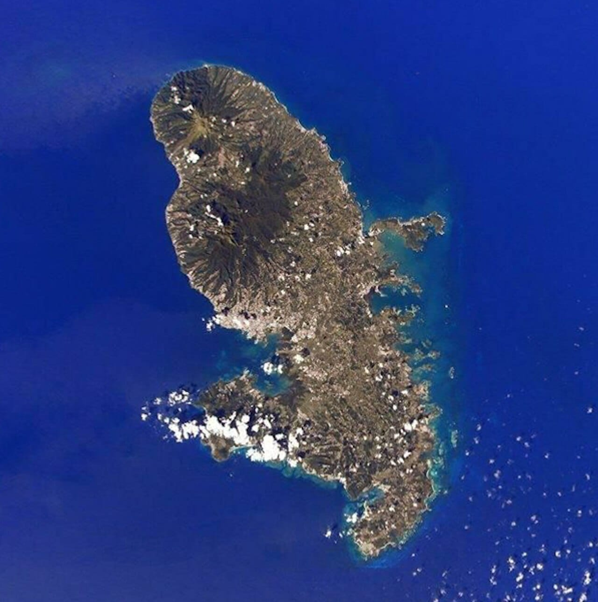

# 马提尼克

马提尼克是加勒比海小安的列斯群岛中的法属岛屿，位于多米尼克与圣卢西亚之间。它最特殊的地方不在风景，而在制度：1996 年 11 月 5 日的法国法令为“Rhum de la Martinique”建立了原产地命名控制（AOC），这是朗姆酒世界中第一个以产地与工艺同时约束的 AOC。理解马提尼克，需要把火山、甘蔗带、发酵时限与克里奥尔柱式蒸馏器放在同一套规则里看。

图：马提尼克。图片：ESA/NASA，Public domain，via Wikimedia Commons（[原图页面](https://commons.wikimedia.org/wiki/File:Martinique-de-haut_(cropped).jpg)）。

> **先给结论**
> **一句话：** 这页判断马提尼克的风味与旅行价值，以及怎么安排。
>
> - **适合谁：** 正在比较马提尼克与其他产区、准备买酒或安排旅行的人。
> - **不适合谁：** 只想要“哪个产区最贵”的结论、不关心风格和年份的人。
> - **先看这两点：**
>   - 马提尼克是法国的海外省，行政代码 MQ，本页把它作为法国之下的省级产区节点。
>   - 马提尼克属热带海洋性气候，受信风与赤道洋流影响，6 月至 12 月为湿热季，1 月至 5 月相对干燥。

## 岛屿与地理

马提尼克是法国的海外省，行政代码 MQ，本页把它作为[法国](ref:france)之下的省级产区节点。岛屿北部以培雷火山（Mont Pelée）为主体，1902 年的喷发曾摧毁圣皮埃尔（Saint-Pierre）；南部地势较缓，更多沉积与石灰岩地貌。甘蔗带并不覆盖全岛：AOC 划定的是适合甘蔗成熟、排水良好且不在高山多雨区或盐沼沿海的地块。蒸馏厂多分布在北部与中部河谷，靠近甘蔗供应与水源。

## 气候与甘蔗带

马提尼克属热带海洋性气候，受信风与赤道洋流影响，6 月至 12 月为湿热季，1 月至 5 月相对干燥。甘蔗需要 20℃ 以上的温度、生长期充足降雨，以及成熟期适度的水分压力；这种“先湿后干”的节奏有利于糖分积累。AOC 的采收期因此被限定在 1 月 1 日至 8 月 31 日之间，既避开最湿的季节，也保证压榨时甘蔗的新鲜度。海拔与迎风/背风差异造成不同的小气候，蒸馏厂按地块与成熟期安排供应。

## 土壤与地块

北部火山灰土壤排水好、矿物质丰富，赋予甘蔗较强的生长势；南部黏土与石灰岩地块保水性强，成熟节奏不同。AOC 明确排除前 50 厘米内强烈水化的土壤、冲积谷底以及受盐水影响的沿海红树林地带。土壤水储量、降雨与昼夜温差共同决定甘蔗的糖分、酸度与香气前体，进而影响[发酵](ref:fermentation)与蒸馏后的风格。岛上约有十五个甘蔗品种在种植，分布随各地块的土壤气候而异。

## 历史：从糖厂副产物到农业朗姆

甘蔗约在 1640 年进入马提尼克，岛上长期以糖业为主，蒸馏最初只是处理糖蜜与糖厂副产物的手段。1854 年，拿破仑三世政府取消相关税负，马提尼克的朗姆产量与对法出口迅速扩大；19 世纪末，岛上一度成为世界最大的朗姆产地之一。1884 年至 1896 年的糖业过剩危机导致大量糖厂关闭，部分庄园转而直接压榨甘蔗、发酵甘蔗汁并蒸馏，农业朗姆（rhum agricole）由此成形。与此同时，连续式克里奥尔柱逐渐取代壶式蒸馏器，以适应甘蔗汁不耐久放、需要快速处理的特点。

## 法定框架：1996 年 AOC

“Rhum de la Martinique”由 1996 年 11 月 5 日法令确立，并由 INAO 管理，后纳入欧盟地理标志体系。AOC 约束的不只是产地，还包括甘蔗品种、种植、采收、压榨、发酵、蒸馏、陈年与装瓶。名称中的 agricole 指原料为新鲜甘蔗汁，而不是糖蜜；标注 AOC 的产品必须产自马提尼克并符合整套规则。AOC 是产地与工艺的保证，不是质量排名。岛上同样生产以糖蜜为原料的工业朗姆（rhum industriel），属于[朗姆酒](ref:rum)大类，但不在这一 AOC 范围内；两类产品可以在同一厂区生产，标签与原料必须区分。

## 地理范围与 34 个公社

AOC 的地理范围覆盖马提尼克的 34 个公社，包括法兰西堡（Fort-de-France）、勒拉芒坦（Le Lamentin）、圣皮埃尔（Saint-Pierre）、勒罗贝尔（Le Robert）、拉特里尼泰（La Trinité）、圣玛丽（Sainte-Marie）、勒马兰（Le Marin）与圣安娜（Sainte-Anne）等。甘蔗必须在 INAO 核准的地块范围内种植，蒸馏、陈年与装瓶也须在区内完成。范围看似覆盖全岛，实际通过地块划界排除了高山雨林、盐沼与不适宜的水化土壤，因此“岛产”不等于“AOC”。

## 甘蔗、采收与产量

AOC 规定甘蔗品种须属于 Saccharum officinarum 与 Saccharum spontaneum 及其杂交种，禁止转基因品种；新引种需在区内适应、繁殖与筛选至少 4 年才能用于 AOC 生产。灌溉在种植或采收后最多 6 个月，且 12 月 1 日至采收日之间禁止灌溉；禁止使用催熟物质。采收期从 1 月 1 日开始，至 8 月 31 日结束。压榨前的甘蔗汁须达到 14 Brix 以上、pH 4.7 以上；地块产量不得超过 120 吨/公顷。这些参数把“新鲜、成熟、不过量”写成了可核查的门槛。

## 发酵：120 小时上限

甘蔗汁经机械压榨与清水/末道汁浸提后，以机械方式澄清，不加热、不加石灰。发酵必须为间歇式，使用惰性材料制成的开放式发酵槽，单槽容量不超过 500 百升；连续发酵与密闭槽被禁止。不得添加糖蜜、糖浆或其他糖业副产物来提高酒精度。发酵从装满发酵槽到进入蒸馏，最长不得超过 120 小时；发酵液酒精度不得超过 7.5%。短促、低温的发酵保留了甘蔗的草本、柑橘与花香，也降低了挥发酸与杂菌风险。

## 蒸馏：克里奥尔柱

蒸馏必须在 1 月 2 日至 9 月 5 日之间完成。AOC 规定的传统方式是带回流的连续多级蒸馏，即克里奥尔柱（colonne créole）：提馏区至少 15 块不锈钢或铜制塔板，浓缩区为全铜材质、5 至 9 块塔板，提馏区柱径在 0.7 至 2 米之间。蒸馏器以直接蒸汽或管式换热器加热发酵液，馏出液酒精度控制在 65% 至 75% 之间。禁止在液相中做改变馏出物部分浓度的精馏操作。与传统壶式蒸馏相比，克里奥尔柱效率更高，能在甘蔗汁变质前快速处理，同时保留足够的酯类与香气。

## 陈年与标签：blanc、EBS 与 vieux

白色农业朗姆（blanc）必须无色，蒸馏后在槽中静置至少 6 周才可上市；也可短暂入桶，但不得着色。标注“élevé sous bois”（EBS）的酒须在橡木容器中陈年至少 12 个月；标注“vieux”的酒须在容量小于 650 升的橡木容器中陈年至少 3 年；若标注蒸馏年份，则须至少陈年 6 年。所有 AOC 朗姆上市时酒精度不得低于 40%；标准产品的非甲基/乙基挥发物须达到 225 克/百升纯酒精，EBS 为 250 克，vieux 为 325 克。陈年带来香草、椰子、干果与木质，但甘蔗的植物感仍是辨认产区的线索。

## 风格与代表生产者

白色农业朗姆常见新鲜甘蔗汁、青草、柠檬皮、青香蕉与矿物气息，口感干爽，适合调制 Ti' Punch 等本地饮法；陈年版本则更圆润，带香草、可可、干果与香料。代表性生产者包括克莱蒙（Clément）、HSE（Habitation Saint-Étienne）、拉莫尼（La Mauny）、德帕兹（Depaz）、三河（Trois Rivières）、内松（Neisson）、圣詹姆斯（Saint-James）、拉法沃里特（La Favorite）与 JM。它们的差异来自甘蔗来源、蒸馏器操作与陈年策略，不能用一个岛名概括。

## 年份与市场

农业朗姆的“年份”与葡萄酒不同：多数产品是多年调配，只有标注蒸馏年份的 vieux 才强调单一年份，并须满足至少 6 年陈年。甘蔗年份、雨季长度与台风会影响糖分与香气，但酒厂更常通过调配保持风格稳定。市场长期以法国本土为主，近年出口到美国、日本与欧洲调酒市场，白色 Agricole 在鸡尾酒吧中的可见度上升，陈年版本则进入精品烈酒货架。旅游与酒庄参观也是重要收入来源。

## 常见误区

第一，把农业朗姆等同于所有马提尼克朗姆，岛上同样生产糖蜜朗姆。第二，把 AOC 当成质量等级，它只规定产地与工艺。第三，认为农业朗姆一定是白色，陈年版本同样存在。第四，认为甘蔗汁朗姆更甜，多数成品并不甜。第五，认为所有克里奥尔柱都一样，塔板数量、铜材与操作仍造成差异。第六，认为颜色越深越陈，颜色也可能来自焦糖着色，需看标签与陈年声明。

## 延伸阅读

- [法国](ref:france)：法国原产地命名制度与产区层级。
- [朗姆酒](ref:rum)：朗姆酒的原料类别与基本工艺。
- [蒸馏](ref:distillation)：连续蒸馏与壶式蒸馏的基本原理。
- [发酵](ref:fermentation)：甘蔗汁发酵与风味前体。
- [橡木桶陈年](ref:oak-ageing)：陈年农业朗姆的桶型与风味。

## 相关图像

图：四方朗姆酒厂的橡木桶仓库，热带陈年与桶型共同塑造朗姆风格。图片：Unknown author Unknown author，CC BY 2.5，via Wikimedia Commons（[原图页面](https://commons.wikimedia.org/wiki/File:Foursquare_Rum_Distillery_Barrel_Warehouse.jpg)）。关联图像：马提尼克。

图：Moët & Chandon vineyards in Verzenay, Champagne, France。摄影：Mustang Joe，CC0，来自 Flickr / Openverse。。图片：Mustang Joe，CC0，via Wikimedia Commons（[原图页面](https://www.flickr.com/photos/63234672@N04/13180177073)）。关联图像：马提尼克。
