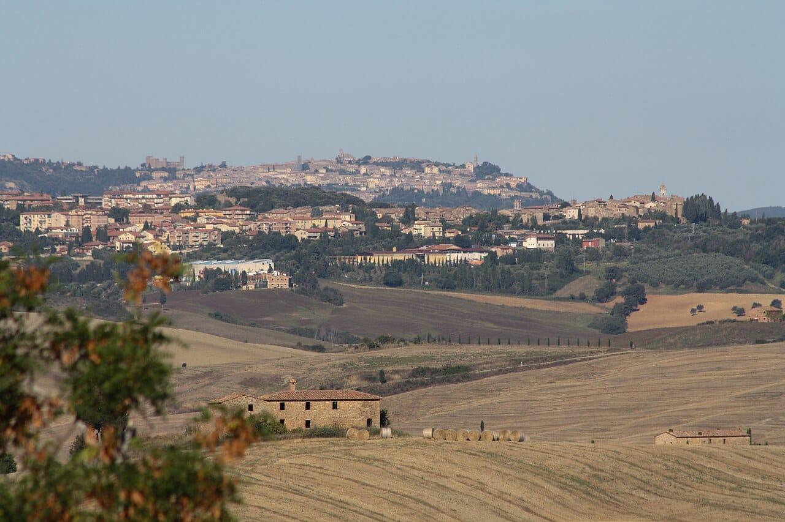
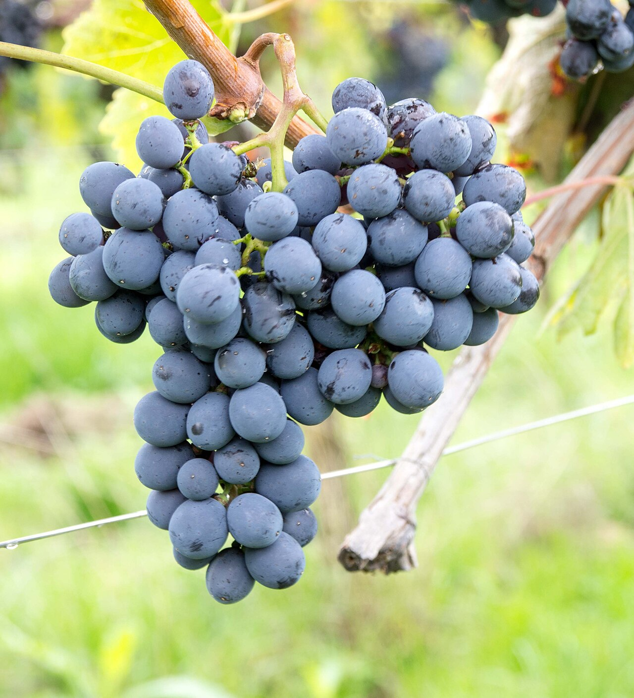

# 蒙塔希诺

蒙塔希诺（Montalcino）是意大利托斯卡纳锡耶纳省蒙塔希诺市镇的红葡萄酒保证法定产区（DOCG），以 100% 桑娇维塞酿造的布鲁奈罗（Brunello）著称。它的法定范围只有一个市镇，却因土壤、海拔与坡向的差异，在同一套规范下呈现出相当多样的风格。

图：蒙塔希诺。图片：Marco Usan，CC BY 3.0，via Wikimedia Commons（[原图页面](https://commons.wikimedia.org/wiki/File:Montalcino-_panoramio.jpg)）。

## 定义与范围

蒙塔希诺的 DOCG 只能用于在蒙塔希诺市镇范围内完成全部生产与装瓶的红[葡萄酒](ref:red-wine)。产区位于[意大利](ref:italy)中部的[托斯卡纳](ref:tuscany)，行政上属于锡耶纳省；Brunello di Montalcino、Rosso di Montalcino、Moscadello di Montalcino 与 Sant'Antimo 四种命名都限定在同一市镇内。

Brunello 不是另一个葡萄品种，而是当地对桑娇维塞的传统称呼。法规要求 Brunello 使用 100% [桑娇维塞](ref:sangiovese)，不得混入其他品种；Rosso di Montalcino 使用同一品种，但定位为更早饮用的红酒。两者的差别主要来自陈年要求与上市时间，而不是葡萄来源。

酒标上的 Montalcino 必须与法定范围一致；Brunello 只能装瓶于产区内，并使用规定的波尔多形瓶。购买时核对 DOCG 字样、年份与装瓶信息，比只看酒庄名称更能确认身份。

## 历史脉络

蒙塔希诺的葡萄种植与酿酒传统可追溯到中世纪，村庄位于锡耶纳以南、瓦尔道尔恰与马雷马之间的丘陵。19 世纪后半叶，本地酒农开始以纯桑娇维塞酿造可长期陈年的红酒，Brunello 的名称逐渐与这一风格绑定。

1980 年 7 月 1 日总统令授予 Brunello di Montalcino DOCG 地位，这是意大利最早一批保证法定产区之一。1984 年起，Rosso di Montalcino 获得 DOC 地位；1996 年起，Sant'Antimo DOC 进一步补全了蒙塔希诺的产品金字塔，涵盖白葡萄酒与红葡萄酒。

1998 年 5 月 19 日的法令确立了当时生效的规范，此后又有修订。规范把品种、产量、陈年、上市日期与装瓶地点逐项固定下来，使“Brunello”不再只是一个地方酒名，而是一套可核查的法律身份。

## 地理与气候

蒙塔希诺市镇位于锡耶纳以南的丘陵，葡萄园分布在村庄周围的山坡与谷地边缘。海拔与坡向造成明显的微气候差异：朝南坡面更暖、成熟更早，朝北或较高处更凉、酸度更高；谷底容易积冷空气，通常不是最优地块。

气候受地中海与第勒尼安海影响，夏季温暖干燥，秋季昼夜温差大，夜间凉爽有助于保留酸度。周围山地与谷地为产区提供一定的屏障与空气流动，但年份差异仍然明显，降雨时机往往比平均温度更能决定采收质量。

土壤类型多样，从 galestro 泥灰岩、黏土到砂质与海洋沉积物都有分布，排水性与水分保持能力差别较大。单一块地很难代表整个市镇，同一酒庄不同葡萄园的酒也常呈现不同结构；[风土](ref:terroir)在这里更多是地块组合，而不是一条统一公式。

## 品种与栽培

布鲁奈罗法定只能使用[桑娇维塞](ref:sangiovese)，当地常称 Sangiovese grosso 或 Brunello。这一品种果皮较薄、酸度高、单宁中等偏强，晚熟，典型香气包括酸樱桃、紫罗兰、干草与泥土；成熟不足时酸度尖锐，成熟充分时结构更完整。

产量上限为每公顷 80 公担，出酒率 68%，约合 52 百升/公顷；最低自然酒精度为 12.5%。这些上限把产量压得较低，以换取更集中的风味与足够的酸度。Rosso di Montalcino 使用同一品种，但可在采收后次年 9 月 1 日上市，适合更早饮用。

栽培上强调坡地、通风与适当叶幕，以减少病害并让果实缓慢成熟。由于法定范围只有一个市镇，酒庄之间的距离并不远，但海拔、坡向与土壤差异足以让成熟节奏明显不同；这也是同一产区内部风格分化的重要来源。

## 酿造与陈年

Brunello 须在木桶中至少陈年 2 年，并在瓶中至少陈年 4 个月；Riserva 的瓶陈至少 6 个月。普通 Brunello 须到采收后第 5 年的 1 月 1 日才能上市，Riserva 则晚一年，到第 6 年的 1 月 1 日。

上市时最低酒精度为 12.5%，总酸不低于 5 克/升，净干浸出物不低于 26 克/升。法律没有规定桶型或新桶比例，传统大橡木桶与小型法式桶都合法；[橡木桶陈年](ref:oak-ageing)在这里主要用于整合高酸与单宁，而不是单纯增加香气。

Brunello 的陈年潜力通常被描述为至少 10 年、可达约 30 年，具体取决于年份与酒庄。长期陈年依赖的是桑娇维塞的高酸与单宁骨架，而不是酒精度；因此低产、晚收与适度萃取比单纯延长桶陈更重要。

## 分级与法规

蒙塔希诺的法定层级只有 DOCG 一层，没有官方葡萄园分级。Brunello 与 Riserva 的差别在于陈年时长与上市时间，不是地块等级；同一葡萄园可以同时生产普通版与 Riserva。Rosso di Montalcino 是独立的 DOC，不是 Brunello 的法定“副牌”，尽管它使用同一品种。

Sant'Antimo DOC 允许白葡萄酒与红葡萄酒，并可在酒标上标注品种；Moscadello di Montalcino DOC 则是以莫斯卡托酿造的甜型白葡萄酒。四者共同构成蒙塔希诺的产品体系，但只有 Brunello 与 Riserva 属于 DOCG。

装瓶必须在产区内完成，Brunello 只能使用波尔多形瓶。酒标须标明 DOCG、年份与装瓶者；Riserva 须在完成法定陈年后申请认证，不是所有长陈年酒都自动获得该标注。

## 风格与饮用

Brunello 颜色为明亮的石榴红，香气浓郁而持久，常见灌木丛、芳香木材、浆果、香草与果酱的气息；口感干、温暖、略带单宁，结构扎实而和谐。随着陈年，香气从果味转向干花、皮革、烟草与泥土，酸度仍然是骨架。

饮用温度通常建议在 18 至 20 摄氏度；老酒可提前醒酒，以帮助香气展开，但不宜长时间暴露。配餐适合红肉、野味、菌菇与松露菜肴，以及陈年 pecorino 等硬质奶酪；高酸与单宁能切开油脂，也能承受浓郁的酱汁。

年轻 Brunello 常显得紧致，果味与单宁尚未整合；经过 5 至 10 年，结构逐渐展开，香气也更复杂。选购时先确认年份与酒庄的陈年策略，再决定是否立即饮用或继续存放；并非所有 Brunello 都需要等到 20 年以上才适饮。

## 参考资料

- [意大利](ref:italy)：国家级产区与 DOCG 体系。
- [托斯卡纳](ref:tuscany)：蒙塔希诺所在的大区框架。
- [桑娇维塞](ref:sangiovese)：布鲁奈罗唯一法定品种。
- [红葡萄酒](ref:red-wine)：蒙塔希诺的类别、单宁与酿造概览。
- [橡木桶陈年](ref:oak-ageing)：桶型、桶龄与微氧化的作用。
- [风土](ref:terroir)：海拔、坡向与土壤差异的讨论框架。

## 相关图像

图：Tuscany vineyard。摄影：cova69，CC BY 2.0，来自 Wikimedia Commons。。图片：cova69，CC BY 2.0，via Wikimedia Commons（[原图页面](https://commons.wikimedia.org/w/index.php?curid=1393578)）。关联图像：蒙塔希诺。

图：桑娇维塞。图片：Please note: This photo can be reproduced. Please quote the source as indicated below: Ursula Brühl, Julius Kühn-Institut (JKI) Bundesforschungsinstitut für Kul，CC BY-SA 4.0，via Wikimedia Commons（[原图页面](https://commons.wikimedia.org/wiki/File:VIVC10680_SANGIOVESE_Cluster_in_the_field_20354.jpg)）。关联图像：蒙塔希诺。
