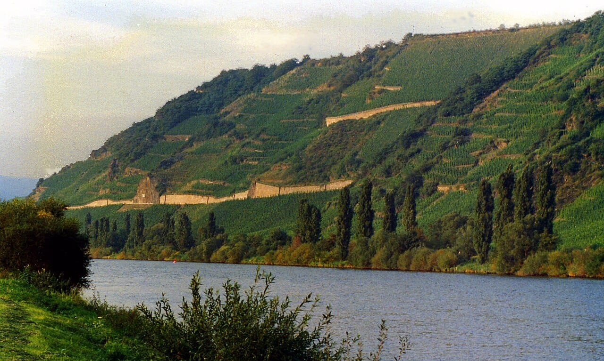

# 摩泽尔

摩泽尔（Mosel）是德国摩泽尔河及其支流萨尔（Saar）、鲁维尔（Ruwer）河谷的法定产区，以陡峭板岩坡地上的雷司令著称。它是德国 13 个法定产区中最靠北的一批，也是低酒精度、高酸度雷司令的代表。

图：摩泽尔。摄影：Mosel vineyard in Tittenheim。署名：Phillip Capper，CC BY 2.0，来自 Wikimedia Commons（[来源](https://commons.wikimedia.org/w/index.php?curid=4168277)）。

## 定义与范围

摩泽尔是受保护的法定产区名称，酒标上的“Mosel”必须来自划定区域并在区内酿造。产区在 2007 年由“Mosel-Saar-Ruwer”简化为“Mosel”，旧名称仍可能出现在较早的酒标与文献中。

产区以白葡萄酒为主，雷司令占种植面积约六成，其余包括 Elbling、Müller-Thurgau、Weißburgunder 与 Grauburgunder；红葡萄以 Spätburgunder 为主，比重很小。

## 「摩泽尔」的时间线
摩泽尔河谷的葡萄种植可追溯到罗马时期，中世纪修道院推动了坡地开垦与酿酒传统。19 世纪，摩泽尔酒在英国与荷兰市场获得高价，陡坡梯田与石墙景观也在这一时期成形。

1971 年的德国葡萄酒法确立了以采收成熟度为基础的 Prädikat 体系，摩泽尔是这套体系最典型的应用地区。20 世纪后期陡坡弃耕与合并加剧，近二十年又因高品质雷司令的国际需求而出现复耕。

## 地理与气候

摩泽尔河从德国与卢森堡边境流向科布伦茨，在特里尔与科布伦茨之间形成大量弯道。南向与西南向的坡地获得最长日照，河面反射的光与热、板岩白天吸热夜间释放，共同缓解了高纬度的冷凉。

气候属冷凉大陆性，生长季长而成熟缓慢，秋季昼夜温差大。降雨集中在冬季，生长季相对干燥，干旱与坡地水土流失是主要压力。板岩（泥盆纪板岩）是主要土壤，风化后破碎、排水好、保热能力强，不同板岩的走向与厚度造成地块差异。

坡地坡度常在 30%–70%，部分地块更陡。机械化极其有限，修剪、采收与运输多依赖人工与小型设备，这也是成本高、产量低的结构性原因。

## 河谷与子区

摩泽尔产区由四段主要河谷构成，彼此风格不同。

- 摩泽尔中段（Mittelmosel）：围绕 Bernkastel、Wehlen、Zeltingen 一带，弯道多、坡地陡，是产区最核心的雷司令地带。
- 下摩泽尔（Terrassenmosel，也称 Untermosel）：靠近科布伦茨，坡度稍缓、阶地更多，酒体相对轻。
- 萨尔（Saar）：支流河谷，海拔更高、更冷，酸度锐利，成熟年份才有足够的果味。
- 鲁维尔（Ruwer）：更小的支流河谷，产量少，风格清瘦、矿物感强。

这些分段是地理与气候差异，不是等级高低。同一品种在萨尔与中段可以表现出完全不同的酸度、酒体与成熟度。

## 品种与原料

雷司令是绝对主导品种，皮薄、晚熟、抗寒，能在低酒精度下保留高酸度与清晰香气。Elbling 在摩泽尔上游与卢森堡一侧更常见，酸度高、香气简单，多用于清爽型酒。

Müller-Thurgau 提供更早熟、更柔和的选项；Weißburgunder 与 Grauburgunder 增加酒体与果味。红葡萄 Spätburgunder 用于轻酒体的红[葡萄酒](ref:red-wine)。原料是[葡萄](ref:grape)。

## 「摩泽尔」怎么做出来
雷司令通常经整串压榨、澄清后低温缓慢[发酵](ref:fermentation)，以保留果香与[酸度](ref:acidity)。传统使用大型旧橡木桶（Fuder）发酵与短暂酒泥接触，现代酒庄更多使用不锈钢罐控温。

多数酒款避免苹果酸乳酸发酵，防止酸度下降；部分干型酒会短暂酒泥接触以增加质感。陈年多在惰性容器或旧大桶中完成，新桶使用很少，避免橡木味覆盖品种特征。这里的[橡木桶](ref:oak-ageing)主要是容器而非风味来源。

## 分级与法规

德国葡萄酒分为 Wein、Landwein、Qualitätswein 与 Prädikatswein。Qualitätswein 允许在发酵前加糖提高酒精度；Prädikatswein 不允许加糖，酒精完全来自葡萄自身糖分。

Prädikatswein 按采收时的葡萄汁含糖量（°Oe）分为六级，逐级提高的是成熟度要求，不是成酒的甜度。

- Kabinett：最轻的一级，成酒酒精度常低至 7%–9% vol，清爽、酸度高。
- Spätlese：晚采，果味更成熟、酒体更饱满，可干可甜。
- Auslese：精选成熟果穗，常有贵腐感染，香气更浓、糖分更高。
- Beerenauslese（BA）：逐粒挑选贵腐葡萄，产量极低，通常为甜酒。
- Trockenbeerenauslese（TBA）：挑选风干皱缩的贵腐果粒，糖分与酸度都高度浓缩，极为罕见。
- Eiswein：果实在藤上自然冻结后带冰压榨，糖分与酸度浓缩，酒精度低、甜度高。

以摩泽尔雷司令为例，法定最低采收要求约为 Kabinett 73 °Oe、Spätlese 80 °Oe、Auslese 88 °Oe；BA 约 110 °Oe、TBA 约 128 °Oe、Eiswein 约 120 °Oe。具体数值随产区与品种不同，德国范围内 Auslese 的区间为 83–100 °Oe，Eiswein 为 110–128 °Oe。

干型与半干是口感标注，不是 Prädikat 等级。trocken 指残糖不超过 9 g/L，halbtrocken 指 9–18 g/L；feinherb 是未入法的常用说法，大致对应半干到微甜。Kabinett 可以是 trocken，Auslese 也可以是 trocken，等级高不等于甜。

## 「摩泽尔」的酒标与喝法
酒标应核对产区名 Mosel、Prädikat 等级、村庄与地块名、年份、酒精度、容量与装瓶者。德国酒标上的 AP 编号（Amtliche Prüfungsnummer）可用于追溯官方质量检验批次。

“Großes Gewächs”与“Erste Lage”是 VDP 等生产者组织的私法分级，不是国家法规等级，购买时应与 Prädikat 等级区分。

年轻雷司令建议 8–10 摄氏度饮用，干型可稍高。高酸度适合搭配猪肉、禽类、油炸食物与亚洲菜；甜型适合蓝纹奶酪与水果甜点。开瓶后冷藏并在数日内喝完。本页关于摩泽尔的内容涉及酒精饮料；过量饮酒有害健康，未成年人不应饮酒。

## 「摩泽尔」容易被读错的地方
第一，把 Prädikat 等级当成甜度。等级描述采收成熟度，同一等级可以酿成干型、半干或甜型。
第二，认为雷司令就是甜酒。摩泽尔有大量 trocken 与 feinherb 酒款，甜型只是其中一部分。
第三，认为板岩一定带来“矿物感”。矿物感是品鉴描述，不能直接等同于某种土壤的化学属性。
第四，认为低酒精度等于加水。摩泽尔雷司令的 7%–9% vol 来自冷凉气候下糖分不完全转化，是产区特征。
第五，把“Mosel”理解为单一风格。中段、下摩泽尔、萨尔与鲁维尔的酸度、酒体差异明显。

摩泽尔的陡坡与板岩常被当成单一风格，但河谷不同段的坡度、朝向与河雾差异很大；酒标上的村名与园名比摩泽尔更具体。

## 参考资料
- [德国](ref:germany)：摩泽尔所属的国家产区框架。
- [葡萄酒](ref:wine)：理解摩泽尔的类别、年份与产地规则的入口。
- [白葡萄酒](ref:white-wine)：雷司令所属的类别。
- [红葡萄酒](ref:red-wine)：Spätburgunder 等红葡萄酿成的酒款。
- [葡萄](ref:grape)：酿酒葡萄的结构与成熟指标。
- [发酵](ref:fermentation)：低温缓慢发酵与苹果酸乳酸发酵的差异。
- [酸度](ref:acidity)：摩泽尔雷司令高酸度的来源与作用。
- [酒精度](ref:abv)：7%–9% vol 在标签与风格上的含义。
- [橡木桶陈年](ref:oak-ageing)：Fuder 大桶作为容器而非风味来源的角色。

## 相关图像

图：德国类别配图。图片：Renardo la vulpo，CC0，via Wikimedia Commons（[原图页面](https://commons.wikimedia.org/wiki/File:M%C3%BCnchen,_Oktoberfest_2022,_Fischer-Vroni_v_S,_1.jpeg)）。关联图像：摩泽尔。

图：白葡萄酒类型示意图。项目自制双语视觉卡，示意性编辑图，不是现场照片。关联图像：摩泽尔。
