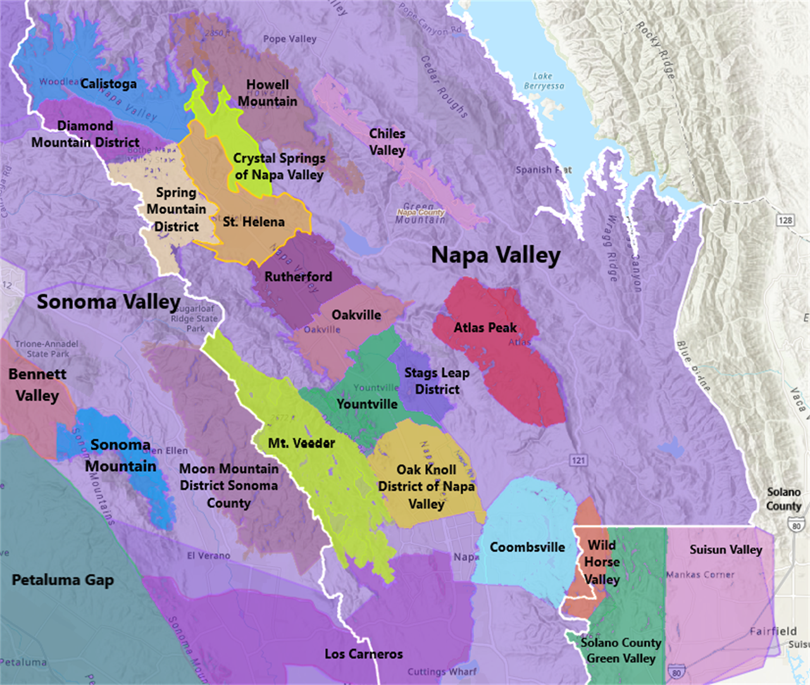

# 纳帕谷

纳帕谷（Napa Valley）是加州最知名的葡萄酒产区，以 Cabernet Sauvignon 与高密度的小产区体系著称。

图：纳帕谷。图片：Unknown author Unknown author，Public domain，via Wikimedia Commons（[原图页面](https://commons.wikimedia.org/wiki/File:TTB_Map_Napa_Valley_AVA.png)）。

## 定义与范围

纳帕谷是加州纳帕县内的葡萄酒产区，1981 年成为加州第一个联邦法定葡萄酒产区（American Viticultural Area，AVA）。谷地南北长约 30 英里（48 公里），最宽处约 5 英里（8 公里），葡萄园海拔从海平面延伸到约 2,600 英尺（800 米）。

纳帕谷 AVA 面积不大，但内部差异密集。县内约 9% 的土地可以种植葡萄，葡萄产量只占加州葡萄收成的 4%、世界葡萄酒产量的 0.4%。县内还有 16 个已批准的子产区（sub-appellation），每个子产区有自己的边界与气候特征。

## 「纳帕谷」的时间线
纳帕谷的葡萄种植始于 19 世纪中叶，欧洲移民带来 vinifera 品种与酿酒技术。20 世纪前期经历病害、禁酒令与经济波动，酒业一度萎缩。

1968 年，纳帕县建立农业保护区（Agricultural Preserve），把葡萄园与农业用地从城市开发中分离出来，这是美国首个同类制度。1981 年纳帕谷成为加州第一个 AVA；1970 年代以后，酒庄数量与品质声誉快速上升，Cabernet Sauvignon 逐渐成为产区标志。

## 地理与气候

纳帕谷是地中海气候：夏季干燥少雨，冬季温和多雨，降水集中在冬季。谷地南端靠近 San Pablo Bay，冷湿海风与晨雾进入谷口，使 Carneros 一带明显凉爽；越往北，海洋影响减弱，Calistoga 与 St. Helena 更热，成熟更早。

两侧山地与谷底形成第三个层次。山坡葡萄园海拔更高、昼夜温差更大、排水更好；谷底土壤更深、水分更充足。同一品种在南部、北部与山地会呈现不同的酸度、果味与单宁结构。

土壤多样性是纳帕谷的核心卖点之一。产区拥有世界 12 个土壤目中的 6 个，以及 33 个不同土壤系列，包括冲积扇、火山土、沉积岩与河流砾石。排水与保水的差异直接决定根系深度与成熟节奏，构成[风土](ref:terroir)基础。

## 子产区

纳帕谷 AVA 内有 16 个已批准的子产区。它们大致可以分为三类：

- 谷底子产区：Oak Knoll District、Yountville、Stags Leap District、Oakville、Rutherford、St. Helena 与 Calistoga，从南到北温度逐渐升高。
- 山地子产区：Howell Mountain、Diamond Mountain District、Spring Mountain District、Mount Veeder 与 Atlas Peak，海拔更高、昼夜温差更大。
- 边缘谷地与共享子产区：Carneros 横跨纳帕与索诺马、受海湾冷雾影响；Coombsville 位于东南部；Chiles Valley 与 Pope Valley 位于东部山地之间。

Oakville 与 Rutherford 以谷底砾石与 Cabernet Sauvignon 著称；Stags Leap District 的火山岩与夜间冷空气带来更柔和的单宁；Howell Mountain 海拔高、成熟晚，酒体更紧致。

## 品种与原料

纳帕谷约 80% 的葡萄园种植红葡萄、20% 白葡萄，品种超过 34 个。按纳帕谷酒商协会的品种面积口径，Cabernet Sauvignon 约 25,000 英亩（10,117 公顷），占葡萄园的 54%；Chardonnay 约 5,628 英亩（2,277 公顷，12%）；Merlot 约 3,632 英亩（1,469 公顷，8%）；Sauvignon Blanc 约 2,553 英亩（1,033 公顷，6%）；Pinot Noir 约 2,409 英亩（975 公顷，5%）；Zinfandel 约 1,270 英亩（514 公顷）与 Cabernet Franc 约 1,224 英亩（495 公顷）。

按纳帕县农业专员 2025 年报告，全县酿酒葡萄结实面积为 42,937 英亩（约 17,376 公顷），产量约 144,807 吨。品种面积与结实面积的口径不同，酒标与统计不应混用。原料是[葡萄](ref:grape)。

Cabernet Sauvignon 在纳帕谷通常表现为黑加仑、黑樱桃、雪松与石墨，单宁厚实，适合[橡木桶](ref:oak-ageing)陈年。Merlot 更柔和，常与 Cabernet 混酿；Chardonnay 在 Carneros 与南部表现清爽，部分酒款经橡木桶与苹果酸乳酸发酵；Sauvignon Blanc 以柑橘与草本香气为主；Pinot Noir 主要集中在 Carneros 的冷凉地带。

## 「纳帕谷」怎么做出来
红葡萄经除梗后温控[发酵](ref:fermentation)，浸渍时间按品种与风格调整。Cabernet Sauvignon 常采用较长的浸渍与淋皮，以提取颜色与单宁；发酵后在法国或美国[橡木桶](ref:oak-ageing)中陈年 18–24 个月，新桶比例因酒庄而异。部分酒款使用整串或整粒发酵，追求更完整的香气与更柔和的提取。

白葡萄低温发酵，Chardonnay 部分酒款进行酒泥搅拌与苹果酸乳酸发酵，Sauvignon Blanc 多用不锈钢罐保持酸度。高糖年份可能进行加酸或调整，但需符合联邦与州法规。

## AVA 与酒标

美国的产地标识由联邦法规 27 CFR 4.25 规定。酒标标注 AVA 时，至少 85% 的葡萄酒须来自该 AVA 范围内的葡萄；标注县或州时，比例降至 75%。酒款还须在标注产地所在的州完成装瓶或最终处理（有限例外）。

AVA 只划定地理边界与允许的名称，不规定品种、产量或酿造方式。同一 AVA 内可以有不同品种与风格，酒标上的 AVA 不等于质量等级。纳帕谷的子产区名称须经联邦规则批准，酒庄不能自行创造。

## 「纳帕谷」的酒标与喝法
酒标应核对 AVA 或子产区名称、品种、[年份](ref:vintage)、[酒精度](ref:abv)、容量与装瓶者。标注[单一品种](ref:single-varietal)的酒款须达到联邦品种比例；混酿按法规列出品种。Cabernet Sauvignon 建议 16–18 摄氏度，Merlot 类似；Chardonnay 建议 10–12 摄氏度，Sauvignon Blanc 建议 8–10 摄氏度，Pinot Noir 建议 14–16 摄氏度。

Cabernet Sauvignon 适合红肉、烤肉与硬质奶酪；Chardonnay 适合海鲜、禽肉与奶油类菜肴；Sauvignon Blanc 适合沙拉与清淡海鲜。开瓶后冷藏并尽快喝完。本页关于纳帕谷的内容涉及酒精饮料；过量饮酒有害健康，未成年人不应饮酒。

## 「纳帕谷」容易被读错的地方
第一，认为纳帕谷只产 Cabernet Sauvignon。Cabernet 占葡萄园约 54%，Chardonnay、Merlot、Sauvignon Blanc 与 Pinot Noir 也有可观面积。
第二，把 AVA 当成质量等级。AVA 只划定地理范围，不评价酒质。
第三，把“纳帕谷”与“纳帕县”混为一谈。AVA 边界小于县界，县内还有不属于 AVA 的葡萄园。
第四，以为纳帕谷葡萄产量很大。它只占加州葡萄收成的 4%，以高价值、低产量为主。
第五，把子产区名称当成酒庄自创品牌。子产区须经联邦规则批准，名称使用受法规约束。

对照阅读：[葡萄酒](ref:wine)、[红葡萄酒](ref:red-wine)。

**关键事实。**

| 项目 | 内容 |
| --- | --- |
| 一句话定位 | 加州纳帕县内的葡萄酒产区，1981 年成为加州第一个 AVA，谷地约 30 英里长、最宽 5 英里，葡萄园海拔从海平面到约 800 米；2025 年结实面积 42,937 英亩（约 17,376 公顷），Cabernet Sauvignon 约 25,000 英亩（10,117 公顷，占葡萄园 54%） |
| 层级 | 其他 |
| 所属 | 美国 |
| 国家代码 | US |

## 参考资料
- [葡萄酒](ref:wine)：理解纳帕谷的类别、年份与产地规则的入口。
- [红葡萄酒](ref:red-wine)与[白葡萄酒](ref:white-wine)：纳帕谷两大酒类的基本框架。
- [葡萄](ref:grape)：酿酒葡萄的结构与成熟指标。
- [发酵](ref:fermentation)：红葡萄浸渍与白葡萄低温发酵的差异。
- [酸度](ref:acidity)：海湾冷雾与昼夜温差对酸度的影响。
- [风土](ref:terroir)：谷底、山坡与冲积扇如何形成子产区差异。
- [橡木桶陈年](ref:oak-ageing)：Cabernet Sauvignon 与 Chardonnay 的容器选择。
- [干型](ref:dry)：纳帕谷白葡萄酒的干型定位。
- [年份](ref:vintage)：纳帕谷的年份差异与干旱、山火影响。
- [单一品种](ref:single-varietal)：纳帕谷的品种比例与酒标标注规则。
- [酒精度](ref:abv)：酒标上 % vol 的含义。
