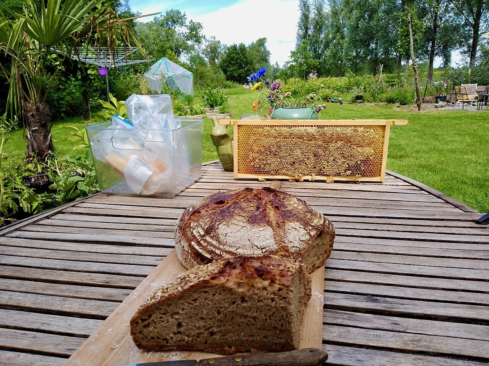

# 荷兰

荷兰是欧洲西北部的低地国家，莱茵河、马斯河与斯海尔德河在此入海。谈荷兰酒类，最容易只想到喜力与皮尔森；但荷兰同时有受欧盟保护的传统烈酒 jenever、正在增长的精酿啤酒，以及一个规模不大却持续存在的葡萄酒产业。把这三条线放在一起，才能理解这个国家的酒精版图。

图：荷兰。摄影：Vineyard Dassemus (Chaam, Netherlands, July 2020) - 2 (50522232027)。署名：Bruno Rijsman，CC BY-SA 2.0，来自 Wikimedia Commons（[来源](https://commons.wikimedia.org/w/index.php?curid=101342530)）。

## 低地国家的地理与水源

荷兰约 26% 的国土低于海平面，靠堤坝、沙丘与排水系统维持。气候属温带海洋性气候，冬季温和、夏季凉爽，降水全年分布均匀，风力较强。西部与北部多为黏土与泥炭，东部与南部有砂质土与黄土。水质总体偏软，适合拉格类的清爽风格；但不同城市的水源矿物组成差异明显，酒厂通常先做水处理，再按风格调整糖化用水的 pH 与矿物含量。

## 啤酒：从城市酒厂到皮尔森

中世纪与近代早期，荷兰城市有大量小型酒厂，啤酒是日常饮品，也参与城市税收与行会制度。19 世纪，下发酵技术从欧洲中部传入，低温发酵与长期贮酒逐渐取代上层发酵，拉格成为主流。1864 年，喜力在阿姆斯特丹创立，随后通过出口与并购成长为国际品牌；Grolsch 的历史可追溯到 1615 年，Bavaria 则始于 1719 年，二者与喜力共同构成荷兰大型啤酒的骨架。20 世纪后期行业集中度提高，21 世纪的精酿复兴又带来数百家小型酒厂。

## 啤酒风格与酒厂

荷兰最常见的风格是皮尔森：淡金色、清爽、苦味适中，适合佐餐与日常饮用。拉格之外，荷兰也生产小麦啤酒、比利时风格艾尔、修道院风格与季节性产品。La Trappe 位于蒂尔堡附近的 Koningshoeven，是荷兰唯一的特拉普斯特（Trappist）啤酒厂，生产范围从浅色艾尔到四料。阿姆斯特丹的 Brouwerij 't IJ 与博德格拉芬的 De Molen 则代表精酿路线，前者以本地酒吧文化为核心，后者以重口味与桶陈实验著称。南部林堡与北布拉班特也有区域性酒厂。

## jenever：被忽略的烈酒线

jenever（荷兰语，英语常写 genever）是荷兰与比利时的传统杜松子烈酒，以麦芽酒（moutwijn）与中性酒精混合后加入杜松子等植物香料蒸馏而成。它分为 jonge jenever 与 oude jenever：前者风格清淡、麦芽酒比例较低，后者更甜、更厚重，常经橡木桶陈年；Korenwijn 则以更高比例的麦芽酒为特征。欧盟地理标志体系登记了 Jonge jenever、Oude jenever 与 Korenwijn 等名称，说明它不只是“荷兰金酒”的俗称。传统喝法是冷藏后用小杯一口饮下，或与啤酒搭配成“kopstootje”。

## 葡萄酒：气候边缘的小产业

荷兰的葡萄种植面积约 300 公顷，集中在南部的林堡、中部的贝图沃与泽兰。气候偏凉、湿度高，成熟与病害管理都困难，因此酒农大量使用 PIWI 抗病品种，如 Solaris、Johanniter、Souvignier Gris 与 Regent，以减少喷洒。产品以白葡萄酒、桃红与起泡酒为主，红葡萄酒较少。荷兰不是欧盟主要产酒国，也没有形成像法国或德国那样完整的法定产区层级；酒庄多以“荷兰葡萄酒”作为产地叙事，品质差异很大。

## 法规、税制与市场

荷兰的酒精饮料受《酒精法》与食品安全法规约束，最低购买与饮用年龄为 18 岁。啤酒、葡萄酒与烈酒适用不同的消费税税率，烈酒税率最高，这影响了即饮渠道的价格结构。啤酒消费在近二十年持续下降，无酒精与低酒精产品增长明显；精酿渠道、酒厂直售与餐饮场景成为小型酒厂的主要出口。出口方面，喜力等大型品牌占据全球份额，jenever 则更多依赖本地市场与旅游零售。

## 饮用与搭配

皮尔森适合冷藏后饮用，温度过高会让苦味与酒精感突出；小麦啤酒适合稍高温度，以释放果香。jenever 传统上冷藏纯饮，也可用于鸡尾酒；它的麦芽甜与杜松子香适合搭配奶酪、鲱鱼与炸物。葡萄酒以清爽白葡萄酒配海鲜最为常见。本页关于荷兰的内容涉及酒精饮料；过量饮酒有害健康，未成年人不应饮酒。

## 常见误区

第一，认为荷兰只产喜力。荷兰有大型酒厂与数百家精酿品牌。第二，把皮尔森等同于“荷兰啤酒”。皮尔森是风格，荷兰也生产艾尔、小麦啤酒与修道院风格。第三，认为 jenever 就是英国金酒。jenever 使用麦芽酒，风味更甜、更厚重，陈年版本差异明显。第四，把荷兰葡萄酒当成不存在。它有约 300 公顷葡萄园，只是规模小、成本高。第五，认为拉格是低端工艺。下发酵是风格选择，与质量高低无关。第六，认为颜色浅一定酒精度低。颜色与酒精度没有直接关系。

对照阅读：[啤酒](ref:beer)、[水](ref:water)。

## 延伸阅读

- [啤酒](ref:beer)：啤酒的总体分类与工艺框架。
- [大麦](ref:barley)与[水](ref:water)：荷兰啤酒的基础原料。
- [发酵](ref:fermentation)：下发酵与低温熟化的特点。
- [精酿](ref:craft-beer)：精酿复兴与小型酒厂的关系。

相关条目：[大麦](ref:barley)。

**关键事实。**

| 项目 | 内容 |
| --- | --- |
| 一句话定位 | 欧洲西北部的低地国家，莱茵河与马斯河在此入海；皮尔森啤酒主导市场，喜力 1864 年创立于阿姆斯特丹，jenever 是受欧盟保护的传统烈酒，葡萄酒则是气候边缘的小产业 |
| 层级 | 国家 |
| 国家代码 | NL |

**来源与边界。** 本页关于「荷兰」的关键事实，主要由以下来源交叉核对：Heineken（喜力的创立年份与阿姆斯特丹起源）、Nederlandse Bierbrouwers（荷兰啤酒产业与风格概况）、Oxford University Press（提供关于皮尔森、拉格与荷兰啤酒的条目；由原条目末尾参考资料迁移，未逐条复核访问日期）等 6 条来源。价格、批次与状态会变，涉及这些字段时以页面所列来源的最新版本为准。正文为项目自写，来源只作核验，不复制原文。

**并读。** 把「荷兰」与「啤酒」、「大麦」、「水」放在一起读时，先确认它们是同一层级还是上下游关系：先确认边界与法定分类，再比较气候、土壤、海拔与代表酒款。本页负责给出产区的基本坐标，对照条目补上具体案例与差异；读完再回到本页，才能分清哪些差别属于产区本身，哪些只是产地、批次或品牌选择。

**适用边界。** 对「荷兰」而言，产区边界、面积与法定分类会随法规更新；气候描述是长期趋势，不是某一年的天气预报。

**更新提示。** 「荷兰」最近核对于 2026-11-07；面积、法定分类、标签规则与年份表现会变，引用前以法规与产区官方文本为准。

## 相关图像

图：水注入玻璃杯。酿造用水还需检测硬度、碱度、矿物离子与微生物指标。图片：Jorge Barrios，Public domain，via Wikimedia Commons（[原图页面](https://commons.wikimedia.org/wiki/File:Glass_of_Water.JPG)）。关联图像：荷兰。

图：精酿啤酒。图片：Bernt Rostad，CC BY 2.0，via Wikimedia Commons（[原图页面](https://commons.wikimedia.org/wiki/File:Zachariasbryggen_Microbrewery.jpg)）。关联图像：荷兰。
