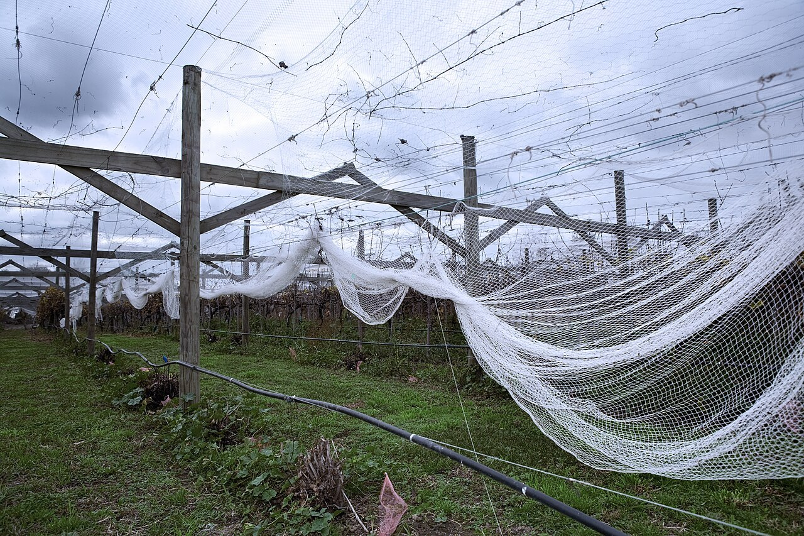

# 新西兰

新西兰是南太平洋岛国，葡萄酒产业规模不大，却以鲜明的品种表达获得国际认知。马尔堡的长相思带柑橘、百香果与草本气息，中奥塔哥的黑皮诺则以红果、香料与清爽酸度著称。海洋性气候、较长生长季与较强风力，是理解新西兰葡萄酒的关键。

图：新西兰。摄影：New Zealand - Vineyard - 9878。署名：Jorge Royan，CC BY-SA 3.0，来自 Wikimedia Commons（[来源](https://commons.wikimedia.org/w/index.php?curid=15897982)）。

## 地理与气候

新西兰由北岛、南岛与多个小岛组成，葡萄酒产区多分布在东部沿海与河谷。气候受海洋强烈调节，气温较同纬度地区温和，生长季较长，昼夜温差在南岛内陆更明显。西风带带来降水与风力，部分产区需要防风林与坡地选择来改善成熟条件。

南岛的中奥塔哥是少数接近大陆性气候的产区，夏季温暖、秋季凉爽，昼夜温差大；马尔堡位于南岛东北端，日照充足、降水较少；北岛的霍克斯湾与怀拉拉帕受海洋影响，风格更温和。微气候差异让同一品种在不同产区呈现不同成熟度与酸度。

## 「新西兰」的时间线
新西兰的葡萄酒业在 20 世纪后期才进入国际市场。早期以杂交品种与日常酒为主，1970 年代以后，生产者逐步转向欧洲葡萄品种与更精细的栽培。马尔堡在 1980 年代以后以长相思打开出口市场，中奥塔哥与霍克斯湾也逐步建立国际认知。产业规模有限，使新西兰更依赖品质与产区叙事。

## 葡萄酒产区

- 马尔堡：长相思的核心产区，也有霞多丽、黑皮诺与起泡酒。
- 中奥塔哥：黑皮诺与雷司令，凉爽、昼夜温差大。
- 霍克斯湾：梅洛、西拉与霞多丽，北岛重要的红葡萄酒产区。
- 怀拉拉帕：黑皮诺与芳香型白葡萄酒。
- 坎特伯雷与尼尔森：凉爽产区，白葡萄酒与起泡酒。
- 奥克兰与北地：较温暖的北部产区，品种更多样。

## 「新西兰」的品种与风格坐标
[长相思](ref:sauvignon-blanc)是新西兰最具辨识度的品种，马尔堡的风格常带百香果、青柠、青草与矿物气息，酸度高、香气外放。[黑皮诺](ref:pinot-noir)在中奥塔哥与怀拉拉帕表现突出，红果、香料与泥土气息结合清爽酸度。

[雷司令](ref:riesling)与[霞多丽](ref:chardonnay)在白葡萄酒中占有一席之地，风格从干型到甜型都有；[梅洛](ref:merlot)与[西拉](ref:syrah)则在北岛较温暖产区形成红葡萄酒风格。[红葡萄酒](ref:red-wine)与[白葡萄酒](ref:white-wine)的比例随产区与年份变化，[起泡酒](ref:sparkling)也有稳定生产。

## 代表酒款与生产者

新西兰的酒庄规模普遍较小，品牌与生产者往往直接绑定。马尔堡的长相思、中奥塔哥的黑皮诺与霍克斯湾的红葡萄酒是国际市场上最常见的类型。具体酒款请参见酒款页；产区页描述地理与制度框架，不评价单个品牌。

新西兰酒标通常标注产区、品种、年份与酒精度。产区名称越具体，原料来源要求越严；但具体酒款仍要看酒庄与年份。

## 法规与产区标识

新西兰的葡萄酒地理标志受《地理标志（葡萄酒与烈酒）注册法》管理，产区名称需要满足注册与使用规则。与欧洲的 AOP/PDO 相比，新西兰体系更年轻，覆盖范围也更集中。酒标上的产区名、品种名与年份都有相应的使用要求。

阅读酒标时，要区分国家名、产区名、酒庄名与品牌名。“Marlborough”与“Central Otago”代表不同气候与品种组合，不能把国家名称当成风格保证。

## 气候与土壤数据

| 区域 | 气候 | 主要土壤 | 代表酒类 |
| --- | --- | --- | --- |
| 马尔堡 | 海洋性，日照充足、降水较少 | 砾石、冲积土 | 长相思、霞多丽 |
| 中奥塔哥 | 大陆性，昼夜温差大 | 片岩、砾石 | 黑皮诺、雷司令 |
| 霍克斯湾 | 海洋性，较温暖 | 砾石、火山土 | 梅洛、西拉 |
| 怀拉拉帕 | 海洋性，多风 | 砾石、冲积土 | 黑皮诺 |
| 坎特伯雷 | 凉爽海洋性 | 砂土、砾石 | 白葡萄酒、起泡酒 |

就「新西兰」而言，这张表是宏观对照，具体地块的土壤、海拔与朝向仍需看单个产区。把国家气候当成酒款风格保证，会忽略产区内部的差异。

## 市场与饮用

新西兰葡萄酒以出口为主，英国、美国、澳大利亚与亚洲是重要市场。[葡萄酒](ref:wine)的价格从日常餐酒到小产量酒庄酒都有。长相思适合海鲜、沙拉与轻食；黑皮诺适合禽类、蘑菇与中等浓度的肉类；起泡酒适合餐前与庆祝场景。

饮用温度与开瓶后的保存会影响体验。对具体酒款，酒标上的产区、年份、品种与酒精度，是最直接的信息来源。

## 「新西兰」容易被读错的地方
第一，新西兰只有长相思。黑皮诺、霞多丽、雷司令与红葡萄酒都有重要地位。

第二，马尔堡长相思都是一个味道。不同酒庄、地块与年份会带来明显差异。

第三，新西兰酒都清淡。部分红葡萄酒与起泡酒有足够的结构。

第四，产区名称等于质量。产区名称规定来源，不保证感官质量。

第五，新西兰葡萄酒历史很长。现代产业主要形成于 20 世纪后期。

对照阅读：[葡萄酒](ref:wine)、[白葡萄酒](ref:white-wine)。

**关键事实。**

| 项目 | 内容 |
| --- | --- |
| 一句话定位 | 南太平洋岛国，葡萄酒以马尔堡长相思与中奥塔哥黑皮诺最具国际认知；海洋性气候与较长生长季塑造清爽、酸度清晰的风格 |
| 层级 | 国家 |
| 国家代码 | NZ |

**来源与边界。** 本页关于「新西兰」的关键事实，主要由以下来源交叉核对：New Zealand Winegrowers（新西兰葡萄酒产区、品种与行业统计的公开信息）、New Zealand Government — MPI（新西兰葡萄酒产业管理与地理标志的公开信息）、Oxford University Press（提供关于新西兰产区、品种与葡萄酒历史的条目；由原条目末尾参考资料迁移，未逐条复核访问日期）。价格、批次与状态会变，涉及这些字段时以页面所列来源的最新版本为准。正文为项目自写，来源只作核验，不复制原文。

## 参考资料
- [葡萄酒](ref:wine)：理解新西兰的分类、酿造与产区框架。
- [红葡萄酒](ref:red-wine)与[白葡萄酒](ref:white-wine)：两类基本风格与工艺。
- [长相思](ref:sauvignon-blanc)：马尔堡最具辨识度的品种。
- [黑皮诺](ref:pinot-noir)：中奥塔哥与怀拉拉帕的核心品种。
- [雷司令](ref:riesling)与[霞多丽](ref:chardonnay)：新西兰白葡萄酒的另一条主线。
- [梅洛](ref:merlot)与[西拉](ref:syrah)：北岛红葡萄酒的常见品种。
- [起泡酒](ref:sparkling)：新西兰起泡酒的风格与场景。

## 相关图像

图：起泡酒。图片：bgvjpe，CC BY 2.0，via Wikimedia Commons（[原图页面](https://commons.wikimedia.org/wiki/File:Glass_of_champagne.jpg)）。关联图像：新西兰。

图：长相思相关实景照片。图片：Geolina163 + 1971markus，CC BY-SA 4.0，via Wikimedia Commons（[原图页面](https://commons.wikimedia.org/wiki/File:HBLA_Klosterneuburg_Sauvignon_Blanc_2.jpg)）。关联图像：新西兰。
