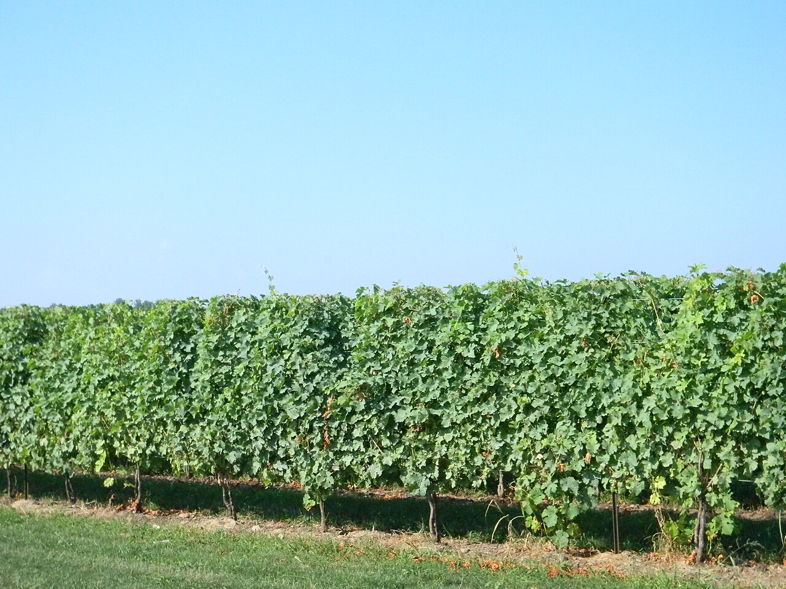
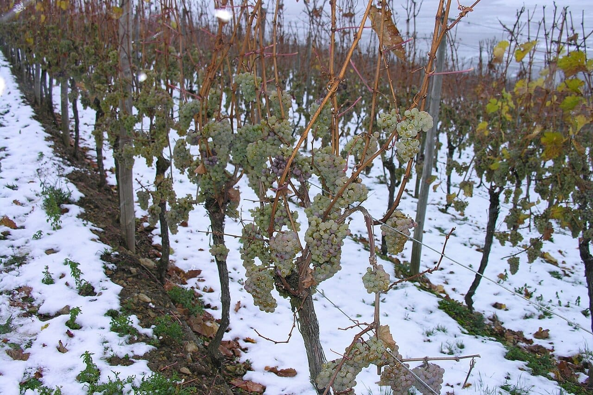

# 尼亚加拉

加拿大安大略省南部的葡萄酒产区，位于尼亚加拉断崖与安大略湖之间；以雷司令、霞多丽、品丽珠与冰酒著称，VQA 体系严格，是加拿大葡萄酒的核心。

尼亚加拉是加拿大安大略的冷凉产区，安大略湖与断崖调节气候，Chardonnay、Riesling、Cabernet Franc 与冰酒是核心；VQA 是读酒标的起点。

图：Niagara Peninsula：Wine Grapes in the Niagara Peninsula（Wikimedia Commons）。图片：M Readey，CC BY-SA 3.0，via Wikimedia Commons（[原图页面](https://commons.wikimedia.org/wiki/File:Wine_Grapes_in_the_Niagara_Peninsula.jpg)）。

## 定义与边界

尼亚加拉是[加拿大](ref:canada)安大略省的葡萄酒产区，位于尼亚加拉半岛，介于安大略湖与尼亚加拉断崖之间；它包含 Niagara-on-the-Lake、Lincoln、Vineland 等子产区，以 Chardonnay、Riesling、Cabernet Franc 与冰酒著称。

尼亚加拉不是“尼亚加拉瀑布”的同义词：瀑布是旅游地标，葡萄酒产区在半岛的湖岸与断崖之间；酒标上的“Niagara Peninsula”比“Niagara”更准确。

它与安大略湖的湖效应紧密相关：湖水调节温度、延长生长季，断崖阻挡冷风，形成加拿大少见的冷凉葡萄酒产区。

尼亚加拉半岛的子产区包括 Niagara-on-the-Lake、Lincoln、Vineland 与 Twenty Valley；湖岸更暖、断崖更凉，酒标上的子产区名能提示成熟度与风格。

## 历史与命名

尼亚加拉的商业葡萄酒史始于 19 世纪，但现代精品酒庄是 1970–80 年代以后才兴起；Inniskillin、Cave Spring、Henry of Pelham 等酒庄把冷凉气候与冰酒推向国际。

冰酒（Icewine）是尼亚加拉的标志：葡萄在藤上自然冻结，压榨时糖分浓缩，发酵后残糖高、酸度高；加拿大法规对冰酒的采收温度与糖分有严格规定。

“Niagara”这个名字来自原住民语言，意为“雷声之水”；产区历史与湖岸农业、果酒与冰酒紧密相关，不是单一的“寒冷产区”叙事。

尼亚加拉的冰酒在 1980–90 年代获得国际奖项，Inniskillin 等酒庄让加拿大成为世界最大的冰酒生产国之一；冰酒的采收常在零下 8°C 以下的夜晚进行。

VQA（Vintners Quality Alliance）是安大略的产地与质量认证，规定产区、品种、采收与酒精度；读尼亚加拉酒标时，VQA 标志比“Canada”更有信息。

## 地理与风土

尼亚加拉半岛由安大略湖与尼亚加拉断崖围成，海拔约 100–200 米；大陆性气候但受湖效应调节，冬季较温和、夏季较凉，生长季长、湿度高。

土壤以黏土、壤土与砂土为主，断崖附近排水更好；湖岸地块更暖、成熟更早，内陆更冷、酸度更高。霜冻是主要风险，酒农用风扇、烟熏与选地来保护。

湖效应让尼亚加拉在寒冷纬度也能成熟 Chardonnay 与 Cabernet Franc；但湿度高，灰霉与霜霉压力大，冠层管理是关键。

尼亚加拉断崖是地质上的石灰岩崖壁，也是产区的气候边界；崖上的冷空气下沉，崖下的湖岸更暖，形成不同的成熟带。

安大略湖的湖效应让冬季不至于过度严寒，夏季又不会过热；生长季长，但秋季降雨与湿度带来灰霉风险，酒农需要精细的冠层管理与采收决策。

## 原料与风格

[霞多丽](ref:chardonnay)（Chardonnay）带柑橘、白花、榛子与矿物，部分经橡木桶与酒泥搅拌；[雷司令](ref:riesling)（Riesling）带青苹果、柠檬、白花与汽油，酸度高；Cabernet Franc 带红樱桃、覆盆子、青椒与香料。

冰酒用 Riesling、Vidal、Cabernet Franc 等，带杏干、蜂蜜、柑橘酱与坚果，甜度高、酸度高；它不是“甜葡萄酒”的同义词，而是特定采收与压榨工艺。

尼亚加拉的风格关键词是“冷凉与湖效应”：酒体中等、酸度高、果味纯净，不像加州那样饱满，也不像德国那样高酸。

尼亚加拉 Chardonnay 的风格从清爽到橡木桶型都有：冷凉地块更柑橘、更矿物，温暖地块更苹果、更榛子；酒泥搅拌与桶陈增加奶油与面包。

Cabernet Franc 在尼亚加拉比 Cabernet Sauvignon 更可靠：它早熟、抗寒，带红樱桃、覆盆子、青椒与香料；部分酒庄用它做冰酒，风味更红果、更香料。

Riesling 在尼亚加拉可以是干型、半干型或冰酒：干型带青苹果、柠檬与白花，冰酒带杏干、蜂蜜与柑橘酱。

## 代表生产者与酒款

Inniskillin 的冰酒、Cave Spring 的 Riesling、Henry of Pelham 的 Chardonnay 与 Cabernet Franc 是尼亚加拉的代表；Tawse、Pearl Morissette 等酒庄更强调低干预与有机种植。

这些酒庄的酒标常标子产区与“VQA”等级；VQA 是安大略的产地与质量认证，读背标时看 VQA 与品种，比看酒庄名气更有用。

Cave Spring 的 Riesling、Henry of Pelham 的 Chardonnay 与 Cabernet Franc、Inniskillin 的冰酒是尼亚加拉的代表；Tawse 与 Pearl Morissette 更强调低干预与有机种植。

## 上桌方式

Chardonnay 与 Riesling 温度 8–10°C，Cabernet Franc 16–18°C，冰酒 6–8°C；白葡萄酒配海鲜、沙拉与鸡肉，红葡萄酒配烤肉与硬质奶酪，冰酒配蓝纹奶酪、水果塔与鹅肝。

冰酒的甜度高，杯型宜小，每次 50–70 毫升即可；不要加冰，稀释会破坏酸甜平衡。

尼亚加拉的冰酒适合配蓝纹奶酪、鹅肝、水果塔与坚果；甜度高，杯型宜小，温度 6–8°C。干型 Riesling 配海鲜与亚洲菜，Chardonnay 配烤鸡与奶油酱汁。

## 选购与误区

买尼亚加拉酒先看 VQA 与年份；冰酒看采收年份、品种与容量，价格高但每次用量小。白葡萄酒适合 3–8 年，冰酒可以放 10 年以上。

常见误读：把尼亚加拉当成“加拿大唯一的葡萄酒产区”；以为冰酒就是甜酒；以为冷凉产区只产清淡酒。尼亚加拉的 Chardonnay 与 Cabernet Franc 可以有很好的结构。

尼亚加拉的冰酒价格高，但每次只喝 50–70 毫升；买之前看容量、年份与 VQA，不要只看酒庄名气。干白更适合日常，冰酒更适合节日与配餐。

常见误读：以为加拿大只有冰酒；以为尼亚加拉太冷、只能做甜酒；以为 VQA 只是营销标签。VQA 对产区与工艺有实际约束。

尼亚加拉的白葡萄酒常标“VQA”与子产区，买之前看品种与年份；冰酒看容量与采收年份，价格高但每次用量小。不要用“加拿大=冰酒”的刻板印象忽略它的干白。

## 参见

- [加拿大](ref:canada)：安大略产区与 VQA。
- [霞多丽](ref:chardonnay)：尼亚加拉的白葡萄。
- [雷司令](ref:riesling)：冰酒与干白的主要品种。
- [白葡萄酒](ref:white)：白葡萄的发酵与风格。
- [红葡萄酒](ref:red)：红葡萄的发酵与结构。

**关键事实。**

| 项目 | 内容 |
| --- | --- |
| 一句话定位 | 加拿大安大略省南部的葡萄酒产区，位于尼亚加拉断崖与安大略湖之间；以雷司令、霞多丽、品丽珠与冰酒著称，VQA 体系严格，是加拿大葡萄酒的核心 |
| 层级 | 省/大区 |
| 所属 | 加拿大 |
| 国家代码 | CA |

**来源与边界。** 本页关于「尼亚加拉」的关键事实，主要由以下来源交叉核对：Canadian Vintners Association（加拿大葡萄酒与 VQA 框架）、Agriculture and Agri-Food Canada（加拿大农业地理与气候背景）、OIV（葡萄酒定义与全球生产框架）等 4 条来源。价格、批次与状态会变，涉及这些字段时以页面所列来源的最新版本为准。正文为项目自写，来源只作核验，不复制原文。

## 相关图像

图：安大略 Forty Creek 酒厂的威士忌橡木桶陈酿库。图片：Gogerr，CC BY-SA 4.0，via Wikimedia Commons（[原图页面](https://commons.wikimedia.org/wiki/File:Whisky_maturation_in_barrels_at_the_Forty_Creek_Distillery.jpg)）。关联图像：尼亚加拉。

图：冰酒。图片：Mya，CC BY 2.0，via Wikimedia Commons（[原图页面](https://commons.wikimedia.org/wiki/File:Frozen_grapes_in_Luxembourg.jpg)）。关联图像：尼亚加拉。
