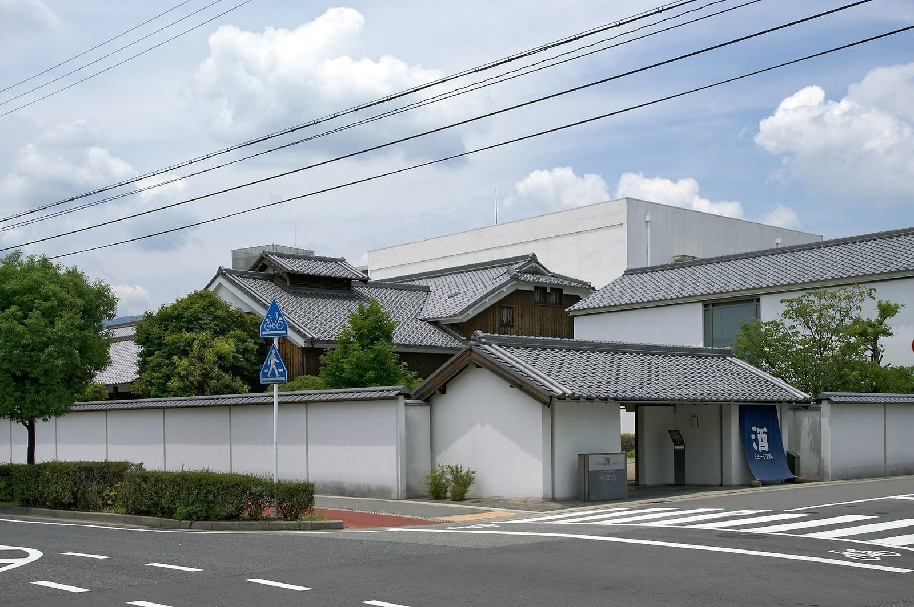
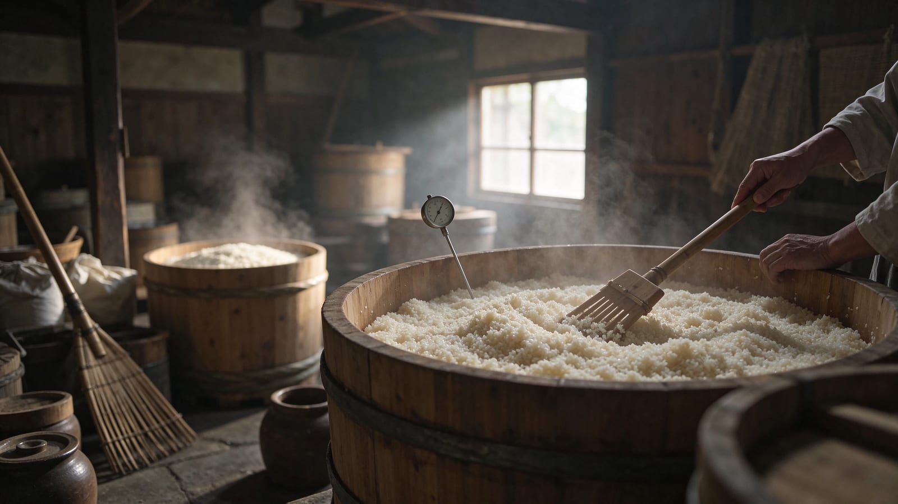

# 新潟

新潟是[日本](ref:japan)海侧的[清酒](ref:sake)大县，也是“淡丽辛口”最常被引用的产地。它的清酒形象不是靠单一酒藏建立，而是由雪国气候、越后杜氏的技术传统、软水与酒米品种共同支撑。理解新潟，要同时看自然环境、人的技术与县内不同酒藏的地理分布。

图：新潟地区的一处实景。图片：663highland，CC BY 2.5，via Wikimedia Commons（[原图页面](https://commons.wikimedia.org/wiki/File:Hakushika_Memorial_Museum02st3200.jpg)）。这张照片来自新潟产区内已核实条目，用于说明当地风貌，不是新潟的全区域地图。

> **先给结论**
> **一句话：** 这页判断新潟的风味与旅行价值，以及怎么安排。
>
> - **适合谁：** 正在比较新潟与其他产区、准备买酒或安排旅行的人。
> - **不适合谁：** 只想要“哪个产区最贵”的结论、不关心风格和年份的人。
> - **先看这两点：**
>   - 新潟清酒的酒标判断与其他产区一致：先看特定名称与精米步合，再看酒母、酵母、生酒与原酒。
>   - 新潟县位于本州中北部，面对日本海，冬季寒冷多雪。

## 定义与范围

新潟县位于本州中北部，面对日本海，冬季寒冷多雪。县内清酒藏分布在下越、中越与上越等地区，其中南鱼沼、十日町、鱼沼、汤泽一带常被视为雪国清酒的核心。新潟县酒造组合负责藏元介绍、技术推广与产地推广；新潟清酒产地呼称协会则围绕“新潟”产地标识运作，强调酒造与风土的关联。

“新潟清酒”不是法定产区名称，而是县级的产业与品牌概念。它涵盖不同规模、不同酒母、不同精米步合的产品；有的酒以吟醸香为主，有的以纯米鲜味为主。把“新潟”直接等同于“淡丽辛口”会过度简化，但在市场传播中，这个标签确实已经成为新潟清酒最鲜明的识别符。

## 雪国与低温长期发酵

新潟的冬季低温是酿造条件，也是技术约束。酵母在过低温度下会停止活动，藏人要在 5 至 10 摄氏度左右的狭窄区间里维持缓慢发酵，让糖化与发酵平稳推进。低温长期发酵带来的结果是香气更干净、杂味更少、酒体更细腻；代价是时间长、管理难度高、设备与人力成本上升。

雪国的[水](ref:water)也是关键。县酒造组合把越后山地的雪解水称为软水，认为软水让酒更柔和、圆润；八海酿造的南鱼沼藏元则把当地的“雷電様の清水”描述为极软水。软水不是绝对优势，它降低了矿物质对酵母的刺激，也让酒体骨架更轻；对追求淡丽风格的藏元，软水与低温是相互配合的一组条件。

空气与季节也参与酿造。雪覆盖地面、空气洁净，被视为有利于麹菌与酵母稳定生长的环境；冬季温差不大，发酵温度更容易控制。把这些条件加起来，新潟的“雪国”不是浪漫背景，而是低温、软水、洁净空气与长期管理共同构成的生产系统。

## 越后杜氏与清酒学校

越后杜氏是日本最著名的杜氏集团之一。新潟县酒造组合的资料称，新潟是日本杜氏与技术集团最多的县，越后杜氏在雪国长期培植了低温发酵的经验与技艺。杜氏是藏人的亲方，负责酒母、醪的管理与整个酒造季的判断；越后杜氏的传统强调经验、纪律与对气温、湿度的细致观察。

1984 年，新潟设立日本唯一的清酒学校——新潟清酒学校，培养酒藏的中坚技术者。这个时间点说明新潟在战后清酒工业化与技术人员短缺的背景下，选择用制度化教育补充师徒制。学校与县醸造试验场、酒藏形成“研究—教育—生产”的链条，让越后杜氏的传统不只靠口传，也靠可复现的技术语言传递。

越后杜氏不是“神秘工匠”的浪漫符号。低温长期发酵需要每天测量温度、酸度、糖度与醪的状态，任何一个环节失控都会导致发酵停滞或杂菌污染。把杜氏的技术理解为“看天吃饭”会低估其中的管理与实验成分；新潟清酒学校的存在，正是这种技术可教化的证据。

## 淡丽辛口的形成

“淡丽辛口”不是一句口感形容，而是新潟清酒在战后市场中的定位。县酒造组合的资料记载，1957 年酒造好适[米](ref:rice)五百万石诞生，这种米杂味少、适合酿造干净清亮的酒，成为“新潟淡丽”形成的契机。战后日本生活水平提高，消费者从浓甜转向清爽，淡丽风格逐渐成为主流。

“新潟淡丽”的五个构成要素被概括为新潟县产米、软水、环境、杜氏的技术与酒藏的意愿。这个框架说明淡丽不是单一工艺的结果，而是米、水、气候、人与组织共同形成的产地品牌。它也不是所有新潟酒的统一风格：纯米酒、吟醸酒、生酒、熟成酒都可以有不同厚度，淡丽只是市场识别的一条主线。

辛口与淡丽常被连用，但两者不是同义词。辛口指甜度低、收口干净；淡丽指酒体轻、香气不浓、回味短。新潟酒可以淡丽而带鲜味，也可以辛口而有厚度。把“淡丽辛口”当成硬性标准，会误判那些酒体更饱满、酸度更高的新潟纯米酒。

## 山废与速酿

清酒的酒母路线在新潟同样多样。山废（山废酛）与生酛依靠天然乳酸菌，让乳酸菌在低温下缓慢繁殖，形成复杂的酸度与鲜味；速酿则直接添加乳酸，缩短酒母制作时间，发酵更稳定、风格更干净。两条路线没有高低之分，只有风险、时间与风味的取舍。

在雪国低温环境中，山废与生酛的天然乳酸菌繁殖更慢，管理难度更高，但成酒的酸度与鲜味层次也更丰富；速酿适合标准化与量产，能更好地控制杂菌风险。新潟的淡丽风格常与速酿、低温长期发酵组合，但不少藏元仍保留山废与生酛产品，用来表达更复杂的[酒母](ref:kimoto)风味。

理解这一点，能避免把“新潟=速酿=淡丽”当成固定公式。酒母只是风味系统的一环，精米步合、酵母、水温、醪的管理与加热处理都会改变最终结果。

## 县内分布：南鱼沼、十日町与下越

南鱼沼是雪国清酒的代表性区域。八海酿造位于南鱼沼市长森，使用当地极软水与越后杜氏传统；青木酒造位于南鱼沼市塩沢，是当地另一家代表性藏元。南鱼沼的豪雪、低温与酒米栽培，让它成为“雪国酿造”叙事最集中的地方。

十日町与鱼沼地区同样重要。魚沼酒造位于十日町市上野，代表铭柄“天神囃子”，其产品使用越淡麗精米至 50%，在越后十日町的严寒中低温发酵。这个例子把“酒米—精米—低温—产地”四个环节连在一起，比单看“新潟”二字更能说明地方酒藏的技术选择。

下越与中越则有不同气候与市场。下越面对日本海，气候较湿润，酒藏产品线更接近县内大众消费；中越以长冈、小千谷一带为代表，信浓川流域的水与米构成另一套条件。把南鱼沼、十日町、下越并列，是为了说明新潟县内部并非只有一种“雪国酒藏”模板。

## 酒标与饮用

新潟清酒的酒标判断与其他产区一致：先看特定名称与[精米步合](ref:polishing)，再看酒母、酵母、生酒与原酒。吟醸要求精米步合 60% 以下，大吟醸要求 50% 以下；本酿造要求 70% 以下，添加酒精不超过白米重量的 10%，米麹须达到白米重量的 15% 以上；[纯米](ref:junmai)酒只能以白米、米麹与水为原料。新潟的“淡丽辛口”是风格描述，不是特定名称。

饮用上，淡丽辛口的酒适合冷饮或常温，搭配海鲜、寿司、天妇罗与清淡料理；纯米与山废系可以温饮，搭配锅物、烤鱼与味道更浓的料理。新潟县酒造组合还推广“新潟清酒×牡蠣”的搭配，说明产地品牌正在把酒与地方食材绑定。无论搭配什么，先确认酒的甜度、酸度与温度，再决定料理，而不是反过来。

购买时，县内藏元直卖与酒藏见学能提供更具体的酿造信息；县外零售则要看运输与保存条件。生酒、原酒与需要冷藏的酒，运输温度比价格更重要。

## 常见误区

第一，把新潟清酒全部当成淡丽辛口。淡丽是市场主线，不是所有产品的统一风格；纯米、山废、熟成与生酒都可能有更厚的酒体。

第二，把越后杜氏当成只靠经验的工匠。低温长期发酵需要精确的温度、酸度与微生物管理，新潟清酒学校与试验场说明这套技术是可教、可研究的。

第三，把软水当成绝对优势。软水让酒体更柔和，但也可能让骨架偏轻；风味取决于水、米、酒母与温度的整体配合。

第四，把山废与速酿当成等级。两者是酒母路线，差别在酸度、鲜味、风险与时间，不是质量高低。

第五，把“新潟”当成法定产区等级。新潟是县级产业与品牌概念；具体酒款要看特定名称、精米步合与工艺信息。

相关条目：[日本](ref:japan)。

## 参考资料

- 新潟県酒造組合「おいしさのキーワード『新潟淡麗』」：https://www.niigata-sake.or.jp/knowledge/delicious/niigata-tanrei/
- 新潟県酒造組合「新潟の酒がおいしいワケ」：https://www.niigata-sake.or.jp/knowledge/delicious/reason/
- 新潟県酒造組合「新潟清酒産地呼称協会」：https://www.niigata-sake.or.jp/activity/association/
- 国税庁「清酒の製法品質表示基準を定める件」：https://www.nta.go.jp/taxes/sake/hyoji/seishu/kokuji891122/03.htm
- 八海醸造「八海山のこだわり」：https://www.hakkaisan.co.jp/vision
- 新潟県酒造組合「魚沼酒造株式会社」：https://www.niigata-sake.or.jp/kuramoto/uonuma

## 相关图像

图：生酛与山废酒母的编辑插图：木桶中的米麹与蒸汽、竹耙翻拌；画面为 AI 辅助绘制，不是酒厂实拍。。图片：Hejiu 编辑团队，使用豆包 Seedream 5.5 AI 辅助生成；项目自制，不是现场照片（[项目说明](https://hejiu.org/about/)）。关联图像：新潟。

图：清酒。图片：Intforce，CC BY-SA 4.0，via Wikimedia Commons（[原图页面](https://commons.wikimedia.org/wiki/File:Overflowing_sake_glass_in_masu.jpg)）。关联图像：新潟。
