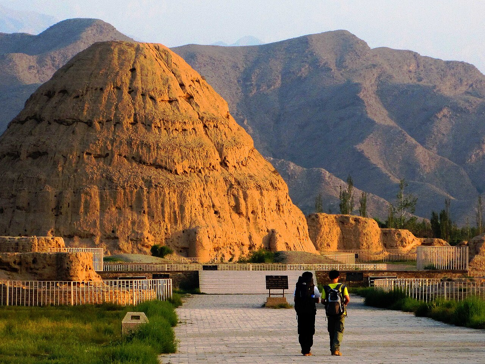
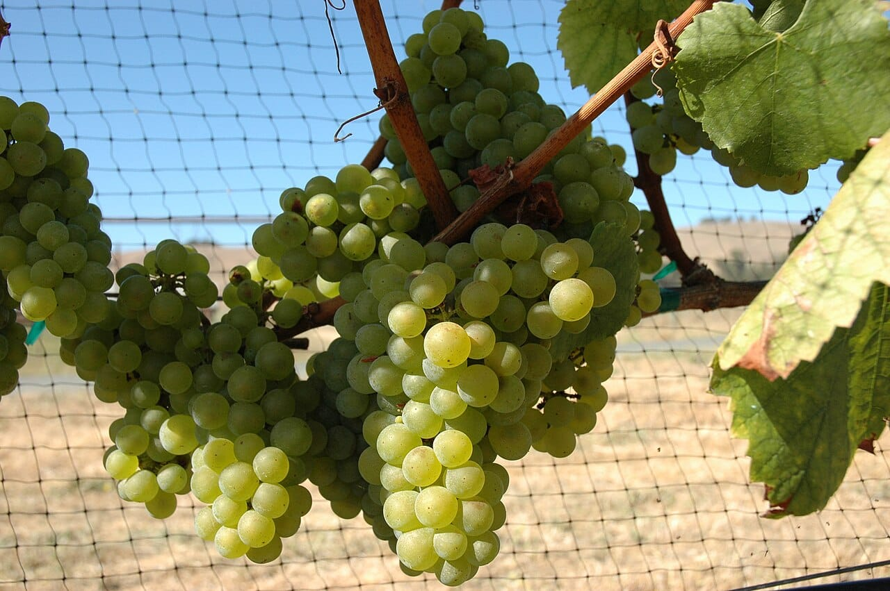

# 宁夏

宁夏是中国西北的内陆省份，葡萄酒产业集中在贺兰山东麓。产区南北绵延近 200 公里，葡萄园多分布在海拔约 1100 米的洪积扇、砾石坡地与黄河灌区，干旱少雨、日照充足。宁夏是中国酒庄酒最集中的产区之一；理解宁夏，要从一条山脉、一条河流、一部产区保护条例和一套酒庄体系入手。

图：宁夏。图片：zengsx，CC BY-SA 3.0，via Wikimedia Commons（[原图页面](https://commons.wikimedia.org/wiki/File:%E8%A5%BF%E5%A4%8F%E9%99%B5_-_panoramio.jpg)）。

## 贺兰山东麓：一条地理边界

贺兰山东麓葡萄酒产区是国家认定的地理标志产品保护产地范围，这一定义写在《宁夏回族自治区贺兰山东麓葡萄酒产区保护条例》第三条。产区以宁夏北部的贺兰山东麓为主体，南北接近 200 公里，当地产业资料把连片种植带记为 195 公里。葡萄园集中在海拔约 1100 米的洪积扇、黄河冲积平原与山前坡地，行政上跨石嘴山、银川、吴忠等地的多个县区。

本页是地区层级中的省级节点，上级为[中国](ref:china)。宁夏的葡萄酒属于[葡萄酒](ref:wine)大类，以[红葡萄酒](ref:red-wine)为主，也有[白葡萄酒](ref:white-wine)。产区范围不等于行政区划，酒标上的“贺兰山东麓”需要符合地理标志产品保护产地范围，而不是任意一块宁夏葡萄园都能使用。

## 一部条例划出的边界

现行条例在 2012 年 12 月 5 日由宁夏回族自治区第十届人民代表大会常务委员会第三十三次会议通过，2024 年 3 月 26 日由第十三届人民代表大会常务委员会第九次会议修订。条例把产区界定为地理标志产品保护产地范围，并要求划定酿酒葡萄种植区保护范围，向同级政府报批后向社会公示。

条例的具体制度包括：禁止向种植区保护范围排放或倾倒废水、废气、固体废物，禁止新建或扩建化工、建材、制药、采矿等可能污染土壤与大气的项目；酿酒葡萄种苗须经检疫，禁止使用未经检疫或检疫不合格的种苗；种植生产记录至少保存两年，禁止伪造、变造记录；新建、改建、扩建酒庄须由产区管理机构组织评估论证；酒庄应使用产区酿酒葡萄做原料。2021 年，国家葡萄及葡萄酒产业开放发展综合试验区落地宁夏，产区政策从规模扩张转向质量、品牌与融合发展的路径更加清晰。

这套制度的意义在于把“产区”从营销概念变成可执行的空间与质量边界。它保护的不只是葡萄园面积，还包括水源、土壤、种苗与生产记录，这些环节共同决定酒庄能否稳定地讲清楚一瓶酒的来源。

## 山、河与砾石

贺兰山是产区的天然屏障。它阻挡来自西北的寒流与风沙，山前洪积扇把碎石、砂粒与黄土混合在一起，形成排水快、保水差、昼夜升温降温都快的土壤环境。黄河从产区东侧流过，为干旱的葡萄园提供灌溉水源，也在河谷形成局部的空气流动与温度调节。

新华每日电讯的产区报道给出的风土数据是：海拔 1100 米，年降水量约 200 毫米，年日照超过 3000 小时，有效积温约 3300 摄氏度，昼夜温差大；土壤以淡灰钙土、砾石土和风沙土为主。干旱减少了病害压力，充足日照帮助糖分与酚类物质积累，砾石则让根系向下寻找水分。把这些条件简单等同于“必然好酒”并不准确，因为品种选择、架式、灌溉与酿造同样会改变结果。

## 品种与酒庄体系

赤霞珠是宁夏最有代表性的品种，果皮厚、单宁足，适合在干燥、日照充足的环境里成熟；梅洛、品丽珠、西拉、霞多丽与雷司令也有种植。[赤霞珠](ref:cabernet)与[霞多丽](ref:chardonnay)分别支撑红、白两类酒款，原料都是[葡萄](ref:grape)。不同酒庄的品种比例、采收时间与发酵温度差异很大，同一品种可以酿出从清爽到浓郁的不同风格。

产业规模上，宁夏日报的报道记录 60.6 万亩葡萄园、130 座酒庄、1.4 亿瓶年产量，产品销往 40 多个国家和地区，“贺兰山东麓葡萄酒”品牌价值为 350.86 亿元；报道还称每两瓶国产酒庄酒中约有一瓶来自宁夏。2013 年，贺兰山东麓被编入《世界葡萄酒地图》；2011 年，贺兰晴雪的加贝兰特别珍藏获得品醇客世界葡萄酒大赛最高奖项，这些节点让宁夏进入国际葡萄酒界的视野。

## 南北长廊的差异

近 200 公里的种植长廊不是一块均质的土地。北段靠近石嘴山，海拔与纬度略高，生长季偏短，酒体往往更紧致；中段围绕银川、永宁、贺兰一带，酒庄密集，洪积扇与黄河灌区的过渡带来多样的土壤；南段延伸到青铜峡、红寺堡等地，气候更干热，成熟度更容易推高，酸度保持成为酿酒师要处理的问题。

这些差异是气候与土壤的连续变化，不是简单的等级排序。把“北段优雅、南段浓郁”当成固定公式会忽略年份、品种与酿造。更可靠的判断方式，是看具体酒庄的地块、灌溉方式、采收日期与发酵控制，再结合酒标上的产区信息。

## 酿造与饮用

宁夏红葡萄酒多以赤霞珠为主体，经除梗破碎、控温[发酵](ref:fermentation)、压榨与橡木桶或惰性容器陈年。新桶比例、陈年时长与酒泥接触会改变单宁与香气；部分酒庄减少新桶，以保留果味与产区的干燥草本气息。白葡萄酒多强调低温发酵与清新酸度，霞多丽则可能经橡木桶与酒泥接触增加质感。[橡木桶陈年](ref:oak-ageing)在这里是风格选择，不是质量保证。

饮用上，红葡萄酒适合在 16–18 摄氏度、白葡萄酒在 8–10 摄氏度左右品尝；开瓶后视酒体与年份决定是否醒酒。搭配上，赤霞珠型红葡萄酒适合牛羊肉与烧烤，霞多丽型白葡萄酒适合禽类、鱼类与中式清蒸菜肴。本页关于宁夏的内容涉及酒精饮料；过量饮酒有害健康，未成年人不应饮酒。

## 对宁夏产区的五个误解

第一，把宁夏等同于中国葡萄酒的全部。宁夏酒庄酒集中，但山东、新疆、河北、云南等产区同样重要。

第二，认为海拔 1100 米一定带来高分。海拔影响日照与温差，但品种、土壤与年份同样关键。

第三，把砾石土壤说成“矿物感”的直接来源。矿物感是品鉴描述，不能简单等同于土壤化学成分。

第四，认为干旱产区不需要灌溉。宁夏葡萄园依赖黄河水与限量灌溉，水分管理直接影响成熟与酸度。

第五，把酒庄数量多理解为质量统一。酒庄之间的设备、地块与管理水平差异很大，选购要看具体酒款与年份。

## 参考资料

- [中国](ref:china)：宁夏所属的国家层级地区节点。
- [葡萄酒](ref:wine)：葡萄酒的分类、年份与产地规则。
- [红葡萄酒](ref:red-wine)：赤霞珠等红葡萄酿成的酒款。
- [白葡萄酒](ref:white-wine)：霞多丽等白葡萄酿成的酒款。
- [赤霞珠](ref:cabernet)：宁夏最具代表性的红葡萄品种。
- [霞多丽](ref:chardonnay)：宁夏白葡萄酒的主要品种之一。
- [葡萄](ref:grape)：酿酒葡萄的结构与成熟指标。
- [发酵](ref:fermentation)：控温发酵与苹果酸乳酸发酵的差异。
- [橡木桶陈年](ref:oak-ageing)：新桶与旧桶对风格的影响。

## 相关图像

图：中国类别配图。图片：Gary Todd，CC0，via Wikimedia Commons（[原图页面](https://commons.wikimedia.org/wiki/File:Shang_Bronze_Gu,_Jue,_%26_Jia_Wine_Vessels.jpg)）。关联图像：宁夏。

图：霞多丽。图片：Jenavive at English Wikipedia，Public domain，via Wikimedia Commons（[原图页面](https://commons.wikimedia.org/wiki/File:Chardonnay.jpg)）。关联图像：宁夏。
