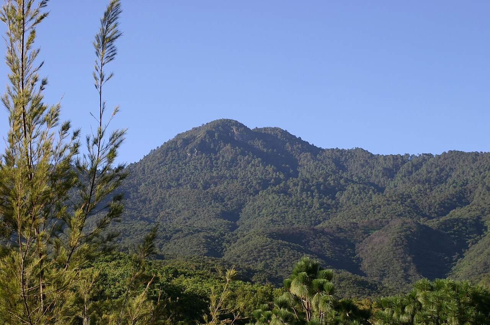

# 瓦哈卡

瓦哈卡（Oaxaca）位于墨西哥南部，北接普埃布拉与韦拉克鲁斯，西邻格雷罗，东连恰帕斯，南面是太平洋。它既是全国梅斯卡尔（mezcal）产量最大的州，也是这种蒸馏酒最广为人知的产地形象。但必须先把两件事分开：梅斯卡尔是覆盖多州的全国性原产地命名类别，瓦哈卡是其中最重要的生产带，而不是梅斯卡尔的同义词。

图：瓦哈卡。图片：Prsjl，CC BY-SA 4.0，via Wikimedia Commons（[原图页面](https://commons.wikimedia.org/wiki/File:Oaxaqa_(41).jpg)）。

## 行政位置与地形

州府瓦哈卡-德华雷斯位于中央谷地（Valles Centrales），海拔约 1550 米。州域被南马德雷山脉切成多条相对封闭的谷地，中央谷地又分为 Etla、Tlacolula、Ocotlán、Zimatlán 与 Ejutla 几个小盆地；东侧是特万特佩克地峡的低地，南侧是狭窄的海岸带。这种“谷地套谷地”的地形，使同一州内的降雨、霜冻与龙舌兰成熟期差别很大。蒸馏坊往往集中在有水源、有柴薪、又能把酒运到城镇的谷底与坡脚，交通条件因此直接塑造了产区分布。

## 气候、海拔与微气候

中央谷地属于半干旱高原气候，降雨集中在 6 月至 9 月，旱季漫长，昼夜温差大。海拔每上升数百米，夜间温度就明显下降，龙舌兰生长变慢，糖分积累周期拉长；低海拔的 Tlacolula 与 Ejutla 更热，成熟更快，香气往往更直接。太平洋一侧湿度高、雨季更长，病害压力也更大。生产者谈“年份”，通常不是指葡萄酒式的单一年份，而是指雨季长短、旱季强度与野火情况如何影响龙舌兰的含糖量与成熟节奏。

## 土壤与龙舌兰

谷底多为冲积土与石灰质土，坡地则是浅薄的石质土，排水快、保水差。龙舌兰靠肥厚的叶片储水，根系浅而广，能在贫瘠坡地上生存，但生长极慢。栽培最广的是 espadín（Agave angustifolia），定植后约 6 至 8 年成熟，糖分稳定、产量可靠；tobalá（A. potatorum）多生于阴坡与岩石缝，需 10 年以上；madrecuíz、tepeztate、mexicano、arroqueño、coyote（A. karwinskii）等野生或半栽培种，成熟期常在 10 至 15 年，风味更复杂，供给却高度不稳定。野生种被过度采挖、以及 espadín 单一化，是产区近年最现实的生态议题。

## 法定框架：DO 与 NOM-070

梅斯卡尔的原产地命名（Denominación de Origen，DO）于 1994 年公布，最初覆盖瓦哈卡、格雷罗、杜兰戈、萨卡特卡斯与圣路易斯波托西等州，此后又纳入瓜纳华托、米却肯、普埃布拉与塔毛利帕斯，具体市镇由官方声明逐一列出。未被列入的市镇即使有蒸馏传统，也不能标注“mezcal”。现行产品标准 NOM-070-SCFI-2016 规定原料、工艺类别与标签，并把产品分为 Mezcal、Mezcal Artesanal 与 Mezcal Ancestral 三档；后两档对土坑烘烤、石磨或机械碾碎、自然发酵与蒸馏器材质有更严格的限定，Ancestral 尤其强调陶制蒸馏器等传统做法。监管由 Consejo Regulador del Mezcal 执行，出口瓶需附官方认证标签。DO 说明产地与工艺范围，不构成质量等级。

## 实际生产带

瓦哈卡的生产并不均质。中央谷地的 Santiago Matatlán 被称为“梅斯卡尔之都”，蒸馏坊沿公路密集分布，产量大、商业化程度高；Santa Catarina Minas 以陶制壶式蒸馏器（olla de barro）闻名，酒体更厚、矿物感更强；San Luis del Río 与 Sola de Vega 位于更深的谷地，交通不便，仍保留小批量家族生产；Miahuatlán 与 San Baltazar Guelavila 则以野生龙舌兰与高酸度风格受到关注。把这些村庄统称为“瓦哈卡风味”，会掩盖蒸馏器、水源与发酵容器造成的巨大差异。

## 从 piña 到酒：工艺链

成熟的龙舌兰被刈去叶片，只留茎心（piña），放入地下土坑，以柴火加热石块，再覆盖泥土与纤维，烘烤 3 至 5 天。烟熏与焦糖化在这一步完成，也是梅斯卡尔与龙舌兰酒最直观的分界：后者多用蒸汽 autoclave，烟熏感很弱。冷却后的茎心用 tahona 石磨或机械碾碎，加水后进入木槽或皮囊，依靠环境中的酵母与细菌自然发酵，温度随天气波动，发酵时间从数天到两周不等。随后在铜制壶式蒸馏器中蒸馏两次，切取中段；Ancestral 类别则使用陶制蒸馏器。部分产品装入橡木桶陈年，另有以龙舌兰虫浸泡的款式，那其实是蛾类幼虫，并非工艺必需。

## 陈年分级与标签

按现行标准，Joven 指未经陈年或仅短暂陈放的产品；Reposado 在橡木桶中陈年 2 个月至 1 年；Añejo 陈年 1 至 3 年；Extra Añejo 超过 3 年。桶陈会带来香草、焦糖与木质单宁，也会掩盖龙舌兰本身的植物气息，因此不少生产者宁愿把酒保持在 Joven。酒标上的“100% agave”表示糖源全部来自龙舌兰，但仍需结合品种、村庄与工艺类别阅读；同一个 espadín 可以是清瘦的，也可以是浓重的。

## 风格与代表村庄

年轻梅斯卡尔常见烟熏、烤龙舌兰、青椒、柑橘皮与湿石气息，入口偏干，余味带灰烬与植物苦感。espadín 更直接、甜感更明显；tobalá 常更花香、更细腻；tepeztate 带青椒与草本；coyote 则有更明显的柑橘与香料。Matatlán 的大产量产品适合入门，Minas 的陶锅酒适合慢饮，Sola de Vega 与 Miahuatlán 的小批次作品常出现在精品渠道。同一品种因烘烤时长、发酵温度与蒸馏器不同，结果可以相差很远。

## 市场、年份与挑战

21 世纪的鸡尾酒与手工烈酒热潮把梅斯卡尔推入出口市场，瓦哈卡的蒸馏坊数量在十余年间快速增长，随之而来的是价格波动、品牌代工与原产地叙事之间的张力。年份差异主要来自雨季与旱季，而不是像葡萄酒那样有统一的采摘期；同一村庄不同年份的酒，酸度与烟熏强度都会变化。更长期的压力来自生态：野生龙舌兰生长慢，长鼻蝠等传粉者依赖其花蜜，过度采挖会削弱种群；同时，espadín 的单一化让小农在价格下行时更脆弱。

## 常见误区

第一，梅斯卡尔等于瓦哈卡。其他州同样在 DO 范围内生产。第二，梅斯卡尔等于龙舌兰酒。两者是独立类别，原料、产区与标准都不同。第三，梅斯卡尔一定带虫。虫浸只是少数款式。第四，烟熏越重越正宗。烘烤与发酵本就有多种传统。第五，手工等于高质量。设备、原料与卫生同样重要。第六，陈年越久越好。桶陈会掩盖龙舌兰的植物气息。第七，所有瓦哈卡梅斯卡尔都用陶锅蒸馏。陶锅只是 Minas 等地的传统之一。

## 延伸阅读

- [梅斯卡尔](ref:mezcal)：类别定义与基本工艺。
- [龙舌兰酒](ref:tequila)：与梅斯卡尔相邻但独立的类别。
- [发酵](ref:fermentation)：自然发酵与风味前体。
- [蒸馏](ref:distillation)：壶式蒸馏与切酒的基本原理。
- [橡木桶陈年](ref:oak-ageing)：reposado 与 añejo 的桶陈影响。

相关条目：[梅斯卡尔](ref:mezcal)、[龙舌兰酒](ref:tequila)、[发酵](ref:fermentation)。
