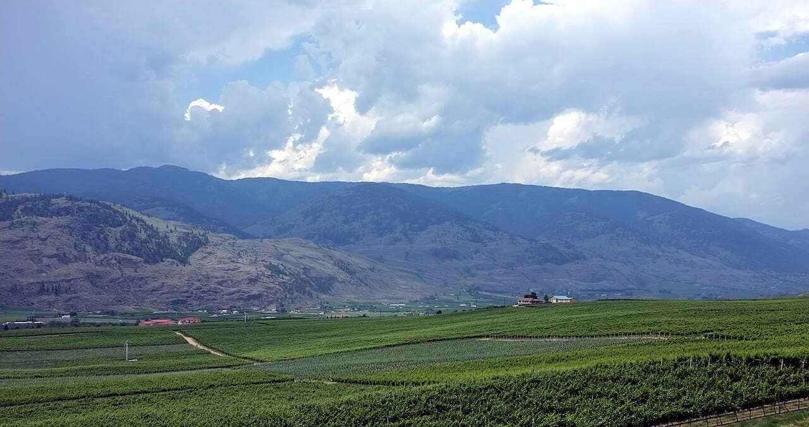
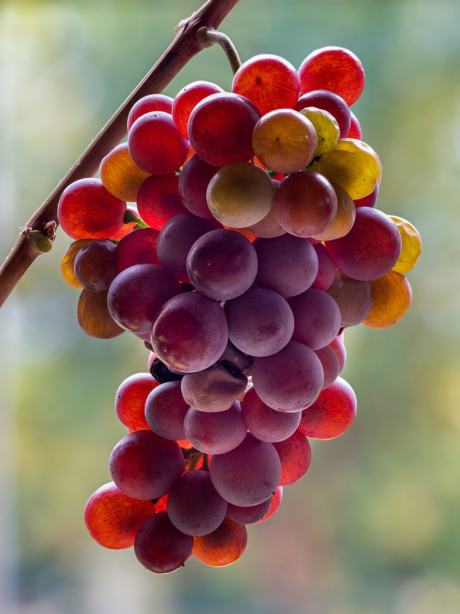

# 欧肯那根

欧肯那根谷是加拿大不列颠哥伦比亚省南部的狭长湖谷，北接半沙漠地带、南抵美加边境；湖水调节气温、夏季日照长，以灰皮诺、梅洛、赤霞珠、黑皮诺与冰酒著称，是加拿大仅次于尼亚加拉的第二大葡萄酒产区。

图：Okanagan Valley：Okanagan Valley (7631693050)（Wikimedia Commons）。图片：xlibber，CC BY 2.0，via Wikimedia Commons（[原图页面](https://commons.wikimedia.org/wiki/File:Okanagan_Valley_(7631693050).jpg)）。

## 先划清「欧肯那根」的边界
欧肯那根谷位于 BC 省南部，沿欧肯那根湖及其支流湖盆南北延伸约 250 公里；北端近沙漠气候，南端 Osoyoos 一带最暖，中部 Kelowna、Penticton 居中。BC 葡萄酒协会把谷地划分为七个葡萄种植区：Lake Country 与北欧肯那根、Kelowna 中部、West Kelowna–Mount Boucherie、Summerland–Peachland、Naramata、Penticton 与南欧肯那根（Oliver、Osoyoos）。欧肯那根湖本身长达一百多公里，支流小湖与岸线坡地共同构成微气候；谷地西侧靠山、东侧迎湖风，坡面朝向决定日照与排水。

标签上的“Okanagan Valley”是 VQA 地理标志，覆盖整个湖谷；区内没有法定次级 AOC，但 Golden Mile Bench 于 2015 年成为 BC 第一个官方次级 GI，位于 Oliver 南侧。同一谷内，北部冷凉地块与南部暖热地块适合的品种不同，村镇与台地名比笼统谷名更能说明风格。

## 历史与命名

现代种植史从 1927 年算起：J.W. Hughes 在 Kelowna 一带种下葡萄，地块后来成为 Tantalus 葡萄园；1932 年 Calona 成为谷内第一家商业酒庄。早期葡萄园多与果园混作，20 世纪后半叶水果种植逐渐让位于精品葡萄酒。果园传统在 BC 省由来已久，早期酒庄常把葡萄与苹果、梨混种，酒厂也加工果汁与果酱；直到精品酒市场起来后，葡萄园才单独成块。

1980 年代以后，一批家族酒庄在 West Kelowna、Naramata 与 Oliver 一带建立；Quails' Gate 家族 1956 年购入 Allison Ranch，1989 年放弃果园专注酿酒。VQA 体系把省内产区、品种与酿造规范固定下来，冰酒则在冬季低温稳定的年份成为标志性产品。

## 「欧肯那根」的地理与风土
湖谷气候半干旱，降雨少、湿度低，夏季白天暖、夜晚凉，湖水与支流湖泊推迟降温、延长成熟季。土壤以冰川沉积、砂质砾石与火山冰碛物为主，排水快；台地海拔可达 600 米，空气流通好，降低春秋霜冻风险。Golden Mile Bench 的生长度日约 1,340 至 1,630，土壤为冰碛扇上的砾质砂壤土。谷地处于内陆雨影区，年降雨低，灌溉靠湖水与地下水；干燥空气减少霉菌压力，强日照让皮色与酚类成熟充分，夜晚降温保住酸度。

南北温差决定品种布局：北部 Kelowna、Lake Country 偏冷，适合黑皮诺、霞多丽、雷司令与灰皮诺；南部 Oliver、Osoyoos 最暖，梅洛、赤霞珠、品丽珠与西拉表现更好。冬季极端低温是主要风险，晚熟红葡萄在偏冷年份可能达不到理想成熟度。

## 原料与风格

白葡萄以灰皮诺 (ref:pinot-gris)、霞多丽、雷司令、琼瑶浆为主；红葡萄以梅洛 (ref:merlot)、黑皮诺、赤霞珠、品丽珠、西拉与佳美为主。按 BC 全省统计，梅洛是种植最广的红葡萄（约 1,861 英亩），黑皮诺约 1,655 英亩，赤霞珠约 972 英亩；谷内比例随南北地块变化。除主流品种外，琼瑶浆、维欧尼与少量黑皮诺克隆在冷凉地块试种，长相思在偏北与高坡地块也有少量种植。

欧肯那根红酒通常果味直接、单宁结构清晰，梅洛圆润、赤霞珠偏硬朗；白葡萄酒酸度清爽、果香纯净，灰皮诺常带梨与柑橘。冰酒用天然冰冻葡萄压榨，法规要求采收时气温不高于 -8°C、葡萄达到 35 Brix；采收期可从 11 月延续到次年 2 月，温度不够的年份多做晚收甜酒。

## 代表生产者与酒款

代表酒庄包括 Mission Hill、Quails' Gate（West Kelowna，家族 1989 年重启酿酒）、Burrowing Owl（Oliver）、Inniskillin Okanagan（Oliver，冰酒代表）、Blue Mountain（Okanagan Falls）与 CedarCreek；Tantalus 则坐落在 Kelowna 最早的种植地块上。Mission Hill 位于西 Kelowna 山坡，以观景品鉴室与多元品种线著称；Blue Mountain 家族经营，风格偏冷凉优雅。

这些名字是市场长期形成的参照，不是官方分级。家族酒庄与外来资本并存，合作社与大酒商承担部分大众产量；旗舰单一园与冰酒价高量小，入门款在餐厅与零售渠道更易找到。比较同一品种在北部冷凉地块与南部暖热地块的差别，是理解谷内风格最直接的方式。

## 「欧肯那根」的上桌方式
红酒适饮 15 至 17 摄氏度，白葡萄酒与灰皮诺 8 至 11 摄氏度，冰酒 6 至 8 摄氏度。年轻果味款不必醒酒，结构强的梅洛或赤霞珠可提前半小时透气。酒杯按品种选通用中等杯型即可；陈年梅洛与波尔多式混酿可在开瓶后静置一刻钟再判断。

配餐围绕当地烤肉、烟熏肉、三文鱼与奶酪：梅洛配烤牛排与炖菜，黑皮诺配鸭肉与蘑菇，灰皮诺配海鲜与亚洲风味菜；冰酒配蓝纹奶酪、坚果、干果或作为餐后甜酒，酸度平衡甜度。

## 选购、标签与误区

读标签先分清 VQA 标志与谷名层级；谷内台地、村镇名（Naramata、Oliver、Osoyoos、West Kelowna）可提示冷暖与品种方向。冰酒标签上的采收温度与 Brix 是法规指标，普通晚收甜酒不等同于冰酒。

常见误区是把“加拿大冰酒”当成一个统一风格，或认为高糖分就是冰酒。欧肯那根多数年份冬季低温并不稳定，冰酒产量小、价格高；普通干红干白的风格更多取决于南北地块与年份，购买时留意生产者、储存条件与年份天气。VQA 标志要求果实来自本省并符合产区与品种规则，但不代表庄内等级；买冰酒时留意标注的次级产区与年份。

## 「欧肯那根」周边怎么走
谷地南北狭长，Kelowna 是中部门户，Penticton 与 Oliver 向南依次展开；酒庄之间车程多在 20 至 50 分钟，品鉴预约制，单次留 60 至 90 分钟。一天两三家加午餐较从容，采收季（9 至 10 月）最忙。

夏季可结合湖上游船、自行车与果园走访；冬季冰酒采收在 12 月至次年 2 月，部分酒庄安排冰冻葡萄压榨体验。公共交通有限，自驾或参加当地酒乡团更方便；台地土路与品鉴室门槛对行动不便者需提前确认。夏季周末品酒室最拥挤，工作日到访更从容；部分酒庄只接受预约步行或团组参观。

- 相关条目：[canada](ref:canada)、[pinot-gris](ref:pinot-gris)、[merlot](ref:merlot)、[red-wine](ref:red)、[ice-wine](ref:icewine)。
- 欧肯那根冬季低温年份波动较大，出行前可在 BC Wine Institute 或酒庄官网核对冰酒产量、开放时间与品鉴预约。

相关条目：[加拿大](ref:canada)。

**关键事实。**

| 项目 | 内容 |
| --- | --- |
| 一句话定位 | 加拿大不列颠哥伦比亚省南部的狭长湖谷，北接沙漠、南接美国边境；湖水调节温度、日照长，以灰皮诺、梅洛、赤霞珠与冰酒著称，是加拿大第二大葡萄酒产区 |
| 层级 | 省/大区 |
| 所属 | 加拿大 |
| 国家代码 | CA |

## 相关图像

图：灰皮诺。图片：Ermell，CC BY-SA 4.0，via Wikimedia Commons（[原图页面](https://commons.wikimedia.org/wiki/File:Pinot_Grigio-20201027-RM-114053.jpg)）。关联图像：欧肯那根。

图：安大略 Forty Creek 酒厂的威士忌橡木桶陈酿库。图片：Gogerr，CC BY-SA 4.0，via Wikimedia Commons（[原图页面](https://commons.wikimedia.org/wiki/File:Whisky_maturation_in_barrels_at_the_Forty_Creek_Distillery.jpg)）。关联图像：欧肯那根。
