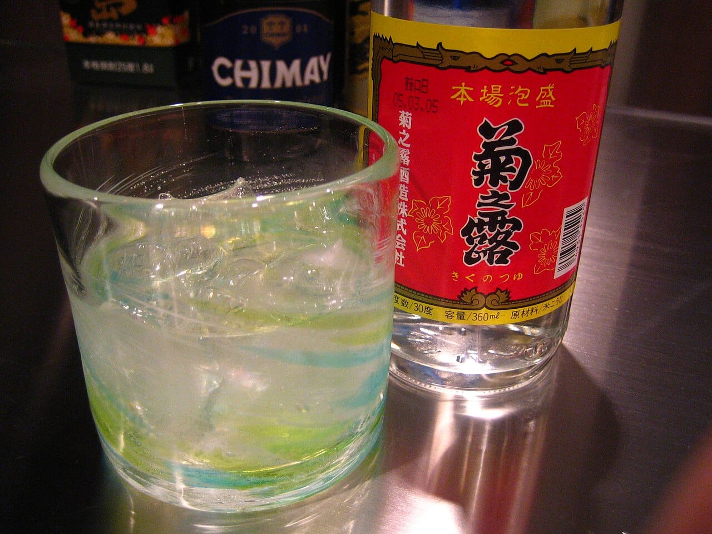
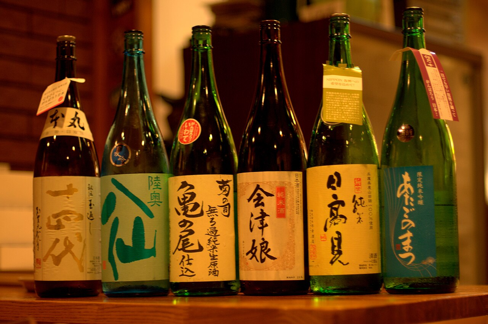

# 冲绳

日本冲绳县的泡盛产区，以稻米与黑曲霉（black koji）为原料，经单式蒸馏与长期陈年；泡盛是日本最古老的蒸馏酒之一，那霸、首里与石垣岛是主要产地。

图：菊之露泡盛，冲绳本岛生产的米制蒸馏酒。图片：ayustety（Flickr），CC BY-SA 2.0，via Wikimedia Commons（[原图页面](https://commons.wikimedia.org/wiki/File:Kikunotsuyu_Awamori.jpg)）。

## 先划清「冲绳」的边界
冲绳泡盛是日本冲绳县的蒸馏酒，以稻米与黑曲霉（Aspergillus awamori）发酵，经单式壶式蒸馏，酒精度通常 25–60%；新酒透明，陈年三年以上称“古酒”（kusu）。

这里的“产区”是岛屿与工艺传统，不是葡萄酒式地块。看到“泡盛”先确认是泡盛、古酒还是泡盛调饮；类型、酒精度与陈年决定喝法。

## 历史与命名

泡盛起源与琉球王国、东南亚贸易有关，15–16 世纪已有蒸馏记录；那霸与首里是历史核心，石垣岛也有重要酒厂。

琉球时期的酒税、使节与贸易让泡盛成为岛屿经济的一部分；近代冲绳经历战争与回归，酒厂在战后重建。名字“泡盛”比产区边界更早稳定。

## 「冲绳」的地理与风土
黑曲霉是泡盛的关键，糖化与发酵同时进行；与日本清酒的黄曲霉不同，黑曲霉带来更丰富的酸与香气。

冲绳炎热潮湿，发酵温度高，酒厂需要控制曲室与发酵罐；海岛地下水与稻米构成原料基础。风土是气候、水与曲，而不是葡萄园坡向。

## 原料与风格

泡盛以稻米与黑曲霉为原料，单式蒸馏保留更多原料香；风格从清爽、干净到浓郁、带香草与坚果都有。陈年古酒颜色变深，带蜂蜜、香料与木质。

风格差异来自曲的比例、发酵温度、蒸馏批次与陈年容器。新酒适合加冰或调饮，古酒适合净饮；不要用“泡盛”一个词概括所有年份。

## 代表生产者与酒款

代表酒厂包括 Kumesen、Chuko、Sato no Yume、Kikuya 与 Higa Shuzo；那霸的泡盛博物馆与酒厂参观是主要旅游点。

看生产者时，先看是泡盛还是古酒、陈年多久、酒精度与曲种；大厂与小酒坊的差异很大。那霸与石垣岛的酒厂风格也不同，比较时选同年份或同陈年。

## 「冲绳」的上桌方式
泡盛可以净饮、加冰或加水；新酒酒精度高，少量水能打开香气。古酒适合小杯慢饮，温度接近室温。不要用甜饮料掩盖酒精。

配餐适合冲绳料理：苦瓜、海带、猪肉、海鲜与岛豆腐都能托住酒体。高酒精配重辣会放大灼热；先吃咸鲜与油脂，再小口喝。

## 选购、标签与误区

标签重点看：泡盛/古酒、陈年、酒精度、酒厂与原料。若只写“泡盛”而没有陈年，可能是新酒；古酒要有明确陈年标识。

常见误区是把泡盛当成清酒或烧酒，或把高酒精度当成陈年。开瓶后避光、直立、常温保存；古酒可以慢慢喝，新酒尽快喝完。

## 「冲绳」周边怎么走
冲绳路线可以围绕那霸、首里与石垣岛：那霸的泡盛博物馆适合入门，酒厂参观需要预约，离岛要查船班。

本岛交通以单轨与巴士为主，酒厂多在郊区；石垣岛需要飞机或船。一次选一家酒厂加博物馆，比赶多个点更有效；不要酒后驾车。

## 进一步阅读

进一步阅读：泡盛最容易被误解成“日本清酒”或“烧酒”，但它走的是黑曲霉、单式蒸馏与陈年三条线。先分清新酒与古酒：新酒清爽、酒精度高，适合加冰或调饮；古酒经过三年以上陈年，颜色变深，带蜂蜜、香料与木质，适合小杯慢饮。再分曲与酒厂：黑曲霉带来酸与香气，不同酒厂的曲室、发酵温度与蒸馏批次会改变风格。最后看价格与年份：古酒的价格不只来自年份，也来自仓储损耗与产量。那霸的博物馆适合建立框架，石垣岛的酒厂适合看另一种岛屿表达；不要把两家酒厂的风格当成整个冲绳。

泡盛的“古酒”不是越老越贵这么简单：陈年带来圆润与香气，也带来仓储损耗、搬桶与资金占用；年份只是价格的一部分。买古酒时看酒厂、桶型、陈年与酒精度，最好先试小杯；新酒则看曲香与蒸馏干净度。那霸与石垣岛的风格差异，常来自水、曲与仓库，而不是“冲绳”两个字。若只安排半天，博物馆加一家酒厂足够；离岛行程把船班与天气留出余量，泡盛不适合匆匆打卡。泡盛配冲绳菜的重点是咸鲜与油脂，不是甜味。若只买一瓶，选三年以上的古酒小样，再与一瓶新酒对照；差别会在颜色、香气与口感上同时出现。古酒开瓶后可以放很久，但每次倒小杯，避免反复氧化；博物馆的展示能补上历史，但别把展板当成全部风味。先试饮再买，尤其高价古酒，别只看年份。

泡盛的新酒与古酒，适合用两只不同杯型对照，香气差异会更清楚。

- 相关条目：[japan](ref:japan)、[awamori](ref:awamori)、[sake](ref:sake)、[rice](ref:rice)、[distillation](ref:distillation)。
关于冲绳，本页只保留产区与风格信息；地图、实时价格与营业时间请查当地官方渠道。

对照阅读：[日本](ref:japan)、[清酒](ref:sake)。

相关条目：[泡盛](ref:awamori)。

**关键事实。**

| 项目 | 内容 |
| --- | --- |
| 一句话定位 | 日本冲绳县的泡盛产区，以稻米与黑曲霉（black koji）为原料，经单式蒸馏与长期陈年；泡盛是日本最古老的蒸馏酒之一，那霸、首里与石垣岛是主要产地 |
| 层级 | 省/大区 |
| 所属 | 日本 |
| 国家代码 | JP |

**来源与边界。** 本页关于「冲绳」的关键事实，主要由以下来源交叉核对：Okinawa Distillers Association（泡盛以稻米与黑曲霉、单式蒸馏与古酒 kusu 的工艺与产区）、Visit Okinawa Japan（泡盛历史、黑曲霉、泰米与三年以上 kusu 的说明）、National Tax Agency, Okinawa Regional Taxation Bureau（泡盛定义、黑曲霉、蒸馏与酒精度的说明）等 4 条来源。价格、批次与状态会变，涉及这些字段时以页面所列来源的最新版本为准。正文为项目自写，来源只作核验，不复制原文。

**并读。** 把「冲绳」与「日本」、「泡盛」、「清酒」放在一起读时，先确认它们是同一层级还是上下游关系：先确认边界与法定分类，再比较气候、土壤、海拔与代表酒款。本页负责给出产区的基本坐标，对照条目补上具体案例与差异；读完再回到本页，才能分清哪些差别属于产区本身，哪些只是产地、批次或品牌选择。

**适用边界。** 对「冲绳」而言，产区边界、面积与法定分类会随法规更新；气候描述是长期趋势，不是某一年的天气预报。

**更新提示。** 「冲绳」最近核对于 2026-11-22；面积、法定分类、标签规则与年份表现会变，引用前以法规与产区官方文本为准。

## 相关图像

图：清酒瓶装，精米步合、酒度与日本酒度常决定选购判断。图片：koutalou，CC BY 2.0，via Wikimedia Commons（[原图页面](https://commons.wikimedia.org/wiki/File:Sake_bottles.jpg)）。关联图像：冲绳。

图：日本类别配图。图片：OS6，CC BY-SA 3.0，via Wikimedia Commons（[原图页面](https://commons.wikimedia.org/wiki/File:Kamotsuru_Sake_Brewing.jpg)）。关联图像：冲绳。
