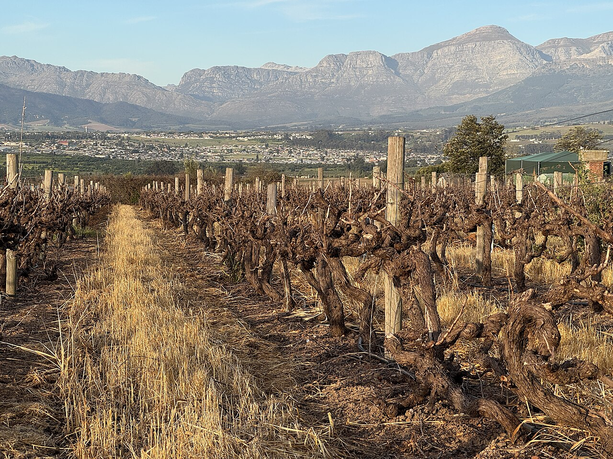

# 帕尔

帕尔是西开普省的葡萄酒产区，位于开普敦东北约 60 公里，伯格河穿谷而过，两侧为 Drakenstein 与 Paarl 花岗岩山体。产区以皮诺塔吉、白诗南、赤霞珠、西拉与霞多丽见长，汇集 KWV、Nederburg、Fairview 等历史酒庄，是开普酒乡历史最厚、酒庄最集中的地带之一。

图：Paarl：Nantes Vineyard Old Vine Sauvignon Blanc, Paarl, South Africa（Wikimedia Commons）。图片：Treephoto，CC BY-SA 4.0，via Wikimedia Commons（[原图页面](https://commons.wikimedia.org/wiki/File:Nantes_Vineyard_Old_Vine_Sauvignon_Blanc,_Paarl,_South_Africa.jpg)）。

## 先划清「帕尔」的边界
帕尔产区北邻斯泰伦博斯，东北接惠灵顿，东南为 Groot Drakenstein、Klein Drakenstein 与 Franschhoek 山脉；伯格河在 Groot Drakenstein 与 Wemmershoek 山之间流过，是产区的灌溉动脉。按南非原产地（Wine of Origin）制度，帕尔是一个 district，下设 Simonsberg-Paarl、Agter-Paarl 与 Voor Paardeberg 三个 ward；酒标标注 Paarl，果实须来自划定的产区范围，ward 名称则指向更具体的坡地或河谷。

产区地势从河谷平地到山脚台地，海拔约 50–400 米。河谷土地在炎热生长季需要补充灌溉，东坡土壤保水性较好，不少地块可以不用灌溉。产区范围之外，相邻的 Franschhoek 与 Wellington 已分别是独立 district，风土与酒风各有归属；读酒标时先分清 district、ward 与酒庄名，才不会把不同谷地的果实混为一谈。

## 历史与命名

“Paarl”在荷兰语中意为“珍珠”，得名于 Paarl 山上三块花岗岩巨石，雨后在阳光下如珍珠般发亮。17 世纪末法国胡格诺教徒抵达开普并在谷地种植葡萄；Fairview 地块 1693 年划给首批定居者，旧名 Bloemkoolfontein，1699 年产出农庄首瓶酒。Nederburg 农庄建于 1791 年，是南非现存最老的酒庄之一。

合作社与现代产业阶段从 20 世纪开始。1918 年 KWV（葡萄酒种植者合作社协会）在帕尔成立，长期承担稳定产业、规范酿造与白兰地生产的职能，直至 1990 年代私有化后不再拥有行业管理角色。皮诺塔吉是 Perold 以黑皮诺 × Cinsault 杂交育成的南非独有品种，1940 年代前后在帕尔周边庄园种下早期商业植株，使产区成为这个品种的精神故乡之一。

家族独立化是 1970 年代后的主线。1902 年立陶宛移民 Charles Back I 抵达南非，1937 年购入 Fairview 庄园；1955 年 Cyril Back 接手后重植葡萄园，引入赤霞珠、西拉与皮诺塔吉。1974 年庄园首次独立装瓶，并举办开普第一场公开葡萄酒拍卖；1978 年 Charles Back II 完成酿酒学业后回到庄园与父亲共同经营，1995 年全面接手。1980 年农庄引入奶山羊群开始奶酪生产，1981 年建起标志性山羊塔。

## 「帕尔」的地理与风土
帕尔属地中海气候，夏季干热、冬季温和多雨，年降雨约 770 毫米，雨水集中在冬季；一月均温约 21–22°C，比斯泰伦博斯高 2–3°C，盛夏常升至 35°C 以上。谷地避风，海洋影响弱于海岸产区，但夜间降温明显，昼夜温差帮助保留酸度与香气层次。生长季河谷依赖伯格河与地下水灌溉，坡地则靠土壤保水。

土壤随地形分层：山坡以风化花岗岩为主，排水快、白天蓄热；黏土含量较高的坡地更适合结构型红葡萄；伯格河沿岸为冲积土，土层肥沃、产量偏高；谷地局部夹有砂岩。花岗岩地块养分偏低、根系下扎，白葡萄与早熟红果风味集中；冲积平地长势旺，需要通过修剪与产量控制压实力度。同一产区内，坡向、海拔与距河远近带来的差别，往往大于品种之间的表面差异。

## 原料与风格

按种植面积估算，赤霞珠约占 16%，[皮诺塔吉](ref:pinotage) 约 14%，西拉约 12%，[白诗南](ref:chenin) 约 10%，霞多丽约 8%；其余还有梅洛、长相思、维欧尼、慕合怀特与神索等。红葡萄在产区占比高，整体风格偏成熟浓郁：赤霞珠果味黑甜、单宁紧实，好的坡地版本兼具力量与优雅；皮诺塔吉呈熟李子、巧克力、咖啡与烟熏气息，部分 1940 年代老藤仍在产出；西拉酒体饱满，带香料与黑莓果香。

白葡萄方面，白诗南（本地旧称 Steen）从清爽干白到木桶陈酿老藤、贵腐风格都有，蜂蜜、榅桲与核果香气配鲜活酸度；霞多丽用于饱满白酒与 Méthode Cap Classique 起泡酒；长相思与维欧尼补充芳香型阵容。历史上产区还以 Muscadel（亚历山大麝香）酿制加强酒与浅色干型雪利风格酒。罗讷混酿（西拉、慕合怀特、歌海娜）与波尔多式混酿在多家酒庄并行，酿造上整串比例、野生酵母、桶陈与浸皮时间都会改变质地。

## 代表生产者与酒款

KWV 是产区体量最大的名字之一，1918 年以合作社起家，帕尔厂区拥有大型酒窖与白兰地生产传统，Cathedral Cellar 系列与十年陈白兰地是其代表；Nederburg 建于 1791 年，Winemasters 与 Private Bin 系列覆盖多品种，其年度拍卖是南非最具声望的酒拍之一。Fairview 由 Back 家族三代经营，旗舰 Cyril Back 西拉与 The Beacon Shiraz 是代表作，农场同时经营手工奶酪与山羊塔旅游项目。

其余值得留意的生产者包括 Backsberg、Avondale（有机与生物动力）、Rhebokskloof、Laborie（历史农庄，现为餐饮与品鉴旗舰）、Rupert & Rothschild Vignerons（Baron Edmond、Baroness Nadine 波尔多混酿）、Glen Carlou、Eikendal、Rickety Bridge、Babylonstoren、Anthonij Rupert 与 Boekenhoutskloof。这些名称不是法定分级，而是市场长期参照；大酒商、家族庄园与精品小庄在同一产区并存，自有园比例与果实来源差别明显。

## 「帕尔」的上桌方式
帕尔红葡萄酒适饮温度约 16–18°C，年轻赤霞珠与皮诺塔吉可短时间醒酒，杯型选中到大肚红酒杯；西拉与混酿约 15–17°C。白诗南干白约 10–12°C，老藤桶陈白诗南稍凉即可；霞多丽与起泡酒 6–10°C。年轻酒酸度清新，陈年皮诺塔吉与赤霞珠会发展出皮革、烟草与干果气息，开瓶后随空气逐步展开。

配餐上，产区红葡萄酒对接烤肉、羊排、炖牛肉、野味与硬质奶酪，单宁与脂肪相互平衡；皮诺塔吉配熏烤肉类、炖菜与带香料的菜肴，烟熏气息与炭火风味呼应。白诗南配猪肉、禽肉、沙拉与咸香前菜，老藤版本可配奶油酱白肉；长相思与维欧尼配海鲜与轻食。当地餐饮以烤肉、农庄蔬菜与奶酪拼盘见长，与产区成熟饱满的红白风格互补。

## 选购、标签与误区

读帕尔酒标，先确认 WO 产区名（Paarl 或旗下 ward），再看生产者、品种与年份。Wine of Origin 制度下，标注产区的酒须使用划定范围内的果实；ward 名称比 district 更具体，但 Simonsberg-Paarl、Agter-Paarl、Voor Paardeberg 之间的土壤与朝向差异，需要结合酒庄地块资料判断。年份在大陆性谷地同样重要：春季霜冻、夏季热浪与采收雨都会改变成熟度，同酒庄不同年份的酒精度与果味可能拉开距离。

常见误区之一是把产区名当成品质等级：帕尔既有大规模合作社与商业酒款，也有小产量精品庄园，酒标名称本身不分级。另一个误区是把“老藤”“手工”“传统”当成法律术语；南非法规对这些表述的限定有限，需要结合生产者记录判断。高酒精度也不等于成熟度更好——暖热年份的酒可能酒精度高而酸度单薄。储存上红葡萄酒避热避光，旗舰款可多年陈放，入门款宜在年轻时饮用。

## 「帕尔」周边怎么走
帕尔小镇距开普敦约一小时车程，是开普酒乡通往惠灵顿、Franschhoek 方向的枢纽。酒庄沿 R44 公路与伯格河两侧分布，产区内车程多在十几分钟；Paarl 山自然保护区步道可登上 Paarl Rocks，俯瞰葡萄园与 Drakenstein 山脉，山坡上的南非语语言纪念碑与语言博物馆也是本地历史地标。

多数酒庄设有品鉴室，Fairview 等热门庄园周末与采收季人流集中，建议提前预约；采收季在南半球 2 至 3 月，部分酒庄开放丰收活动。单次品鉴约一小时，一天安排两三家加午餐较为从容；不开车可参加从开普敦或帕尔镇出发的酒旅团。参观时不要进入作业中的葡萄园与发酵车间，品鉴后不驾车。

- 相关条目：[south-africa](ref:south-africa)、[pinotage](ref:pinotage)、[chenin-blanc](ref:chenin)、[red-wine](ref:red)、[white-wine](ref:white)。

相关条目：[南非](ref:south-africa)。

**关键事实。**

| 项目 | 内容 |
| --- | --- |
| 一句话定位 | 西开普省伯格河畔的温暖产区，花岗岩山体与河谷构成风土；以皮诺塔吉、白诗南、赤霞珠与历史酒庄著称，Nederburg、KWV 与 Fairview 是常见名字 |
| 层级 | 省/大区 |
| 所属 | 南非 |
| 国家代码 | ZA |
