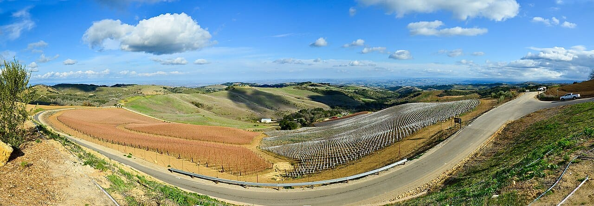
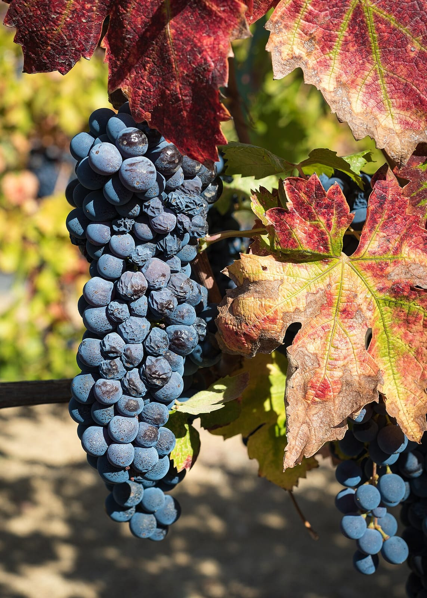

# 帕索罗布尔斯

加州中央海岸北部的 AVA，白天炎热、夜晚凉爽，以仙粉黛、赤霞珠与西拉著称；1983 年获 AVA，现有 11 个子 AVA，石灰岩与冲积土使风格比一般加州酒更紧。

帕索罗布尔斯是加州中央海岸的内陆产区，石灰岩土壤、极大昼夜温差与 Rhône 品种让它同时有阳光与骨架；西部更凉，东部更饱满。

图：Paso Robles：Daou Vineyards - Paso Robles, California, USA - Feb. 2012（Wikimedia Commons）。图片：SD Dirk from San Diego, USA，CC BY 2.0，via Wikimedia Commons（[原图页面](https://commons.wikimedia.org/wiki/File:Daou_Vineyards_-_Paso_Robles,_California,_USA_-_Feb._2012.jpg)）。

## 定义与边界

帕索罗布尔斯是[美国](ref:usa)加利福尼亚州中央海岸的葡萄酒产区，位于圣路易斯奥比斯波县北部，包含 Paso Robles、Templeton、Adelaida 等子产区；以 Zinfandel、Syrah、Cabernet Sauvignon 与 Rhône 品种混酿著称。

帕索罗布尔斯不是“加州的一个小镇”，而是一个面积很大的产区，东西跨度大、海拔差异明显；酒标上的“Paso Robles”可能来自温暖的东部或凉爽的西部，风格差别很大。

它与 Santa Barbara、Monterey 不同：帕索罗布尔斯更内陆、更暖，昼夜温差极大，石灰岩土壤与 Rhône 品种是它的标志。

## 历史与命名

帕索罗布尔斯在 19 世纪后期已有葡萄种植与酿酒，但现代精品酒庄是 1980–90 年代以后才兴起；Tablas Creek、Justin 等酒庄把 Rhône 品种与石灰岩土壤带进国际市场。

“Paso Robles”西班牙语意为“橡树之路”，名称来自当地的橡树与古道；产区历史与牧场、农业、温泉和铁路交织，不是单一的“加州红酒”叙事。

2000 年代，帕索罗布尔斯成为加州增长最快的产区之一，酒庄数量与品种多样性迅速增加；同时，过度成熟与高酒精的风格也引发争议。

帕索罗布尔斯的现代复兴与 1980–90 年代的“Rhône Rangers”运动有关：一批酿酒师从法国罗讷河谷引进 Syrah、Grenache、Mourvèdre、Roussanne 与 Viognier，寻找石灰岩土壤。

Tablas Creek 与法国 Beaucastel 家族合作，把 Rhône 品种与有机种植带进帕索罗布尔斯；Justin 则用 Cabernet 混酿打开国际市场。

## 地理与风土

帕索罗布尔斯位于 Santa Lucia Range 与海岸山脉之间，海拔约 200–500 米；温暖的大陆性气候，白天热、夜晚冷，Templeton Gap 的海风与冷空气带来明显降温。

土壤以石灰岩、钙质土、砾石与砂土为主，排水好、pH 高；西部地块更凉、更石灰岩，东部更暖、更黏土。Zinfandel 与 Syrah 在西部表现更紧、更香料。

昼夜温差可达 20°C 以上，让果实白天积累糖分、夜晚保留酸度；干旱与霜冻是风险，灌溉与冠层管理决定成熟度。

帕索罗布尔斯的西部靠近 Santa Lucia Range，海拔更高、海风更强、成熟更晚；东部更内陆、更暖，Zinfandel 与 Cabernet 更饱满。

Templeton Gap 是东西向的低谷，太平洋冷空气从这里进入，傍晚降温明显；这种“海风通道”让西部地块保留酸度，也让酒体不至于过重。

石灰岩土壤（calcareous）是帕索罗布尔斯的标志：它排水好、pH 高，葡萄根系深，果实更小、风味更集中；但石灰岩也让部分地块缺铁、缺锌，需要施肥管理。

帕索罗布尔斯的东部与西部之间有一条明显的温度梯度：西部靠近海风、成熟更慢，东部更内陆、成熟更快；同一品种在两边的酒精度可以相差 1–2 度。

## 原料与风格

[仙粉黛](ref:zinfandel)（Zinfandel）带黑莓、黑樱桃、果酱、黑胡椒与甘草，酒体饱满、酒精高；[西拉](ref:syrah)（Syrah）带黑莓、橄榄、胡椒与皮革；Cabernet Sauvignon 带黑醋栗、雪松与石墨。

Rhône 混酿（GSM）带红樱桃、黑莓、香料与草药；部分酒庄用整串发酵与少橡木，风格更轻、更香料。帕索罗布尔斯不是单一“果酱红酒”产区，西部地块可以很紧。

帕索罗布尔斯的风格关键词是“阳光与石灰岩”：果味熟、酒体饱满，但石灰岩与夜冷让它保留酸度与矿物。

Zinfandel 在帕索罗布尔斯可以很熟、很高酒精，也可以很紧、很香料；老藤 Zinfandel 的果粒小、风味集中，常与 Petite Sirah 混酿增加颜色与单宁。

Syrah 与 GSM 混酿带黑莓、橄榄、胡椒、皮革与草药；部分酒庄用整串发酵与少橡木，风格更轻、更香料。Cabernet 混酿则更黑醋栗、雪松与石墨。

## 代表生产者与酒款

Tablas Creek 以 Rhône 品种与石灰岩土壤闻名；Justin 的 Isosceles 是 Cabernet 混酿代表；Halter Ranch、Adelaida 等酒庄展示 Zinfandel 与 Syrah 的多样性。

这些酒庄的酒标常标“Paso Robles”与子产区；读背标的品种、酒精与橡木比例，比看酒庄名气更能判断风格。

Tablas Creek 的 Esprit de Tablas、Justin 的 Isosceles、Halter Ranch 的 Côtes de Paso、Adelaida 的 Zinfandel 是帕索罗布尔斯的代表；这些酒款展示 Rhône 与 Cabernet 两条路线。

帕索罗布尔斯的酒庄风格差异大：Tablas Creek 更 Rhône、更紧，Justin 更 Cabernet、更饱满，Halter Ranch 更介于两者之间；买之前先确定自己想要 Rhône 还是 Bordeaux 风格。

## 上桌方式

红葡萄酒温度 16–18°C，用大肚红酒杯；Zinfandel 与 Syrah 可醒酒 30–60 分钟。配餐适合烤肉、BBQ、野味、墨西哥菜与硬质奶酪；高酒精的酒不适合配清淡海鲜。

帕索罗布尔斯的白葡萄酒较少，Roussanne、Viognier 与 Chardonnay 带热带水果与蜂蜜，适合配烤鸡与奶油酱汁。

帕索罗布尔斯的 Zinfandel 配 BBQ、烤肉与墨西哥菜时，果味与香料能压住烟熏与辣味；Syrah 配胡椒牛排与野味；Cabernet 混酿配牛排与硬质奶酪。高酒精的酒不要配清淡海鲜。

## 选购与误区

买帕索罗布尔斯先看子产区与酒精：西部更凉、更紧，东部更暖、更果酱；酒精 14% 以下通常更清爽，15% 以上更饱满。Zinfandel 的年份差异大，老藤更值得试。

常见误读：把帕索罗布尔斯当成单一风格；以为 Zinfandel 都是甜酒；以为高酒精就是高质量。它的多样性来自地块与海拔，不是酒标上的一个名字。

帕索罗布尔斯的酒精度常偏高，买之前看酒精度与子产区；14% 以下通常更清爽，15% 以上更饱满。Zinfandel 的老藤与年份差异大，先试单瓶再买整箱。

常见误读：把帕索罗布尔斯当成“加州 Zinfandel 产区”；以为 Rhône 品种只能做混酿；以为高酒精就是高质量。它的多样性来自海拔、海风与石灰岩。

## 参见

- [美国](ref:usa)：加州产区与法规。
- [仙粉黛](ref:zinfandel)：帕索罗布尔斯的标志红葡萄。
- [西拉](ref:syrah)：Rhône 品种与混酿。
- [红葡萄酒](ref:red)：红葡萄的发酵与结构。
- [白葡萄酒](ref:white)：白葡萄的发酵与风格。

**关键事实。**

| 项目 | 内容 |
| --- | --- |
| 一句话定位 | 加州中央海岸北部的 AVA，白天炎热、夜晚凉爽，以仙粉黛、赤霞珠与西拉著称；1983 年获 AVA，现有 11 个子 AVA，石灰岩与冲积土使风格比一般加州酒更紧 |
| 层级 | 省/大区 |
| 所属 | 美国 |
| 国家代码 | US |

**来源与边界。** 本页关于「帕索罗布尔斯」的关键事实，主要由以下来源交叉核对：Wine Institute（加州葡萄酒产区与产业框架）、USDA（农业地理、气候与土地利用背景）、OIV（葡萄酒定义与全球生产框架）等 4 条来源。价格、批次与状态会变，涉及这些字段时以页面所列来源的最新版本为准。正文为项目自写，来源只作核验，不复制原文。

## 相关图像

图：仙粉黛。图片：Frank Schulenburg，CC BY-SA 4.0，via Wikimedia Commons（[原图页面](https://commons.wikimedia.org/wiki/File:Ripe_Zinfandel_grapes_in_Dry_Creek_Valley-8958.jpg)）。关联图像：帕索罗布尔斯。

图：美国类别配图。图片：Luke，CC BY-SA 2.0，via Wikimedia Commons（[原图页面](https://commons.wikimedia.org/wiki/File:Wine_Country_of_the_Dundee_Hills,_Oregon.jpg)）。关联图像：帕索罗布尔斯。
