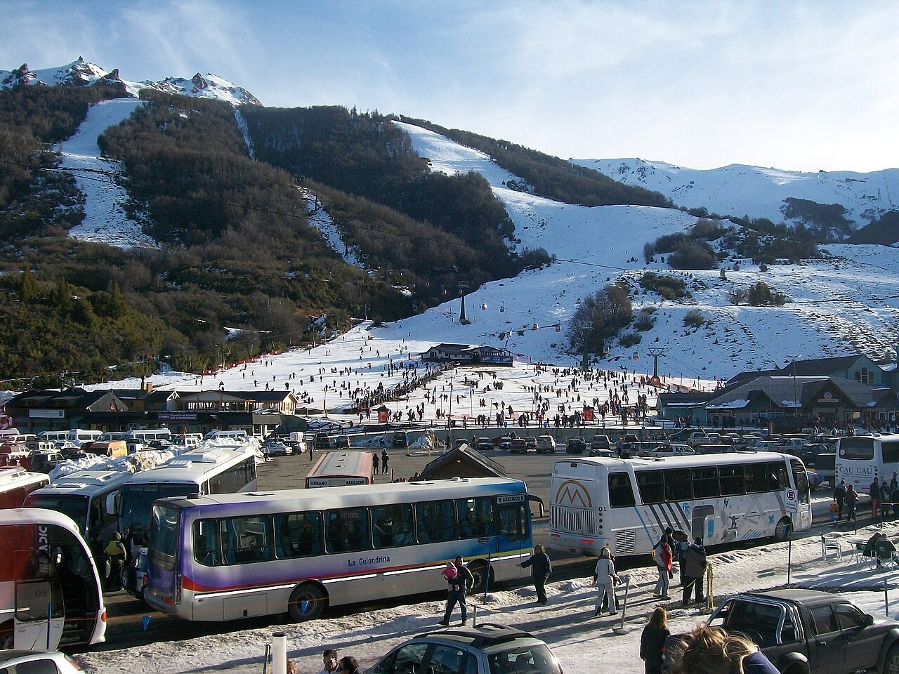

# 巴塔哥尼亚

阿根廷南部的冷凉葡萄酒产区，核心在 Río Negro 与 Neuquén 河谷；南纬 39–42°、日照长、风大、气候冷凉，以黑皮诺、马尔贝克、霞多丽与起泡酒著称。

巴塔哥尼亚是阿根廷南部的冷凉河谷产区，Rio Negro 与 Neuquén 是核心；强风、荒漠、灌溉与高纬度，让它以 Pinot Noir 与 Malbec 著称。

图：巴塔哥尼亚。摄影：Base del Cerro Catedral en Bariloche. (Patagonia Argentina) 01。署名：Diego Gabriel，CC BY-SA 3.0，来自 Wikimedia Commons（[来源](https://commons.wikimedia.org/w/index.php?curid=23263151)）。

## 定义与边界

巴塔哥尼亚是[阿根廷](ref:argentina)南部的葡萄酒产区，核心在 Rio Negro 与 Neuquén 河谷，北起 Neuquén、南到 Chubut 的少量种植；它与门多萨、萨尔塔的干旱产区不同，纬度更高、风更大、生长季更冷。

巴塔哥尼亚不是单一产区，而是由河谷、绿洲与灌溉地块组成的带状区域；酒标上的“Patagonia”可能覆盖 Rio Negro、Neuquén 与 Chubut，子产区与酒庄信息更重要。

它与智利南部的 Patagonia 不是同一地区：阿根廷的巴塔哥尼亚葡萄酒集中在 Rio Negro 与 Neuquén，智利的 Aysén 与 Magallanes 也有种植，但法规与风格不同。

## 历史与命名

巴塔哥尼亚的现代葡萄酒史始于 20 世纪初，Humberto Canale 在 Rio Negro 建立酒庄；20 世纪后期，灌溉与移民让河谷农业扩大，葡萄酒只是其中一部分。

2000 年代以后，Chacra、Bodega del Fin del Mundo、Familia Schroeder 等酒庄把巴塔哥尼亚的 Pinot Noir 与 Malbec 推向国际市场；高纬度、冷凉气候与强风成为产区的卖点。

“Patagonia”来自麦哲伦的命名，原指“巨人之地”；葡萄酒产区借用这个名字，但它的风土与巴塔哥尼亚草原、沙漠、河谷紧密相关，不是单一的旅游品牌。

Humberto Canale 在 1909 年于 Rio Negro 河谷建立酒庄，用灌溉与防风林把荒漠变成葡萄园；20 世纪后期，Neuquén 的果园与葡萄园扩大，葡萄酒逐渐成为区域产业。

2000 年代以后，Chacra 的 Piero Incisa della Rocchetta 在 Rio Negro 寻找冷凉 Pinot Noir 地块，用低产、整串发酵与旧桶，让巴塔哥尼亚进入精品酒讨论。

## 地理与风土

巴塔哥尼亚位于南纬 39–45°，受西风带控制，风速常达 30–50 km/h；安第斯山脉阻挡水汽，形成荒漠与草原，葡萄园依赖 Rio Negro、Neuquén 与 Limay 河的灌溉。

土壤以冲积土、砂土、砾石与火山灰为主，排水好、肥力低；河谷的昼夜温差大，白天温暖、夜晚寒冷，让 Pinot Noir 与 Malbec 保留酸度与香气。

强风会吹倒藤蔓、增加蒸腾，酒农用防风林、低矮架式与滴灌来应对；霜冻与冰雹是主要风险，生长季比门多萨短 2–4 周。

Rio Negro 河谷的土壤以冲积砂土、砾石与石灰岩为主，排水极好、肥力低；Neuquén 的河谷更靠西，海拔更高、风更大，成熟更晚。

巴塔哥尼亚的强风来自西风带，常持续整天；它降低湿度、减少病害，也增加蒸腾与风蚀。酒农用杨树防风林、低矮架式与滴灌来保护藤蔓。

高纬度带来长日照与冷凉夜晚，糖分积累慢、酸度高；生长季短，早熟品种如 Pinot Noir、Chardonnay 更稳，晚熟 Cabernet 需要选最暖的地块。

巴塔哥尼亚的葡萄园多分布在河谷阶地与冲积扇上，土壤排水好但保肥差，酒农需要分块施肥与灌溉；滴灌让有限的水资源用在根部，防风林则降低风速与蒸腾。

## 原料与风格

[黑皮诺](ref:pinot)（Pinot Noir）是巴塔哥尼亚的明星：颜色浅、红樱桃、草莓、香料与矿物，酸度高、单宁低，风格接近俄勒冈或勃艮第的冷凉版本。

[马尔贝克](ref:malbec)（Malbec）带黑莓、黑樱桃、紫罗兰与胡椒，酒体中等到饱满，酸度比门多萨更高；Merlot 与 Cabernet Sauvignon 也有种植，风格更紧、更草本。

白葡萄酒以 Chardonnay、Sauvignon Blanc 与 Semillon 为主，带柑橘、白花、青草与矿物；部分酒庄做起泡酒，酸度是优势。

巴塔哥尼亚 Pinot Noir 的颜色浅、红樱桃与草莓香、酸度高、单宁细；部分酒庄用整串发酵增加香料与结构，部分用去梗保持纯净果味。

Malbec 在巴塔哥尼亚比门多萨更紧、更胡椒，酒体中等到饱满，酸度高；它常与 Merlot、Cabernet 混酿，增加复杂度。

## 代表生产者与酒款

Humberto Canale 是 Rio Negro 的历史酒庄；Chacra 的 Pinot Noir 以冷凉、低产与整串发酵著称；Bodega del Fin del Mundo 与 Familia Schroeder 则更偏商业化与旅游。

这些酒庄的酒标常标“Patagonia”与河谷名；读背标的品种、年份与产区，比只看“Patagonia”更能判断风格。

Humberto Canale 的“Gran Reserva”与 Chacra 的“Barda”“Cinco”是巴塔哥尼亚的代表；Bodega del Fin del Mundo 的“Special Selection”与 Familia Schroeder 的“Saurus”更偏商业风格。

## 上桌方式

Pinot Noir 温度 14–16°C，用中等口径红酒杯；Malbec 16–18°C，用大肚杯。Pinot Noir 配烤鸡、蘑菇、鸭肉与轻奶酪；Malbec 配烤肉、野味与硬质奶酪。

巴塔哥尼亚的白葡萄酒温度 8–10°C，配海鲜、沙拉与淡水鱼；起泡酒 6–8°C，配开胃菜与油炸食物。

巴塔哥尼亚 Pinot Noir 配烤鸡、蘑菇、鸭肉与轻奶酪；Malbec 配烤肉、羊排与硬质奶酪；白葡萄酒配海鲜、沙拉与淡水鱼。Pinot Noir 不要过度冰镇，14–16°C 最能保留红樱桃与香料。

巴塔哥尼亚的白葡萄酒与起泡酒适合冰镇后作为开胃酒，酸度与矿物感比浓郁度更重要。

## 选购与误区

买巴塔哥尼亚 Pinot Noir 先看年份与酒庄：冷凉年份酸度更高、红果更亮，温暖年份更饱满；Chacra 等低产酒庄价格高，但风格更精细。Malbec 则看酒精与酸度，不要只看“Patagonia”标签。

常见误读：把巴塔哥尼亚当成“阿根廷的另一个门多萨”；以为高纬度只能做白葡萄酒；以为强风等于粗糙。巴塔哥尼亚的 Pinot Noir 可以很细、很香。

巴塔哥尼亚的 Pinot Noir 价格跨度大，Chacra 等名庄昂贵，普通酒庄更亲民；买之前看年份与产区，冷凉年份酸度更高，温暖年份果味更熟。

常见误读：以为巴塔哥尼亚只有 Pinot Noir；以为高纬度等于清淡；以为强风让酒粗糙。它的 Malbec 也可以有结构，白葡萄酒也可以有质地。

巴塔哥尼亚的酒庄产量小，年份差异大；买之前看酒精度与酸度，Pinot Noir 以 13–14% 酒精、清爽红果为佳，Malbec 以 14–15%、胡椒与酸度为佳。

## 参见

- [阿根廷](ref:argentina)：产区与法规背景。
- [马尔贝克](ref:malbec)：巴塔哥尼亚的红葡萄。
- [黑皮诺](ref:pinot)：冷凉产区的明星品种。
- - [起泡酒](ref:sparkling)：巴塔哥尼亚的起泡与酸度。
- [白葡萄酒](ref:white)：白葡萄的发酵与风格。

**关键事实。**

| 项目 | 内容 |
| --- | --- |
| 一句话定位 | 阿根廷南部的冷凉葡萄酒产区，核心在 Río Negro 与 Neuquén 河谷；南纬 39–42°、日照长、风大、气候冷凉，以黑皮诺、马尔贝克、霞多丽与起泡酒著称 |
| 层级 | 省/大区 |
| 所属 | 阿根廷 |
| 国家代码 | AR |

**来源与边界。** 本页关于「巴塔哥尼亚」的关键事实，主要由以下来源交叉核对：Argentina Tourism（阿根廷葡萄酒产区的旅行与地理背景）、Government of Argentina（农业与产区管理框架）、OIV（葡萄酒定义与全球生产框架）等 4 条来源。价格、批次与状态会变，涉及这些字段时以页面所列来源的最新版本为准。正文为项目自写，来源只作核验，不复制原文。
