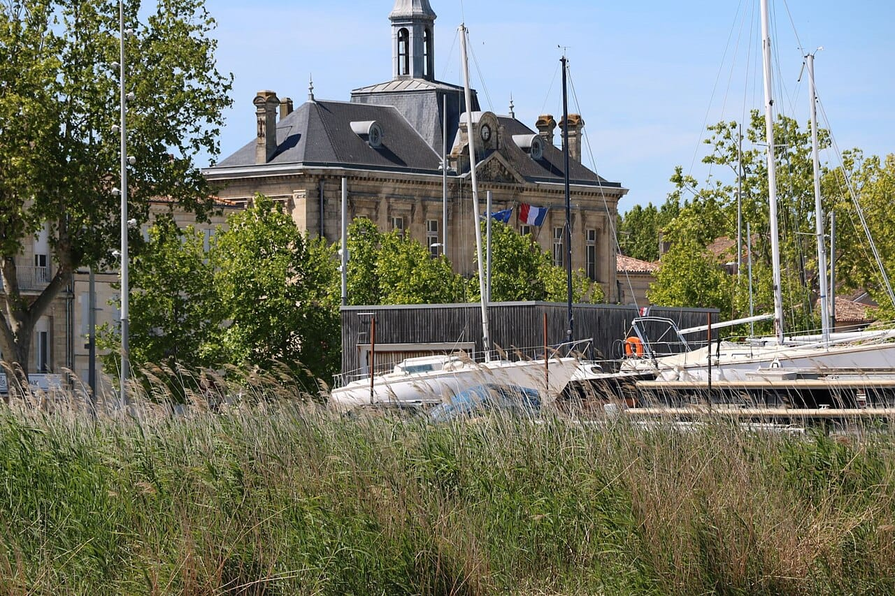

# 波亚克

波亚克（Pauillac）是法国吉伦特省梅多克半岛中段、吉伦特河口左岸的红葡萄酒法定产区，1936 年 11 月 14 日获得 AOC 地位。葡萄园建立在被溪流切割的砾石台地之上，1855 年分级中的拉菲、拉图与木桐三座一级庄都位于此，这种集中度在梅多克村庄中独一无二。

图：波亚克。图片：Anthony Baratier，CC BY-SA 4.0，via Wikimedia Commons（[原图页面](https://commons.wikimedia.org/wiki/File:La_mairie_de_Pauillac_vue_depuis_le_port_de_plaisance.jpg)）。

## 定义与范围

Pauillac 只能用于来自划定地块、并在区内完成发酵与陈年的静止红[葡萄酒](ref:red-wine)。法定地理范围以波亚克公社为主体，另外包括 Cissac-Médoc、Saint-Estèphe、Saint-Julien-Beychevelle 与 Saint-Sauveur 四个邻村中经批准的个别地块。cahier des charges 描述的葡萄园面积接近 1,250 公顷；大型庄园经营约 90% 的葡萄园，其余由约六十家小农与一座合作社构成。

这种“村庄名 + 个别邻村地块”的结构，说明村庄级 AOC 的边界并不总与行政边界重合。购买时以酒标上的产区名和装瓶信息为准，不能仅凭酒庄位于波亚克就推断其酒一定属于该 AOC。

产区内部还可以按丘脊进一步区分：靠河口的坡面更暖、成熟更早，内陆谷地更凉、保留更多酸度。这类微差异不会写进酒标，却是同一款酒在不同年份表现不同的原因。

## 砾石台地如何决定风格

产区地势在 3 至 30 米之间，第四纪砾石台地厚约十米，覆盖在始新世与渐新世的泥灰岩、石灰岩之上。垂直河口的 esteys 与 jalles 把台地切成三组主要丘脊：南部以 Saint-Lambert 与 Bages 为中心，中部围绕 Artigues，北部以 Pouyalet 为骨架。

砾石排水极快、白天吸热、夜间释放，使晚熟的[赤霞珠](ref:cabernet-sauvignon)在海洋性气候中能够充分成熟；低洼处的砂质土与 palus 冲积土排水较差，通常不属于最优地块。同一村庄内，丘脊顶部、坡面与谷底的成熟节奏差异明显，这也是同一酒庄不同地块需要分开采收的原因。

气候属温带海洋性，吉伦特河口与大西洋起调节作用；生长季温暖，但秋季降雨会打乱成熟节奏，年份差异因此明显。砾石丘脊在降雨年份的优势更大，因为排水快、根系深，果实不易被稀释。

## 1855 年分级与三座一级庄

1855 年为巴黎世界博览会制定的梅多克分级，把波亚克的拉菲（Lafite Rothschild）、拉图（Latour）与木桐（Mouton Rothschild）列为一级庄。木桐并非一开始就在一级：它在 1973 年由二级晋升，是这份历史名单唯一一次升级。

三座酒庄分别代表不同的砾石位置与地块结构，但共同点是赤霞珠比例高、结构紧实、陈年潜力长。列级庄称号是历史遗产，不是当代质量认证；1855 年之后酒庄的分拆、易主与葡萄园变更，都使“名号”与实际地块之间需要单独核对。

## 品种与原料

法定品种为赤霞珠、梅洛、品丽珠、小维多、马尔贝克与佳美娜。实际配比以赤霞珠为主，常见 60% 至 80%，[梅洛](ref:merlot)提供柔化与早熟，品丽珠与小维多补充香气与结构。

法规要求采收时梅洛的最低糖度为 189 克/升，其他品种为 180 克/升；法定最低自然酒精度为 11%，产量上限 57 百升/公顷，封顶产量 63 百升/公顷，种植密度至少 7,000 株/公顷，最大田间负载 9,500 公斤/公顷（获准灌溉的地块为 8,000 公斤/公顷）。这些下限与上限共同框定了酒体：产量被压低，成熟度被要求，但风格仍由地块与酿造决定。

## 酿造与陈年

发酵后在[橡木桶](ref:oak-ageing)中陈年，法定最低陈年持续到采收次年的 6 月 1 日，向消费者开放销售不得早于次年 9 月 1 日。上市酒液的苹果酸不得超过 0.30 克/升，可发酵糖不得超过 2 克/升；富集（enrichment）后总酒精度不得超过 13.5%。

新桶比例、桶龄与总陈年时长由酒庄决定，也是同一村庄内风格差异的主要来源。赤霞珠的高单宁与高酸需要时间整合，年轻酒款常显得紧致，陈年后才展开雪松、烟草与黑醋栗的层次。

从年轻到成熟，波亚克红酒通常经历三个阶段：果味主导的紧致期、单宁整合的中期，以及雪松与皮革出现的陈年期。不同酒庄的桶陈策略会改变每个阶段的长度，但不会改变赤霞珠骨架的基本走向。

## 酒标与法规核对

酒标上的 Pauillac 必须与产区一致；同时核对年份、酒精度、容量、装瓶者与是否标注具体酒庄。Cru classé 字样只说明其在 1855 年名单（及个别后续调整）中的历史位置，并不等同于当前品质。AOC 规则还规定修剪方式、最小叶幕高度与缺株率上限，这些细节决定了地块能否持续保有产区资格。

## 常见误区

第一，认为砾石一定带来“矿物感”。砾石的实际作用是排水与储热，矿物感是品鉴描述，不能直接等同于土壤化学成分。
第二，把 1855 年分级当成现行排名。名单基本冻结于历史，酒庄实力与地块边界早已变化。
第三，认为波亚克只种赤霞珠。梅洛、品丽珠与小维多都在法定品种内，配比因酒庄而异。
第四，把“一级庄”与“一级园”混为一谈。前者是波尔多式的酒庄分级，后者是勃艮第式的地块分级，两套体系不可互换。

对照阅读：[法国](ref:france)、[赤霞珠](ref:cabernet-sauvignon)。

波亚克的法定范围只覆盖红葡萄酒；同一地块的砾石厚度与排水差异，也会让相邻酒庄的风格拉开距离。

**关键事实。**

| 项目 | 内容 |
| --- | --- |
| 一句话定位 | 吉伦特河口左岸梅多克中段的红葡萄酒法定产区，1936 年 11 月 14 日获 AOC 地位，葡萄园约 1,250 公顷，建立在厚约十米的第四纪砾石台地之上；1855 年分级的拉菲、拉图与木桐三座一级庄均在此，法定最低自然酒精度 11%，产量上限 57 百升/公顷、封顶 63 百升/公顷，种植密度至少 7,000 株/公顷 |
| 所属 | 法国 |
| 国家代码 | FR |

**来源与边界。** 本页关于「波亚克」的关键事实，主要由以下来源交叉核对：République française（法定范围、品种、最低自然酒精度 11%、产量 57 与封顶 63 百升/公顷、种植密度 7,000 株/公顷、砾石台地描述与上市日期）、INAO（AOC 管理与 cahier des charges 的官方地位）、Conseil Interprofessionnel du Vin de Bordeaux（波尔多产区分层与村庄级产区的背景）等 4 条来源。价格、批次与状态会变，涉及这些字段时以页面所列来源的最新版本为准。正文为项目自写，来源只作核验，不复制原文。

## 参考资料

- [法国](ref:france)：国家级产区框架与 AOC 制度。
- [波尔多](ref:bordeaux)：左岸、右岸与村庄级产区的整体结构。
- [赤霞珠](ref:cabernet-sauvignon)：波亚克主导品种的成熟与单宁特征。
- [梅洛](ref:merlot)：柔化酒体与提供早熟果味的角色。
- [红葡萄酒](ref:red-wine)：波亚克的类别、单宁与酿造概览。
- [橡木桶陈年](ref:oak-ageing)：桶型、桶龄与微氧化的作用。

## 相关图像

图：梅洛。图片：Felloni claire，CC BY-SA 4.0，via Wikimedia Commons（[原图页面](https://commons.wikimedia.org/wiki/File:Merlot.jpg)）。关联图像：波亚克。

图：橡木桶陈酿的编辑插图：桶壁烘烤层、酒液与取样管；AI 辅助绘制，不是酒窖实拍。图片：Hejiu 编辑团队，使用豆包 Seedream 5.5 AI 辅助生成；项目自制，不是现场照片（[项目说明](https://hejiu.org/about/)）。关联图像：波亚克。
