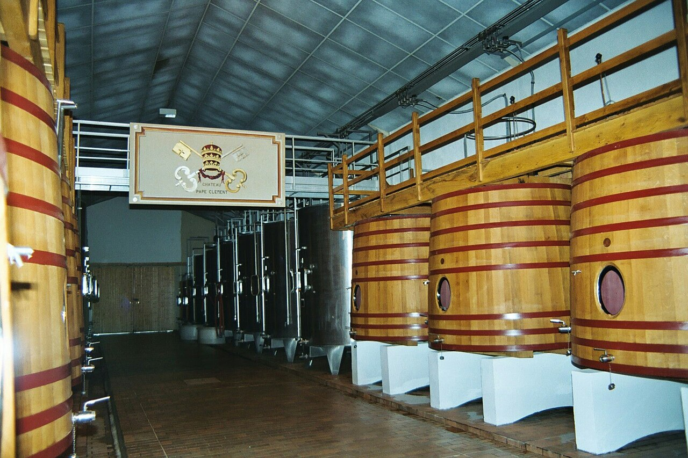

# 佩萨克-雷奥良

佩萨克-雷奥良位于波尔多市区以南，是格拉夫（Graves）产区北段 1987 年独立的 AOC，砾石丘上红白兼产：红酒以赤霞珠为主的波尔多混酿，白酒以长相思与赛美蓉调配，是波尔多干白最受推崇的产区之一。

图：Pessac-Léognan：PapeClement05（Wikimedia Commons）。图片：Kassander der Minoer at German Wikipedia，CC BY-SA 3.0，via Wikimedia Commons（[原图页面](https://commons.wikimedia.org/wiki/File:PapeClement05.jpg)）。

## 先划清「佩萨克-雷奥良」的边界
产区地处吉伦特省，是波尔多都会区向南延伸的丘陵地带，覆盖 Pessac、Léognan、Talence、Gradignan、Villenave-d'Ornon、Martillac、Cadaujac、Saint-Médard-d'Eyrans、Canéjan、Cestas 等市镇；距波尔多市中心约 10–15 公里。

1987 年 9 月 9 日法令正式认可 Pessac-Léognan AOC，最早适用 1986 年份；此前这片土地属于 1937 年获批的 Graves AOC。区内红酒、白酒均可标注本 AOC 名，法令同时允许标签保留“vin de Graves”等历史表述。

它是 Graves 最靠北、离波尔多最近的一段；向南更远的 Graves 乡村不能使用本 AOC 名。2023 年种植面积约 1,860 公顷，约 56 家酒庄，产量约 75,199 百升；红酒约占 82%，白酒约 18%。当年平均单产约为红酒 39 百升/公顷、白酒 52 百升/公顷，白葡萄的单位产量上限通常高于红葡萄。

## 历史与命名

14 世纪初，后来的教皇克莱蒙五世（Clement V）家族创建 Château Pape Clément，这是波尔多第一座拥有正式名称的酒庄；产区酿酒史早于多数梅多克葡萄园。

17 至 18 世纪，Haut-Brion 早在 1663 年就出现在 Samuel Pepys 对伦敦法国红酒的记载中。Smith Haut Lafitte 所在砾石高原 17 世纪由 Du Boscq 家族开发，1720 年 Georges Smith 购入并把姓氏加入园名。Domaine de Chevalier 早在 16 世纪初便以“Chivaley”（加斯科尼语“骑士”）知名，1783 年出现在 Belleyme 地图上。

1855 年巴黎世博会官方分级中，Haut-Brion 是唯一入选一级庄的格拉夫酒庄，与拉菲、玛歌、拉图同列。格拉夫产区 1953 年发布红酒分级，1959 年补入白酒分级，入选酒庄几乎都在今天的佩萨克-雷奥良。AOC 名取北部 Pessac 镇与南部 Léognan 镇，两个核心市镇各取一字。

## 「佩萨克-雷奥良」的地理与风土
这里属海洋性气候，受大西洋调节，降雨均匀、气候温和；波尔多年均日照约 2,069 小时。北面城市热岛、东面加龙河缓解霜冻，西面朗德森林挡风并保持湿度，三者共同缓和了极端天气。

典型“graves”砾石由第四纪冲积带来的滚圆卵石、燧石与小石构成，混有黏土、砂、alios 硬化层与 falun 钙质砂泥；分布在丘陵顶部，天然排水极好。石块白天吸热、夜间放热，帮助葡萄成熟。区内 Peugue、Eau Bourde、Eau Blanche、Breyra、Saucats 等小溪是加龙河支流，葡萄园不受洪水淹没。

微地形上，砾石厚度、黏土底层深度与坡向决定地块风格：偏厚砾石排水快、成熟早，黏土比例高的地块结构更厚、保留更多酸度。

## 原料与风格

红酒以赤霞珠为主，梅洛、品丽珠辅助，少量小维尔多与马尔贝克；典型混酿由赤霞珠提供骨架与单宁，梅洛带来圆润果味。

白酒以长相思与赛美蓉为主，少量密斯卡岱；长相思给结构、清爽与果香，赛美蓉给酒体、蜡质与陈年潜力，常见比例如 70% 长相思、30% 赛美蓉。

红酒呈黑色果、雪松、烟熏与矿物气息，单宁细腻、结构平衡，可长时间陈年。白酒常经橡木桶发酵并在酒泥上陈年，部分酒庄酒泥陈酿约 15 个月、其中约 10 个月在法国橡木桶中完成，新桶比例因酒庄策略而定；柑橘、白花、矿物与蜂蜜蜡质并存，是波尔多干白的标杆之一。采收后按地块手工挑选，发酵与陈酿容器因酒庄分化。

## 代表生产者与酒款

Haut-Brion 是 1855 一级庄、区内最知名酒庄，种植约 53.56 公顷（红 50.63 公顷、白 2.93 公顷），红白均出旗舰；紧邻的 La Mission Haut-Brion 同属名庄序列。

Domaine de Chevalier 位于 Léognan，共 67 公顷（红 60 公顷、白 7 公顷）；1983 年 Bernard 家族收购，由 Olivier Bernard 主持，走有机与生物动力路线，其白酒被视为世界最伟大干白之一。

Smith Haut Lafitte 位于 Martillac，共 56 公顷，红方为 55% 赤霞珠、35% 梅洛、10% 品丽珠，白方约 90% 长相思。此外还有 Pape Clément、Haut-Bailly、Carbonnieux、La Garde 等酒庄。

这些酒庄分属格拉夫分级或市场长期形成的参照，价格带较宽：名庄旗舰红与白价格高、产量小，二级园与入门白酒更易入手。比较时先看红或白、地块砾石比例与年份，不要只按酒庄名排序。

## 「佩萨克-雷奥良」的上桌方式
饮用温度按风格调整：红酒 16–18°C，白酒 10–12°C；年轻白酒可稍凉，陈年白酒回温后香气更展开。

红酒配红肉、烤羊排、牛肉、野味与硬质奶酪；白酒配牡蛎、扇贝、白鱼、烤鸡、奶油酱与软质奶酪，也可搭配芦笋、洋葱等带清甜的蔬菜。

波尔多本地饮食以炖牛肉、红酒烩菜、鹅肝、河海海鲜与奶酪为主。名庄酒建议搭配相对克制的主菜，让酒本身的层次成为主角；陈年红酒开瓶前先评估年份与状态，必要时提前醒酒。

## 选购、标签与误区

标签上的 AOC 名提示产区与品种组合；酒庄名、分级、年份与地块信息比“波尔多”大区标签更能预测品质。格拉夫分级（1953 年红酒、1959 年白酒）是产区内独立分级，与 1855 梅多克分级不属于同一体系。

常见误区有三：以为本区只产红酒——白酒正是产区招牌之一；以为波尔多红酒一定厚重——本区红酒以细腻平衡见长；把高年份标价等同于现在即饮——名庄红酒通常需要十年以上才进入适饮窗口。

红白旗舰都适合长期陈放；避光、恒温恒湿、卧放。买进口酒时留意运输与仓储温度，瓶塞状态与酒液高度检查后再收藏。

## 「佩萨克-雷奥良」周边怎么走
从波尔多市中心向南，沿 D10 与乡间公路串联 Pessac、Léognan、Martillac；酒庄分散在市镇与林间，自驾最方便。

半天行程可安排两三家预约品鉴，看砾石园与酒窖；一天可把北线 Pessac、Talence 与南线 Léognan、Martillac 各走一半。多数名庄只接受预约，开放时间与品鉴费以酒庄官网为准。

参观遵守预约时间，不在酿造区拍照打扰；采收季（9 月前后）田头工作繁忙，未受邀请不要进入葡萄园。酒庄周边有餐厅与旅馆，旅游旺季提前订位。各酒庄接待规模有限，旺季尤其需要提前预约；部分庄园设有小餐厅或对外住宿，可在酒庄官网一并查询，到访前先确认当日是否开放品鉴。

- 相关条目：[bordeaux](ref:bordeaux)、[cabernet-sauvignon](ref:cabernet)、[sauvignon-blanc](ref:sauvignon)、[red-wine](ref:red)、[white-wine](ref:white)。

相关条目：[波尔多](ref:bordeaux)、[赤霞珠](ref:cabernet)、[长相思](ref:sauvignon)。

**关键事实。**

| 项目 | 内容 |
| --- | --- |
| 一句话定位 | 1987 年从格拉夫独立出来的波尔多左岸 AOC，覆盖波尔多市郊向南的十个市镇；以砾石丘、红白兼产与侯伯王、美讯等名庄著称，是波尔多最靠近城市、也最容易做“城市酒庄”访问的产区之一 |
| 层级 | 其他 |
| 所属 | 波尔多 |
| 国家代码 | FR |
