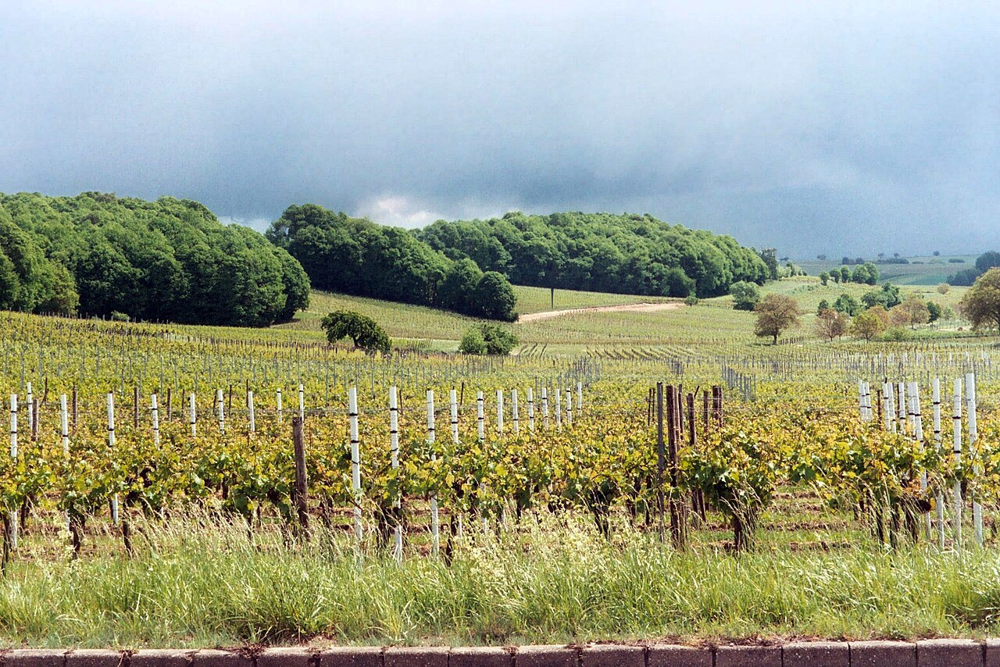

# 法尔茨

法尔茨（Pfalz）是德国西南部的法定产区，沿“德国葡萄酒之路”（Deutsche Weinstraße）从博肯海姆（Bockenheim）延伸到与阿尔萨斯接壤的施韦根（Schweigen），全长 85 公里，串联约 130 个村庄，2025 年约 23,700 公顷，是德国第二大产区。

图：法尔茨。摄影：Gleiszellen (Pfalz), vineyards。署名：Dguendel，CC BY 3.0，来自 Wikimedia Commons（[来源](https://commons.wikimedia.org/w/index.php?curid=29822009)）。

## 定义与范围

法尔茨是受保护的法定产区名称，葡萄必须来自划定区域并在区内酿造。产区分成两个部分：北部的 Mittelhaardt-Deutsche Weinstraße 与南部的 Südliche Weinstraße。

产区以白葡萄酒为主，白葡萄约占六成；雷司令约 5,950 公顷，是德国雷司令面积最大的产区；红葡萄以 Dornfelder 与 Spätburgunder 为主。法尔茨不是“莱茵兰-普法尔茨州”的同义词，后者包含多个产区。

## 「法尔茨」的时间线
法尔茨的葡萄种植可追溯到罗马时期，中世纪修道院与地方领主推动了莱茵平原边缘的坡地开垦。中世纪与近代的葡萄酒贸易沿莱茵河向下游输出，法尔茨酒在荷兰与英国市场早有记录。

1935 年设立的“德国葡萄酒之路”把产区的村庄与酒庄串联成一条旅游与营销线路，战后逐渐成为德国最知名的葡萄酒旅游目的地之一。20 世纪后期，Dornfelder 等新红葡萄品种的推广改变了产区的品种结构。

## 地理与气候

法尔茨位于莱茵河上游平原的西缘，西侧是 Haardt 山地与普法尔茨森林。山地挡住来自大西洋的湿气，使产区成为德国最温暖、最干燥的地区之一，生长季日照充足，成熟稳定。

气候接近阿尔萨斯：夏季炎热、秋季干燥，杏树、栗树与无花果在坡地上生长。干旱是主要压力，部分年份需要灌溉；冰雹与早霜也有风险。

土壤高度多样，包括砂岩、石灰岩、火山岩、黄土与黏土。不同土壤的排水、保热与 pH 差异，造成同一品种在不同村庄的风格差异。

## 两个分区

法尔茨分为两个分区，各自的气候与品种侧重不同。

- Mittelhaardt-Deutsche Weinstraße：北部核心，围绕 Forst、Deidesheim、Ruppertsberg、Wachenheim 与 Bad Dürkheim，坡地陡、土壤多样，雷司令与 Spätburgunder 表现突出。
- Südliche Weinstraße：南部，从 Edenkoben 到 Schweigen，气候更暖、更干燥，黄土与砂岩较多，Dornfelder 与白葡萄的产量更大。

分区是地理与风格描述，不是等级排序；同一分区内部的地块差异同样明显。

## 品种与原料

雷司令约 5,950 公顷，是面积最大的品种，酒体比摩泽尔更饱满，酸度仍然清晰。Dornfelder 约 2,450 公顷，是法尔茨最重要的本土红葡萄之一，颜色深、果味浓，常酿成干型红或半干红。

Spätburgunder 约 1,740 公顷，用于结构型红酒；Grauburgunder 约 2,240 公顷，酒体饱满；还有 Weißburgunder、Müller-Thurgau、Kerner 与 Portugieser。原料是[葡萄](ref:grape)。

## 「法尔茨」怎么做出来
白葡萄低温[发酵](ref:fermentation)，以保留香气与[酸度](ref:acidity)；雷司令可在不锈钢罐或大桶中发酵，部分酒款经酒泥接触增加质感。红葡萄带皮发酵，Dornfelder 常经较短浸渍以保留果味，Spätburgunder 浸渍更长并进入旧橡木桶。

法尔茨的干型酒比例高，甜型主要集中在 Prädikat 高级别与 Eiswein。这里的[橡木桶](ref:oak-ageing)多用于红酒结构与部分白葡萄的质感，新桶比例通常低于国际风格的红酒。

## 分级与法规

就「法尔茨」而言，德国葡萄酒分为 Wein、Landwein、Qualitätswein 与 Prädikatswein。Prädikatswein 按采收成熟度分为 Kabinett、Spätlese、Auslese、Beerenauslese、Trockenbeerenauslese 与 Eiswein 六级；等级描述葡萄汁含糖量，不决定成酒甜度。

酒标上的 trocken 指残糖不超过 9 g/L，halbtrocken 指 9–18 g/L；feinherb 是未入法的常用说法。法尔茨日常酒款多为干型。

“Großes Gewächs”与“Erste Lage”是 VDP 等生产者组织的私法分级，不是国家法定等级。Weißherbst 是德国法定的单品种红葡萄压榨桃红，酒标会注明所用红葡萄品种。

## 「法尔茨」的酒标与喝法
酒标应核对产区名 Pfalz、分区（Bereich）、村庄与地块、品种、年份、酒精度、容量与装瓶者。AP 编号可用于追溯官方质量检验批次。

干型雷司令建议 10–12 摄氏度饮用，Dornfelder 与 Spätburgunder 建议 14–16 摄氏度。雷司令适合禽类、河鱼与亚洲菜；Dornfelder 适合烤肉、香肠与中等强度奶酪。开瓶后冷藏并尽快喝完。本页关于法尔茨的内容涉及酒精饮料；过量饮酒有害健康，未成年人不应饮酒。

## 「法尔茨」容易被读错的地方
第一，把法尔茨等同于莱茵兰-普法尔茨州。该州还包含 Rheinhessen、Mosel、Nahe 与 Ahr 等产区。
第二，认为法尔茨只有雷司令。Dornfelder、Spätburgunder 与 Grauburgunder 都占有重要面积。
第三，把 Dornfelder 当成低端品种。它能酿出颜色深、结构完整的红酒，也能做 Weißherbst。
第四，认为温暖产区一定甜。法尔茨的干型比例很高，甜度取决于发酵与标注。
第五，把“Deutsche Weinstraße”当成法定等级。它是旅游与营销线路，不是质量分级。

法尔茨是德国第二大葡萄酒产区，沿“德国葡萄酒之路”南北展开，分为 Mittelhaardt-Deutsche Weinstraße 与 Südliche Weinstraße 两个分区；雷司令与 Dornfelder 是重要品种，白葡萄约占六成。它是产区，不是单一风格；酒标上的村庄与地块名通常比“Pfalz”更具体。

对照阅读：[德国](ref:germany)、[白葡萄酒](ref:white-wine)。

23,700 公顷与两个分区说明内部差异很大；雷司令与 Dornfelder 只是主要品种，不能代表全部法尔茨。

法尔茨的雷司令从干型到甜型都有；Mittelhaardt 与南部产区的成熟度与酒精度不同。

**关键事实。**

| 项目 | 内容 |
| --- | --- |
| 一句话定位 | 德国西南部的法定产区，北起博肯海姆、南至与阿尔萨斯接壤的施韦根，沿“德国葡萄酒之路”延伸 85 公里、串联约 130 个村庄，2025 年约 23,700 公顷，是德国第二大产区；分为 Mittelhaardt-Deutsche Weinstraße 与 Südliche Weinstraße 两个分区，雷司令约 5,950 公顷、Dornfelder 约 … |
| 层级 | 其他 |
| 所属 | 德国 |
| 国家代码 | DE |

**来源与边界。** 本页关于「法尔茨」的关键事实，主要由以下来源交叉核对：Wines of Germany / Deutsches Weininstitut（产区气候、白红比例与雷司令种植规模）、Pfalz Wein e.V.（2025 年主要品种面积（Riesling 5,954 公顷、Dornfelder 2,454 公顷等）；由原条目末尾参考资料迁移，未逐条复核访问日期）、European Union（Prädikatswein 的类别、最低残糖与酒精度规则）。价格、批次与状态会变，涉及这些字段时以页面所列来源的最新版本为准。正文为项目自写，来源只作核验，不复制原文。

**并读。** 把「法尔茨」与「德国」、「葡萄酒」、「白葡萄酒」放在一起读时，先确认它们是同一层级还是上下游关系：先确认边界与法定分类，再比较气候、土壤、海拔与代表酒款。本页负责给出产区的基本坐标，对照条目补上具体案例与差异；读完再回到本页，才能分清哪些差别属于产区本身，哪些只是产地、批次或品牌选择。

## 参考资料
- [德国](ref:germany)：法尔茨所属的国家产区框架。
- [葡萄酒](ref:wine)：理解法尔茨的类别、年份与产地规则的入口。
- [白葡萄酒](ref:white-wine)：雷司令与 Grauburgunder 所属的类别。
- [红葡萄酒](ref:red-wine)：Dornfelder 与 Spätburgunder 所属的类别。
- [葡萄](ref:grape)：酿酒葡萄的结构与成熟指标。
- [发酵](ref:fermentation)：低温发酵与带皮发酵的差异。
- [酸度](ref:acidity)：法尔茨雷司令酸度与酒体的平衡。
- [酒精度](ref:abv)：温暖产区酒精度与标签的关系。
- [橡木桶陈年](ref:oak-ageing)：Spätburgunder 与 Dornfelder 的桶陈差异。
